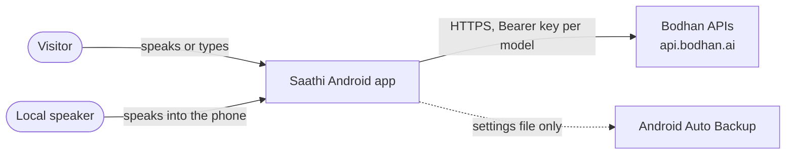
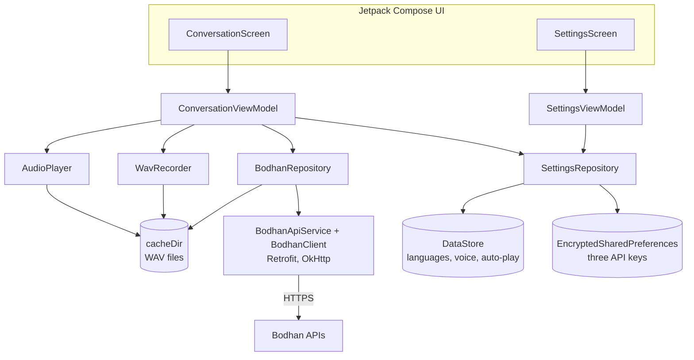
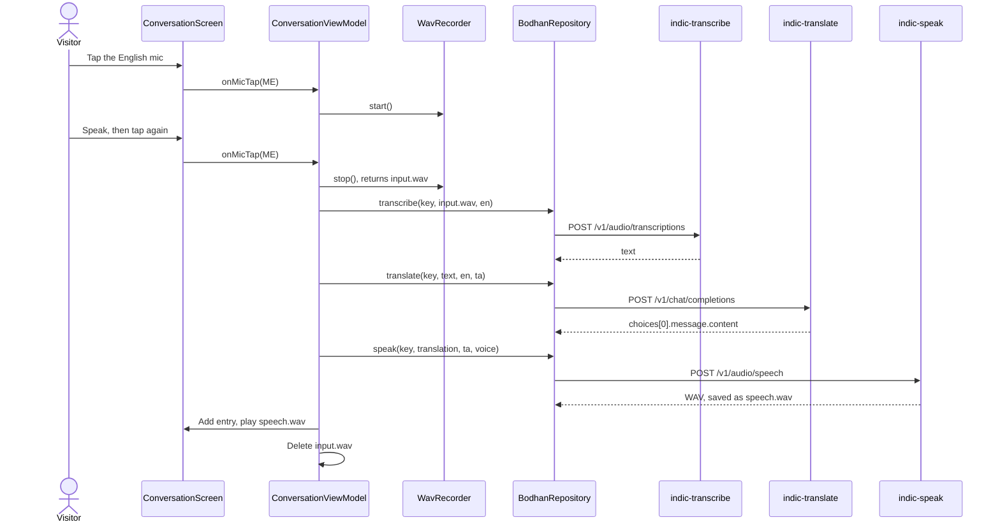

# Saathi (AndroidSpeak) — Architecture

> **Sample document.** This is a worked example of the Bodhan AI Cookbook architecture
> document template, written after the fact for
> [`examples/AndroidSpeak`](../../../examples/AndroidSpeak/) as merged in PR #6 (commit
> `ae51852`). It describes the code as it is, including its shortcuts, which are listed in
> Section 14. Read it after the companion
> [SOFTWARE_SPECIFICATION.md](SOFTWARE_SPECIFICATION.md).

## 1. Document details

| Field | Value |
| --- | --- |
| App name | Saathi (folder `examples/AndroidSpeak`) |
| Approved spec | [SOFTWARE_SPECIFICATION.md](SOFTWARE_SPECIFICATION.md), version 1.0 |
| Authors | App: Rudra Murthy (@rudra431). This document: Bodhan AI Cookbook maintainers |
| Bodhan reviewers | @Bodhan-AI/cookbook-maintainers |
| Status | Sample (retrospective) |
| Version | 1.0 |
| Last updated | 13 Oct 2026 |
| Code | [`examples/AndroidSpeak`](../../../examples/AndroidSpeak/), PR #6 |

## 2. Overview and architectural drivers

**Summary.** Saathi is a single native Android app with no backend. Two Compose screens drive
two ViewModels, which call a repository wrapping Retrofit and OkHttp. Every request goes
straight from the phone to `https://api.bodhan.ai`, carrying the user's own key for that
model. Audio is recorded as raw PCM and wrapped as WAV on the device; spoken translations come
back as WAV files cached for replay. Apart from those files, nothing about a conversation
outlives the app process.

### Architectural drivers

| Driver | From the spec | What it forces in the design |
| --- | --- | --- |
| Users bring their own keys; no backend in V0 | Sections 5, 10 | Keys typed into Settings, kept in encrypted storage excluded from backup; the app calls Bodhan directly |
| Bodhan issues one key per model | Section 7 | Three key fields, and an `ApiModel` enum that picks the key for each call |
| `indic-transcribe` refuses AAC, AMR, M4A and WebM | FR-2 | Record raw 16 kHz mono PCM with `AudioRecord` and write a WAV header, instead of using `MediaRecorder` |
| One phone passed between two people | J1 | Two mic buttons, one per language; translations play automatically |
| Noisy places | J2 | A typed path that skips transcription |
| Code other developers learn from | G3 | No backend, no dependency-injection framework, few libraries |

**Constraints:** one developer; native Android only; Bodhan's per-request limits; no budget
for hosting.

### Quality attributes, ranked

1. Simplicity and readability, because the app is teaching code
2. Safety of the user's keys on the device
3. Time from tapping Stop to hearing the translation
4. Robustness: V0 trades much of this away (Section 14)

## 3. System context

| Outside system | What it does for the app | Data sent to it |
| --- | --- | --- |
| Bodhan APIs | Speech to text, translation, text to speech | Voice recordings, transcripts, translations |
| Android Auto Backup | Backs up app data if the user has backup turned on | Languages, voice and auto-play settings. Keys are excluded. Conversation text is never on disk, and the cached spoken-translation files are not backed up |

## 4. Containers and components

There is one container, the app. Its components:

`SaathiApplication` acts as a simple service locator: it builds `SettingsRepository` at start-up
and `BodhanRepository` on first use. `MainActivity` hosts the navigation graph and creates each
ViewModel scoped to its screen.

### Tech stack

| Layer | Choice and version | Why this choice |
| --- | --- | --- |
| Language and build | Kotlin 2.2.10, Android Gradle Plugin 9.4.0, Gradle 9.7.0, Java 17 bytecode (Gradle daemon on JDK 26) | Current AGP and Gradle; Kotlin and Compose versions from 2024 and 2025 |
| SDK levels | compileSdk 35, targetSdk 35, minSdk 26 | Android 8.0 and later |
| UI | Jetpack Compose (BOM 2024.09.00), Material 3, Navigation Compose 2.7.7 | Two screens with little code |
| Networking | Retrofit 2.11.0 with Gson, OkHttp 4.12.0 | The usual Android HTTP stack; easy multipart uploads |
| Storage | security-crypto 1.1.0-alpha06 for keys; DataStore Preferences 1.1.1 for settings | Encrypted keys, simple settings |
| Concurrency | Kotlin coroutines 1.8.1; one raw thread for recording | Network calls off the main thread |
| Audio | `AudioRecord` to capture, `MediaPlayer` to play | WAV without a conversion library |
| Hosting and distribution | None; built from source in Android Studio | V0 is a developer demo |

### Components

| Component | Responsibility | Depends on |
| --- | --- | --- |
| `ConversationViewModel` | Runs each turn: record, transcribe, translate, speak, add the entry, play | SettingsRepository, BodhanRepository, WavRecorder, AudioPlayer |
| `SettingsViewModel` | Edits keys and preferences | SettingsRepository |
| `SettingsRepository` | Reads and writes keys (encrypted) and settings (DataStore) | EncryptedSharedPreferences, DataStore |
| `BodhanRepository` | Builds the three requests, adds the bearer key, turns failures into user-facing messages | BodhanApiService |
| `BodhanClient` and `BodhanApiService` | OkHttp and Retrofit set-up; endpoint definitions | Retrofit, OkHttp, Gson |
| `WavRecorder` | Records 16 kHz mono 16-bit PCM and writes a WAV file | AudioRecord, cacheDir |
| `AudioPlayer` | Plays a WAV file, stopping any current playback | MediaPlayer |

## 5. Bodhan API integration design

| Concern | Saathi V0 | Reference default | Gap |
| --- | --- | --- | --- |
| Key custody | The user's own keys, encrypted with a Keystore-backed key, excluded from backup and device transfer | A backend holds the keys | Accepted deviation for V0 (spec Section 10) |
| Base URL | Hard-coded `https://api.bodhan.ai/` | Configurable per environment | Minor |
| Input preparation | WAV, 16 kHz mono, any length. Speech text sent whole. Transcription also sends `vad=true`, which the public reference does not document | At most 30 s of audio per request; a sentence or two per speech request | No cap, no splitting |
| Translate route | `/v1/chat/completions` with `target_language_code` and `source_language_code` | `POST /translate` is the documented main route; both routes give the same output | Open question Q3 |
| Timeouts | Connect 30 s, read 60 s, write 60 s; no overall limit | A timeout per model, with progress in the UI | Acceptable: a status line shows each stage |
| Errors | Message names the failed stage. Only 401 gets friendly wording; other codes show "Server said: <code>." The error body and `request_id` are discarded | Branch on `error.code`; keep `request_id` | Gap |
| Retries and rate limits | No retry or backoff. Rate-limit headers are not read | Back off on 429 and 5xx; cap concurrency | Gap |
| Cost guardrails | None; each user spends their own credit | Per-user caps on a backend | Not needed while users bring their own keys |
| Caching | Spoken translations kept in the cache for replay | Cache only what is replayed or reused | Files are never deleted |
| Voice | One free-text voice for every language, default "Amit" | A voice that matches the target language | Gap (spec risk R2) |
| Model ids | `indic-transcribe`, `indic-translate`, `indic-speak` | Lower-case, current ids | None |

## 6. Data architecture

### Data stores

| Store | Technology | What it holds | Retention | Encrypted at rest? |
| --- | --- | --- | --- | --- |
| `saathi_secure_prefs` | EncryptedSharedPreferences | Three Bodhan keys | Until the app is uninstalled; no clear button, but blanking a field and tapping Save overwrites that key | Yes: AES-256-GCM values, AES-256-SIV names, Keystore master key |
| `saathi_settings` | DataStore Preferences | My language (default `en`), local language (`ta`), voice (`Amit`), auto-play (on) | Indefinite; included in backup | No; holds nothing sensitive |
| Conversation log | Memory (`StateFlow` in the ViewModel) | Every turn's text and its audio file path | Until the conversation screen is closed or the process ends | Not stored |
| `saathi_rec_*.pcm` | App cache | Raw recording while the mic is on | Deleted when recording stops | No |
| `input_<ms>.wav` | App cache | The clip sent to `indic-transcribe` | Deleted when the turn finishes, success or failure | No |
| `speech_<ms>.wav` | App cache | Each spoken translation | Never deleted by the app; Android may evict it | No |

**Data model.** One in-memory type: `ConversationEntry(id, speaker, originalText,
originalLangCode, translatedText, translatedLangCode, audioFile)`, where `speaker` is `ME` or
`LOCAL`.

**User rights.** There is no way to delete cached audio from inside the app, and no clear button
for keys (blanking a field and tapping Save overwrites it). Android's "Clear storage" for the
app removes everything.

## 7. Key flows

### J1: one voice turn

- **Wait budget:** three calls run one after another, so the user waits for the sum of all three. Not yet measured (Section 11).
- **On failure:** the failing stage's message appears as a snackbar. No entry is added, so if speech fails the transcript and translation already obtained are lost, and the recording has been deleted. The user must speak again.

### J2: a typed turn

The same flow from `translate` onward. `sendTypedText` skips recording and transcription.

## 8. Security architecture

| Threat | Default mitigation | Saathi V0 |
| --- | --- | --- |
| A Bodhan key is extracted from the app | Keys exist only on a backend | No key ships in the app. Each user's own key is encrypted on their device, so extracting it only exposes their own key |
| Strangers use your backend as a free route to Bodhan | Sign-in and per-user quotas | Not applicable: no backend |
| A key is committed to git | `.env` git-ignored; CI secret scan | No keys in the repo. The folder has no `.env.example` and its `.gitignore` does not ignore `.env`, so the cookbook validator fails |
| Personal data leaks through logs | Log status and timings only | OkHttp logs at BASIC level: method, URL, status, timing and size, with no headers or bodies. It also runs in release builds |
| Keys leak through backups | Exclude secrets from backup | Key file excluded from cloud backup and device transfer |
| Oversized uploads | Check size and duration before sending | None: recordings have no limit |
| Traffic is intercepted | HTTPS only | HTTPS only; targetSdk 35 blocks cleartext by default; no certificate pinning |
| A compromised or abandoned dependency | Pinned versions, Dependabot | Versions pinned. `security-crypto` is pinned at 1.1.0-alpha06 (2023); Google deprecated all of the library's APIs in April 2025 in favour of platform APIs and the Android Keystore, so V1 needs a replacement |

- **End-user sign-in:** none. Saathi is a single-user app on the user's own phone.
- **Secrets management:** keys exist only on the device, encrypted with an Android Keystore master key.
- **Device permissions:** `INTERNET` and `RECORD_AUDIO`; a microphone is declared as required hardware.

## 9. Deployment and infrastructure

| Item | Saathi V0 |
| --- | --- |
| Environments | None hosted; the app runs on the user's phone |
| Distribution | Source only. Build from Android Studio; no APK is published |
| CI | The cookbook workflow runs Python checks only and does not build the app. The folder fails the recipe validator (Section 14) |
| Configuration and secrets | Keys entered at runtime in Settings; nothing secret in the repo |
| Infrastructure cost per month | ₹0 |
| Who keeps it running | Not applicable: there is no hosted service |

### Run it locally (from the app README)

1. The wrapper jar and `gradlew` scripts are not committed, and the wrapper points at a file on the author's machine. Run `gradle wrapper --gradle-version 9.7.0` in `examples/AndroidSpeak` first, or change `distributionUrl` to `https://services.gradle.org/distributions/gradle-9.7.0-bin.zip`.
2. Open the folder in Android Studio and let Gradle sync.
3. Run on a device or emulator with a microphone.
4. On first launch, paste a key for each of the three models, tap Save, pick both languages and go back.

## 10. Observability and operations

| Signal | Saathi V0 | V1 suggestion |
| --- | --- | --- |
| Errors | Snackbar text, plus OkHttp's logcat line with status and time per call; no error body or `request_id` kept | Show and log Bodhan's `error.code` and `request_id` |
| Latency | Per-call time in the OkHttp logcat line only; turn time not recorded | Time each stage in debug builds |
| Usage and cost | Each user's own Bodhan console | Same |
| Rate limits | Not tracked; a 429 shows "Server said: 429." | Back off, and say "busy, try again" |
| Client crashes | No crash reporting | Optional, with personal data stripped |

**Support path:** a user reports the snackbar text. Without the `request_id`, a failed call
cannot be traced on the Bodhan side.

## 11. Performance and scalability

### Latency budget for J1

| Step | Budget (s) | Measured (s) |
| --- | --- | --- |
| Stop recording and write the WAV | 0.2 | Not measured |
| `indic-transcribe` | 3 | Not measured |
| `indic-translate` | 2 | Not measured |
| `indic-speak` | 2.5 | Not measured |
| Start playback | 0.3 | Not measured |
| **Total** | **8** | |

### Load and limits

- **Upload size:** 32 KB per second of speech, about 250 KB for an 8-second turn and 1.92 MB per minute.
- **Main-thread work:** stopping a recording joins the recording thread, reads the whole PCM file into memory and writes the WAV on the main thread. Harmless at 8 seconds; it would stall the screen on a multi-minute recording.
- **Concurrency:** only the busy mic is disabled. The other mic and the typed Send stay active, so two turns can overlap; entries are then added in the order they finish.
- **What breaks first:** any recording over 30 seconds is rejected by `indic-transcribe`. Next would be the per-key requests-per-minute allowance, which each user has to themselves.
- **What V1 changes:** a 30-second cap with a countdown, WAV assembly off the main thread, and both mics disabled while a turn runs.

## 12. Testing and quality

The repo has no tests for the app yet. The plan for V1:

| Level | What it covers | Tools | When it runs |
| --- | --- | --- | --- |
| Unit | WAV header bytes, error-message mapping, language and voice selection | JUnit | Every commit |
| Integration, offline | `BodhanRepository` against recorded responses, including 401, 413, 415, 429 and 5xx | OkHttp MockWebServer | Every commit |
| Live smoke test | One real call per model with a 2-second synthetic clip | Script run by a maintainer | Before each release; never in public CI with a real key |
| End to end | J1 and J2 on a physical phone | Manual script | Before a demo |
| Output quality | 20 English-to-Tamil and 10 Tamil-to-English turns rated by a native speaker | Rating sheet | Once, then on model changes |
| Accessibility | Spoken labels on every icon button, text scaling | Android Accessibility Scanner | Before a demo |

**Test data:** synthetic recordings by consenting team members, including silence, background
noise, code-mixed speech and a 31-second clip.

## 13. Decision log

| ID | Decision | Options considered | Why this one | Consequences | Status |
| --- | --- | --- | --- | --- | --- |
| ADR-1 | Users bring their own keys; no backend | Backend proxy; bring your own key; key inside the app | No hosting for a developer demo, and no shared credit to protect | Three keys to paste; conflicts with the cookbook rule for mobile apps; must not be distributed to non-developers | Accepted for V0 only |
| ADR-2 | Record with `AudioRecord` and write the WAV header by hand | `MediaRecorder` (AAC or AMR); a conversion library | WAV is the documented format and AAC and AMR are refused; no extra dependency | 32 KB/s uploads; header code to maintain | Accepted |
| ADR-3 | Translate through `/v1/chat/completions` | `POST /translate`; chat completions | Follows the code samples the app was built from, and matches the OpenAI-style shape of the other two calls | Differs from the route the cookbook tutorials teach | Under review (Q3) |
| ADR-4 | Manual dependency injection through the `Application` class | Hilt; Koin; manual | Fewer concepts for readers | Harder to swap in fakes for tests | Accepted |
| ADR-5 | Keep the conversation in memory only | Room database; files; memory | No conversation text at rest (spoken-translation audio still stays in the cache) | History is lost when the app closes | Accepted |
| ADR-6 | Run the three calls one after another, with no streaming | Sequential; start speech per sentence | Simplest flow to read | Wait time is the sum of all three calls | Accepted |

**Approaches rejected outright:** shipping a key inside the APK, because anyone could extract
it and spend the owner's credit.

## 14. Risks, technical debt and the path to V1

| Shortcut or gap in V0 | Why it was acceptable | What V1 should do |
| --- | --- | --- |
| No 30-second cap or splitting | Short utterances fit | Cap at 30 s with a countdown, or split longer audio |
| One voice for every language | The author worked from three code samples and did not have the published voice list | Choose the voice from the target language, with an explicit default for English |
| No 429 or 5xx handling; error body and `request_id` discarded | Low traffic per user | Parse the error envelope, back off on 429, show `request_id` |
| A failed speech call discards the transcript and translation | Simpler flow | Add the entry after translation, then attach audio when it arrives |
| Mic permission denial is silent | Not reached in testing | Explain why the mic is needed and link to settings |
| Spoken-translation files never deleted | Needed for replay | Delete them when the screen is cleared |
| WAV assembly on the main thread | Short recordings | Move it to a background dispatcher |
| Two turns can run at once | Rare in practice | Disable both mics and Send while a turn runs |
| Mic, swap and back buttons have no spoken labels | Not reviewed | Add content descriptions |
| `security-crypto` 1.1.0-alpha06, deprecated since April 2025 | Still works, and common in older samples | Move to Android Keystore with DataStore |
| Build not reproducible: no wrapper jar or `gradlew` scripts, and a wrapper URL on the author's machine | Built on one machine | Commit a standard Gradle wrapper |
| Fails the cookbook validator | Validator expects Python or JavaScript | Add `.env.example` and a `.gitignore` entry; teach the validator about Kotlin |

**V1 direction.** Put a small backend between the app and Bodhan, so users sign in instead of
pasting three keys and the backend enforces per-user limits. Fix the gaps above in the app, add
the test plan in Section 12, and keep the single-screen design.

## 15. Review

*Illustrative: how a reviewer might complete the section for this app.*

### Reviewer checklist

- [x] Every architectural driver traces to a requirement in the spec
- [x] Context and component diagrams show every place data goes
- [x] No Bodhan key reaches code other people install
- [ ] Inputs respect per-request limits and accepted formats (formats yes; 30-second limit no)
- [ ] Errors branch on `error.code`; 429 and 5xx back off without loops; `request_id` is logged
- [x] Per-user caps or another guard stop a backend becoming an open proxy (no backend)
- [x] Personal data is classified and kept out of logs
- [ ] Tests run offline by default; output quality is checked by native speakers (no tests yet)
- [ ] A reviewer can run V0 from the documented steps (Gradle wrapper)
- [x] Shortcuts are listed with a V1 plan

### Decision

| Field | Value |
| --- | --- |
| Decision | Illustrative: Approved with changes |
| Conditions | 30-second cap, error-envelope handling and a reproducible Gradle wrapper before the app is promoted in the cookbook README |
| Next step | Open V1 issues from the table in Section 14 |
