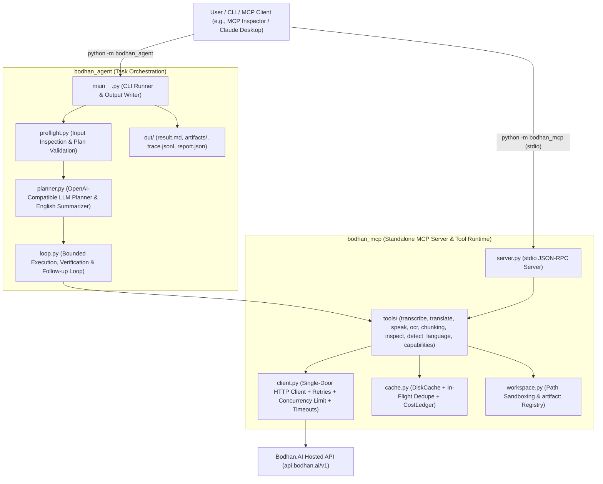
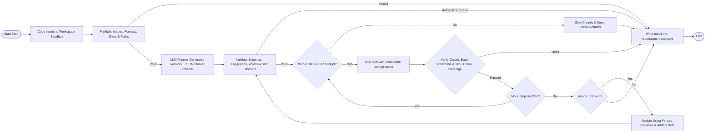

# Bodhan Tool Server & Budgeted Task Agent (`bodhan-tool-agent`)

A **Model Context Protocol (MCP)** tool server (`bodhan_mcp`) exposing Bodhan's four Indic models (`indic-transcribe`, `indic-translate`, `indic-speak`, `indic-ocr`), paired with an autonomous, budgeted CLI task agent (`bodhan_agent`) for multi-step Indian-language workflows.

---

## Architecture Overview

`bodhan_mcp` owns model API access, chunking/limit handling, content-hash caching, path sandboxing, and INR cost accounting. `bodhan_agent` uses an OpenAI-compatible LLM strictly for high-level planning, optional follow-up replanning, and English-only summarization.



---

## Agent Execution Flow



---

## Tool Design & Model Limits

One tool per Bodhan model keeps orchestration explicit and composable, while helper tools (`inspect_media`, `chunk_media`, `detect_language`, `list_capabilities`) handle deterministic inspection and script checks locally at ₹0 cost.

| Tool | Role | Internal Limit & Plumbing Handling |
|---|---|---|
| `transcribe_audio` | Speech-to-text (`indic-transcribe`) | Segments audio and extracted video audio tracks (`.wav`, `.mp3`, `.m4a`, `.flac`, `.ogg`, `.opus`, `.aac`, `.mp4`, `.mov`, `.mkv`, `.webm`) into ≤29.5s WAV windows via FFmpeg; supports `output_format="srt"` with ordered segment timestamps; caches per chunk. |
| `translate_text` | Machine translation (`indic-translate`) | Splits long inputs into ≤15,000-char chunks along paragraph/table-row/sentence boundaries; preserves `.srt` cue IDs/timestamps and Markdown pipe tables; bisects automatically if truncated; caches per chunk. |
| `speak_text` | Speech synthesis (`indic-speak`) | Splits text into ≤500-char requests; validates against Bodhan's 45 verified speaker voices (`voice_id` or `voice_gender`); stitches multi-chunk WAV/MP3 responses into a single `.wav` or `.mp3` artifact via FFmpeg; caches per chunk. |
| `ocr_document` | Document/image OCR (`indic-ocr`) | Renders multi-page PDFs page-by-page via `pypdfium2` (all pages unless `page_number` is set); converts `.tiff`/`.bmp`/`.webp` to PNG; passes `table_format="markdown"` and `max_tokens=4096`; caches per page. |
| `chunk_media` | Helper: media splitting | Splits PCM WAV into ≤30s files or UTF-8 text into translation chunks, returning `artifact:<ref>` manifests. |
| `inspect_media` | Helper: metadata | Reads file type, size, line count, PDF page estimate, or FFmpeg/WAV duration without model calls. |
| `detect_language` | Helper: script ID | Unicode script analysis returning candidates, confidence, and explicit `ambiguous` flag (e.g., Devanagari shared across `hi`/`mr`/`ne`). |
| `list_capabilities` | Helper: discovery | Returns supported languages, pricing, limits, and verified voice defaults. |

- **No base64 in LLM context:** Media moves strictly via workspace paths and `artifact:<ref>` handles. Tools return truncated previews (`<=300` chars) for long documents while keeping full outputs file-backed.
- **No-waste caching:** `DiskCache` hashes `(model, op, params, input_content)` (with NFC-normalized text) and deduplicates both within a run and across reruns, recording `cached` and `avoided_inr` in `trace.jsonl` and `CostLedger`.

---

## Where the LLM Is Used (and Guardrails)

The OpenAI-compatible LLM (`LLM_BASE_URL`, `LLM_MODEL`, `LLM_API_KEY`) is used **only** for:
1. **`plan_task` / `replan_task`**: Choosing catalogued tools, refusing unsupported languages/tasks cleanly, and optionally planning follow-up steps after inspecting discovery results (`needs_followup=true`).
2. **`summarize_english`**: Writing English-only summaries when a task requests summarization (for example, calibrating `max_words` at ~130 words/minute for duration-targeted audio summaries before passing to `indic-translate` and `indic-speak`).

**Enforced safety rules:**
- `contains_non_english_script()` rejects any summary containing Indian-language scripts—all Indian-language text must come from a Bodhan model.
- OCR/transcript text passed into `summarize_english` or `replan_task` is wrapped in `<untrusted_source_data>` / `<untrusted_tool_observations>` tags and treated strictly as data.
- `Workspace.resolve_input()` enforces structural path sandboxing so prompt-injected text cannot read `.env`, `.git`, or files outside allowed workspace/input directories.

---

## Bodhan Models, Pricing & Voices

| Model | Hosted Endpoint Default | Pricing |
|---|---|---|
| `indic-transcribe` | `/audio/transcriptions` | ₹0.10 / input audio minute |
| `indic-translate` | `/chat/completions` | ₹0.20 / 10,000 output tokens |
| `indic-speak` | `/audio/speech` | ₹6.00 / 10,000 input characters |
| `indic-ocr` | `/chat/completions` | ₹0.20 / image (per PDF page) |

- **Languages:** 23 languages configured (`as`, `bn`, `brx`, `doi`, `en`, `gu`, `hi`, `kn`, `kok`, `ks`, `mai`, `ml`, `mni`, `mr`, `ne`, `or`, `pa`, `sa`, `sat`, `sd`, `ta`, `te`, `ur`).
- **Voices:** Uses Bodhan's 45-voice library (e.g., Bengali female `Ishita` / male `Sourav`, Tamil female `Anitha` / male `Arun`, Hindi female `Kavya` / male `Amit`, Telugu female `Sravani` / male `Vamsi`). **All synthesized audio is labeled as AI-generated** in `result.md` and `speak_text` metadata; Indic-Speak does not clone voices.

---

## Setup & Installation

### Option A: Local Python (Clean Clone)

**Prerequisites:** Python 3.11+, `ffmpeg` (optional system install; `imageio-ffmpeg` also bundles FFmpeg), Bodhan API keys, and an OpenAI-compatible LLM key.

```bash
python -m venv .venv
source .venv/bin/activate  # On Windows: .venv\Scripts\activate
pip install -e ".[dev]"
cp .env.example .env
# Fill in BODHAN_*_KEY and LLM_* variables in .env
```

### Option B: Docker

```bash
docker build -t bodhan-tool-agent .

# Run the task agent
docker run --rm --env-file .env \
  -v "$(pwd)/inputs:/data/inputs:ro" \
  -v "$(pwd)/out:/data/out" \
  bodhan-tool-agent \
  python -m bodhan_agent --task "Translate this worksheet into Marathi and keep the table" --files /data/inputs/worksheet.png --out /data/out

# Run the standalone MCP stdio server
docker run --rm -i --env-file .env bodhan-tool-agent
```

---

## Usage

### 1. Task Agent CLI

```bash
python -m bodhan_agent \
  --task "Make a two-minute Tamil audio summary of this chapter" \
  --files ./path/to/inputs/ \
  --out ./out \
  [--max-steps 30] [--max-cost-inr 20]
```

**Output layout (`./out`):**
```text
out/
├── result.md      # What was done, final answer, assumptions, artifact links, AI-audio notice
├── artifacts/     # Produced audio (.mp3/.wav), subtitles (.srt), Markdown (.md), transcripts (.txt)
├── trace.jsonl    # One JSON event per line: preflight, planner, plan, tool_call, verification, summary
└── report.json    # status, steps, verification results, total_cost_inr, elapsed_seconds
```

### 2. Standalone MCP Server (`stdio`)

```bash
python -m bodhan_mcp
```

---

## Verification, Cost & Demo Runs

- **Output verification:** Every generated audio file is back-transcribed via `indic-transcribe` (`back_transcription_complete`, recognized character count, and script check). Translations check full chunk coverage, non-empty output, target script sanity, and Markdown table row counts.
- **Demo runs & traces:** `[TODO: add links to your 6 demo result.md / report.json / trace.jsonl outputs and cost/runtime table]`
- **Demo video (≤ 5 min):** `[TODO: add public, sign-in-free link to your recorded demo]`

---

## Testing

Run lint and unit/integration tests (mocked clients; zero live API spend):

```bash
make check
# Equivalent to:
# ruff check src
# pytest -q
```

---

## Known Limitations & Trade-offs

- **Spoken-language ambiguity on shared scripts:** Audio language identification transcribes with `indic-transcribe` auto-detect and applies Unicode script analysis; languages sharing Devanagari (`hi`/`mr`/`ne`) or Perso-Arabic (`ur`/`ks`/`sd`) scripts are flagged as ambiguous rather than guessed silently.
- **Duration targeting:** Exact audio duration (e.g., "two-minute summary") is approximated via English summary word-count calibration (~130 wpm) before translation and synthesis, since `indic-speak` does not take a target-seconds parameter.
- **Best-effort INR cap:** `--max-cost-inr` checks conservative pre-step estimates for Bodhan API calls; actual provider billing on an in-flight step or external LLM planner charges can differ slightly.
- **No interactive clarification:** Runs are non-interactive; reasonable assumptions (such as auto-detected input language or default female/male voice selection) are recorded in `result.md` and `report.json`.

---
