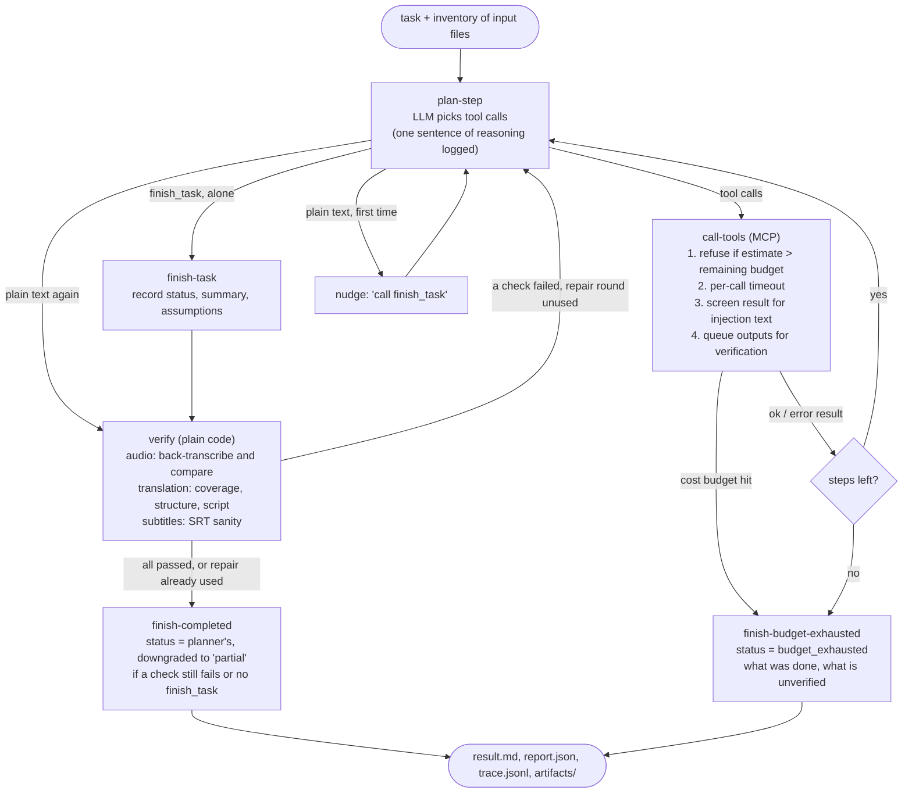

# Agent flow

The agent loop: plan, act, verify, retry and stop. Components are in [architecture.md](architecture.md);
design reasoning is in [design-notes.md](design-notes.md). Diagram is Mermaid (rendered by GitHub).

Stops: `completed`, `partial`, `impossible` (planner's honest end), `budget_exhausted` (steps or rupees), `blocked` (instruction-like text in an input: halted, no LLM sees it).
Retry rules: a failed tool call may be retried once by the planner if it is fixable; verification gets exactly one
repair round; transient API errors (429, 5xx, timeouts) are retried inside the tools with exponential backoff.
