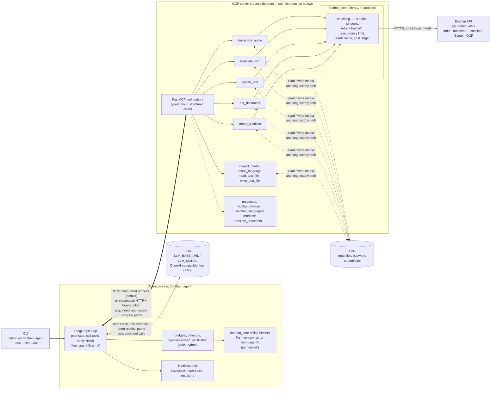

# Architecture

How the MCP server, its tools and the agent connect at run time. The agent loop is in
[agent-flow.md](agent-flow.md); design reasoning is in [design-notes.md](design-notes.md).
Diagrams are Mermaid (rendered by GitHub).

**Legend.** Thick arrow: the process boundary (MCP). Solid arrows: calls. Dotted arrows to disk: media and long text,
which never pass through the LLM. Text over 3,000 characters (`output.inline_chars` in `config/config.yaml`) is saved to
a file and the tool returns its path. English text also gets a 600-character preview; Indian-language text gets none, so
the LLM cannot copy a fragment of it.

| Part | Role |
|---|---|
| Agent process | CLI and LangGraph loop. The LLM plans. Plain Python enforces budgets and timeouts, screens untrusted text, verifies outputs and writes the trace. Uses `bodhan_core` only for offline checks; it never calls the Bodhan API directly. |
| MCP server process | `bodhan_mcp`: one tool per Bodhan model plus helpers. The agent spawns it over stdio, and any other MCP client can drive it the same way. |
| `bodhan_core` | Library loaded inside the server: chunking, WAV windows, retries, concurrency limit, cache and cost ledger. Every Bodhan API call goes through it. |
| Bodhan API | The only place any speech-to-text, translation, speech synthesis or OCR happens. |
| Disk | Audio, images, PDFs and long text move between tools as paths. Only short text and paths reach the LLM. |
