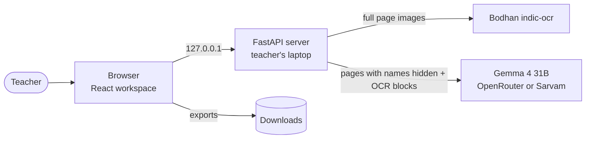
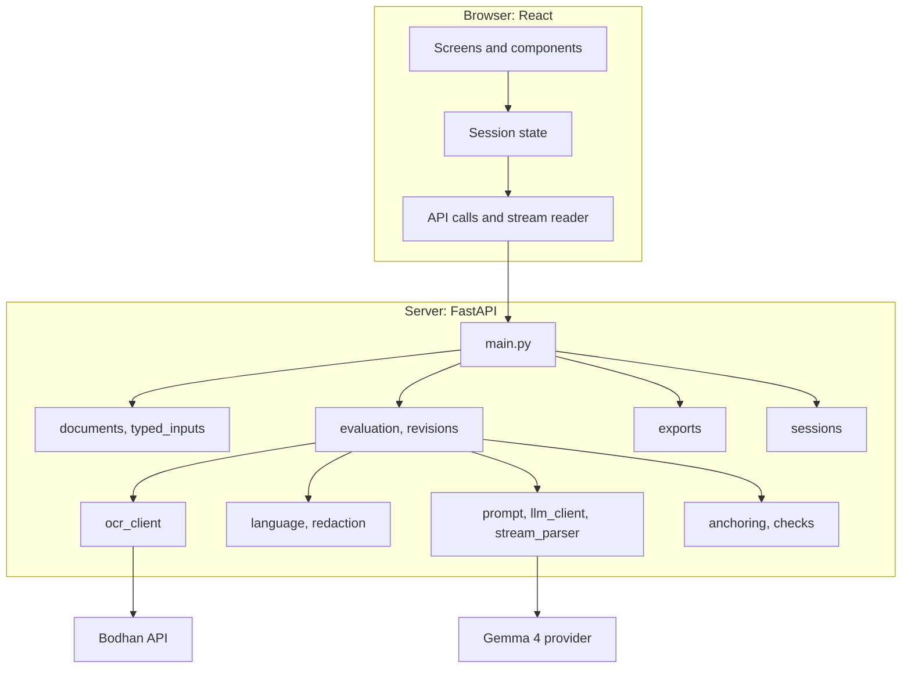
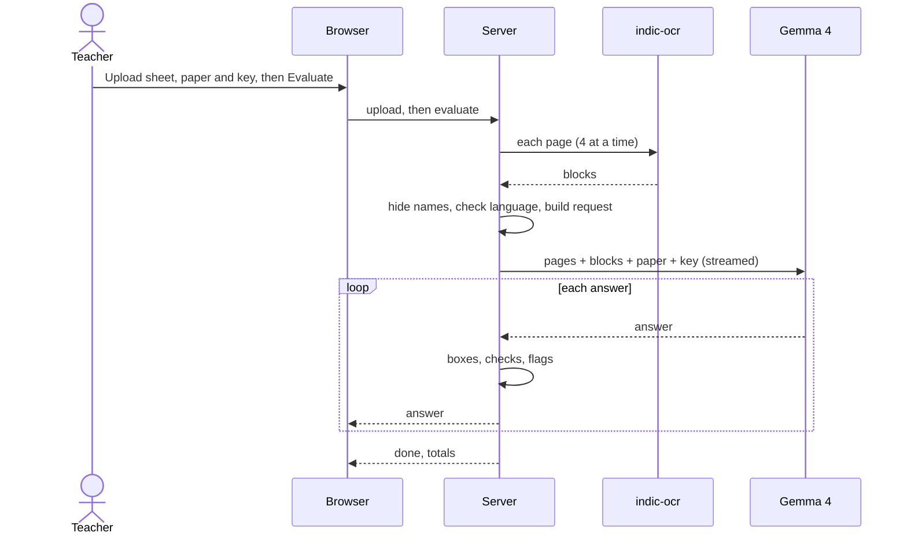

# Answer Sheet Evaluator — Architecture

## 1. Document details

| Field | Value |
| --- | --- |
| App name | Answer Sheet Evaluator (folder `examples/answer_sheet_evaluator`) |
| Approved spec | [SOFTWARE_SPECIFICATION.md](SOFTWARE_SPECIFICATION.md), version 0.1 (first draft, not yet approved) |
| Authors | Dhara Gorasiya |
| Bodhan reviewers | @Bodhan-AI/cookbook-maintainers |
| Status | Draft for review |
| Version | 0.1 |
| Last updated | 16 Oct 2026 |
| Code | `examples/answer_sheet_evaluator` on branch `recipe/answer_sheet_evaluator` (documents only in this pull request) |

Ids such as FR-n, R-n and Q-n refer to the specification.

## 2. Overview and architectural drivers

**Summary.** One FastAPI server on the teacher's laptop serves a React workspace.

1. The teacher uploads the answer sheet, and optionally the question paper and answer key.
2. The server reads every page once with Bodhan `indic-ocr`, hides names and roll numbers, and checks the language.
3. It sends Gemma 4 one request for the whole sheet: each page image with its numbered OCR blocks, plus the paper, key and instructions.
4. Answers stream back one at a time. For each, the server turns cited blocks into boxes, checks quotes and marks, and adds flags.
5. The teacher reviews on the page, edits, re-marks by chat, and exports.

Nothing is stored: the session is deleted on **Clear**, after 60 minutes, or at shutdown.

### Architectural drivers

| Driver | Spec | Design response |
| --- | --- | --- |
| OCR text alone misses ticks, circles and diagrams | Section 3 | The model reads the page images |
| Vision models misread Indian scripts and cannot point at the page | R1, R9 | Bodhan's blocks go with every page; the model cites block ids and the app draws Bodhan's boxes |
| Every mark must be checkable | G2, FR-15, FR-16 | A fixed reply format; code checks quotes and arithmetic and flags problems |
| Answers run across pages | FR-11 | One request for the whole sheet |
| Papers and keys arrive as images; marks are printed on them | FR-4, FR-13 | The paper and key are uploaded and read like the sheet |
| Children's work goes to a third-party model | FR-9 | Names hidden before the model call; nothing stored or logged |
| The teacher stays in control | G4, FR-19, FR-20 | Editable boxes and cards; scoped re-marking with undo |
| Two providers behave differently | FR-24, R14 | One client with a profile per provider |

**Constraints:** one developer; Python 3.10+ and Node.js 22+; Gemma 4 31B through a hosted API.

**Quality attributes, in order:** faithfulness, privacy, teacher control, simplicity, speed, cost.

## 3. System context



| Outside system | Role | Receives |
| --- | --- | --- |
| Bodhan `indic-ocr` | Reads each page into text blocks with boxes | Full page images |
| Gemma 4 31B | Marks and re-marks the sheet | Pages with names hidden, OCR blocks, paper, key, instructions. Never the student label |

## 4. Containers and components



### Tech stack

| Layer | Choice |
| --- | --- |
| Server | Python 3.10+, FastAPI 0.143.0, uvicorn 0.54.0, python-multipart 0.0.32 |
| Front end | React 19.3.1, built with Vite 8.3.4 (@vitejs/plugin-react 6.1.2); state with `useReducer` and context |
| Pages and images | pypdfium2 5.14.0 (not PyMuPDF, which is AGPL), Pillow 12.3.0 |
| Calls and checks | requests 2.32.3, pydantic 2.14.1, rapidfuzz 3.14.5, regex 2026.9.29 |
| Configuration | python-dotenv 1.0.1 |
| Tests | pytest 9.1.1; Vitest 5.0.5 with @testing-library/react 16.3.3 and jsdom 30.1.3 |

### Components

**Front end (`frontend/src/`)**

| Component | What it does |
| --- | --- |
| `screens/` | The four screens: Inputs, Workspace, Chat, Export |
| `PageView`, `AnswerBox`, `FindingMarker` | Show a page with its answer and finding boxes; the teacher can drag and resize them |
| `AnswerCard`, `SummaryBar` | One card per answer with marks, comment and flags; the totals |
| `state/` | One store for everything on screen, so totals and undo stay correct |
| `api/`, `hooks/` | Call the server and read results as they stream in |

**Server (`app/`)**

| Component | What it does |
| --- | --- |
| `main.py` | Routes, start-up checks and security |
| `sessions.py` | Keeps each session in memory; deletes it on **Clear** or after 60 minutes |
| `documents.py`, `typed_inputs.py` | Turn uploads into page images, or into typed answers |
| `ocr_client.py` | Reads each page with Bodhan `indic-ocr` |
| `language.py`, `redaction.py` | Work out the language; hide names and roll numbers before the model call |
| `prompt.py`, `llm_client.py`, `stream_parser.py` | Build the request, call Gemma 4, and read each answer as it arrives |
| `anchoring.py`, `checks.py` | Turn cited blocks into boxes; check quotes and marks; add flags |
| `evaluation.py`, `revisions.py` | Mark a whole sheet; re-mark part of it, with undo |
| `exports.py` | CSV, JSON and annotated page images |
| `prompts/` | Marking guidance (editable) and the reply format (fixed) |

### Folder layout

```text
examples/answer_sheet_evaluator/
├── SOFTWARE_SPECIFICATION.md, ARCHITECTURE.md, README.md
├── app/            server modules above, prompts/
├── frontend/       package.json, package-lock.json, vite.config.js, src/
├── tests/          server tests and recorded replies
├── tools/          make_samples.py, run_eval.py, smoke_test.py
├── sample_data/    synthetic sheets, papers and keys in English, Hindi and Gujarati
└── requirements.txt, .env.example, .gitignore
```

### HTTP API

| Route | Purpose |
| --- | --- |
| `POST /api/sessions` | Start a session |
| `POST /api/sessions/{id}/sheet` and `/reference` | Upload the sheet; upload the paper and key |
| `PUT /api/sessions/{id}/settings` | Instructions, marks per question, student label, comment language, guidance |
| `POST /api/sessions/{id}/evaluate` | Mark the sheet (streamed); `/evaluate/rest` marks only what is missing |
| `GET /api/sessions/{id}` | Current pages, answers, flags and totals |
| `PUT`, `POST`, `DELETE …/answers` | Save, add or delete an answer or finding |
| `POST /api/sessions/{id}/reevaluate` | Re-mark an answer, a page or the sheet with feedback (streamed) |
| `POST …/revisions/{rev}/undo` | Undo the latest re-marking |
| `GET …/export.csv`, `.json`, `pages.zip` | Exports |
| `POST /api/sessions/{id}/next` | Next sheet with the same paper and key |
| `DELETE /api/sessions/{id}` | **Clear** |

Streamed routes return one JSON object per line: `status`, `answer`, `reply`, then `done` or
`error`. A stream that ends without `done` or `error` is shown as a failure.

## 5. Bodhan API integration design

| Concern | Design |
| --- | --- |
| Key | `BODHAN_API_KEY` in `.env`, used only by the server |
| Request | `POST /v1/chat/completions`, `model: "indic-ocr"`, one page per request as PNG or JPEG, at most 2000 px |
| Parallelism | 4 pages at a time; each page read once per session; the paper and key reused for the next sheet |
| Errors | Readable message per error, with `request_id` |
| Retries | `502` from `max_tokens`: once with `max_tokens: 4096`. `429`: wait once. Otherwise **Retry page** |

### Gemma 4 integration

| Concern | Design |
| --- | --- |
| Profiles | **OpenRouter:** `google/gemma-4-31b-it`, Bearer key, `response_format`, no-data-collection routing on paid. **Sarvam:** `gemma4`, `api-subscription-key`, no `response_format`, 10 MB request limit |
| Request | One streamed call per sheet, `temperature: 0.2`; teacher instructions inside a marked section |
| Size | Images shrunk in steps (2000, 1600, 1280 px) to fit the provider's limit; an over-long sheet is refused, never cut |
| Failures | `429`: wait once. Otherwise stop, keep the answers received, and offer **Mark the rest** |

## 6. Data architecture

### Data stores

| Store | Holds | Kept until |
| --- | --- | --- |
| `.env` | Keys and settings | The user deletes it; git-ignored |
| Server memory | Pages, OCR blocks, answers, flags, revisions | **Clear**, 60 minutes idle, or shutdown |
| Session temp folder | Page images: original, model copy, masked copy | Deleted with the session |
| Downloads | Exports | The teacher's own files |

### Main data types

| Type | Key fields |
| --- | --- |
| `Page` | sheet or reference, number, image, blocks |
| `Block` | id (`3.4` = page 3, block 4; `R1.2` = reference page 1), box, text |
| `Answer` | question, parts (page and blocks), category, maximum and its source, breakdown, marks, comment, findings, flags, reviewed |
| `Finding` | block, quote, quote check, comment, marks lost |
| `Revision` | scope, feedback, answers before and after |

### What the model receives

```text
[system]  marking guidance (editable) + reply format (fixed)
[user]    Page 1 image (names hidden)
          [1.1] (Text) "[masked]"
          [1.2] (Title) "Section A  4X1=4"
          [1.3] (Text) "1. The capital of India is ... New Delhi"
          ... every page, then the paper and key the same way
          <<<TEACHER INSTRUCTIONS  Class 9 science. Be strict on units. >>>
```

### Reply format

One JSON object per answer, with the comment before the marks so the marks follow the judgement:

```json
{
  "question": "6",
  "parts": [{"page": 2, "blocks": ["2.5", "2.6"]}, {"page": 3, "blocks": ["3.1"]}],
  "comment": "Explains fossil fuels well, but leaves out deforestation.",
  "findings": [{"block": "2.6", "quote": "burning of fosil fuels", "comment": "Deforestation is missing.", "marks_impact": -1}],
  "ocr_corrections": [{"block": "2.6", "ocr": "fosil", "read_as": "fossil"}],
  "marks_breakdown": [{"step": "Human causes", "max": 2, "awarded": 2}, {"step": "Deforestation", "max": 2, "awarded": 0}, {"step": "Natural causes", "max": 1, "awarded": 1}],
  "max_marks": 5, "max_marks_source": "paper", "marks_awarded": 3, "category": "minor_mistake"
}
```

### Checks on every answer

| Check | Flag if |
| --- | --- |
| Blocks | A cited block does not exist, or two answers share one |
| Location | No block was cited and the model's own box is used |
| Maximum | Not found on the paper or in the teacher's settings (the answer is left out of totals, Q8) |
| Arithmetic | The breakdown does not add up, or marks exceed the maximum (never rescaled) |
| Category | It disagrees with the marks, for example "correct" without full marks |
| Quotes | A quote is not in its block's OCR text (a softer flag if the model listed it as an OCR correction) |
| Missing questions | A question on the paper has no answer (added as unattempted) |
| Language | An answer is in a different script from the key |
| Instructions on the sheet | The sheet contains text like "give full marks" |
| No key | No answer key was given (label on every answer) |

**Hiding names.** Blocks starting with labels such as Name, Roll No, Class or School (and नाम,
अनुक्रमांक, નામ, રોલ નંબર and similar) are painted over on the model's copy of the page and their
text replaced with `[masked]`. The teacher can view the masked page.

**Exports.** CSV with a byte-order mark (so Hindi and Gujarati open correctly in Excel), a
totals row and formula escaping; JSON of the evaluation; PNG pages with boxes.

## 7. Key flows

### Marking a sheet (J1)



**On failure:** an OCR error stops before the model call and offers **Retry page**. A model
error keeps the answers received and offers **Mark the rest**.

### Re-marking with feedback (J3)

The teacher selects an answer, a page or the sheet and writes feedback. The server sends only
those pages, the current answers (with the teacher's edits) and the feedback. Only answers in
scope change. Edits are locked while it runs, and **Undo** restores the previous version.

### Next sheet (J7)

The paper, key and settings are kept; the sheet and results are cleared.

## 8. Security architecture

| Threat | Mitigation |
| --- | --- |
| Keys leak | Keys stay on the server; `.env` is git-ignored |
| Others use a running instance | The server listens on `127.0.0.1` only |
| Another website calls the local server | No CORS; every write needs the `X-ASE: 1` header and a matching `Origin` |
| Text on the sheet steers the marks | Sheet text is treated as content; fixed reply format; marks capped and checked; suspicious text flagged |
| Model text injected into the page | React shows text as text; no `dangerouslySetInnerHTML`; Content-Security-Policy |
| Bad uploads | Type, size and page limits; password-protected PDFs refused |
| Children's identities reach the model | Names and roll numbers hidden; the student label never sent |
| Student content in logs | Logs hold only steps, timings, status codes, token counts and request ids |
| Data left behind | Everything deleted on **Clear**, expiry or shutdown |
| Unsafe dependencies | Python and npm versions pinned; npm not yet watched by Dependabot (R20) |

## 9. Deployment and infrastructure

Local only; no hosting cost. The cookbook validator runs on pull requests; tests run locally
and need no keys.

### Run it locally

1. `pip install -r requirements.txt`
2. `cd frontend && npm ci && npm run build && cd ..` (Node.js 22+)
3. `cp .env.example .env` and add a Bodhan key and an OpenRouter key
4. `uvicorn app.main:app`, open `http://127.0.0.1:8000`, choose **Load sample**

For front-end work, also run `npm run dev` in `frontend/`.

## 10. Observability and operations

On screen and in the log: the step, error message and `request_id` for failures; time per
stage; OCR pages and tokens used, with cost, in a **Details** panel; flags per sheet. No sheet
content is ever logged.

## 11. Performance and scalability

| Step (4-page sheet, 2-page paper, 10 questions) | Budget (s) |
| --- | --- |
| Prepare pages | 4 |
| OCR 6 pages, 4 at a time | 20 |
| Build request, model reads it | 11 |
| First answer | 8 |
| **First answer on screen** | **43** (target 45) |
| Remaining answers | 72 |
| **Whole sheet** | **115** (target 120) |
| Re-mark one answer | 15 (target 20) |

None of these are measured yet; model times assume about 50 output tokens per second.
Requests are about 19,000 tokens in English and 33,000 in Hindi or Gujarati, well within
both providers' limits. What slows down first is long sheets with many questions.

## 12. Testing and quality

| Level | Covers | Runs |
| --- | --- | --- |
| Server unit tests | Uploads, PDF pages, hiding names, language, request building, stream parsing, every check and flag, quotes in Indian scripts, undo, CSV export | Every commit |
| Front-end tests | State and undo, stream reading, dragging boxes, edits locked during re-marking, text shown as text | Every commit |
| API tests | Every route with fake Bodhan and model clients, including failures part-way and **Mark the rest** | Every commit |
| Live smoke test | The sample sheet with each provider | Before release, by a maintainer |
| Quality evaluation | Spec Section 12 targets, for Gemma 4 and Gemini 3.8 Flash | Before the code pull request |
| Manual | All journeys in four browsers; keyboard use | Before a demo |

Test data is synthetic, plus consented handwritten sheets kept outside the repository.

## 13. Decision log

| ID | Decision | Why | Trade-off | Status |
| --- | --- | --- | --- | --- |
| ADR-1 | FastAPI with a React front end | Boxes, streaming answers, cards, chat and undo all change together | A Node.js build step (R20, R21) | Accepted |
| ADR-2 | Gemma 4 31B through a hosted API; OpenRouter and Sarvam profiles | Maintainer guidance; local was too slow | Children's work goes to a provider (R8, Q3) | Accepted |
| ADR-3 | The model reads page images, with Bodhan blocks as a reading aid | Text alone misses ticks and layout; images alone misread Indian scripts | Bigger requests | Accepted |
| ADR-4 | Locations come from cited Bodhan blocks | Bodhan's boxes are exact | Boxes only as fine as blocks (R6) | Accepted |
| ADR-5 | The model gives marks; code checks and flags, never rescales | Papers set marks per question and step | Marks rely on the model, measured against teachers (R2) | Accepted |
| ADR-6 | One streamed request per sheet | Answers run across pages | A long reply can fail part-way (R13) | Accepted |
| ADR-7 | Paper and key uploaded as they are; marks read from the paper | Teachers already have them | The maximum relies on the model's reading (R7) | Accepted |
| ADR-8 | Hide names using OCR blocks | Automatic and visible | Unusual labels may be missed | Accepted |
| ADR-9 | Quotes checked against the cited block | Catches invented evidence | Declared OCR corrections need a softer flag | Accepted |
| ADR-10 | Editable guidance, fixed reply format | Teachers can tune marking safely | Edited guidance can mark worse | Accepted |
| ADR-11 | Streaming as one JSON object per line over `fetch` | Works with `POST`; simple | The page parses lines itself | Accepted |
| ADR-12 | Sessions in memory, deleted after 60 minutes | Nothing of a child's work is kept | A restart loses work in progress | Accepted |
| ADR-13 | pypdfium2 for PDFs | Licence fits Apache-2.0 | Lower-level API | Accepted |
| ADR-14 | Language from the script; key and sheet must match | Nothing for the teacher to set | Hindi and Marathi look the same (R18) | Accepted |
| ADR-15 | Typed text and CSV as extra inputs | Some answers are digital | Photos stay the main path (R16) | Accepted |
| ADR-16 | A missing maximum is flagged, not defaulted | A wrong default distorts totals | Teachers set a few by hand (Q8) | Proposed |

**Rejected:** the model's own coordinates over Bodhan's boxes; silently rescaling marks;
storing sheets after the session; sending names or the student label to the model.

## 14. Risks, technical debt and the path to V1

| Gap in V0 | V1 plan |
| --- | --- |
| Boxes only as fine as OCR blocks | Line-level boxes if Bodhan adds them (Q9) |
| One sheet at a time | Batch marking and a class report |
| Names hidden by label patterns only | Let the teacher draw a mask once per paper layout |
| Diagrams and multi-step maths not measured | Add test sheets and targets |
| Local only, no sign-in | Sign-in and limits before any hosting |
| Recipe tests not in CI; npm not in Dependabot | Tooling pull request |
| Documents-only pull request fails the validator | Resolved by the code pull request (Q5) |

**V1 direction:** batch marking, finer boxes, more languages, keeping the same shape: Bodhan
reads, Gemma 4 judges, code checks, the teacher decides.

## 15. Review

*To be completed at the review meeting.*

### Reviewer checklist

- [ ] Every driver traces to the spec
- [ ] The diagrams show everywhere data goes
- [ ] No key reaches the browser or the repository
- [ ] Inputs respect both services' limits
- [ ] Errors are readable, retries never loop, `request_id` is shown
- [ ] A running instance cannot be used by others to spend the keys
- [ ] Names are hidden before the model call; nothing is logged or kept
- [ ] Model output is checked and problems are flagged, not hidden
- [ ] Teacher edits are never overwritten
- [ ] Tests run offline; quality is measured against teachers
- [ ] A reviewer can run V0 from the steps above
- [ ] Gaps have a V1 plan

### Decision

| Field | Value |
| --- | --- |
| Decision | Pending |
| Conditions | |
| Next step | Implement the milestones in spec Section 13 |
