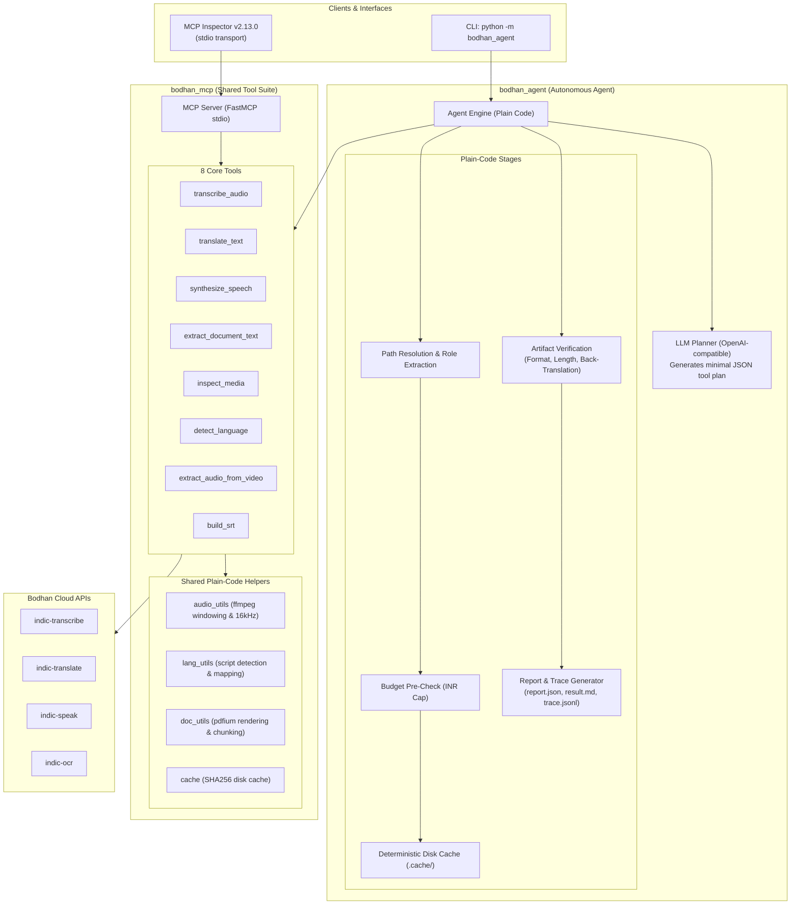
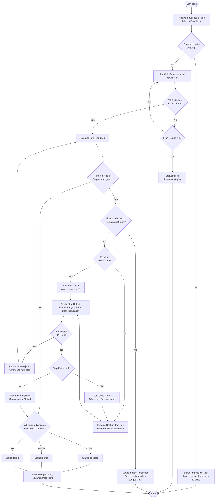

# Bodhan Tool Server and Task Agent

> Autonomous task agent and stdio MCP tool server for Bodhan Indic AI models.

**Bodhan models:** indic-transcribe, indic-translate, indic-speak, indic-ocr  
**Languages shown:** Indic languages (Hindi, Tamil, Bengali, Marathi, etc.) and English  
**Format:** CLI Agent and Stdio MCP Server  

---

## What it does

An autonomous task agent and Model Context Protocol (MCP) tool server that orchestrates Bodhan's Indic AI models (`indic-transcribe`, `indic-translate`, `indic-speak`, `indic-ocr`) alongside deterministic plain-code media processing utilities.

The agent accepts plain-language requests and input media files, breaks down complex workflows (such as video subtitling, multi-page document translation, and audio voice-over generation), enforces strict rupee budget caps and deterministic disk caching, verifies outputs using plain-code heuristics and English back-translation, and produces reproducible run traces and audit reports.

---

## Requirements

- **Python**: $\ge 3.10$
- **ffmpeg**: Required on system `PATH` for audio resampling (16 kHz mono WAV), audio windowing, and audio extraction from video files.

---

## Setup

### Windows PowerShell

```powershell
cd examples/bodhan-tool-agent
python -m venv .venv
.venv\Scripts\Activate.ps1
pip install -r requirements.txt
pip install -e .
cp .env.example .env
```

### Linux / macOS

```bash
cd examples/bodhan-tool-agent
python3 -m venv .venv
source .venv/bin/activate
pip install -r requirements.txt
pip install -e .
cp .env.example .env
```

### Environment Variables

Configure your keys in `.env` (copied from `.env.example`):

| Variable | Scope | Description | Default |
| :--- | :--- | :--- | :--- |
| `BODHAN_TRANSCRIBE_KEY` | Tools / Server | Indic-Transcribe API Key (from console.bodhan.ai) | *Required for transcribe tool* |
| `BODHAN_TRANSLATE_KEY` | Tools / Server | Indic-Translate API Key (from console.bodhan.ai) | *Required for translate tool* |
| `BODHAN_SPEAK_KEY` | Tools / Server | Indic-Speak API Key (from console.bodhan.ai) | *Required for speak tool* |
| `BODHAN_OCR_KEY` | Tools / Server | Indic-OCR API Key (from console.bodhan.ai) | *Required for OCR tool* |
| `LLM_BASE_URL` | Agent Only | Any OpenAI-compatible endpoint URL (e.g. local vLLM, Ollama, LiteLLM, or cloud provider) | *Required for agent (no default)* |
| `LLM_MODEL` | Agent Only | Orchestration model identifier | `gpt-4o-mini` |
| `LLM_API_KEY` | Agent Only | API key for the OpenAI-compatible endpoint | *Required for agent* |
| `LLM_TIMEOUT_S` | Agent Only | Per-call timeout for LLM calls (seconds) | `120` |
| `LLM_MAX_RETRIES` | Agent Only | Max retry attempts for LLM calls | `1` |

> [!NOTE]
> The standalone MCP server (`python -m bodhan_mcp`) requires **only** the four `BODHAN_*_KEY` variables and runs completely without any LLM configured. `LLM_*` variables are required solely when executing the task agent CLI (`python -m bodhan_agent`).
> The code does not read `BODHAN_API_KEY`; it appears in `.env.example` solely as an unused placeholder required by `scripts/validate_recipe.py`.

---

## Run

### 1. Standalone MCP Server (over stdio)

Launch the MCP server over standard input/output for third-party MCP clients (e.g., Claude Code, Cursor, MCP Inspector):

```bash
python -m bodhan_mcp
```

The server exposes 8 tools with built-in chunking, media normalization, and format conversion.

### 2. Task Agent CLI

Execute autonomous multi-step tasks across input files:

```bash
python -m bodhan_agent --task "<instruction>" --files <file1> <file2> --out <output_dir> [--max-steps N] [--max-cost-inr M]
```

**CLI Parameters:**
- `--task`: Plain-language task instruction.
- `--files`: Space-separated paths to input media or document files.
- `--out`: Destination directory for artifacts, trace, and reports.
- `--max-steps`: Maximum execution steps before stopping (default: `30`).
- `--max-cost-inr`: Hard spending cap in Indian Rupees (INR) (e.g. `10.0`). Execution halts cleanly before making any API call that would breach this budget.

#### Example 1: Text Translation with Verification
```bash
python -m bodhan_agent --task "Translate this text file into Hindi and save the result" --files samples/test_text.txt --out ./out/run_translate --max-steps 10 --max-cost-inr 5.0
```

#### Example 2: Audio Transcription & Subtitle Generation
```bash
python -m bodhan_agent --task "Transcribe this Hindi audio and create subtitles" --files samples/test_audio.wav --out ./out/run_transcribe --max-steps 10 --max-cost-inr 5.0
```

#### Example 3: Multimodal Video Audio Extraction & Bilingual Subtitles
```bash
python -m bodhan_agent --task "Create English subtitles for this Hindi video" --files samples/test_video.mp4 --out ./out/run_video --max-steps 20 --max-cost-inr 10.0
```

---

## Output Structure

Each run initializes a fresh output folder containing:

```
out/<run_name>/
├── result.md           # Human-readable final summary, assumptions, and artifact links
├── report.json         # Machine-readable execution report and accounting summary
├── trace.jsonl         # Append-only chronological trace of every plan step & tool call
├── artifacts/          # Final verified deliverables (.txt, .srt, .wav, .md)
└── work/               # Intermediate processing files (extracted audio, 16kHz WAV, page images)
```

### `report.json` Field Guide

| Field | Type | Description |
| :--- | :--- | :--- |
| `status` | string | Final outcome: `"success"`, `"partial"`, `"budget_exceeded"`, `"impossible_task"`, or `"failed"`. |
| `task` | string | The original plain-language task instruction. |
| `steps_taken` | int | Number of execution steps completed. |
| `total_cost_inr` | float | Total billed cost across all API calls in INR (matches sum of step costs). |
| `total_time_s` | float | Total elapsed wall-clock execution time in seconds. |
| `steps` | list | Detailed records of every executed step (tool name, arguments, latency, cached status, and `cost_charged_inr`). |
| `artifacts` | list | Paths to verified final artifact files in `artifacts/`. |
| `assumptions` | list | Plain-code assumptions made during execution (e.g. language assignments, media windowing). |
| `verification_results` | list | Individual verification pass/fail results for each generated artifact. |
| `files` | list | Per-input-file results array including filename, duration, window count, transcript artifact, detected script, and candidate languages. |
| `known_limitations` | list | Disclosures regarding model-specific or language constraints applicable to the run. |
| `failures` | list | Error messages or failure reasons if steps failed or execution halted early. |

---

## Tested Clients

- **MCP Inspector v2.13.0** (`@modelcontextprotocol/inspector` v2.13.0): Connected to `python -m bodhan_mcp` over stdio transport, successfully listed all 8 registered tools, and executed `inspect_media` against sample media to verify tool discovery and response schema compliance. *(Note: Only MCP Inspector v2.13.0 with `inspect_media` was tested).*

---

## Architecture

The system cleanly separates tool execution, deterministic plain-code orchestration, and semantic planning:



### Agent Loop Flowchart



---

## Detailed Design & Demos

- For in-depth design rationale, tool chunking analysis, verification strategies, prompt-injection isolation, and cost models, see [docs/DESIGN.md](docs/DESIGN.md).
- For the index table of verified live demo runs across all modalities, see [demos/README.md](demos/README.md).

---

## Limitations

The following limitations are stated honestly from direct observations in this repository:
1. **67-Second Joined Clip Anomaly (UNEXPLAINED)**: In earlier testing of a 67-second concatenated audio file containing 5 repeated speech segments, only 4 of the 5 repetitions were transcribed. The cause is UNEXPLAINED. In contrast, a 39.1 s continuous audio file (`test_long.wav`) transcribed all 3 windows completely without error.
2. **Missing API Timestamps and Language Metadata**: The Indic-Transcribe API returns strictly `{"text": "...", "usage": null}`. It provides no word-level or segment timestamps, and no detected language code. Consequently, subtitle timecodes are approximate window boundaries ($\le 30$ s windows), and audio language must be inferred from the transcript's detected Unicode script (which can yield Arabic script for Urdu or Devanagari for Hindi given identical speech).
3. **Proper Noun Translation**: Proper names in Indian languages lack capitalization and cannot be reliably identified or verified by plain-code checks; translation models may mistranslate or substitute personal names without detection.
4. **LLM Planner Constraints**: The LLM planner was evaluated with hosted OpenAI-compatible models. Testing a local 7B parameter model on an 8 GB RAM laptop was too slow for practical multi-step planning.
5. **Dockerfile Status**: The `Dockerfile` has been statically reviewed (verifying Python 3.10+, ffmpeg installation, non-root user setup, and `.dockerignore` hygiene), but was never built or run in a local Docker engine.
6. **TTS Length Limit**: The exact character ceiling of `indic-speak` was not found in provider documentation or empirical testing; text is defensively chunked into $\le 150$-character sentences.
7. **Model Accuracy Dependencies**: Speech recognition and OCR accuracy are strictly dependent on the underlying Bodhan models.
