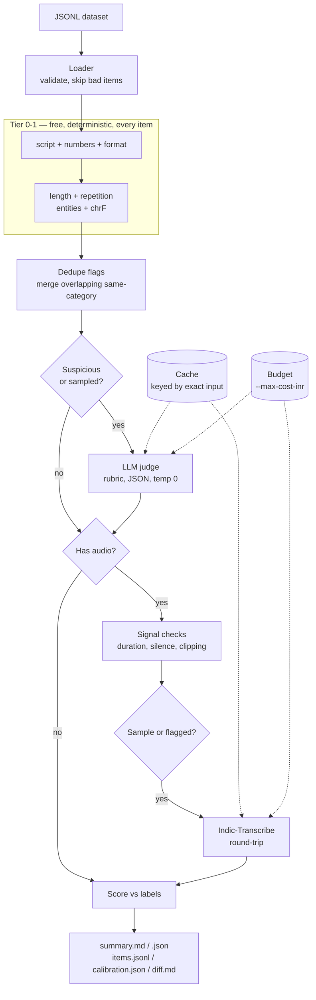
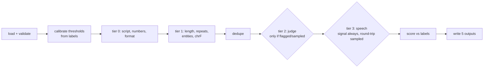

# Bodhan quality harness — Indic-Translate and Indic-Speak

An agentic evaluation harness that finds, localizes and explains quality problems in
Bodhan's Indic translation and speech output, then reports what changed between runs.

It is built to be run on a dataset it has never seen: no rule is tied to the demo data,
and every threshold is either swept from labels or left at a documented default.

```
python -m bodhan_eval --dataset data/demo.jsonl --langs hi,ta,bn --out ./report
```

**Project page:** open [`docs/site/index.html`](docs/site/index.html) in a browser for a visual
overview — architecture, the check table, measured results and the known limits.

## Demo video

A five-minute walkthrough — a full run on the demo dataset, the report, and the optional
Control Center UI:

**https://drive.google.com/file/d/1I_OxB5BFGrs01RDszR1E_Vkveair0oJl/view**

## What it does

1. Reads a JSONL dataset (`id`, `source`, `lang`, plus optional `reference`,
   `translation`, `audio`, `labels`).
2. Runs free, deterministic checks first — script, numbers, Markdown/LaTeX structure,
   length ratio, repetition, entity preservation.
3. Escalates only suspicious items to an LLM judge, and only a deliberate sample to the
   paid audio round-trip.
4. Scores itself against human labels: precision, recall, localization and category
   accuracy per category and per language.
5. Writes `summary.md`, `summary.json`, `items.jsonl`, `calibration.json` and, with
   `--baseline`, `diff.md`.

## Setup

```bash
python -m venv .venv && source .venv/bin/activate
pip install -e .                  # pinned dependencies + the bodhan_eval package
cp .env.example .env              # fill in BODHAN_API_KEY and a judge endpoint
```

`requirements.txt` pins the same versions, for environments that install dependencies
separately; in that case run `pip install -e . --no-deps` as well, so the package itself is
importable.

System dependencies: none required. Audio checks read PCM WAV directly; convert other
formats with ffmpeg before scoring.

A `Dockerfile` is included for a reproducible image:

```bash
docker build -t bodhan-eval .
docker run --rm -v "$PWD:/data" -v "$PWD/.env:/app/.env:ro" bodhan-eval \
  --dataset /data/data/demo.jsonl --langs hi,ta,bn --out /data/report
```

## Run

```
python -m bodhan_eval \
  --dataset data/demo.jsonl \
  --langs hi,ta,bn \
  --out ./report \
  [--generate] [--baseline ./previous_report] [--calibration labels.jsonl] \
  [--max-cost-inr 50] [--speech-sample 25] [--judge-sample 0] [--offline] [--inject]
```

| Flag | Meaning |
| --- | --- |
| `--generate` | Create missing translations and audio with Bodhan models |
| `--baseline DIR` | Diff against a previous report |
| `--calibration FILE` | Extra labelled items, pooled with in-dataset labels, used to sweep thresholds (never scored) |
| `--max-cost-inr N` | Hard budget ceiling; the run degrades instead of overspending |
| `--speech-sample N` | Max items sent for paid back-transcription |
| `--inject` | Self-measure: inject labelled errors into clean items first |
| `--offline` | No model calls at all (deterministic checks only) |

## Control Center (optional)

The harness is a CLI, but there is a small web UI over it for exploring flags with a human
in the loop. It serves the project page, a live translate-and-check studio, a batch runner,
an item explorer, a review queue and a regression diff.

```bash
python tools/serve.py --port 8080 --report ./report
# open http://localhost:8080
```

Run the CLI first so there is a `report/` to explore. The UI reads the same report files and
never changes them; it is a viewer plus a thin trigger over the same pipeline. Nothing in the
CLI, the tests or the scoring depends on it, so it can be ignored entirely.

## Architecture



### Flow from dataset to report



## Checks

| Check | Category | Tier | Why it is trustworthy |
| --- | --- | --- | --- |
| `script.wrong_script` | language | 0 | Fraction of characters in the language's own script; ignores tables/code |
| `script.untranslated` | language | 0 | Output identical to the English source |
| `numbers.added_or_changed` | number | 0 | A significant number in the output that is absent from the source — localizes exactly |
| `numbers.missing` | number | 0 | A significant source number absent from the output |
| `format.*` | format | 0 | Heading/table/LaTeX counts must survive |
| `length.*` | omission / addition | 1 | Word-ratio beyond swept thresholds; noisy on short items, so guarded |
| `length.repeat` | addition | 1 | Adjacent verbatim 3-word repeat inside the translation; structural Markdown excluded |
| `terms.entity_missing` | term | 1 | Acronyms and technical tokens must survive; proper names are excluded because they are transliterated |
| `reference.chrf` | mistranslation | 1 | chrF (character n-gram F) when a reference exists — no dependency, morphology-tolerant |
| `speech.signal` | speech_garbled | 3a | Duration, silence fraction, clipping, RMS straight from the WAV |
| `speech.roundtrip` | speech_omission / repetition | 3b | Back-transcription compared to expected text with chrF |

Two deliberate false-alarm controls, both learned the hard way during development:
Markdown tables and LaTeX legitimately contain Latin text, so script and Latin-ratio
checks run on **prose only**; and proper names are transliterated rather than preserved,
so the entity check ignores them.

## Where the LLM is used, and why

Only as the judge, for meaning-level errors that no string check can see: mistranslations,
and localizing omissions. The rubric names the four categories, three severities and the
requirement to give a character span in the translation. It is told what the deterministic
checks already found so it does not re-derive the easy cases, and it is told to omit
anything it is unsure about, because a false alarm costs more than a miss.

It **never writes, rewrites or corrects Indian-language text** — it reads and reports only.
Temperature 0, cached by exact input.

Judge consistency is measured honestly: each judged item is re-asked with the cache
**bypassed**, so the second verdict reflects the model rather than a cache hit. `judge_stats`
in `summary.json` reports `items_judged` and the resulting `consistency`.

## Calibration

Thresholds are swept, not guessed. `calibrate.sweep_length` fits `length_lo` and
`length_hi` against labelled items and records the whole sweep table in
`calibration.json` so the choice is auditable. Two guards stop it overfitting: the sweep
is clamped to physically sensible ranges (0.40–0.75 and 1.80–3.00) and it refuses to
tune on fewer than 8 examples per class, falling back to the documented default.

## Results

On the 108-item demo set generated directly with Bodhan Indic-Translate across `hi`, `ta`, and `bn`, with the LLM judge enabled:

| Metric | Value | Target |
| --- | --- | --- |
| Detection recall | **96.1%** | ≥ 80% |
| False alarms on clean items | **5.3%** | ≤ 10% |
| Precision | **83.1%** | — |
| F1 | **0.891** | — |
| Localization | **100%** of detections | ≥ 70% |
| Determinism | identical digest (`2e6b34b0d36bdfb7`) + byte-identical `items.jsonl` on rerun | required |

Per category: `addition` 0.73/0.96, `language` 0.92/1.00, `number` 0.78/0.88.
The LLM judge tier reviews suspicious items, evaluating meaning-level mistranslations and character spans with high consistency.

## Cost and runtime

Estimates at list price, per 100 items:

| Stage | Cost |
| --- | --- |
| Indic-Translate only (no `--generate`) | ~₹0.25 |
| + Indic-Speak (~200 chars/item) | ~₹12 |
| + Indic-Transcribe back-check (~20s/item) | ~₹3.3 |

A full run with speech is roughly **₹15 per 100 items**. Everything is cached by exact
input, so a rerun costs nothing and is byte-identical. `--speech-sample` caps the paid
round-trip; `--max-cost-inr` stops the run before it overspends.

## Trade-offs and known limitations

- **Mistranslation recall is low without the judge.** Deterministic checks cannot judge
  meaning. This is by design: the judge is the expensive tier and is only reached when
  the cheap tiers fire or the item is sampled.
- **Omission localization is approximate.** A dropped clause has no position in the
  output; the flag points at the nearest number or the head of the text.
- **Length ratio is weak on short items.** Guarded at 8 source words; below that the
  ratio is noise.
- **Speech checks need PCM WAV.** Other containers must be converted with ffmpeg first.
- **chrF is not a semantic metric.** It flags drift, not wrong meaning.
- **Transliterated entities are not checked.** A wrongly transliterated name is currently
  invisible to the harness.
- **Endpoint shapes are OpenAI-compatible by convention.** `/chat/completions`,
  `/audio/speech` and `/audio/transcriptions` are overridable by env var; confirm against
  Bodhan's docs before the first live run.

## Demo data

`data/sources.jsonl` is 36 English items written for this exercise (short sentences,
numbers and units, a Markdown table, LaTeX, acronyms).

`data/demo.jsonl` is 108 items across Hindi, Tamil and Bengali, translated from the
English sources with **Indic-Translate** and then mutated by `tools/make_demo.py` so that
roughly half carry one labelled, programmatically injected error. Regenerate it with:

```bash
python tools/make_demo.py --out data/demo.jsonl --calibration data/calibration.jsonl
```

The injector never asks a model to write Indian-language text: it deletes spans, changes
digits, perturbs entities and breaks structure on text Indic-Translate already produced.
The harness itself never calls anything except Bodhan models and the configured judge.

## Tests

CI runs the suite on Python 3.10 and 3.12 plus an end-to-end offline run (`.github/workflows/tests.yml`).

```bash
pytest -q     # 48 tests: normalization, spans, every deterministic check, speech signal
              # analysis, judge/generate/cache/budget/diff against a local fake API,
              # CLI flag behaviour, e2e, determinism, and bad-item handling
```

## AI assistance

Written with an AI coding assistant: the check design, the false-alarm controls and the
calibration guards came from measuring the harness against injected errors and iterating
(three rounds, each fixing a specific over-firing check). Every line is explainable in the
debrief, including why the entity heuristic excludes proper names and why the length sweep
refuses to tune on small samples.
