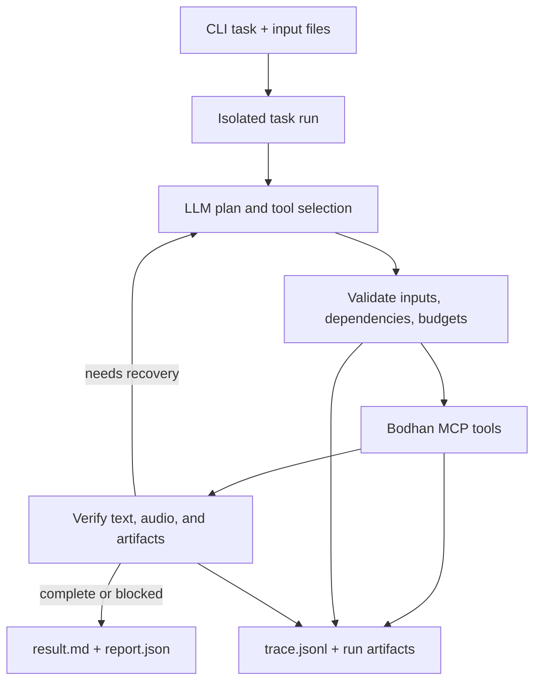
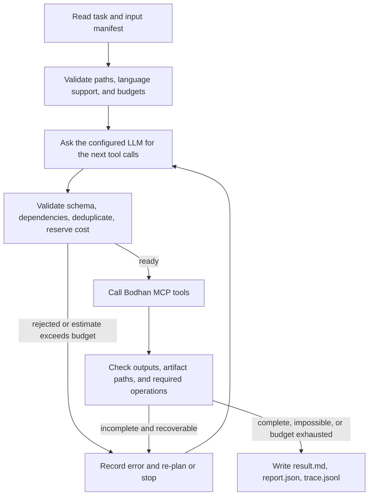

# Bodhan task agent: design and evaluation plan

The runnable task-agent package lives at [`src/bodhan_agent/`](../src/bodhan_agent/). This folder records the agent-specific design, benchmark approach, and future work separately from the MCP server implementation.

## Assignment contract

The agent accepts a plain-language `--task`, input `--files`, and `--out` directory. Each run writes `result.md`, an `artifacts/` directory, `trace.jsonl`, and `report.json`. It must use Bodhan tools for OCR, transcription, translation, and speech generation; verify requested outputs; enforce step, rupee, and per-call timeout limits; and report assumptions, partial work, and failures honestly.

The evaluator will supply its own OpenAI-compatible LLM and Bodhan keys. The agent therefore must rely on standard tool calling and MCP schemas, not provider-specific features. Its tools and descriptions must work independently of the agent because reviewers also connect an off-the-shelf MCP client directly to the server.

## Proposed architecture

Keep one task run as the outer unit of isolation. Inside it, the LLM plans and chooses tools; deterministic Python code owns input validation, dependency tracking, budgets, retries, file transfer, verification, and output writing.

### Agent turn flow

## Tool granularity and contracts

The public MCP surface keeps the core model actions separately callable: transcription, translation, synthesis, and OCR. That gives a third-party MCP client control over the order of work, allows it to inspect/reuse intermediate file references, and makes each model's own limits and cost visible. The tools absorb mechanics callers should not have to manage: transcription normalizes supported audio formats and chunks at 25 seconds, translation splits long text, synthesis splits long speech text, and OCR renders and processes each PDF page.

Higher-level tools are reserved for deliverables whose media coordination is the hard part. `translate_audio` performs VAD, transcription, translation, synthesis, and time-fitting while restoring the original audio outside speech regions. `translate_video` composes that path and muxes the new track while preserving source-video duration. These tools are convenient for a complete dubbed-media request; the lower-level calls remain available when a caller needs a transcript, extracted audio, separate translation, or an intermediate result. Local helpers (`extract_video_audio`, `replace_video_audio_track`, `convert_pdf_to_images`, `chunk_audio`, and `get_file`) expose file operations without hiding paid model work.

Each tool declares a `TypedDict` return contract, and the MCP SDK publishes it as `outputSchema`. The current schemas deliberately allow optional properties because paid results, dry-run estimates, cache hits, and media-specific results have different fields. The remaining contract improvement is to represent those result variants more explicitly (for example, discriminated success/estimate/error shapes) and make the fields required for each variant mandatory. Validation errors are returned as MCP tool errors with actionable text rather than as successful payloads that resemble model results.

### Parallel work

The agent executes multiple tool calls emitted in the same LLM response concurrently, up to `--max-parallel-tools` (default 3). Calls in that batch cannot depend on one another's results because the model has not received those results yet; dependent actions happen in a later turn. Calls share atomic step accounting and cost reservations. Identical paid calls in a batch are deduplicated, and output/artifact paths are unique. Each tool call still has its own timeout and trace record.

This bounded batch model avoids inventing a second LLM planning format. A future explicit dependency-graph planner could schedule independent ready nodes and unblock downstream nodes as results arrive, but the current agent should first measure how often its normal tool-calling model emits useful independent batches.

### Resumable work

Checkpoint the run ID, task, plan, completed step results, pending dependencies, budget consumed, assumptions, and artifact paths after each completed step. Resume only after revalidating input paths and artifacts. `setu:=` references stay valid while their cached files exist, but the per-user cache limit (20 files by default) evicts the oldest file when exceeded; verify artifacts before resuming and recreate an evicted artifact from its source when possible. Resume must not replay successful paid calls.

## What to borrow from DeepSeek Harness

DeepSeek Harness is a large, plugin-oriented agent application, not a drop-in Python orchestration library for this MCP recipe. The useful ideas are its explicit boundaries:

| Harness idea | Apply to Bodhan Setu |
| --- | --- |
| A concrete agent turn/step loop is distinct from an outer goal or workflow policy. | Keep LLM tool selection separate from the task-run lifecycle, shared budgets, and resume/parallel policies. Avoid one generic loop abstraction that owns all of them. |
| Independent benchmark tasks use separate workspaces and session IDs. | Give every benchmark case its own output root, cache namespace where practical, run ID, and trace. Parallel eval jobs must not overwrite artifacts or leak state. |
| Benchmarking has a dedicated runner and reports measured results. | Build a repeatable task-agent runner with fixed case IDs, machine-readable verifiers, per-case costs/timings, and raw traces. Keep model/provider configuration explicit. |
| Plugin seams let components be independently enabled and tested. | Use the MCP protocol and registered tool/resource descriptions as the integration boundary; keep Bodhan tools usable without the task agent. Do not import the DeepSeek Harness runtime or its plugin system. |
| Iterative work needs explicit state handoff and stopping conditions. | If resumability is added, use a versioned, bounded checkpoint and explicit `completed`, `blocked`, `budget_limited`, or `failed` states. Do not treat a model's claim of success as independent verification. |
| A live interface makes long-running work inspectable. | `python -m bodhan_agent.web` provides a local chat workspace with persistent conversations, dry-run-only mode by default, a shared user-tagged artifact drawer, downloads, live progress, and a separate explicit paid-run mode. The UI delegates task orchestration and budgets to the agent. |

Sources reviewed: [DeepSeek Harness README](https://github.com/deepseek-ai/deepseek-harness), [benchmark instructions](https://github.com/deepseek-ai/deepseek-harness/blob/master/BENCHMARK.md), [harness-level execution design](https://github.com/deepseek-ai/deepseek-harness/blob/master/.agents/notes/archived/feature/2026-07-16-harness-level-loop.md), and [hosted benchmark runner design](https://github.com/deepseek-ai/deepseek-harness/blob/master/.agents/notes/archived/testing/2026-09-06-standard-hosted-benchmark-runner.md).

## Evaluation plan

Keep tool-level MCP tests and task-agent evaluations separate. MCP tests answer whether a tool handles its inputs, limits, schemas, and errors. Agent evaluations answer whether the planner composes tools correctly and delivers the requested result.

### Suite layout

The starter suite and runner live under `evals/task_agent/`. Each versioned JSONL case declares:

- `case_id`, task prompt, input paths, expected/forbidden tools, and accepted statuses;
- maximum steps, rupee cost, per-tool timeout, and overall runner timeout;
- deterministic checks for tool coverage and honest failure.

The starter set has eight cases and structural/tool-coverage checks; expand it with output-specific deterministic verifiers, recovery fault injection, a low-budget case, and held-out cases before treating its pass rate as a quality score. Include a multi-file case to measure whether the LLM emits independent calls in parallel, plus the assignment's scanned chapter summary, subtitles, table translation, clip selection, speech generation, and unsupported French examples.

### Runner and safety

The runner gives each case a fresh output root, in-memory MCP cache, artifact stores, logs, and trace/report files. Cases run concurrently up to `--jobs`; tool calls within a case are separately limited by `--max-parallel-tools`. Start with `--jobs 1` for live services. The starter suite uses the configured OpenAI-compatible LLM and Bodhan APIs; add a fake-provider adapter for deterministic planner sequences, malformed tool calls, timeouts, partial failures, and budget edges. No evaluator may use a non-Bodhan OCR, speech-recognition, translation, or TTS provider.

### Metrics

Report task pass rate separately from execution coverage. For each case, record:

- whether the required tools and verifiers ran;
- artifact validity and semantic/content checks;
- honest failure for impossible tasks;
- cost versus budget, latency, step count, retry count, and duplicate same-input/model calls;
- assumptions, verification verdicts, and any partial output.

Aggregate the dimensions from the assignment rubric: hidden-task versatility (25), output quality (20), agent/tool design (30), engineering quality (15), documentation/PR (10), with stretch items reported separately. Translation correctness and naturalness still require human/native-speaker review; an LLM judge is advisory, not a pass certificate.

## Current implementation and next work

The agent package has the required CLI, per-run output files, MCP stdio connection, dry-run cost gates, step/time limits, trace records, bounded concurrency, a local chat workspace, and a starter isolated evaluation runner. Current follow-up priorities:

1. Extend deterministic media validation to subtitle formats and check source-to-output text coverage where fixtures provide a known reference.
2. Verify audio produced by high-level workflows, not only direct `synthesize_speech` calls; translation review remains advisory and needs native-speaker confirmation for quality claims.
3. Run at least six documented demos including an impossible task; name the off-the-shelf MCP client used and include a short demo video as the assignment requires. Demo reports and traces belong in `demos/`; distinguish live Bodhan runs from mock-backed orchestration runs and never claim mock responses are language-quality results.

Implemented and regression-tested: a real multi-turn `get_file` → `translate_text` chain; deterministic artifact checks for text presence, WAV/MP4 signatures, and tool success; injected 429/connect-timeout failures; server-wide per-process Bodhan HTTP concurrency control; and atomic checkpoints with safe resume/uncertain in-flight handling. `--resume` continues completed conversation state without replaying successful calls and accepts increased step/cost limits. Calls interrupted mid-flight are deliberately blocked pending reconciliation.
