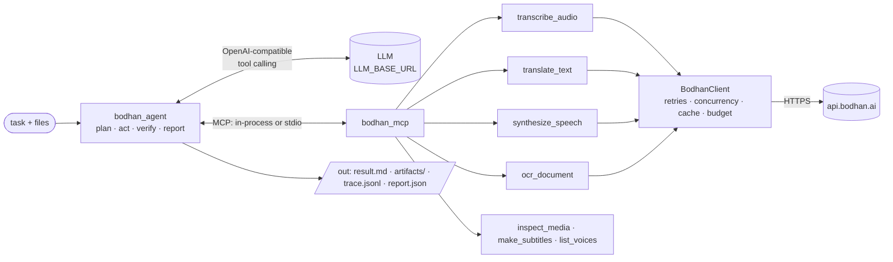

# Bodhan tool server and task agent

An **MCP server** (`bodhan_mcp`) that exposes Bodhan's four Indic models (Indic-Transcribe, Indic-Translate, Indic-Speak and Indic-OCR) as seven well-described tools, plus an unattended **task agent** (`bodhan_agent`). Given a plain-language task and some input files, the agent plans, calls those tools, verifies its outputs and reports honestly, within step, rupee and time budgets.

```bash
python -m bodhan_agent --task "Make a two-minute Tamil audio summary of this chapter" \
  --files sample_data/demo/chapter_water_cycle.pdf --out ./out
python -m bodhan_mcp            # the server on its own, over stdio, for any MCP client
```

- **Design notes:** [docs/design_notes.md](docs/design_notes.md). Covers tool granularity, verification, budgets, recovery, untrusted content, and where the LLM is and isn't used.
- **Architecture diagram:** [docs/architecture.md](docs/architecture.md)
- **Agent flow chart:** [docs/agent_flow.md](docs/agent_flow.md)
- **Demo results:** [evals/results.md](evals/results.md), with outputs and traces under [demo_runs/](demo_runs/)
- **Demo video (5 minutes or less):** [watch on Google Drive](https://drive.google.com/file/d/1xEoQqoFkLuQ8-r51O_Zsjkbnbi0w1WKL/view?usp=sharing)
- **Demo audio:** generated `.mp3` files are kept out of git, as the brief asks. Listen to them here: [01 Tamil audio summary](https://drive.google.com/file/d/12ASVBqmDdxV2TIjDPhstx0pO7HMFg_-5/view?usp=sharing) · [05 Bengali read-aloud](https://drive.google.com/file/d/1_1OAAuhcf4on-nc7ZfpyDJwgDsG1PjGT/view?usp=sharing). Or regenerate them with `python scripts/run_evals.py`

## Setup

Requirements: Python **3.12+** and **ffmpeg** on `PATH` (`apt install ffmpeg` / `brew install ffmpeg`). No GPU is needed. PDFs are rasterised with `pypdfium2` (a wheel), so there is no poppler dependency.

```bash
git clone <your fork> && cd Bodhan-AI-Cookbook/examples/bodhan_task_agent
python3.12 -m venv .venv && source .venv/bin/activate
pip install -r requirements.txt          # one command: fully pinned deps + this recipe
cp .env.example .env                     # then fill in the keys
```

`.env` takes:

| Variable | Purpose |
|---|---|
| `BODHAN_TRANSCRIBE_KEY`, `BODHAN_TRANSLATE_KEY`, `BODHAN_SPEAK_KEY`, `BODHAN_OCR_KEY` | Per-model keys from [console.bodhan.ai](https://console.bodhan.ai) |
| `BODHAN_API_KEY` | Optional. Used for any model whose per-model key is unset (Cookbook convention; the Cookbook validator requires it in `.env.example`) |
| `LLM_BASE_URL`, `LLM_MODEL`, `LLM_API_KEY` | Any OpenAI-compatible endpoint with tool calling (the agent's "brain") |
| `LLM_MAX_TOKENS` | Optional, not a secret. Output cap per LLM call (default 4096; dropped automatically if the provider rejects it) |

**Docker (recommended for a clean environment):**

```bash
docker build -t bodhan-task-agent .
docker run --rm --env-file .env -v "$PWD/sample_data/demo:/data:ro" -v "$PWD/out:/out" bodhan-task-agent \
  python -m bodhan_agent --task "Read this paragraph aloud in Bengali with a female voice" \
  --files /data/library_paragraph.txt --out /out
```

## Run

### The task agent

```bash
python -m bodhan_agent --task "<plain-language task>" --files <files or folders...> --out ./out \
  [--max-steps 30] [--max-cost-inr 20] [--call-timeout-s 300] [--max-time-s 900] [--server inproc|stdio]
```

Each run writes one folder:

```
out/
  result.md        # what was done, the final answer, assumptions, verification, links to artifacts
  artifacts/       # deliverables only: audio, subtitles, Markdown, ...
  trace.jsonl      # one line per step: plan, tool, arguments, result summary, latency, cost (+ every LLM response)
  report.json      # status, steps, verification results, total cost and time, missed quality targets
  work/            # intermediate tool outputs (transcripts, segment files, OCR Markdown)
```

`report.json` `status` is one of `completed`, `partial`, `infeasible`, `budget_exhausted`, `incomplete` or `failed`. **Code decides it from verification and budgets, not the LLM**: the LLM's claimed status can be lowered but never raised. The exit code is `0` whenever the run ended cleanly and wrote its report, `1` for a configuration error, and `2` if the agent crashed (a report is still written).

**Replay a run** from its trace. This uses the recorded LLM decisions and runs the same code, and the Bodhan cache makes it free:

```bash
python -m bodhan_agent --replay out/trace.jsonl --out out_replay
```

### The MCP server on its own

```bash
python -m bodhan_mcp                                          # stdio (what the agent and most clients use)
BODHAN_MCP_TOKEN=secret python -m bodhan_mcp --transport http --port 8765   # streamable HTTP + bearer token
```

**Tested off-the-shelf clients:** [MCP Inspector](https://github.com/modelcontextprotocol/inspector) CLI (v2.15.0 and v0.17.2) over stdio, covering tool listing and calls including bad inputs; and the official MCP Python SDK client (`mcp.Client`, v2.3) over stdio and in-process, in [tests/test_mcp_server.py](tests/test_mcp_server.py). For Claude Desktop, Claude Code or MCP Inspector, register it as a stdio server:

```json
{ "mcpServers": { "bodhan": { "command": "python", "args": ["-m", "bodhan_mcp"],
  "env": { "BODHAN_API_KEY": "<your key>" } } } }
```

```bash
npx @modelcontextprotocol/inspector python -m bodhan_mcp     # browse and call the tools interactively
npx @modelcontextprotocol/inspector --cli python -m bodhan_mcp --method tools/list   # or scripted
```

### Demo tasks and self-evaluation

```bash
python scripts/make_demo_inputs.py --audio   # synthetic, original inputs; audio is generated with Bodhan (~₹2)
python scripts/run_evals.py                  # runs 10 demo tasks via the agent command, writes evals/results.md
```

The last live run passed 10/10 (about ₹3.5 for the suite with a cold cache) (see [evals/results.md](evals/results.md)). The demo voice note is about 1 minute long, and the clips are 2–5 s each. All demo inputs are original and synthetic, written for this recipe and generated locally, so no media is committed. The suite covers the brief's example tasks plus missing files, a too-small budget, prompt injection in a document, and an unstated input language.

### Tests

```bash
pip install -r requirements-dev.txt && pytest -q && ruff check src tests scripts
```

There are 64 tests. Unit tests cover each tool's chunking and limit handling (30-second audio windows, short TTS pieces, the translation context and table preservation, multi-page PDFs), retries, budgets, caching and guards. A tool-level suite drives the server through an MCP client with bad inputs. The end-to-end tests run the real agent loop, MCP client, server and tools against a faithful fake Bodhan API, covering multi-step subtitles, read-aloud with back-transcription, honest refusal, budget exhaustion, prompt injection, false success claims and trace replay.

## How it works



### Tools

| Tool | Model | What it handles so the caller doesn't have to |
|---|---|---|
| `inspect_media` | none (free) | File kind, duration, pages, image size; for text files, the script, likely languages and a preview |
| `transcribe_audio` | Indic-Transcribe | Any length and any audio/video format. It splits at pauses into windows of 30 s or less, never sends silence, auto-detects the language from the script, warns on a wrong language hint, and returns a timed `segments_file` |
| `translate_text` | Indic-Translate | Text, documents or timed segments. It chunks at paragraphs within the context window and keeps tables, rebuilding them cell by cell if the model breaks them. It checks length ratio, target script, numbers, tables and headings, and on failure re-sends the chunk as two halves |
| `synthesize_speech` | Indic-Speak | Splits long text into sentence pieces of 220 characters or less, reads Markdown tables as lists, and verifies each piece by back-transcription. Repetitions and omissions are re-synthesised in smaller pieces. Output is loudness-normalised MP3/WAV labelled AI-generated |
| `ocr_document` | Indic-OCR | Scanned PDFs (renders pages, processes them concurrently, `pages="1-3,5"`) and photos. Returns Markdown with page markers, the detected script, per-page stats and low-confidence blocks |
| `make_subtitles` | none | SRT/VTT from timed segments, splitting long segments into timed cues |
| `list_voices` | none | Voice library by language and gender, plus speaking styles (also the `bodhan://voices` resource) |

Every tool takes typed inputs and returns typed, structured output. Media moves **by file path, never base64**, and long text comes back as a file path plus a preview. Errors are JSON with a stable `code`, a `message`, an actionable `hint` and a `retryable` flag. Each paid tool accepts `max_cost_inr` and refuses before sending anything if its estimate exceeds it. Resources: `bodhan://voices`, `bodhan://languages`, `bodhan://pricing`. Prompt: `plan_language_task`.

### The agent in one paragraph

Plain code first inspects the inputs and spots language names in the task, including unsupported ones like French. The LLM must then call `submit_plan` (understanding, feasibility, assumptions and steps). Impossible tasks end right there, with an explanation and no Bodhan calls. The LLM then acts through tools, and independent calls run in parallel with the remaining budget split between them. Code enforces the ground rules: the LLM cannot write Indian-language text (any file, `text` argument or answer containing Indian script is rejected), it can read only the inputs and its own outputs, and it never sets the output folder or the budget. When the LLM calls `finish`, code verifies every generated audio file and translation plus every deliverable. A failed check sends the LLM back once to fix it; after that the status is downgraded. Every step is written to `trace.jsonl`. See the [design notes](docs/design_notes.md).

## Bodhan models used

Everything uses the hosted API at `https://api.bodhan.ai`: `indic-transcribe`, `indic-translate`, `indic-speak` and `indic-ocr`. Settings: transcription windows of 30 s or less cut at pauses (about 15 s targets for subtitle granularity); translation chunks of about 1,500 tokens; TTS pieces of 220 characters or less; OCR pages rendered at 170 DPI, with a long side of 2,200 px or less and Markdown tables. No other speech, translation, TTS or OCR system is used anywhere, not even as a fallback. Language identification is by script, which the brief explicitly allows.

## Trade-offs and known limitations

- **Language ID is by script.** Distinctive scripts (Tamil, Telugu, Bengali, Gujarati, ...) are reliable. Devanagari (Hindi, Marathi, Nepali, ...) and Bengali-script (Bengali, Assamese) languages are ambiguous, so the agent picks the most likely and records it as an assumption.
- **The voice library lists no English voices.** English speech uses a Hindi-library voice, with a warning in the tool result.
- **No video output.** "Translate this video" yields a translated transcript and subtitles, not a dubbed MP4. If a task explicitly requires a dubbed video, the agent says that isn't possible.
- **The LLM sees English and Bodhan's outputs, never images or audio.** To reason about Indian-language content (for example, to summarise it), the agent first translates it to English with Indic-Translate.
- **Prompt-injection detection is a heuristic** (English and a few Hindi patterns). The real defence is structural: data is wrapped as data, the agent has no shell, network or arbitrary file access, and every paid call is budget-capped.
- **Reruns are free, but there are no mid-run checkpoints.** Bodhan results are content-cached, so re-running or replaying a task repeats no paid call, but an interrupted run restarts from the plan.
- **Costs are estimated before each call** (conservatively) and computed after it from Bodhan's billing units. The LLM's own token cost is reported separately in `report.json` (`llm_tokens`), not in rupees.

## AI assistance

Built with Claude Code (Anthropic), which was used for API research, scaffolding, implementation, tests and docs. I reviewed the design and code and can explain every line.
