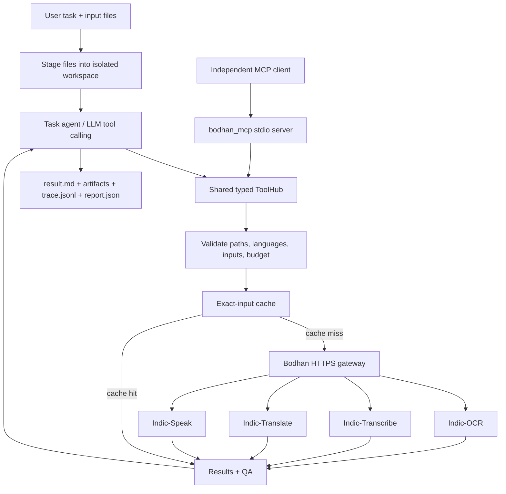
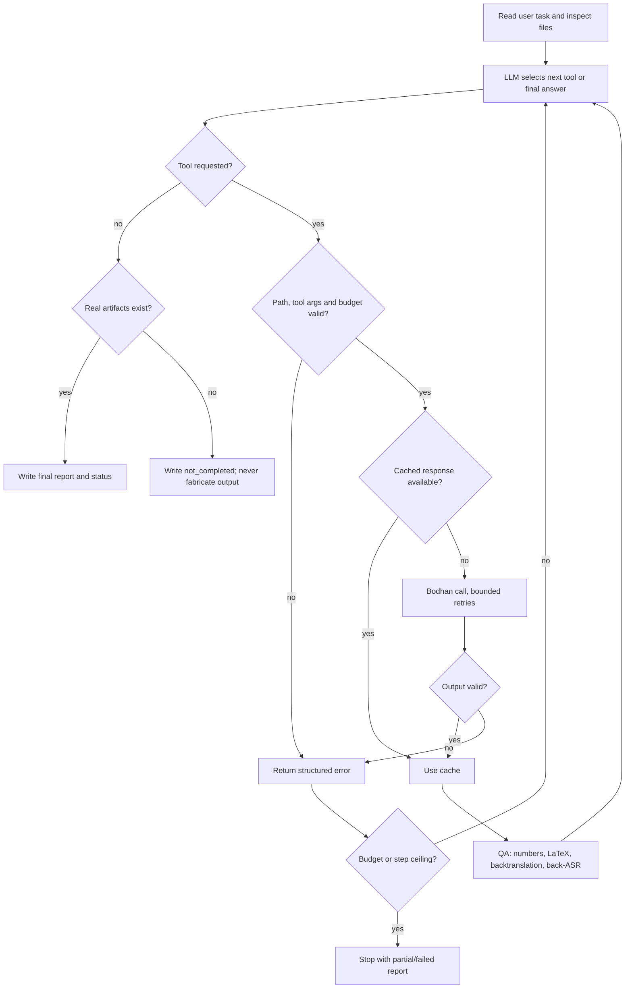

# Architecture and workflow

## Components

## Agent loop and recovery

## Boundary of responsibility

- **LLM:** infer user intent, plan, choose typed tools, write *English* summaries and explanations, decide which errors are recoverable.
- **Bodhan models:** all OCR, ASR, translation and TTS. Indian-language content is never generated or rewritten by the LLM.
- **Deterministic Python:** media conversion, document page rasterization, chunk boundaries, timestamped subtitles, normalization, cache hashes, token checks, path validation and report emission.
- **MCP client:** may call the same validated model tools independently of the agent; the server prints only JSON-RPC to stdout.
- **Untrusted sources:** OCR text, transcripts, filenames and source documents are content, not instructions.
