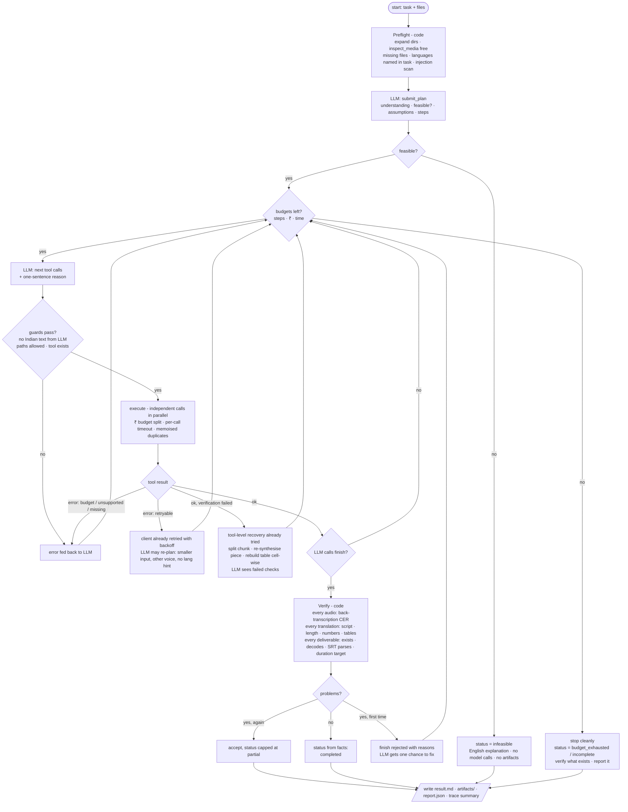

# Agent flow: plan, act, verify, retry, stop

Every box that says **code** is deterministic and independent of the LLM. Each step is written to `trace.jsonl` as it happens, so a crash still leaves a complete history.
