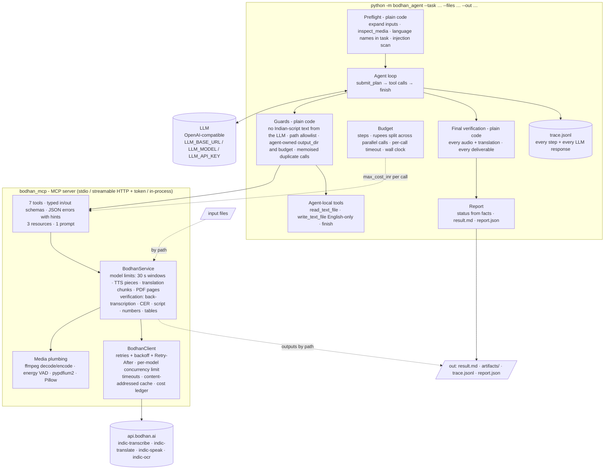

# Architecture

| Part | Responsibility |
|---|---|
| `bodhan_mcp/server.py` | MCP surface: tool schemas and descriptions written for third-party planners, annotations, resources, a prompt, and stdio and HTTP+token transports. It maps every failure to a structured error and never crashes the client. |
| `bodhan_mcp/service.py` | One coroutine per tool. Handles model limits, chunking, recovery and per-tool verification. |
| `bodhan_mcp/client.py` | The only code that talks to Bodhan: auth per model, retries, concurrency, timeouts, cache and cost. |
| `bodhan_mcp/{audio,documents,text,languages}.py` | Deterministic plumbing: VAD windowing, PDF rasterising, chunkers, script detection, CER. |
| `bodhan_agent/agent.py` | Preflight, the plan → act → finish loop, parallel execution, budget enforcement and finish validation. |
| `bodhan_agent/toolbox.py` | MCP client to the server, agent-local tools, guards, memoisation and context trimming. |
| `bodhan_agent/llm.py` | OpenAI-compatible client with retries and a parameter / JSON-tool-protocol fallback, plus a scripted LLM for replay and tests. |
| `bodhan_agent/verify.py`, `report.py`, `trace.py` | Final checks, the status decision, result.md / report.json, and the JSONL trace. |
