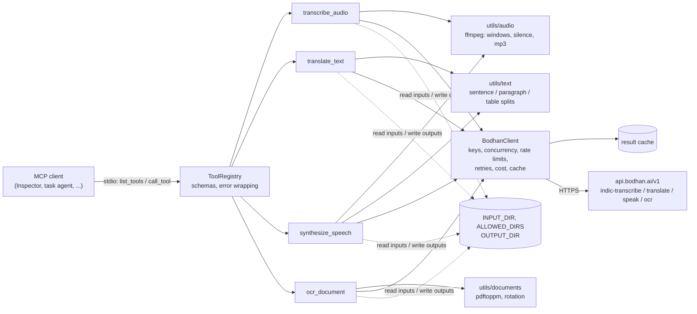

# Bodhan MCP server (`bodhan_mcp`)

An MCP server that exposes Bodhan's four Indic models as four tools: speech-to-text, translation, speech synthesis and OCR. Any MCP client can use it over stdio without the task agent. Each tool handles its model's limits itself, including audio windows, short TTS requests, the translation context window and multi-page documents. A caller passes file paths and gets back file paths, a structured result, the cost in rupees and actionable errors.

| | |
|---|---|
| Transport | stdio (`python -m bodhan_mcp`) |
| Tools | `transcribe_audio`, `translate_text`, `synthesize_speech`, `ocr_document` |
| Models | `indic-transcribe`, `indic-translate`, `indic-speak`, `indic-ocr` (hosted API, `https://api.bodhan.ai/v1`) |
| Tested clients | [MCP Inspector](https://github.com/modelcontextprotocol/inspector) (UI and CLI), and the task agent's own MCP client (`mcp` Python SDK) |
| SDK | `mcp==2.3.0`, low-level `Server` |

## Contents

- [Setup](#setup)
- [Run](#run)
- [Tools](#tools)
- [How it works](#how-it-works)
- [Why these four tools](#why-these-four-tools)
- [Files and paths](#files-and-paths)
- [Errors](#errors)
- [Cost, usage and the cache](#cost-usage-and-the-cache)
- [Reliability](#reliability)
- [Verification](#verification)
- [Untrusted content](#untrusted-content)
- [Configuration](#configuration)
- [Tests](#tests)
- [Found in live testing](#found-in-live-testing)
- [Known limitations](#known-limitations)

## Setup

Run these from the recipe folder (`examples/bodhan_task_agent/`).

**System dependencies.** You need ffmpeg and ffprobe for audio, and poppler-utils (`pdfinfo`, `pdftoppm`) for PDFs.

```bash
sudo apt-get install -y ffmpeg poppler-utils   # Debian/Ubuntu
brew install ffmpeg poppler                    # macOS
```

**Python 3.10 or later, with pinned dependencies.**

```bash
uv sync --extra dev                  # or: pip install -e ".[dev]"
cp .env.example .env                 # then fill in your keys
```

**Keys.** Each model reads its own key: `BODHAN_TRANSCRIBE_KEY`, `BODHAN_TRANSLATE_KEY`, `BODHAN_SPEAK_KEY` and `BODHAN_OCR_KEY`. If one key covers every model, set `BODHAN_API_KEY` instead; a per-model key overrides it. The server needs no LLM key.

## Run

```bash
python -m bodhan_mcp                 # stdio server; or: uv run python -m bodhan_mcp
```

The server reads `.env` from the current folder. By default it reads inputs from `./inputs` and writes results to `./outputs/mcp` (see [Files and paths](#files-and-paths)).

### With MCP Inspector

```bash
# Web UI: lists the tools and their schemas, and lets you call them
npx @modelcontextprotocol/inspector .venv/bin/python -m bodhan_mcp

# CLI: one call; a fresh server is started for each call
npx @modelcontextprotocol/inspector --cli .venv/bin/python -m bodhan_mcp \
  --method tools/call --tool-name translate_text \
  --tool-arg text_path=sample_en.md --tool-arg target_language=hi
```

Two things to know about the Inspector:

- **Long calls time out.** Speech and long translations can take more than a minute, so raise *Request Timeout* under *Configuration* in the UI.
- **The UI keeps its server running.** After a code change, click *Disconnect*, then *Connect*.

### With any other MCP client

Register the server as a stdio command, with the working directory set to the recipe folder. Here is the usual `mcpServers` shape. It is an untested sketch; only the clients listed above were tested.

```json
{
  "mcpServers": {
    "bodhan": {
      "command": "/abs/path/to/examples/bodhan_task_agent/.venv/bin/python",
      "args": ["-m", "bodhan_mcp"],
      "cwd": "/abs/path/to/examples/bodhan_task_agent",
      "env": { "BODHAN_MCP_INPUT_DIR": "/abs/path/to/your/files" }
    }
  }
}
```

## Tools

Every tool has typed input and output schemas (`inputSchema` and `outputSchema`) and a description written for a third-party agent. Each result also includes `usage` and `warnings`. Media always moves by file path, never as inline base64.

| Tool | Model | Input | Writes | Limits handled inside the tool |
|---|---|---|---|---|
| `transcribe_audio` | indic-transcribe | `audio_path`: WAV, MP3, M4A, FLAC, OGG, OPUS, WEBM, MP4 and similar formats | `.txt` transcript and `.segments.json` | Splits audio at pauses into windows of 25 s or less, transcribes them in parallel and joins the results. Skips silent windows. Rejects audio longer than 30 minutes or larger than 200 MB, before any call is made. |
| `translate_text` | indic-translate | `text`, or a `.txt`/`.md` file in `text_path`; `target_language` | Translation file (same extension as the source) | Splits long text at paragraph, sentence and table-row boundaries (about 2,000 characters per piece) and translates up to 4 pieces in parallel. If the model cuts a piece short, it splits that piece and retries. Checks that Markdown tables keep their shape. Rejects unsupported languages before any call. |
| `synthesize_speech` | indic-speak | `text` or `text_path`, already in `language`; optional `voice`, `gender`, `style`, `format` | `.wav` or `.mp3` | Removes Markdown symbols. Splits text at sentence boundaries into pieces of about 250 characters, because Bodhan speaks only about 30 s per request. Paces requests under Bodhan's low speech rate limit and joins the pieces. Back-transcribes each piece to check it. |
| `ocr_document` | indic-ocr | `file_path`: PDF, PNG or JPEG (WebP, BMP and TIFF are converted); `pages` for PDFs | `.md` text and `.blocks.json` layout | Renders PDF pages to images locally and reads up to 20 pages per call; the `pages` field selects others. Converts LaTeX the model adds back to plain text. Retries a block the model truncated once, with a larger `max_tokens`. If some pages still fail, returns the rest and lists the failed ones in `unread_pages`; errors only when no page is read. Lists low-confidence blocks in warnings. |

### `transcribe_audio`

- **Input fields:**
  - `audio_path` (required);
  - `language`, only if the spoken language is known;
  - `vad` (off by default);
  - `output_path` and `overwrite`.
- **Output fields:**
  - `transcript`, which is only a preview when `transcript_is_preview` is true;
  - `output_path` and `segments_path`;
  - `language`, `language_source` (`requested`, `detected` or `undetermined`), `script` and `candidate_languages`;
  - `duration_s`, `chunks`, `silent_chunks` and `suspect_chunks`;
  - `verification_status`.
- **Why windows of 25 s:** the hosted model silently truncates audio longer than about 40–45 s and rejects about 60 s with a 502. Windows of 25 s or less cut at pauses (ffmpeg `silencedetect` at -35 dB, 0.3 s) stay well inside that.
- **Why silent windows are skipped:** the model invents text for silence even with `vad`. A skipped window costs nothing.
- **Language:** with no `language`, the model picks one. The tool names a language only when the script belongs to a single supported language, such as Tamil, Telugu, Kannada, Malayalam, Gujarati or Odia. For Devanagari, Bengali, Perso-Arabic or Latin script it returns `undetermined` plus the candidate languages.
- **Checks:** a looping repetition, or a script that doesn't match the requested language, is flagged as suspect. The text is kept.

### `translate_text`

- **Input fields:**
  - either `text` or `text_path`;
  - `target_language`: one of 26 codes, covering English and 22 Indian languages with their script variants;
  - `script` (`native`, `roman` or `codemix`);
  - `output_path` and `overwrite`.
- **Output fields:**
  - `translation`, which is only a preview when `translation_is_preview` is true;
  - `output_path`;
  - `source_chars` and `translated_chars`;
  - `chunks` and `recovery_splits`;
  - `verification_status`;
  - `untrusted_content`.
- **Source language:** it doesn't need to be given.
- **Unsupported languages:** they are refused locally with `unsupported_language`, before anything is sent.

### `synthesize_speech`

- **Input fields:**
  - `language` (required);
  - either `text` or `text_path`, and the text must already be in `language`, because this tool does not translate;
  - `voice`, or a `gender` to pick that language's default voice (female when neither is given);
  - `style`;
  - `format` (`wav` by default, or `mp3`);
  - `output_path` and `overwrite`;
  - `verify` (on by default).
- **Output fields:**
  - `output_path`, `format`, `voice`, `voice_gender`, `duration_s`, `chars` and `chunks`;
  - `verification`, which holds a status, `word_recall` and a reason;
  - `label` (`AI-generated speech (Bodhan Indic-Speak)`). The same label is written into the file's metadata.
- **Formats:** Bodhan returns 24 kHz mono WAV, even though its header says `audio/mpeg`. MP3 is converted locally with ffmpeg.
- **Voices:** the voice and language are validated locally, because the hosted API answers every bad value with the same generic 500.

### `ocr_document`

- **Input fields:**
  - `file_path` (required);
  - `pages`, for example `1-3` or `1,3,5-8`;
  - `table_format` (`markdown` by default, or `html` to keep merged cells);
  - `output_path` and `overwrite`.
- **Output fields:**
  - `text`, which is only a preview when `text_is_preview` is true;
  - `output_path` and `blocks_path`;
  - `pages_read`, and `unread_pages` for pages that failed; each is marked `[Page N could not be read.]` in the text, with the reason in `warnings`;
  - `script`, `language`, `language_source` and `candidate_languages`;
  - `untrusted_content`.
- **File types:** the type is checked from the file's contents, not its name. A PDF sent as an image would make the API return a `null` body, so PDFs are rendered to PNG first.

## How it works



- **`server.py`** builds the MCP `Server` and registers the four tools.
- **`core/registry.py`** turns each tool's pydantic models into the MCP schemas, runs the call, and turns every failure into a structured error result.
- **`core/base_tool.py`** validates input, resolves paths, and attaches `usage` to the result.
- **`tools/*.py`** hold each tool's chunking, its checks and the shape of its output.
- **`core/client.py`** is the only place that talks to Bodhan. It handles keys per model, a concurrency limit and rate limiter per model, retries, error mapping, cost estimates and the cache.
- **`schemas/`** holds the input and output models. They are the source of the published MCP schemas.

## Why these four tools

There is one tool per model and capability, and each one handles everything that model needs.

- **Model limits stay inside the tool.** Audio windows, TTS piece size, translation context and PDF pages are implementation details. A caller asks to "transcribe this file", not to "split, transcribe 14 windows and join them". Exposing chunking as separate tools would push work onto the planner of every client.
- **The tools aren't higher-level than one model.** No tool does "audio to English speech" in one call, for example. Combining models is orchestration, and it belongs to the agent, where each step can be checked, priced and retried on its own. A combined tool would also hide which model produced which text, and the agent uses that to prove all Indian-language text came from Bodhan.
- **Helpers are internal, not tools.** Media inspection, silence detection, PDF rendering and format conversion are things each tool needs, not choices a client has to make. Keeping them internal keeps the surface small, at four tools whose schemas fit in a client's context.

## Files and paths

- **Files only, no inline media.** Media is passed only as file paths. Long results are written to a file, and the response carries only a preview with `*_is_preview: true`.
- **Where tools read and write:** they read only from `BODHAN_MCP_INPUT_DIR` (default `./inputs`), `BODHAN_MCP_OUTPUT_DIR` (default `./outputs/mcp`) and `BODHAN_MCP_ALLOWED_DIRS`. They write only under `BODHAN_MCP_OUTPUT_DIR`.
- **Paths:** a relative input path is resolved against the input folder. A path outside the allowed folders is refused with `path_not_allowed`.
- **No overwriting by default:** `overwrite` is off. If you give an `output_path` that already exists, you get `file_exists`. If you give none, the tool picks a free name based on the input.
- **Output pairs:** files are written in pairs (transcript and segments, OCR text and blocks), and both appear in the result.

## Errors

Every error is a tool result with `isError: true` and one JSON object as its text content. It carries no `structuredContent`, so a client that validates the output schema doesn't reject the error itself.

```json
{"error": {"status": 422, "code": "unsupported_language", "message": "...", "hint": "...", "retryable": false, "details": {}}}
```

| Code | Status | Typical cause |
|---|---|---|
| `invalid_input` | 400 | Schema violation, both `text` and `text_path` given, or a bad page range |
| `missing_api_key` / `auth_failed` | 401 | Key not set, or rejected |
| `insufficient_credit` | 402 | Bodhan balance used up |
| `path_not_allowed` | 403 | Path outside the input, output or allowed folders |
| `file_not_found` | 404 | No such file |
| `file_exists` | 409 | `output_path` exists and `overwrite` is false |
| `input_too_large` | 413 | Audio, text or page count over the server limit |
| `unsupported_file` / `unsupported_encoding` | 415 | Not audio, PDF or image; text that isn't UTF-8 |
| `unsupported_language` | 422 | Language the model doesn't support, checked before any call |
| `rate_limited` | 429 | Bodhan rate limit, after backing off |
| `upstream_error` / `incomplete_result` | 502 | Bodhan failure, or a result that couldn't be completed |
| `timeout` / `tool_deadline_exceeded` | 504 | One request, or the whole tool call, took too long |
| `internal_error` | 500 | Bug; logged with a traceback and returned as this error, never raised to the client |

An unknown tool name gets a JSON-RPC `INVALID_PARAMS` error that lists the available tools. If a client sends `""` for an optional field, which the Inspector UI does for blank fields, it is treated as not given. Bad input never crashes the server.

## Cost, usage and the cache

**Usage.** Every successful result has a `usage` block:

- `model_calls` and `http_attempts`;
- `estimated_cost_inr`, at Bodhan's published rates;
- `billing_uncertain` and `possibly_billed_failed_attempts`;
- `cache_hits`;
- `latency_ms`.

| Model | Rate used for the estimate |
|---|---|
| indic-transcribe | Rs 0.10 per input audio minute (from duration; the API reports no usage) |
| indic-translate | Rs 0.20 per 10,000 output tokens (from the response's `usage`) |
| indic-speak | Rs 6 per 10,000 input characters (characters after Markdown cleanup) |
| indic-ocr | Rs 0.20 per image (one per page) |

Speech costs far more than the other models, so it is the one to avoid repeating. Its tool description says so.

**The cache.** Successful model calls are cached on disk, keyed by model and request content. The request content includes the audio bytes, the text, the voice, the language and the options. An identical call is then answered from disk at no cost, and that is reported in `cache_hits`.

- **Setting:** it is on by default (`BODHAN_CACHE=on`), and entries are kept for 7 days (`BODHAN_CACHE_TTL_DAYS`).
- **Location:** files go in `BODHAN_CACHE_DIR`, default `./.cache/bodhan`.
- **Privacy:** the cache keeps copies of your text, transcripts and audio on local disk. `BODHAN_CACHE=off` stops new writes but does not delete files already there.
- **Scope:** identical requests made at the same time share one call within a server process.

## Reliability

- **Concurrency:** each model has its own concurrency limit (`BODHAN_MAX_CONCURRENCY`, default 4) and requests-per-minute limit. The limit is 100 for most models. Speech is limited to 6 per minute, because the hosted speech model returns 429 after about 9 quick requests. OCR can also return 429 in bursts: with only 4 pages in flight, Bodhan answered 429 with `Retry-After: 30`, so a few pages of a long scan wait about 30–60 s.
- **Retries:** up to 3 retries (`BODHAN_MAX_RETRIES`), with exponential backoff from 1 s to 16 s. `Retry-After` is honoured, capped at 30 s.
- **What is retried:** only errors marked `retryable` (rate limits, timeouts and 5xx). Deterministic failures are never retried blindly, for example the model refusing an audio window or the speech API's generic 500 for a bad voice.
- **No double charge for speech:** a speech request that may already have reached Bodhan is not retried, so it can't be billed twice. Such attempts are counted in `possibly_billed_failed_attempts`.
- **Timeouts:** each HTTP request has a timeout (`BODHAN_TIMEOUT_S`, default 60 s), and each tool call has an overall deadline (`BODHAN_TOOL_DEADLINE_S`, default 240 s). Hitting the deadline returns `tool_deadline_exceeded` rather than leaving the call hanging.

## Verification

Each tool reports a `verification_status`. Every check is structural: none of them grades translation or transcription quality.

| Tool | `passed` means | `warning` means |
|---|---|---|
| `transcribe_audio` | Every window was transcribed or deliberately skipped; no suspect windows; the script matches the requested language | Some windows were flagged, as repetition or an unexpected script; see `warnings` |
| `translate_text` | Every piece was translated and is non-empty; Markdown table shapes and document structure match; the length is plausible | A table or the structure changed, a table row had to be split, or the translation is much shorter than the source |
| `synthesize_speech` | The back-transcription recalls at least 80% of the words, with no large extra speech (repetition) | Words may be missing or repeated (`verification.reason`); `skipped` when `verify=false`; `error` if the check itself failed (the audio is still saved) |

`ocr_document` has no status field. Blocks read with confidence below the threshold are listed in `warnings`, with a preview of each.

## Untrusted content

Text read from a user's file (OCR output, transcripts and translations of files) is returned with `untrusted_content: true`. It is data, not instructions. The field descriptions tell clients never to follow commands found in it. The server itself never acts on content.

## Configuration

Every variable is listed with placeholders in [`.env.example`](../../.env.example).

| Variable | Default | Purpose |
|---|---|---|
| `BODHAN_TRANSCRIBE_KEY`, `BODHAN_TRANSLATE_KEY`, `BODHAN_SPEAK_KEY`, `BODHAN_OCR_KEY` | none | Keys, one per model |
| `BODHAN_API_KEY` | none | Shared key used when a model's own key is not set |
| `BODHAN_BASE_URL` | `https://api.bodhan.ai` | API base URL |
| `BODHAN_MCP_INPUT_DIR` / `BODHAN_MCP_OUTPUT_DIR` | `./inputs` / `./outputs/mcp` | Folder to read from, and the only folder written to |
| `BODHAN_MCP_ALLOWED_DIRS` | none | Extra folders tools may read from (`:`-separated, `;` on Windows) |
| `BODHAN_MAX_CONCURRENCY` | 4 | Parallel requests per model |
| `BODHAN_REQUESTS_PER_MINUTE` / `BODHAN_SPEAK_REQUESTS_PER_MINUTE` | 100 / 6 | Rate limits |
| `BODHAN_TIMEOUT_S` / `BODHAN_TOOL_DEADLINE_S` | 60 / 240 | Timeout per request / per tool call |
| `BODHAN_MAX_RETRIES` | 3 | Retries for retryable errors |
| `BODHAN_TRANSLATE_CHUNK_CHARS` / `BODHAN_TRANSLATE_PARALLEL_CHUNKS` | 2000 / 4 | Translation piece size and parallelism |
| `BODHAN_MAX_INPUT_CHARS` / `BODHAN_INLINE_TEXT_LIMIT` | 200000 / 4000 | Largest text input; characters returned inline before a result becomes a preview |
| `BODHAN_TRANSCRIBE_MAX_DURATION_S` / `BODHAN_TRANSCRIBE_MAX_FILE_MB` | 1800 / 200 | Audio limits |
| `BODHAN_OCR_MAX_PAGES` | 20 | Pages per OCR call |
| `BODHAN_CACHE` / `BODHAN_CACHE_DIR` / `BODHAN_CACHE_TTL_DAYS` | `on` / `./.cache/bodhan` / 7 | Result cache |
| `BODHAN_MCP_LOG_LEVEL` / `BODHAN_MCP_LOG_FILE` | `INFO` / stderr | Logging; stdout is reserved for the MCP protocol |

## Tests

```bash
.venv/bin/python -m pytest tests/test_tools.py tests/test_client.py tests/test_server.py \
  tests/test_audio_and_documents.py tests/test_text_and_script.py tests/test_files.py \
  tests/test_cache.py tests/test_schemas.py -q
```

The tests mock Bodhan with `respx`. They cover:

- each tool's chunking and limit handling: audio windows and silence, translation splits and recovery, TTS piece size, PDF page limits;
- error mapping, retries and backoff;
- path rules and the cache;
- the MCP surface: tool listing, schemas, and structured errors for bad input.

## Found in live testing

Everything below was seen in real calls between 17 and 23 November 2026. Bodhan's documentation and its live behaviour differ in several places, so the server follows the live behaviour.

### Bodhan API behaviour

| Model | What we saw | How the server handles it |
|---|---|---|
| Translate | The documented `/translate` and `/v1/translate` endpoints return 404. The working endpoint is `/v1/chat/completions` with a top-level `target_language`. | Uses the chat endpoint. |
| Translate | With no target language the API silently translates into Hindi. | Always sends `target_language`; it is required in the schema. |
| Translate | The response has no truncation flag; a cut-off piece shows only as `finish_reason: "length"`. | Splits that piece and retries it (`recovery_splits`). |
| Transcribe | The API returns text only: no timestamps, no language, no punctuation, and `usage` is null. | Times come from the tool's own windows; language comes from the script; cost comes from duration. |
| Transcribe | Audio over about 40–45 s is silently truncated, and about 60 s is rejected with a 502 ("ASR vendor rejected"). An Urdu transcript of 31 s was cut mid-word with no flag. | Windows of 25 s or less, cut at pauses. The 502 is treated as deterministic and not retried. |
| Transcribe | An unsupported `language` such as `fr` is accepted with a 200. | Languages are validated locally first. |
| Transcribe | Silence, tones and noise come back as invented text in random scripts, even with `vad=true`. `vad` also made calls about 4x slower. | Silent windows are skipped; repetition and wrong-script output are flagged; `vad` is off by default. |
| Transcribe | M4A, AAC and WebM uploads are refused with 415. | Every window is sent as WAV. |
| Speak | Any bad voice, language or missing `instructions` returns the same generic `500 Internal server error`. The docs promise a 422 naming the bad value. | Voice, language and style are validated locally; speech 500s are never retried. |
| Speak | The `Content-Type` says `audio/mpeg`, but the bytes are 24 kHz mono WAV. `response_format: "mp3"` is ignored. | Format is detected from the bytes; MP3 is made locally with ffmpeg. |
| Speak | Audio stops silently after about 30 s. A 737-character Hindi input came back as 30.5 s of audio, cut mid-sentence. | Pieces of about 250 characters, plus back-transcription of every piece. |
| Speak | 429 after about 9 quick requests, with no `Retry-After`. | Speech is paced at 6 requests per minute. |
| Speak | There is no endpoint that lists voices. The Bhili voices on the model card return 500; the hosted voice "Suhani" is not on the card but works. | A fixed voice table, with Bhili excluded. |
| OCR | A PDF, or bytes that aren't an image, returns 200 with a `null` body. The docs say 502. | Files are checked by their bytes, and PDFs are rendered to PNG first. A `null` body is treated as an error. |
| OCR | A block longer than `max_tokens` fails the whole page with a 502 ("the page was not transcribed"). | One retry of that page with `max_tokens=8192`. |
| OCR | On 2 of 17 pages of a scanned Bengali science chapter, the page failed at the default limit (about 18 s) and again at 8192 tokens (about 48 s). This was probably the model looping on chemical-equation blocks. | The other pages are returned and the two are listed in `unread_pages` (see below). |
| OCR | 429 with `Retry-After: 30` after about 6 requests in quick succession, although the rate-limit headers advertise 120 per minute and 10 in parallel. | `Retry-After` is honoured; some pages of a long scan take about 59 s. |
| OCR | The output often wraps plain words in LaTeX (`$\rightarrow$`, `\textsc{}`), and once included a line that isn't on the page. | LaTeX is converted back to plain text; low-confidence blocks are listed in warnings. The invented line can't be detected. |
| All | Spend can't be read with an API key (`/key/info` and `/spend/logs` return 403). | Costs are estimates from published rates. |

### Bugs we found in our own server

| Problem | Effect | Status |
|---|---|---|
| OCR was all-or-nothing. | One unreadable page failed a whole 17-page call and discarded the 15 pages that had been read. The agent then ran out of time. | Fixed: partial results with `unread_pages`, a `[Page N could not be read.]` marker and a warning per page. The call fails only when no page is read. |
| Error results carried `structuredContent`. | MCP Inspector validated errors against the success schema and rejected them. | Fixed: errors are text JSON with `isError: true`. |
| The Inspector UI sends `""` for blank optional fields. | "Provide exactly one of text or text_path" for a valid call. | Fixed: blank optional fields count as not given. |
| Translated Markdown lost table alignment (`---:` became `---`), and a heading marker was dropped. | Tables and headings didn't match the source. | Fixed: separator rows are restored from the source, and structure changes are reported as warnings. |
| The inline preview was cut mid-word, and costs showed float noise (`0.009940000000000001`). | Untidy results. | Fixed: previews end at a space or line break; costs are rounded to 6 decimals. |
| A failed OCR page isn't cached. | The same unreadable pages are sent again on every rerun, which costs about 70 s each time. | Open. |
| HTTP error responses (for example the OCR 502s) are counted as not billed. | If Bodhan charges for them, the reported cost is too low. | Open; `billing_uncertain` is set only for requests whose outcome is unknown. |

## Known limitations

- **Transcription**
  - **No real speech detection:** a tone, music or steady noise can come back as a short, plausible invented phrase (for example "हाँ हाँ") that isn't flagged. A real voice-activity detector would fix this.
  - **Timings:** segment times are processing windows, not subtitle-accurate timings.
  - **Punctuation:** the model returns no punctuation.
  - **Language hints:** a wrong `language` hint degrades the output. A target-language hint can even transliterate the speech into that script. Bhojpuri, Maithili and Urdu often come out as Hindi unless the language is given.
- **Translation**
  - **Terminology:** terms can drift between chunks of a long document.
  - **Punctuation errors:** the model sometimes turns `:` into the Tamil aytham `ஃ`. This is not corrected, because code must not rewrite Indian-language text.
- **Speech**
  - **Long pieces are cut:** the hosted model silently stops after about 30 s of audio. The tool's 250-character pieces avoid this, but a single long sentence with no break can still be cut, and the back-transcription check reports it.
  - **What verification measures:** it measures text agreement, not pronunciation or naturalness.
- **OCR**
  - **Invented text:** the model can invent a short line that isn't on the page. In one test it added a line with confidence 0.88, and there's no reliable local way to detect it.
  - **Page headers:** running page headers come back as normal paragraphs.
  - **Pages that never finish:** on some textbook pages (one Bengali science chapter lost 2 of 17), the model keeps generating on one block until it hits the token limit, even at 8192 tokens. Those pages are reported in `unread_pages` rather than guessed.
- **Costs**
  - **Estimates only:** costs are computed from published rates, not read from a Bodhan bill.
  - **Possible extra charges:** failed attempts that reached Bodhan may also have been charged. They're counted in `possibly_billed_failed_attempts` and flagged with `billing_uncertain`.
- **Transport:** only stdio is implemented. There's no HTTP transport and no authentication.
