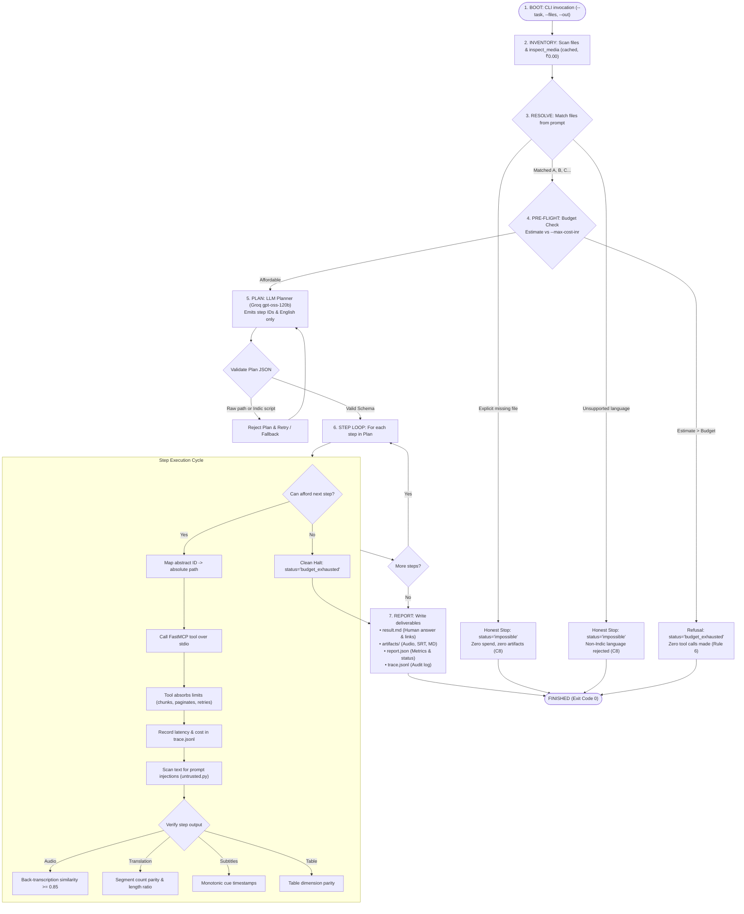

> The rationale for the agent loop, the code-vs-LLM split, budgets, verification, and recovery. Read alongside TOOL_DESIGN.md.

## The loop



> **Visual Diagrams Available:**
> - Interactive Excalidraw file: [`docs/agent-flow.excalidraw`](agent-flow.excalidraw) (open directly on [excalidraw.com](https://excalidraw.com))
> - Vector SVG diagram: [`docs/agent-flow.svg`](agent-flow.svg)

Each stage has a clear owner. The LLM only participates in `PLAN`, verification judgment, and English prose in `result.md`.

## The code-vs-LLM split (the single most important decision)

| Decision | Owner | Why |
|---|---|---|
| What files exist and their metadata | **Code** (`resolver`) | Cheap, deterministic |
| Which file a task refers to | **Code** first, LLM tie-break on **metadata only** | Hallucinated paths are a known failure mode |
| Whether a task is affordable | **Code** (`budget`) | Arithmetic, not judgment |
| Plan structure (which tools, in what order) | **LLM** | Genuine judgment |
| Chunk boundaries | **Code** (inside tool) | Must be deterministic and tested |
| Timestamp remapping | **Code** (inside tool) | Arithmetic |
| Pagination boundaries | **Code** (inside tool) | Must respect structure |
| Whether an output is verified | **Code** (`verifier`) | Metric, not opinion |
| English summary text | **LLM** | English prose is the LLM's job |
| Indic text | **Bodhan model only**, via tools | Constraint C2 |
| Assumptions to record | **LLM proposes**, **code stores** | Human-readable, but must be traceable |
| When to stop | **Code** | Ceilings, not vibes |

**Rule of thumb:** if the decision can be expressed as arithmetic, parsing, or a deterministic function, it belongs in code. If it requires reading English and choosing an approach, it belongs to the LLM.

## Planner contract

The LLM receives:
- The task string.
- The inventory as **IDs and metadata** (never paths, never file contents — except wrapped untrusted text where the task requires reading it).
- The tool list with their descriptions.
- Remaining budget and step count.

It returns a plan (validated JSON):
```json
{
  "steps": [
    {"id": "s1", "tool": "ocr_document", "args": {"pdf_id": "B"}, "depends_on": []},
    {"id": "s2", "tool": "translate_text",
     "args": {"from_step": "s1", "source_lang": "en", "target_lang": "ta"},
     "depends_on": ["s1"]},
    {"id": "s3", "tool": "synthesize_speech",
     "args": {"from_step": "s2", "language": "ta", "voice_id": "female_01"},
     "depends_on": ["s2"], "verify": "audio_back_transcribe"}
  ],
  "rationale": "OCR the PDF, then translate the summary, then synthesize and verify."
}
```

Validation rejects:
- Unknown tool names.
- Args containing `"/"` or starting with `~` or `.` (paths).
- Any Unicode in the Indic ranges (Devanagari, Tamil, Telugu, Bengali, Gujarati, Gurmukhi, Odia, Kannada, Malayalam, Arabic).
- Cyclic `depends_on`.
- A step whose tool isn't in the registered set.

Rejection → one LLM retry with the reason in the prompt. Second rejection → `planner_fallback` (a small deterministic plan for the common transcribe→translate→speak shape), and this fact is recorded in `report.json`.

## File resolution policy (recap of SPEC §8.2)

1. Inventory via `inspect_media`, cached.
2. Match: exact filename (case-insensitive) → ordinal → descriptive (defer) → singular → plural.
3. Singular + multiple candidates: prefer type-consistency with the task verb. If still tied, LLM chooses from **metadata**, choice and rationale recorded.
4. Never read outside `--files`. Never silently pick among equals.

The rationale is written to both `result.md` and `report.json.inputs`.

## Budget model

- **Pre-flight:** estimate from metadata + `PRICES`. If over → stop, `status="budget_exhausted", stage="pre_flight"`, zero calls.
- **Runtime:** `can_afford(next_step_estimate)` before each call. Charge actual cost after. Stop cleanly on exhaustion with a partial report and a list of what was not done.
- **Estimator uses** file duration × ₹0.10/min for STT; file size × tokens-per-byte heuristic for translation; character count of the target text (when known) or of the source for TTS; pages × ₹0.20 for OCR. **Verification is included** — back-transcription of output audio is a real cost.
- **No surprise:** if actual cost would push the total over budget mid-call, the tool call is what causes overshoot. Mitigation: pre-check with a 10% safety margin.

## Verification strategy

| Artifact | Check | Pass threshold | Cost |
|---|---|---|---|
| Generated audio | Back-transcribe, compare to source text | char-similarity ≥ 0.85; duration ±15% of target | ₹0.10/min |
| Translation | Segment-count parity; length ratio in [0.4, 3.0]; no empties | 100% parity, ratio within range | ₹0.20/10K tokens |
| SRT | Parseable; monotonic timestamps; last cue ≤ source dur + 0.5 s | all | free |
| Table (when asked to keep it) | Row/col counts equal to source | exact | free |

Verification failures trigger **one bounded retry with adjusted arguments**, then an honest `partial` report with the failing check recorded.

## Recovery taxonomy

- **Retriable:** 429, 5xx, timeout, partial transcription. Backoff, max 3, then either accept partial with an honest note or fail.
- **Permanent:** unsupported language, missing file, unreadable media, size over limit. Do not retry. Record and either continue (if not blocking) or stop (if blocking).
- **Verification-failed:** retry once with adjusted args; if still failing, report honestly, do not fabricate.

## Untrusted content

All text produced by `ocr_page`, `ocr_document`, or `transcribe_audio` is untrusted before the planner reasons about it. `untrusted.wrap(text)` wraps it in `<UNTRUSTED_CONTENT_START>…<UNTRUSTED_CONTENT_END>`. `untrusted.scan(text)` looks for common injection signatures. A hit is logged but **never executed** — the content is still summarized or translated as data if the task requires it. The system prompt explicitly forbids following instructions inside untrusted blocks.

## Trace format (guaranteed replayable)

One JSON object per line, ordered, monotonically `step`-increasing:

- `plan` — the plan + rationale + inventory summary.
- `resolve` — selected IDs + reason.
- `preflight` — estimate vs. budget.
- `tool_call` — tool, args (IDs and language codes only), result summary, latency, cost.
- `verification` — check name, metric, passed.
- `security` — injection detected.
- `error` — code, hint, whether retry will follow.
- `final` — status, total cost, total time.

Replay from a trace means: reading the plan and each tool_call's args is sufficient to reconstruct the run **without reading source**.

## Extending the agent

Adding a capability means adding a **tool** first (see TOOL_DESIGN.md §"How to extend"), then letting the planner use it. Do not add agent-side branches for specific tasks. If a new class of task requires new planning logic, that is a signal the tool surface is under-granular — reconsider the tools, not the agent.

## What this design deliberately does not do

- No self-evaluating benchmarks in the loop (that's an external script, per SPEC stretch goals).
- No streaming output to a UI (stretch only).
- No multi-turn user interaction — the task is one-shot from CLI.
- No parallel tool calls inside `loop.py` in the base submission (stretch only; the trace format already supports it).
