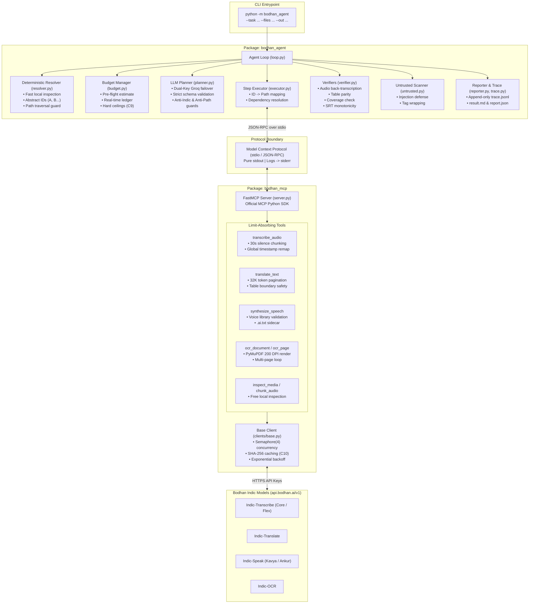

## Shape

Two runnable processes. Two packages in one repo. One contract that crosses between them: **MCP over stdio**, tool calls only.

> **Visual Diagrams Available:**
> - Interactive Excalidraw file: [`docs/architecture.excalidraw`](architecture.excalidraw) (open directly on [excalidraw.com](https://excalidraw.com))
> - Vector SVG diagram: [`docs/architecture.svg`](architecture.svg)

The **agent never imports tool code**; it calls tools over MCP. This is deliberate — it forces the tool surface to be usable by any third-party MCP client, which is exactly what the evaluation does.

The MCP server uses FastMCP from the official MCP Python SDK (`from mcp.server.fastmcp import FastMCP`), provided by `pyproject.toml`'s `mcp>=1.2` dependency. Do NOT use the standalone `fastmcp` PyPI package (2.0).

## Why this shape

**Tool design and agent design are graded as one dimension (30%) but tested separately.** The tool-level check runs your server against an off-the-shelf MCP client with scripted bad inputs, independent of your agent. A server that only works when your agent is driving it fails. Therefore the server must be:

- **Stateless**: no run state on disk or in memory beyond caches.
- **Self-describing**: every schema and description sufficient for an outside planner.
- **Crash-proof**: never raises through MCP; returns `ToolErrorPayload`.

**The agent is where judgment lives** — planning, sequencing, verification, recovery, honesty. It has access to the same tools as a third party would. If it can complete a task, the tools could too.

## Data flow per tool

| Tool | In | Internal | Out |
|---|---|---|---|
| `transcribe_audio` | path, optional lang hint | probe → if >30 s, split at pauses (≥250 ms, target 25 s, hard 30 s) → transcribe chunks → **remap timestamps to global** → join → cache | transcript, language, confidence, segments (global times), duration, cost |
| `translate_text` | text, src, tgt | token estimate vs 32K → split on structural boundaries (headings, blank lines, table rows), never inside a table, with overlap → sequential translate → reassemble | translated text, cost |
| `synthesize_speech` | text, lang, voice | validate lang+voice → char cap → call → stamp AI-generated sidecar | path, duration, chars, `ai_generated=True`, cost |
| `ocr_page` | image path | one image → Markdown (tables as pipes) | markdown, page, cost |
| `ocr_document` | pdf path | render pages at 200 DPI → loop `ocr_page` → assemble in order | markdown, pages, cost |
| `inspect_media` | path | ffprobe / PyMuPDF / mime | kind, duration/pages, format, size |
| `chunk_audio` | path | expose chunk helper | chunk paths + offsets |
| `get_voice_library` | — | return per-language voice list (also as MCP resource) | mapping |

## Contracts that cross boundaries

**Agent → Server (MCP):** tool name + typed args (Pydantic-validated). Args contain **paths and language codes**, never inline media, never Indic text invented by the LLM.

**Server → Models (HTTPS):** OpenAI-compatible. Retries and caching live in `clients/base.py`, invisible to the agent.

**Agent → Disk (`out/`):** `result.md`, `report.json`, `trace.jsonl`, `artifacts/`. Format is fixed by SPEC §9.

**LLM → Agent:** plan JSON with `{tool, args_by_id, depends_on, verify}`. Validated by `planner.py`; rejected if it contains paths or Indic Unicode.

## Key decisions and rationale

**D1. Two packages, MCP between them.** Enables independent tool grading. Prevents agent-side shortcuts (`import transcribe; transcribe(...)`) that would hide tool defects.

**D2. Tools absorb limits; agent does not.** Chunking, pagination, remapping, page loop, retries. Rationale: an LLM planning chunk boundaries is unreliable and expensive; code doing it is testable.

**D3. Model-level tools + helper tools, not one-tool-per-task.** The rubric warns both ways: one-tool-per-model pushes work onto the planner; very high-level tools hide control. The middle ground — `transcribe_audio`, `ocr_document`, `inspect_media`, `chunk_audio` — exposes decision points without requiring planners to reimplement plumbing.

**D4. Pre-flight budget estimate.** Estimate from metadata + published prices. Rationale: the only way to refuse a "10-minute podcast on ₹0.50" task without spending.

**D5. Verification is a first-class step.** Back-transcribe audio; check translation coverage; validate SRT; compare table shapes. Rationale: SPEC §2.5 requires it, and honest failure depends on knowing when output is wrong.

**D6. File resolution is code, LLM only breaks ties on metadata.** Rationale: hallucinated paths are a known LLM failure mode. Paths come from `resolver`, never from generated text.

**D7. Untrusted text is wrapped and scanned.** OCR and transcripts are data. System prompt forbids following instructions found inside. Detection logged, never executed.

**D8. Structured errors, never raised exceptions across MCP.** A third-party client must be able to read `{code, message, hint, details}` and retry with corrected arguments.

**D9. Cache keyed on `(model, sha256(input))`.** Satisfies "same input never sent twice per run" without the agent thinking about it.

## Failure modes and how they're handled

| Failure | Detected by | Response |
|---|---|---|
| Rate-limited upstream | `clients/base.py` on 429 | Backoff + jitter, max 3, bounded |
| Timeout | `clients/base.py` per-call timeout | Retry, then `UPSTREAM_TIMEOUT` |
| Missing file | tool input validation | `FILE_NOT_FOUND`, no retry |
| Unreadable media | ffprobe / PDF open | `UNREADABLE_MEDIA`, no retry |
| Unsupported language | tool validation vs `SUPPORTED_LANGS` | `UNSUPPORTED_LANGUAGE`, no spend |
| Over-context translation | token estimate before call | `INPUT_TOO_LONG` with size + suggestion |
| TTS char cap exceeded | pre-call count | `INPUT_TOO_LONG` with cost estimate |
| Budget exhausted mid-run | `budget.can_afford` before step | Clean stop, `budget_exhausted`, partial report |
| Injection in OCR text | `untrusted.scan` | Logged, not executed; content still summarized as data |
| Planner emits path or Indic | `planner` validation | Reject, retry once, then `planner_fallback` |
| Verifier finds mismatch | Similarity / coverage threshold | One bounded retry with adjusted args; then honest report |

## How to extend (add a new tool)

1. Add schemas to `schemas.py` (In/Out) and any new codes to `errors.py`.
2. Implement in `tools/<name>.py`, absorbing any limits internally.
3. Register in `server.py`. Write a planner-facing description: what it does, what it does **not**, limits, error codes.
4. Unit test in `tests/test_<name>.py`, including bad inputs → structured errors.
5. Update this file's *Data flow per tool* table.
6. Confirm MCP Inspector can drive it standalone.

## How to verify the architecture is intact

Run these three checks before any PR:

- `grep -rn "import bodhan_mcp" src/bodhan_agent/` — only `__init__.py` (or empty) should appear; the agent talks to the server via MCP, not imports.
- `grep -rn "print(" src/bodhan_mcp/` — must be empty.
- `grep -rnE "(whisper|tesseract|indic-trans|indicTrans2|deepl|google.cloud)" src/` — must be empty.
