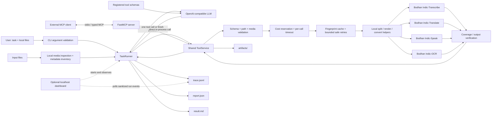
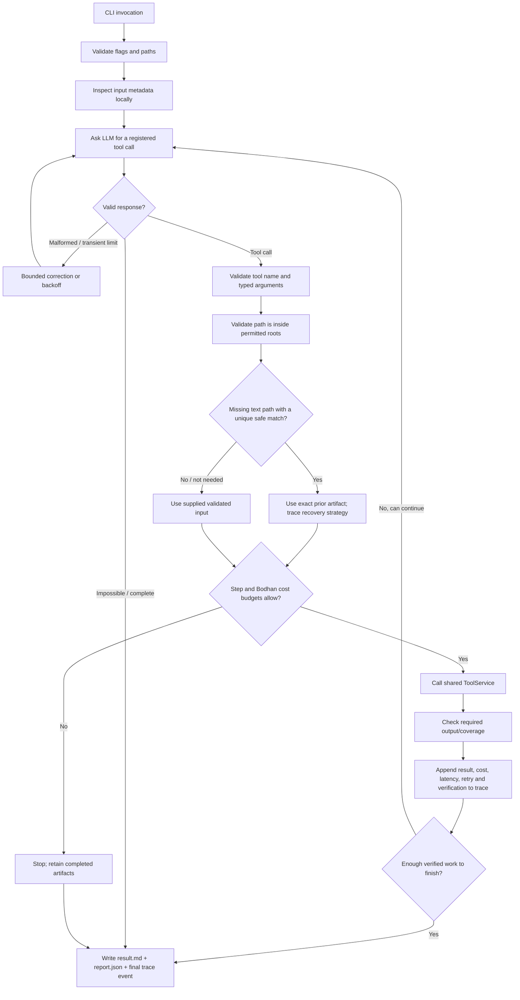

# Bodhan Tool Server and Task Agent: Demo Video Guide

This guide is a recording plan for the assignment's public demo video (five
minutes maximum). It describes the implementation in this repository and gives
a truthful, repeatable script using the available demo inputs.

The recommended video demonstrates three completed runs: Hindi transcription,
worksheet OCR plus Marathi translation, and an intentionally impossible French
video-dubbing request. The last case must visibly end without fabricated audio.
All input media are local and git-ignored; use them in a public recording only
if you have permission to process and show their contents.

## What this implementation is

The repository contains:

- `bodhan_agent`: a non-interactive CLI task agent. It takes a natural-language
  `--task`, a file or directory through `--files`, an output directory, and
  step/cost budgets.
- `bodhan_mcp`: an independent MCP server over stdio. Third-party MCP clients
  can discover and invoke the same model tools without starting the task agent.
- `ToolService`: shared implementation of the five registered tools. The agent
  calls it in-process; the MCP server exposes it through MCP.
- An optional localhost dashboard for starting runs and inspecting sanitized
  traces. The video can use the CLI alone.
- A deterministic 11-scenario orchestration simulation. It makes no live
  Bodhan or planner calls and is not evidence of translation quality.

Text-only evidence from the retained live runs is indexed in
[`demo-results/README.md`](./demo-results/README.md). Input media and generated
audio remain excluded from this public recipe; prepare authorized local inputs
before attempting a fresh recording.

## Architecture



### Component responsibilities

| Component | Responsibility |
|---|---|
| CLI | Checks required flags, input/output paths, and positive step/cost limits; loads environment configuration; starts one run. |
| `TaskRunner` | Inspects inputs, sends the task plus metadata-only inventory to the planner, validates tool calls, applies path recovery only when unambiguous, enforces the step limit, records trace events, and writes final status and report. |
| OpenAI-compatible planner | Interprets intent, chooses one registered tool call at a time, decides when to finish, and may write English summaries/explanations. It does not do OCR, ASR, Indic translation, or TTS. |
| `ToolService` | Enforces model contracts, file roots, limits, retries, cost reservations, same-run caching, artifact writes, and tool-specific verification. |
| Media helpers | Inspect formats/durations/pages, split audio, render PDF pages, convert supported images, split text, and join generated WAV chunks locally. |
| Bodhan APIs | Perform all speech-to-text, translation, speech synthesis, and OCR model operations. |
| MCP server | Runs independently over stdio; advertises typed, documented schemas and maps both successes and `ToolError`s into structured MCP results. |
| Output writer | Preserves artifacts and writes `result.md`, `report.json`, and append-only `trace.jsonl` for each run. |
| Dashboard (optional) | Binds to localhost and displays task progress, sanitized tool events, verification, budgets, and artifacts. It does not expose provider keys to the browser. |

### Implementation map

| Area | Source |
|---|---|
| CLI flags, input checks, exit codes | [`src/bodhan_agent/cli.py`](./src/bodhan_agent/cli.py) |
| Planner loop, schemas, recovery, tracing, result/report writing | [`src/bodhan_agent/runner.py`](./src/bodhan_agent/runner.py) |
| Shared Bodhan service, cost accounting, cache, model requests, verifiers | [`src/bodhan_mcp/tools.py`](./src/bodhan_mcp/tools.py) |
| MCP schemas, structured results, stdio startup | [`src/bodhan_mcp/server.py`](./src/bodhan_mcp/server.py) |
| File-root validation, media inspection, audio/PDF/text chunk helpers | [`src/bodhan_mcp/media.py`](./src/bodhan_mcp/media.py) |
| Environment settings, timeouts, retries, cost ledger | [`src/bodhan_mcp/config.py`](./src/bodhan_mcp/config.py) |
| Structured tool errors | [`src/bodhan_mcp/errors.py`](./src/bodhan_mcp/errors.py) |
| Agent, tool, MCP, and dashboard regressions | [`tests/`](./tests/) |

### Trust and data boundaries

- The planner receives the task, tool schemas, and a metadata-only inventory
  (file name/type/size/inspection); it does not receive raw audio, video, or
  image data.
- Bodhan receives media only through the relevant tool. OCR image bytes are
  encoded as a data URI because that is the Bodhan API contract; those bytes
  are not put into the planner prompt.
- Text extracted by OCR or transcription is data, not instructions. The agent
  tells the planner not to obey instructions found in file content.
- Indic-language text passed from one tool to another uses the exact local
  artifact path. The LLM may write English summaries/explanations, but it must
  not write or rewrite Indian-language text.
- `.env`, `keys.txt`, provider credentials, raw media, and full planner prompts
  must not be shown in a public recording or committed to the repository.

## Agent workflow



### Run lifecycle, in detail

1. **Validate the invocation.** `python -m bodhan_agent` and
   `python -m bodhan_agent run` accept `--task`, `--files`, `--out`,
   `--max-steps`, and `--max-cost-inr`. Invalid/missing input paths, empty task
   text, invalid budgets, and unsafe output locations fail before task
   execution.
2. **Claim a fresh output directory.** A run does not overwrite existing
   `result.md`, `report.json`, `trace.jsonl`, or non-empty artifacts. Choose a
   unique output directory for each command.
3. **Inspect locally.** Files are checked for supported media, valid content,
   duration/page count, and basic metadata. The inventory excludes credential
   files and does not include media content.
4. **Plan.** The LLM receives the task, metadata inventory, tool schemas,
   output location, and budgets. It can select a registered tool or
   `finish_task`; `parallel_tool_calls` is disabled.
5. **Validate and execute.** Tool name and arguments are checked against typed
   schemas. Paths are resolved and confined to permitted roots. The call
   reserves an estimated Bodhan cost before the paid request.
6. **Verify.** Each tool performs its applicable checks. A successful HTTP
   response alone is not sufficient for mandatory verification.
7. **Continue or stop.** The LLM receives a bounded tool result and chooses the
   next action. Repeated errors, exhausted budgets, a user stop request, or an
   irrecoverable provider error stop the loop; completed artifacts are kept.
8. **Finalize.** The runner writes a human-readable result, machine-readable
   report, and final trace event. If mandatory checks fail, a proposed
   `completed` status is downgraded to `partial`.

## Registered tools and model-specific handling

| Tool | Bodhan model | What the tool does | Important limitation/check |
|---|---|---|---|
| `transcribe_audio` | Indic-Transcribe | Validates WAV/FLAC/OGG/MP3, measures duration, splits longer inputs into ordered windows no longer than 30 seconds, joins text, saves a transcript artifact. | Bodhan does not return timestamps. The compatibility `include_segments` flag does not make an SRT or invent timing. Script-based language detection is heuristic and may only say “probable.” |
| `translate_text` | Indic-Translate | Accepts exactly one inline text value or text-file path, splits long text into ordered chunks (2,500-character internal chunk target), assembles output, saves a translation artifact. | Requires non-empty output for each chunk and reports chunk coverage. Coverage does not establish semantic accuracy. Indic text should be supplied through a local artifact path, not written by the LLM. |
| `translate_subtitles` | Indic-Translate | Parses a user-provided valid SRT, translates each caption, then writes a new SRT with the original cue numbers/time ranges. | It does not infer timestamps from a plain transcript. Translation is per segment. |
| `generate_speech` | Indic-Speak | Checks language/voice/style, divides text into short chunks (280-character internal target), synthesizes audio, joins chunks into WAV, and optionally converts to MP3 locally. | The output is labeled AI-generated. It is back-transcribed with Indic-Transcribe and checked for token coverage, sequence similarity, and length ratio. This is a consistency check, not a pronunciation or semantic guarantee. |
| `ocr_document` | Indic-OCR | Handles PDF, PNG, JPEG, and WebP. PDFs render locally and are sent page-by-page; WebP converts locally. Saves ordered OCR text. | Checks expected page count, order, duplicates, and empty pages. Table layout is preserved only as far as the model returns it. |

The MCP server exposes structured outputs with `ok`, tool name, typed data,
estimated cost, unavailable-or-reported actual cost, latency, warnings, and a
structured error when a call fails.

## Budgets, caching, retries, and recovery

### Cost and step limits

- The CLI defaults to at most 30 tool calls and ₹20 estimated Bodhan spend;
  pass tighter per-run values explicitly.
- Bodhan cost estimates use the assignment rates: transcription per input
  minute, translation per output-token count when available, speech per input
  character, and OCR per page.
- Each paid Bodhan request reserves an estimate before sending. If the next
  request would exceed the budget, it is not sent.
- Provider actual billing and LLM charges are unavailable in reports. Never
  describe an estimate as actual spend or imply the Bodhan budget includes the
  planner provider's bill.
- Successful same-input/model/option requests are fingerprint-cached within a
  run. A cache hit avoids a duplicate Bodhan submission and incremental cost.
- Model operations in one `ToolService` are serialized. Do not claim
  parallel-call execution.

### Retry policy and safe failure

| Condition | Behavior |
|---|---|
| Missing, empty, unsupported, corrupt, or out-of-root input | Return an actionable structured tool error; do not call Bodhan. Credential/config files are blocked as inputs. |
| Missing Bodhan key or authentication failure | Return an explicit error. Do not silently substitute another model/provider. |
| Connect error/connection-pool timeout before send | Retry within the configured bounded retry count (default at most two retries). |
| Bodhan HTTP 429 | Honor `Retry-After` when usable; otherwise bounded backoff. Retries are capped. |
| Read/write timeout, post-send connection failure, or server error with uncertain paid outcome | Do not automatically resend. Report an unknown outcome and conservatively account for the reserved cost to avoid duplicate charges. |
| LLM malformed tool call / transient 429 | A small bounded number of correction/backoff retries; Groq pacing can use configured/request-reported limits. Daily exhaustion stops rather than loops forever. |
| Tool schema/path error | Return structured error to planner. Do not execute an unregistered tool or guess at ambiguous files. Repeated identical failures stop the run. |
| Ambiguous prior artifact | Do not select one arbitrarily. Recovery occurs only when a unique safe candidate exists. |
| Step/cost budget exhausted | Stop cleanly, preserve completed artifacts, and mark the run partial rather than fabricate completion. |

The transcript-to-translation recovery added for Task 4 is deliberately
constrained: if the planner supplies a missing/unresolvable translation path,
the runner can select a unique successful transcript only when its detected
script is probable, differs from the translation target, and the task
explicitly names that script. It records an `input_path_recovered` trace event
with strategy `sole_language_transcript`. If more than one candidate matches,
it does not guess. The retained Task 4 trace exercises this recovery; it took
276.554 seconds, so it is not recommended as a live segment in a five-minute
video.

## Trace and output contract

Each run directory has this shape:

```text
<run-output>/
  result.md       # task, status, final answer, assumptions, artifacts, warnings
  report.json     # status, timing, steps, estimated costs, checks, errors
  trace.jsonl     # append-only plan/tool/result/retry/verification events
  artifacts/      # transcript, OCR, translation, speech, or subtitle files
```

Useful trace events include `plan_requested`, `plan_decision`, `tool_call`,
`tool_result`, `llm_retry`, `llm_error`, `input_path_recovered`, `stop`,
`task_finalized`, and `run_finished`. Each line is a separate JSON object.
Results record tool success/failure, latency, estimated cost, provider
submissions, cache hits, and bounded verification/error summaries. The trace
does not intentionally store API keys, raw media, or the full hidden planner
prompt. Review the actual trace before sharing it because it can still contain
task metadata and paths.

Status meanings:

- `completed`: the agent says the requested work is done and required
  verification did not fail.
- `partial`: some work/artifacts exist, but the task could not be completed or
  mandatory verification failed.
- `impossible`: the agent explicitly determines the requested operation is
  unsupported; no fabricated artifact should be present.
- `needs_user_input`: the task cannot safely continue without missing
  information.
- `failed`: setup/planning/tool execution failed before a useful completion.

The report includes separate Bodhan and LLM request counts. The LLM request
count is not an LLM cost. `actual_cost_inr` and `llm_cost_inr` remain null when
providers do not report billing.

## Recording plan (target: exactly 4:44)

The historical runtimes for the chosen runs were approximately 50 seconds
(Task 2), 52 seconds (Task 3), and 41 seconds (Task 6), a total of about
2 minutes 24 seconds before navigation and narration. Their combined recorded
Bodhan estimate was about INR 0.24678. The exact 4:44 cut uses separate
ceilings: INR 1 each for Tasks 2 and 3, and INR 0.01 for Task 6; they are not
one shared budget. Fresh runs vary and may take longer under rate limits.
Label any edit through provider wait with the full elapsed time from the
report. Do not accelerate a trace or imply a shorter real runtime.

| Video time | Segment | What must be visible |
|---|---|---|
| 0:00–0:18 | Intro | Title and the three demonstrated tasks. |
| 0:18–0:48 | Architecture | CLI → planner → validated shared service → Bodhan → verified artifacts; independent MCP stdio path. |
| 0:48–1:32 | Task 2 | Hindi transcription, MP3 caveat, transcript artifact and report. |
| 1:32–2:20 | Task 3 | OCR followed by Marathi translation; artifacts and coverage checks. |
| 2:20–3:03 | Task 6 | Unsupported request; `impossible`, no Bodhan tool calls, no fabricated media. |
| 3:03–3:43 | MCP proof | Standalone stdio server test, tool discovery, structured missing-file error. |
| 3:43–4:22 | Reliability | Selected trace/report fields, cost/step budgets, bounded retries and known limits. |
| 4:22–4:44 | Close | Recap, quality/cost caveats, final title card. |

The exact script is in
[`DEMO_VIDEO_SCRIPT_4M44.md`](./DEMO_VIDEO_SCRIPT_4M44.md). Keep title cards,
transitions, and credits inside the 4:44 export. If a fresh run is delayed by
rate limits, do not hide the failure or misstate the runtime.

## Pre-recording checklist

1. Confirm you have permission to process and publicly show the chosen media
   and any extracted text. If not, do not put those inputs or outputs on screen.
2. Ensure Python 3.11–3.13 and the dependencies are ready. The repository's
   `imageio-ffmpeg` package supplies FFmpeg for compressed-audio splitting.
   Typical setup from a clean checkout:

   ```powershell
   python -m venv .venv
   .\.venv\Scripts\Activate.ps1
   python -m pip install -e ".[dev]"
   Copy-Item .env.example .env
   ```

   Configure `.env` privately. Never open or print `.env`, `keys.txt`, or shell
   variables containing keys while recording.
3. Confirm the three source inputs exist:
   - `demo-inputs\hindi_audio.mp3`
   - `demo-inputs\worksheet.webp`
   - `demo-inputs\video.mp4`
4. Close unrelated windows, email, chats, credential managers, and browser
   tabs. Use a readable terminal font and a clean desktop.
5. Create fresh timestamped output folders. The agent intentionally refuses to
   overwrite existing run outputs.
6. Use task-specific cost ceilings. The exact script uses ₹1 for Tasks 2 and
   3 and ₹0.01 for Task 6; prior estimates were below these ceilings, but
   actual estimates may differ. LLM charges are separate.
7. Do not play the source audio/video in the recording unless licensed and
   necessary. Showing the input file name and output artifact is sufficient.
8. Verify that every shown result comes from the just-completed command or is
   clearly labeled as a previously retained run.

### Prepare a fresh output root

In PowerShell from the repository root:

```powershell
New-Item -ItemType Directory -Force .\out | Out-Null
$stamp = Get-Date -Format 'yyyyMMdd-HHmmss'
$videoOut = Join-Path (Resolve-Path .\out).Path "video-$stamp"
New-Item -ItemType Directory -Path $videoOut | Out-Null
Write-Host "Video run outputs: $videoOut"
```

Do not show secrets while checking credentials. The app loads `.env` from the
current working directory; a missing credential is reported explicitly and
should be fixed before recording rather than hidden in the edit.

## Exact command script

Use the venv interpreter so the recording runs the tested environment. Run
each command separately, capture its exit code, and wait for its final status.

### Task 2 — transcribe the available Hindi clip

The assignment example asks for a Hindi WAV, but this retained demo input is
`hindi_audio.mp3`. Say that clearly; do not call it a WAV.

```powershell
& .\.venv\Scripts\python.exe -m bodhan_agent `
  --task "Transcribe this Hindi audio and save a plain transcript. Do not create SRT timestamps." `
  --files .\demo-inputs\hindi_audio.mp3 `
  --out (Join-Path $videoOut 'task-02') `
  --max-steps 30 `
  --max-cost-inr 1
$task2Exit = $LASTEXITCODE
Write-Host "Task 2 CLI exit code: $task2Exit"
```

Expected result: `completed` with a transcript artifact and one transcription
operation. The previous retained run took 50.106 seconds and estimated
₹0.03296 Bodhan cost. It did not produce timestamps; do not call the transcript
an SRT.

### Task 3 — OCR a worksheet and translate it to Marathi

```powershell
& .\.venv\Scripts\python.exe -m bodhan_agent `
  --task "OCR this worksheet photo, then translate the extracted text into Marathi. Preserve any table structure present in the OCR output; do not invent missing cells." `
  --files .\demo-inputs\worksheet.webp `
  --out (Join-Path $videoOut 'task-03') `
  --max-steps 30 `
  --max-cost-inr 1
$task3Exit = $LASTEXITCODE
Write-Host "Task 3 CLI exit code: $task3Exit"
```

Expected result: `completed` with an OCR text artifact followed by a Marathi
translation artifact. The previous retained run took 52.190 seconds and
estimated ₹0.21382 Bodhan cost. Show the actual output briefly. OCR's page and
translation chunk checks establish coverage, not that every table cell or
translation is perfect.

### Task 6 — request unsupported French video dubbing

```powershell
& .\.venv\Scripts\python.exe -m bodhan_agent `
  --task "Translate this video into French and dub it. Return a French video." `
  --files .\demo-inputs\video.mp4 `
  --out (Join-Path $videoOut 'task-06') `
  --max-steps 30 `
  --max-cost-inr 1
$task6Exit = $LASTEXITCODE
Write-Host "Task 6 CLI exit code: $task6Exit"
```

Expected result: `impossible` (CLI exit code `4`), zero Bodhan tool
submissions, and no fabricated audio/video artifact. The planner still makes
LLM requests, so do not claim the run has zero total API calls or zero LLM
charges. The previous retained run took 41.481 seconds and estimated zero
Bodhan cost.

## Safe result review commands

Display only summary metadata and artifact names in the public video. Avoid
printing sensitive transcript/OCR text unless you have permission to show it.

```powershell
foreach ($taskName in @('task-02', 'task-03', 'task-06')) {
  $runPath = Join-Path $videoOut $taskName
  $report = Get-Content (Join-Path $runPath 'report.json') -Raw | ConvertFrom-Json
  [pscustomobject]@{
    Task = $taskName
    Status = $report.status
    DurationSeconds = $report.duration_seconds
    EstimatedBodhanINR = $report.estimated_cost_inr
    BodhanSubmissions = $report.bodhan_provider_submission_count
    LLMRequests = $report.llm_request_count
    Verification = (($report.verification | ForEach-Object {
      "$($_.tool):$($_.name)=$($_.status)"
    }) -join '; ')
    Artifacts = ($report.artifacts -join '; ')
  } | Format-List
}
```

To show only selected trace event metadata (not the full line):

```powershell
$tracePath = Join-Path $videoOut 'task-03\trace.jsonl'
Get-Content $tracePath |
  ForEach-Object { $_ | ConvertFrom-Json } |
  Where-Object { $_.event -in @('plan_decision', 'tool_result', 'run_finished') } |
  Select-Object timestamp, event, tool, ok, estimated_cost_inr, latency_ms, reason |
  Format-Table -AutoSize
```

`result.md` lists artifacts and warnings. `report.json` gives the authoritative
machine-readable status and run metrics. `trace.jsonl` gives the sequence of
decisions and tool outcomes. Use these rather than claiming success from the
terminal command alone.

## Timed narration script

Use the dedicated [exact 4:44 script](./DEMO_VIDEO_SCRIPT_4M44.md) for all
timecodes, on-screen directions, narration, and the final cut. It supersedes
the earlier approximate draft. Check each displayed status and metric against
the run's actual `report.json` before recording.

## Common recording failures and recovery

| What you see | Likely cause | What to do before continuing |
|---|---|---|
| CLI exits `2` before starting | Bad flags, missing path, invalid output path, or missing LLM configuration. | Fix the command/configuration off-camera; start with a fresh output directory. Never show `.env`. |
| `missing_api_key` or `authentication_failed` | Bodhan key absent/invalid for the selected model. | Stop recording, check local configuration privately, then rerun into a new output directory. |
| `invalid_path` / `missing_input` | Typo or path outside permitted input/output roots. | Use the exact local path under `demo-inputs`; do not move the run output into the input directory. |
| HTTP `429` or long LLM wait | Provider quota/rate limit. | Let bounded retry finish if the recorded time permits. If not, stop the take and schedule another; do not conceal provider waits or claim completion. |
| `partial` result | A later tool failed, budget/steps ended, or required verification did not pass. | Show it honestly as partial, or fix the actual cause and rerun into a new directory. Never edit the report to make it look complete. |
| `output_directory_not_empty` | The chosen run folder already has output. | Generate a new timestamped root and rerun. Do not delete an existing result just to reuse its path. |
| Task 6 creates audio or reports completed | The run did not behave as the expected unsupported case. | Do not label it an impossible-task demonstration. Inspect the trace and task wording first. |

## Claims to avoid

- Do not say the planner never sees any text: it can see task text and bounded
  tool results; the promise is that raw media and full file contents are not
  sent as an input inventory.
- Do not say speech back-transcription proves pronunciation or semantic
  quality. It is a consistency check.
- Do not call script detection definitive language identification.
- Do not call a generated translation “verified correct” based only on chunk
  coverage.
- Do not call reported Bodhan estimates actual billing, and do not claim the
  Bodhan budget caps LLM-provider fees.
- Do not claim zero cost for an impossible task overall; only the retained
  Task 6 run had zero Bodhan submissions/estimated Bodhan cost, while LLM
  requests were made.
- Do not imply the six demo tasks all passed. Task 1 and Task 4 summaries are
  truncated; Task 2 used MP3 rather than the prompt's WAV; semantic quality
  was not independently verified.
- Do not claim the Task 4 recovery is instant: its latest retained run took
  276.554 seconds and is better covered by the result evidence than a live
  five-minute demonstration.

## Final publishing checklist

- [ ] Recording is at most five minutes and includes multiple tasks and the
      impossible case.
- [ ] The actual CLI command and final result are shown for each live task.
- [ ] Edits through provider waits are transparent; report runtimes remain
      visible or are stated.
- [ ] No keys, `.env`, private input content, or unauthorized media/text appear.
- [ ] Unsupported French dubbing has an honest explanation and no fake output.
- [ ] README and PR description use accessible, approved result links.
- [ ] The final video is hosted at a public URL and linked from the README and
      PR description.
- [ ] Any stated test/result values match current reports and were not altered.
