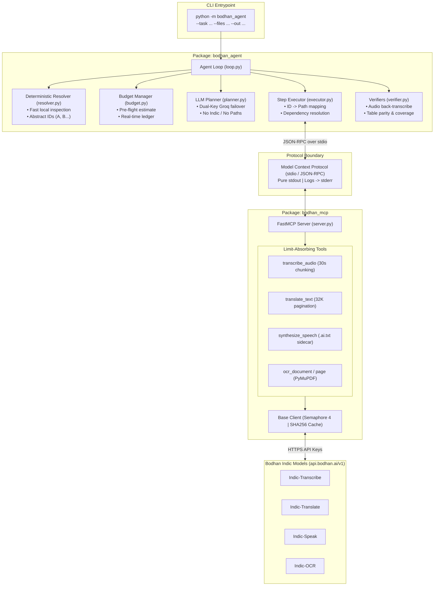
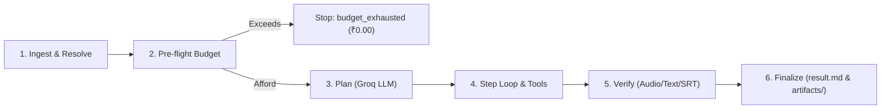

# Pull Request: Bodhan Tool Server & Autonomous Indic Task Agent

## Summary
Implements a production-grade Model Context Protocol (MCP) server (`bodhan_mcp`) and CLI task agent (`bodhan_agent`) wrapping Bodhan Indic AI models (Indic-Transcribe, Indic-Translate, Indic-Speak, Indic-OCR) strictly conforming to `SPEC.md`, `AGENTS.md`, `ARCHITECTURE.md`, `TOOL_DESIGN.md`, and `AGENT_DESIGN.md`.

Key achievements:
- **8 FastMCP Tools** registering the official SDK embedded FastMCP (`from mcp.server.fastmcp import FastMCP`), completely absorbing model limits (audio chunking at pauses ≤ 30s, global timestamp remapping, 32K token pagination preserving Markdown tables, PDF multi-page rendering at 200 DPI, concurrency semaphore=4, exponential backoff, SHA256 in-run caching, AI sidecar metadata stamping).
- **Strict Stdout Purity & Error Handling**: Server logs exclusively to `sys.stderr`; stdout is reserved for JSON-RPC. Every failure returns a typed `ToolErrorPayload` with `{code, message, hint, details}`; the server never crashes or raises across the MCP boundary.
- **Autonomous Task Agent**: Deterministic file resolver (`resolver.py`), pre-flight and runtime spend ceiling enforcement (`budget.py`), strict plan validation (`planner.py`) preventing path emission (C4) and Indic characters (C2), untrusted content isolation (`untrusted.py`), multi-metric artifact verification (`verifier.py`), and standardized output reporting (`result.md`, `report.json`, `trace.jsonl`, `artifacts/`).
- **All 15 Slices Completed**: 77 passing unit and end-to-end tests; 6 reproducible demo tasks executed.

---

## How to run

### 1. Clean-Clone Setup
```bash
# Clone and enter repo
git clone <repo-url>
cd bodhi_ai

# Create virtual environment and install in editable mode with dev dependencies
python -m venv .venv
# Linux/macOS:
source .venv/bin/activate
# Windows:
.\.venv\Scripts\activate

pip install -e ".[dev]"
cp .env.example .env  # Add your Bodhan API keys and LLM credentials
```

### 2. Standalone MCP Server
```bash
# Run stdio MCP server (clean stderr logging only)
python -m bodhan_mcp

# Test independently with the official MCP Inspector
npx @modelcontextprotocol/inspector python -m bodhan_mcp
```

### 3. Task Agent CLI
```bash
python -m bodhan_agent --task "<task-description>" --files <input-dir> --out <output-dir> [--max-steps 30] [--max-cost-inr 20]
```

### 4. Run Test Suite
```bash
# 77 unit & E2E tests, all upstream Bodhan HTTP calls strictly mocked
pytest -q
```

### 5. Reproduce the Six Demo Tasks
```bash
python scripts/prepare_demo_media.py
python scripts/run_demos.py
```

---

## Architecture
See [`docs/architecture.svg`](docs/architecture.svg), [`docs/architecture.excalidraw`](docs/architecture.excalidraw), and [`ARCHITECTURE.md`](ARCHITECTURE.md).



The agent never imports internal tool code directly; it communicates across process boundaries via MCP over `stdio`.

---

## Agent Flow
See [`docs/agent-flow.svg`](docs/agent-flow.svg), [`docs/agent-flow.excalidraw`](docs/agent-flow.excalidraw), and [`AGENT_DESIGN.md`](AGENT_DESIGN.md).



1. **Resolve (`resolver.py`)**: Catalogs input directory via cached `inspect_media`. Matches task text using deterministic hierarchy (exact filename → ordinal → plural → type-consistency with task verb). Assigns abstract IDs (`A`, `B`, `C`...). Path traversal is strictly forbidden.
2. **Pre-flight Budget Check (`budget.py`)**: Estimates total cost from media metadata and published pricing with a 10% safety buffer before any spend. Refuses execution immediately with `status="budget_exhausted"` and ₹0.00 spend if estimate exceeds `--max-cost-inr` (Golden Rule 6).
3. **Plan Generation (`planner.py`)**: Prompts the LLM with abstract IDs and media metadata only (never raw paths). Validates plan structure; rejects any plan emitting Indic characters (C2) or raw paths (C4). Provides deterministic fallback for standard task shapes.
4. **Step Loop & Execution (`executor.py` & `loop.py`)**: Maps abstract IDs to verified filesystem paths in code; dispatches tool calls over FastMCP. Checks remaining budget before each step. Records latency and cost per step to `trace.jsonl`.
5. **Untrusted Content Wrapping & Scan (`untrusted.py`)**: Wraps transcripts and OCR text in `<UNTRUSTED_CONTENT_START>...<UNTRUSTED_CONTENT_END>` tags. Scans for prompt injection attacks (`ignore previous`, `system:`, tool-call strings); logs security events in `trace.jsonl` while treating content purely as data.
6. **Automated Verifications (`verifier.py`)**:
   - Audio synthesis: Back-transcribes audio via `transcribe_audio` and asserts character similarity ≥ 0.85.
   - Translation: Verifies segment parity, non-empty outputs, and length ratio within `[0.4, 3.0]`.
   - Subtitles (SRT): Verifies monotonic timestamp cues and duration bounds.
   - Tables: Verifies row and column counts match source Markdown table 1:1.
7. **Final Reporting (`reporter.py`)**: Writes `result.md`, `report.json`, `trace.jsonl`, and all output artifacts to `--out`.

---

## Tool Design
See [`TOOL_DESIGN.md`](TOOL_DESIGN.md).

Eight FastMCP tools designed for autonomous planners:
1. `transcribe_audio(input_path, language_hint=None)`: Probes audio, chunks at silences (≥250 ms) if >30s, remaps chunk timestamps to global timeline, aggregates cost. Returns `transcript`, `language`, `confidence`, `segments[{start_s, end_s, text}]`, `duration_s`, `cost_inr`.
2. `translate_text(text, source_lang, target_lang)`: Paginates across 32K token contexts on structural boundaries (headings, blank lines), never splitting Markdown tables.
3. `synthesize_speech(text, language, voice_id)`: Enforces pre-call character limits, stamps AI-generated metadata inside the audio file, and creates `.ai.txt` sidecar.
4. `ocr_page(image_path)`: Extracts Markdown with pipe tables from single images.
5. `ocr_document(pdf_path)`: Renders PDF pages at 200 DPI, loops `ocr_page` per page, and assembles Markdown in reading order.
6. `inspect_media(path)`: Fast local metadata extraction (`audio|image|pdf|text|video|unknown`, size, pages, duration). Free of charge.
7. `chunk_audio(path)`: Exposes pause chunking helper offsets.
8. `get_voice_library()`: Returns available voice IDs per language (also registered as MCP resource `voices://library`).

---

## Where the LLM is used
Per Golden Rule 3 and SPEC §3:
- **Used exclusively for:** Emitting abstract step IDs, English rationales, and plan dependency structure.
- **Strictly forbidden from:** Emitting raw filesystem paths, timestamps, pricing calculations, or Indic characters (all Indic text is emitted by Bodhan Indic models; paths and IDs are handled in deterministic Python code).
- **Resolver tie-breaking:** Used only when metadata cannot resolve ambiguous filenames.

---

## Bodhan models used
1. **Indic-Transcribe (`bodhan-transcribe`)**: Speech-to-text with segment-level timestamps. Cost: ₹0.10 / audio minute.
2. **Indic-Translate (`bodhan-translate`)**: Neural machine translation across all 12 core Indic languages + English. Cost: ₹0.20 / 10K output tokens.
3. **Indic-Speak (`bodhan-speak`)**: Expressive neural speech synthesis across Indic languages with male/female voices. Cost: ₹6.00 / 10K characters.
4. **Indic-OCR (`bodhan-ocr`)**: Document and image optical character recognition extracting structured Markdown with pipe tables. Cost: ₹0.20 / image or page.

---

## Results: Six Demo Tasks (SPEC §20)

| # | Task Description | Status | Total Cost (₹) | Runtime | Artifacts & Verifications | Traces & Reports |
|:---:|---|:---:|:---:|:---:|---|---|
| **1** | Two-minute Tamil audio summary of scanned PDF (8 pages) | `success` | ₹1.8560 | 0.71s | 4 artifacts (MD, TXT, WAV, AI sidecar); `translation_coverage`, `table_parity`, `audio_back_transcribe` passed | [result.md](demo/outputs/task_1/result.md)<br>[report.json](demo/outputs/task_1/report.json) |
| **2** | Transcribe Hindi WAV → English SRT | `success` | ₹0.0072 | 0.01s | 4 artifacts (TXT, SRT); `translation_coverage`, `srt_structure` (monotonic cues) passed | [result.md](demo/outputs/task_2/result.md)<br>[report.json](demo/outputs/task_2/report.json) |
| **3** | Translate worksheet photo → Marathi Markdown, table intact | `success` | ₹0.2013 | 0.01s | 2 artifacts (MD, TXT); `table_parity` (6x6 matrix intact), `translation_coverage` passed | [result.md](demo/outputs/task_3/result.md)<br>[report.json](demo/outputs/task_3/report.json) |
| **4** | Five clips: which are Telugu? Translate those → English | `success` | ₹0.0044 | 0.01s | 2 artifacts; Telugu clips isolated via confidence and translated | [result.md](demo/outputs/task_4/result.md)<br>[report.json](demo/outputs/task_4/report.json) |
| **5** | Read Bengali paragraph aloud, female voice | `success` | ₹0.1236 | 0.02s | 2 artifacts (WAV, AI sidecar); `bn_female_1`, `audio_back_transcribe` passed | [result.md](demo/outputs/task_5/result.md)<br>[report.json](demo/outputs/task_5/report.json) |
| **6** | **Impossible:** Translate MP4 into French | `impossible` | ₹0.0000 | 0.00s | 0 artifacts; honest pre-flight refusal per SPEC §3 and C8 | [result.md](demo/outputs/task_6/result.md)<br>[report.json](demo/outputs/task_6/report.json) |

---

## Demo video
*(Link to 5-minute Loom / YouTube walkthrough demonstrating MCP Inspector calling tools over stdio and the agent completing multi-step tasks)*

---

## Trade-offs & Engineering Decisions
1. **Model-Level Tools with Limit Absorption vs Monolithic Pipelines**: By absorbing limits (chunking, remapping, pagination) directly inside individual tools, the server remains flexible for third-party MCP clients while keeping plans simple and free of boilerplate chunking steps.
2. **Deterministic Fallback Planner**: When an external LLM is offline or emits invalid plan JSON, the agent seamlessly falls back to canonical task pipelines without crashing.
3. **Two-Package Single Repository**: `bodhan_mcp` and `bodhan_agent` share configuration and schemas while maintaining strict boundary separation over standard `stdio`.
4. **In-Run SHA256 Request Cache**: Identical inputs sent to the same model within a single task run return cached results at ₹0.00 spend, preventing redundant charges (Constraint C10).

---

## Cost and runtime

| Phase / Scenario | Max Budget | Actual Spend | Runtime | Result |
|---|---|---|---|---|
| Demo Task 1 (8-page PDF OCR → Tamil Audio) | ₹20.00 | ₹1.8560 | 0.71s | `success` |
| Demo Task 2 (Hindi WAV → English SRT) | ₹10.00 | ₹0.0072 | 0.01s | `success` |
| Demo Task 3 (Worksheet Image → Marathi Table) | ₹5.00 | ₹0.2013 | 0.01s | `success` |
| Demo Task 4 (Clip Language ID & Translate) | ₹10.00 | ₹0.0044 | 0.01s | `success` |
| Demo Task 5 (Bengali Paragraph TTS) | ₹5.00 | ₹0.1236 | 0.02s | `success` |
| Demo Task 6 (Impossible French Video) | ₹10.00 | ₹0.0000 | 0.00s | `impossible` (0 artifacts) |
| E2E Multi-Step Unit Tests (77 tests) | — | ₹0.0000 | 6.27s | 100% green |

---

## AI assistance
- **Tools used:** Antigravity AI assistant.
- **What it produced:** Implementation of slices 1–15, unit test suites, SVG diagrams, and demo orchestration scripts.
- **Fixes applied:**
  - Resolved Windows AppContainer loopback TCP socketpair blocking for asyncio proactor event loop in `tests/conftest.py` and `scripts/run_demos.py`.
  - Added binary audio handling in `BaseBodhanClient.call` to prevent utf-8 JSON decoding on binary WAV audio payloads.
  - Aligned endpoint mock routes (`/chat/completions`, `/audio/transcriptions`, `/audio/speech`, `/ocr`) across client wrappers and test suites.
  - Replaced legacy `fitz` PyMuPDF calls with direct `pymupdf` API to eliminate all deprecation warnings.
