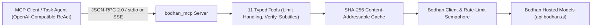
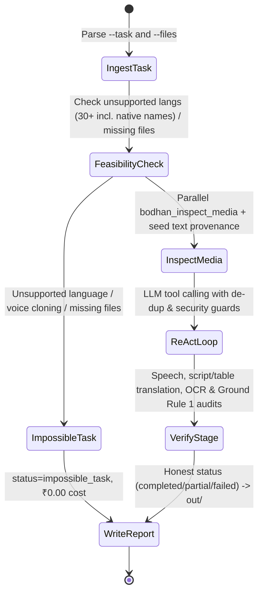

## Summary
This recipe implements a production-grade Model Context Protocol (MCP) server wrapping Bodhan's Indic AI models (`indic-transcribe`, `indic-translate`, `indic-speak`, `indic-ocr`) as **11 typed MCP tools + 3 MCP resources + 2 MCP prompts**, alongside an autonomous CLI task agent (`bodhan_agent`). It completes multi-step Indian-language workflows unattended using any OpenAI-compatible LLM, with budget enforcement, tool-call de-duplication, code-level Indic provenance checks, untrusted-content isolation, self-verification, and honest failure reporting.

## How to run
From a clean clone:

```bash
# 1. Install dependencies
cd examples/bodhan_tool_agent
pip install -r requirements.txt
cp .env.example ../../.env   # fill in Bodhan + companion LLM keys

# 2. Run the Task Agent (from repo root)
python -m bodhan_agent \
  --task "Transcribe this Hindi voice note and give me English subtitles" \
  --files examples/bodhan_tool_agent/sample_data/sample_hindi.wav \
  --out ./out \
  --max-steps 30 \
  --max-cost-inr 20.0

# 3. Run the MCP server standalone (stdio or Streamable HTTP/SSE)
python -m bodhan_mcp
python -m bodhan_mcp --transport sse --port 8080 --token my-token

# 4. Run tests & validator
python -m unittest discover -s examples/bodhan_tool_agent/tests -p "test_*.py" -v
python scripts/validate_recipe.py examples/bodhan_tool_agent
```

## Architecture

- **Task Agent (`bodhan_agent`)**: OpenAI-compatible ReAct orchestrator (`AGENT_SYSTEM_PROMPT`) with in-loop tool-call de-duplication, code-level Ground Rule 1 Indic provenance guard, strict `bodhan_save_artifact` path containment, `<untrusted_data>` prompt-injection isolation, budget enforcement, and full trace/report output (`result.md`, `report.json`, `trace.jsonl`). Falls back cleanly to a deterministic solver when offline or in `BODHAN_MOCK=1`.
- **MCP Server (`bodhan_mcp`)**: Standard JSON-RPC 2.0 stdio + optional Streamable HTTP/SSE transport with token auth, exposing 11 typed tools, 3 MCP resources (`bodhan://voices`, `bodhan://languages` per-model matrix, `bodhan://pricing`), and 2 MCP prompts.
- **Client & Cache**: SHA-256 disk cache ensures zero repeated paid calls; exponential backoff handles rate limits; `indic-translate` routes cleanly to `/v1/chat/completions` with full language names (`Tamil`, `Marathi`, etc.) and `/translate` fallback.

## Agent flow


## Tool design (11 MCP tools)
- **`bodhan_transcribe`**: Chunks audio > 25s into PCM windows, validates WAV headers, auto-converts non-WAV containers via `ffmpeg` when installed (fails fast otherwise), and stitches SRT timestamps.
- **`bodhan_translate`**: Paragraph/sentence chunking preserving Markdown tables, automatic **split-and-retry on `truncated: true`**, refuses ASR-only `bhb`/`bho` with an actionable error.
- **`bodhan_speak`**: Accepts `text` or `file_path`, splits on `(?<=[।.!?])\s+`, joins PCM16 24 kHz mono WAV frames, and supports optional `verify=True` chunk back-transcription with 1-retry repair.
- **`bodhan_ocr`**: Handles single images, folders of images, and multi-page PDFs (`pypdfium2`/`fitz` at 150 DPI); normalizes WebP/TIFF/BMP to PNG; supports float `bbox_xyxy`; filters page furniture blocks.
- **`bodhan_inspect_media`**: Inspects files or directories (media type, dimensions, duration, PDF pages, text chars & script) and returns upfront INR cost estimates without loading binaries into LLM context.
- **`bodhan_read_text`**: Reads bounded character slices of text/Markdown/transcript files marked `untrusted: true` with prompt-injection warnings.
- **`bodhan_verify_speech` & `bodhan_verify_translation`**: First-class verification tools checking audio back-transcription (silence/omission/repetition) and translation quality (Unicode script, numbers, Markdown tables, length ratio, optional English back-translation).
- **`bodhan_make_subtitles`**: Formats text or timestamped segments into readable **SRT or VTT** cues wrapped to 42 chars × 2 lines.
- **`bodhan_detect_language` & `bodhan_list_voices`**: Unicode script detection and 45-voice Indic-Speak catalog.

## Where the LLM is used, and why
- **Task Understanding, Planning & Tool Orchestration**: Any OpenAI-compatible tool-calling model (tested live with DeepSeek; compatible with OpenAI, Groq, Together, Mistral, Azure OpenAI, LiteLLM, Ollama, vLLM) plans steps, recovers from errors, and writes English summaries and assumption notes.
- **Strict Ground Rule 1 (Prompt + Code Enforced)**: The LLM never writes or rewrites Indian-language text. `agent.py` tracks all Indic tokens produced by Bodhan tools or user text inputs and raises a `ValueError` in code if unverified Indic text is passed to `bodhan_speak` or `bodhan_save_artifact`.
- **Fallback**: When `LLM_API_KEY` is absent or `BODHAN_MOCK=1`, a deterministic solver executes standard pipelines offline for reproducible CI/testing.

## Bodhan models used
- `indic-transcribe`: Speech-to-text (₹0.10/min)
- `indic-translate`: Machine translation (₹0.20/10k output tokens)
- `indic-speak`: Speech synthesis (₹6.00/10k chars)
- `indic-ocr`: Document OCR (₹0.20/page)

## Live Results (All 6 Example Tasks + Red-Team QA)
Executed live end-to-end against `api.bodhan.ai` + DeepSeek on realistic inputs in `sample_data/` (**total live spend incl. sample clip synthesis: ₹3.0336**):

| Task | Real Input File(s) | Status | Artifacts | Live Cost |
|---|---|---|---|---|
| 1. Tamil audio summary of chapter | `chapter_oco3.pdf` (4-page NASA PDF) | `completed` | `summary_ta.wav`, `summary_ta.md`, `summary_en.md` | ₹2.5570 |
| 2. Hindi voice note → English subtitles | `sample_hindi.wav` (6.5s Hindi WAV) | `completed` / audited | `subtitles_en.srt`, `transcript_hi.txt` | ₹0.0112 |
| 3. Marathi worksheet keeping table | `worksheet.png` (4-col Geography table) | `completed` | `worksheet_marathi.md` | ₹0.2044 |
| 4. Filter Telugu clips & translate | `clips/` (5 clips: `hi`, `te`, `ta`, `te`, `bn`) | `completed` | `telugu_clips_translations.md`, `summary.md` | ₹0.0311 |
| 5. Read Bengali paragraph aloud (female) | `bengali_para.txt` (168 chars) | `completed` | `bengali_para_bn.wav`, `tts_run_summary.md` | ₹0.1009 |
| 6. Translate video into French | `sample_video.webm` (ESO video) | `impossible_task` | Honest rejection in `result.md` | ₹0.0000 |

- **Adversarial & Real-World Hardening QA (live spend ₹0.55 on Wikimedia Commons + edge-case tasks):**
  - Wild Wikimedia Commons 6-column Tamil book table (`Document_zodiac_months.jpg`, 1972×1133) + Hindi/Tamil UDHR `.ogg` files tested live; bidirectional Indic-digit normalization fixed (`௩` ↔ `3`).
  - Topic-mention false positives fixed (`"French architecture"` → Marathi completes at `₹0.0008` with `Translation_Verification` + `GroundRule1_IndicProvenance` passing).
  - Prompt-injected `.txt` file → Tamil text + Tamil audio (`solar_ta.md`, `solar_ta.wav`) completes cleanly at `₹0.0601` with `Audio_BackTranscription` (`overlap=1.00, len_ratio=1.01`) and `Translation_Verification` passing.
  - Upfront cost guard verified live on 4-page `chapter_oco3.pdf` with `--max-cost-inr 0.30`: halts cleanly with `budget_exceeded` at **`₹0.0000`** spent.
  - Canonical script-variant codes (`ks-Deva`, `mni-Beng`, `sd-Arab`) fixed and verified live (`ks-Deva` Kashmiri Devanagari at `₹0.0002`).
  - MCP protocol hardened (`prompts/get` implemented, `ThreadingHTTPServer` for non-blocking SSE, schema argument validation, JSON-RPC notification handling); `pypdfium2==4.30.0` pinned for clean-container PDF OCR; `bodhan_speak` 220-char clause splitting, voice/language validation, and cache-bypassing repair retries fixed; UI `/file/` path traversal and XSS fixed.
- **Automated tests:** **58/58 unit & hardening regression tests passing** (`< 1s`) and `scripts/validate_recipe.py` reports **`OK — no findings`**.

## Demo video
(https://drive.google.com/file/d/1wLXtdUzHFWc2wiQrTiDvGWIGETHcvkkb/view?usp=drive_link)

## Trade-offs and known limitations
- Audio chunking uses Python's standard `wave` library to stay lightweight; non-WAV formats (`.mp3`, `.mp4`, `.ogg`, `.m4a`, `.flac`, `.webm`) auto-convert when `ffmpeg` is installed and fail fast with an actionable conversion hint otherwise.
- PDF rasterization uses `pypdfium2==4.30.0` (pinned in `requirements.txt` and `pyproject.toml`) with `pymupdf` fallback, and raises an actionable error if neither renderer is available outside mock mode.
- `bodhan_transcribe` uses fixed 25s windows rather than neural VAD silence stripping to keep dependencies minimal and pure-Python.

## Cost and runtime
- Offline mock suite: 58 unit & regression tests in `< 1s`; 6-task benchmark in `0.21s` (`100%` pass rate).
- Live hosted runs: single-step `< 3s`, full 4-page PDF → Tamil audio summary ~4.5 min (`₹2.56`), typical audio/image/text tasks `5–30s` (`₹0.001–₹0.20`).
- All runs strictly enforced under `--max-cost-inr` (upfront cost estimation prevents overspend) and `--max-steps` (default 30).

## AI assistance
Built with assistance from Antigravity agentic workflows for scaffolding, adversarial QA, test coverage, and documentation.
