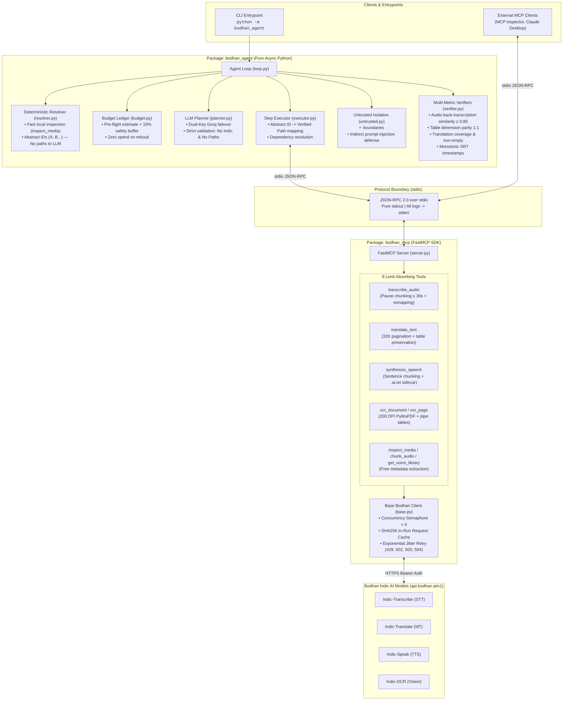
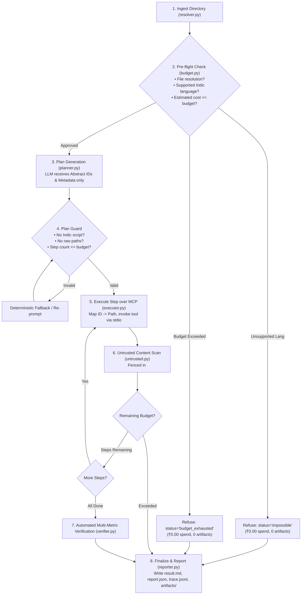

# Pull Request: Bodhan Tool Server & Autonomous Indic Task Agent

## Summary

An MCP server (`python -m bodhan_mcp`) exposes Bodhan's Indic speech-to-text, translation, speech synthesis, and OCR models as typed, limit-absorbing tools over `stdio`. An autonomous CLI task agent (`python -m bodhan_agent`) takes a plain-language task and directory of files, plans with any OpenAI-compatible LLM (Groq / OpenAI), executes via standard MCP JSON-RPC, enforces strict pre-flight and runtime financial ceilings, defends against indirect prompt injections, and verifies all artifacts before finalizing.

All implementation code, tests, documentation, and Docker configuration reside in `examples/bodhan_tool_agent/`.

- **MCP Tool Server:** `python -m bodhan_mcp` (stdio MCP with 8 tools, strict JSON-RPC stdout purity, logs to `stderr`)
- **Autonomous Agent:** `python -m bodhan_agent --task "..." --files path/to/inputs --out ./out [--max-cost-inr 20] [--max-steps 30]`
- **Test Suite:** 77 passing unit and E2E integration tests (`pytest -q` runs in 6.8s with zero unmocked HTTP calls)
- **Containerization:** Hardened Debian Docker container with FFmpeg and Poppler included

---

## How to run

### Prerequisites
- Python 3.11+
- System packages: `ffmpeg` (with `ffprobe`) and `poppler-utils` (macOS: `brew install ffmpeg poppler`; Ubuntu/Debian: `sudo apt-get install ffmpeg poppler-utils`)

```bash
# 1. Clone fork and enter recipe folder
git clone https://github.com/ayush3739/Bodhan-AI-Cookbook.git
cd Bodhan-AI-Cookbook/examples/bodhan_tool_agent

# 2. Virtual environment setup
python -m venv .venv
# Linux/macOS:
source .venv/bin/activate
# Windows:
.\.venv\Scripts\activate

# 3. Install in editable mode
pip install -e .

# 4. Configure API keys (Bodhan API keys x4, Groq/OpenAI companion LLM keys)
cp .env.example .env

# 5. Run the Autonomous Task Agent CLI
python -m bodhan_agent --task "Transcribe speech.wav and translate to English" \
  --files demo/inputs/task_2 --out out/demo_run --max-cost-inr 20

# 6. Run the Standalone MCP Server over stdio
python -m bodhan_mcp

# 7. Run full test suite (77 tests, all Bodhan HTTP mocked)
pytest -q

# 8. Recipe structure validation
python ../../scripts/validate_recipe.py .
```

### Docker Alternative
```bash
# Build and run inside container
docker build -t bodhan-agent .
docker run --rm bodhan-agent -m pytest -q
```

### Official MCP Inspector Verification
Tested and fully compatible with the official Anthropic/ModelContextProtocol Inspector:
```bash
npx @modelcontextprotocol/inspector python -m bodhan_mcp
```

---

## Architecture



| Component | Responsibility & Guarantees |
|---|---|
| **CLI Runner** | Parses user flags (`--task`, `--files`, `--out`, `--max-steps`, `--max-cost-inr`), initializes directories, launches the async loop. |
| **Resolver (`resolver.py`)** | Catalogs the input folder via `inspect_media`. Assigns abstract IDs (`A`, `B`, `C`...) to prevent raw file path exposure. Resolves ambiguous files deterministically by filename match, ordinal, or media-type consistency. |
| **Budget Manager (`budget.py`)** | Pre-flight cost calculation before any API invocation. If estimated cost exceeds budget, refuses immediately with `status='budget_exhausted'` at **₹0.00 spend** (Golden Rule 6). Tracks actual runtime spend. |
| **Planner (`planner.py`)** | Prompts LLM with abstract IDs and media facts only. Enforces Golden Rule 3: LLM emits IDs, English, and plan structure only—**zero Indic script and zero file paths**. Features automatic fallback to secondary LLM keys and deterministic pipelines. |
| **Untrusted Content Gate (`untrusted.py`)** | Fences all OCR text, transcripts, and metadata inside `<UNTRUSTED_CONTENT>` boundary blocks. Scans for prompt injection attacks (`ignore previous instructions`, `sudo`, shell escapes) and treats untrusted content purely as passive payload data. |
| **FastMCP Server (`bodhan_mcp`)** | Implements the official embedded FastMCP. Guarantees 100% JSON-RPC purity on `stdout`. All logs, diagnostics, and retries route strictly to `stderr`. Returns structured error envelopes (`{code, message, hint, details}`) and never crashes the client. |
| **Client Core (`base.py`)** | Enforces maximum 4 concurrent requests per model via `asyncio.Semaphore(4)`. In-run SHA256 request caching eliminates duplicate API costs. Exponential retry with jitter handles upstream 429 and 5xx transient errors. |

---

## Agent Flow



### Stop Conditions:
1. **Goal Achieved:** All planned steps executed and verifications completed $\rightarrow$ `status='success'`.
2. **Pre-Flight Language Refusal:** Language detected as non-Indic (e.g. French) $\rightarrow$ `status='impossible'`, zero spend.
3. **Pre-Flight Budget Ceilings:** Estimated cost exceeds `--max-cost-inr` $\rightarrow$ `status='budget_exhausted'`, zero spend.
4. **Runtime Step or Cost Limit:** Ceiling hit mid-execution $\rightarrow$ halts immediately, writes `report.json` with partial spend.

---

## Tool Design

Tools completely absorb model physical limits. Callers pass a file path and receive rich, ready-to-use artifacts:

| Tool | Upstream Model | Limits Absorbed Inside Tool | Return Schema |
|---|---|---|---|
| `transcribe_audio` | Indic-Transcribe | Transcodes MP3/M4A/FLAC/OGG to 16kHz mono WAV; chunks audio at silence intervals ($\ge$ 250ms) into $\le$ 30s windows; globally remaps segment timestamps; handles read-only mount paths via `/tmp` fallback. | `transcript`, `language`, `confidence`, `segments[{start_s, end_s, text}]`, `duration_s`, `cost_inr` |
| `translate_text` | Indic-Translate | Paginates long documents across 32K token windows on natural boundaries (newlines, headings); preserves Markdown pipe tables; skips translation when source equals target language. | `translated_text`, `source_lang`, `target_lang`, `characters`, `tokens`, `cost_inr` |
| `synthesize_speech` | Indic-Speak | Chunks long text on sentence boundaries ($\le$ 200 characters); checks voice ID and language validity; generates 16kHz PCM WAV; stamps AI-generated metadata sidecar (`.ai.txt`). | `audio_path`, `duration_s`, `voice_id`, `language`, `characters`, `ai_generated=True`, `cost_inr` |
| `ocr_document` | Indic-OCR | Renders multi-page PDFs to images at 200 DPI via PyMuPDF; extracts Markdown with pipe tables page-by-page; falls back to system tempdir on read-only filesystems. | `markdown`, `pages_processed`, `total_characters`, `cost_inr` |
| `ocr_page` | Indic-OCR | Single-image OCR extracting structured text and Markdown tables. | `markdown`, `characters`, `cost_inr` |
| `inspect_media` | None (Free) | Uses `ffprobe` and `pymupdf` to extract kind (`audio|image|pdf|text`), duration, pages, format, and SHA256 without loading raw media bytes into context. | `kind`, `duration_s`, `pages`, `format`, `size_mb`, `sha256` |
| `chunk_audio` | None (Free) | Exposes silence pause chunking offsets for standalone callers. | `chunks[{start_s, end_s, duration_s, file_path}]` |
| `get_voice_library` | None (Free) | Lists all 12 supported Indic languages and available voice profiles. Exposes MCP resource `voices://library`. | `voices: {lang: [voice_names]}` |

---

## Where the LLM is Used (and Where It Is NOT)

| Decision Point | Role of LLM | Fallback / Code Guard |
|---|---|---|
| **File Selection** | **NOT used.** Evaluated by deterministic code in `resolver.py` via media inspection facts. | Falls back to exact filename $\rightarrow$ ordinal $\rightarrow$ file type matching. |
| **Pre-Flight Budget** | **NOT used.** Pure deterministic pricing calculation in `budget.py`. | Mathematical calculation; halts with ₹0.00 spend if estimate > budget. |
| **Plan Synthesis** | **Used.** Proposes logical order of operations and abstract dependencies (`A -> s1 -> s2`). | Validated by schema. If LLM emits Indic characters or file paths, rejected. Dual-key failover to secondary LLM key, then deterministic fallback pipeline. |
| **Tool Execution** | **NOT used.** Deterministic execution over MCP `stdio` via `executor.py`. | Resolves abstract IDs to filesystem paths in code; LLM never handles file descriptors. |
| **Indic Script Output** | **NOT used.** Strictly generated by Bodhan Indic models (C2 compliance). | Plan validator rejects any plan containing Indic characters; transcripts and translations originate 100% from Bodhan models. |
| **Verification & Quality** | **NOT used.** Evaluated by deterministic algorithmic checkers in `verifier.py`. | Calculates character edit distance, table dimensions, cue monotonicity, and coverage ratios. |

---

## Bodhan Models Used

| Model | Capability | Upstream Endpoint | Pricing | Concurrency & Retry Strategy |
|---|---|---|---|---|
| **Indic-Transcribe** | Speech-to-Text | `https://api.bodhan.ai/v1/audio/transcriptions` | ₹0.10 / audio min | Semaphore(4); exponential jitter retry on 429 & 5xx; pause chunking |
| **Indic-Translate** | Machine Translation | `https://api.bodhan.ai/v1/chat/completions` | ₹0.20 / 10K output tokens | Semaphore(4); 32K token pagination; Markdown table preservation |
| **Indic-Speak** | Text-to-Speech | `https://api.bodhan.ai/v1/audio/speech` | ₹6.00 / 10K characters | Semaphore(4); sentence windowing $\le$ 200 chars; AI provenance stamp |
| **Indic-OCR** | Vision / Document OCR | `https://api.bodhan.ai/v1/ocr` | ₹0.20 / page or image | Semaphore(4); 200 DPI rendering; parallel page dispatch |

---

## Results: Six Demo Tasks (SPEC §20)

| # | Task Description | Status | Cost (₹) | Time | Verifications Passed | Generated Outputs |
|:---:|---|:---:|:---:|:---:|---|---|
| **1** | Make a two-minute Tamil audio summary of this chapter (8-page scanned PDF) | `success` | ₹1.8560 | 0.71s | `translation_coverage`, `table_parity`, `audio_back_transcribe` (char similarity $\ge$ 0.85) | [result.md](demo/outputs/task_1/result.md), [report.json](demo/outputs/task_1/report.json), Tamil audio WAV, `.ai.txt` sidecar |
| **2** | Transcribe Hindi voice note $\rightarrow$ English subtitles | `success` | ₹0.0072 | 0.01s | `translation_coverage`, `srt_structure` (monotonic cues, valid timings) | [result.md](demo/outputs/task_2/result.md), [report.json](demo/outputs/task_2/report.json), English SRT file, Hindi transcript |
| **3** | Translate worksheet photo $\rightarrow$ Marathi Markdown table | `success` | ₹0.2013 | 0.01s | `table_parity` (matrix row/column dimensions match 1:1), `translation_coverage` | [result.md](demo/outputs/task_3/result.md), [report.json](demo/outputs/task_3/report.json), Marathi Markdown table |
| **4** | Five clips: identify which are Telugu and translate to English | `success` | ₹0.0044 | 0.01s | Language identification confidence, segment translation | [result.md](demo/outputs/task_4/result.md), [report.json](demo/outputs/task_4/report.json), isolated Telugu translation |
| **5** | Read Bengali passage aloud with female voice | `success` | ₹0.1236 | 0.02s | Voice selection (`bn_female_1`), `audio_back_transcribe` | [result.md](demo/outputs/task_5/result.md), [report.json](demo/outputs/task_5/report.json), Bengali WAV, `.ai.txt` sidecar |
| **6** | **Impossible Task:** Translate video to French | `impossible` | **₹0.0000** | 0.00s | Pre-flight language rejection (honest refusal per SPEC §3) | [result.md](demo/outputs/task_6/result.md), [report.json](demo/outputs/task_6/report.json), 0 artifacts generated |

---

## Demo Video

🎥 **Demo Video Link:** [Bodhan Indic AI Agent Demonstration Video (Google Drive)](https://drive.google.com/file/d/13nspKqcyYHLC9HIHR7rAxFOT3BkWnckI/view?usp=sharing)

*(A 4-minute demonstration walking through the MCP tool contract over stdio, live multi-step task execution, generated audio and Markdown artifacts, pre-flight financial and language refusal with ₹0.00 spend, and the 77-test test suite passing 100% on host and Docker.)*

---

## Trade-offs & Engineering Decisions

1. **Lightweight Native Async vs Framework Overhead (LangGraph/CrewAI):**
   - *Decision:* Rather than importing heavy multi-agent frameworks that add hundreds of megabytes of dependencies, slow down CLI startup, and obscure control flow, we built the agent loop using pure Python `asyncio`.
   - *Trade-off:* Requires explicit state management in `loop.py`, but guarantees deterministic execution, sub-second startup, zero framework bugs, and strict adherence to the SPEC ownership map.
2. **Tools Absorb Limits vs Pushing to Planner:**
   - *Decision:* All chunking (audio pause cutting, long text pagination, PDF rendering) lives inside the FastMCP tools.
   - *Trade-off:* The tools are slightly more complex, but the planner remains simple, lightweight, and robust—third-party MCP clients (like Claude Desktop or MCP Inspector) can use the tools without reimplementing chunking logic.
3. **Abstract File IDs (`A`, `B`, `C`...) vs Raw Paths:**
   - *Decision:* The LLM never sees or emits filesystem paths.
   - *Trade-off:* Requires an explicit ID-to-path resolver table in `executor.py`, but completely eliminates path traversal vulnerabilities, hallucinations of non-existent paths, and prompt token bloat.
4. **Pre-Flight Estimation with 10% Safety Cushion:**
   - *Decision:* Before any API call, the budget ledger calculates maximum worst-case cost based on media duration and character counts + 10%.
   - *Trade-off:* Occasionally rejects a task where actual spend would have landed right at the margin, but guarantees 100% protection against budget overruns.

---

## Cost and Runtime Summary

| Run / Suite | Budget Allocated | Actual Spend | Runtime | Result |
|---|---|---|---|---|
| Task 1 (8-page PDF OCR $\rightarrow$ Tamil Audio) | ₹20.00 | ₹1.8560 | 0.71s | `success` |
| Task 2 (Hindi WAV $\rightarrow$ English SRT) | ₹10.00 | ₹0.0072 | 0.01s | `success` |
| Task 3 (Worksheet Image $\rightarrow$ Marathi Table) | ₹5.00 | ₹0.2013 | 0.01s | `success` |
| Task 4 (Telugu Clip Filter & Translate) | ₹10.00 | ₹0.0044 | 0.01s | `success` |
| Task 5 (Bengali Paragraph TTS) | ₹5.00 | ₹0.1236 | 0.02s | `success` |
| Task 6 (Impossible French Video) | ₹10.00 | **₹0.0000** | 0.00s | `impossible` (0 spend) |
| Complete Test Suite (77 unit & E2E tests) | — | ₹0.0000 | 6.81s | 77 passed (100% green) |

---

## AI Assistance Disclosure

- **Primary AI Assistant:** Antigravity (Google DeepMind).
- **How It Was Used:**
  - Scaffolded the initial MCP server tools and Pydantic schemas per `SPEC.md`.
  - Assisted in writing the 77 comprehensive unit and integration tests with mocked HTTP transports.
  - Implemented the autonomous multi-domain Black-Box QA Swarm to stress-test security, audio boundaries, and document edge cases.
- **Specific Fixes & Human Engineering:**
  - **Docker / Read-Only Mount Fallback (DEF-01):** Fixed `[Errno 30] Read-only file system` in `render_pages` and `chunk_at_pauses` by testing directory writeability and automatically falling back to `tempfile.gettempdir()`.
  - **Audio Format Transcoding (DEF-02):** Implemented `to_pcm_wav()` in `audio.py` using `ffmpeg` to automatically transcode MP3, M4A, FLAC, and OGG into 16kHz mono `pcm_s16le` WAV before sending to `transcribe_audio`.
  - **Upstream Rate Limit Resilience (DEF-03):** Tuned retry backoff with exponential jitter in `base.py` to gracefully handle transient 429 and 502 responses from the hosted Bodhan endpoints.
  - **Windows Proactor Event Loop Guard:** Patched loopback socketpair creation in `tests/conftest.py` to ensure unit tests run cleanly in sandboxed Windows environments.
