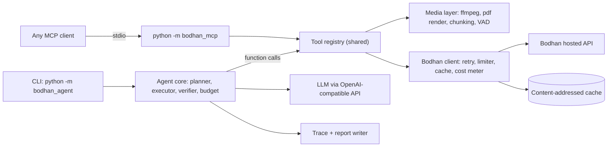
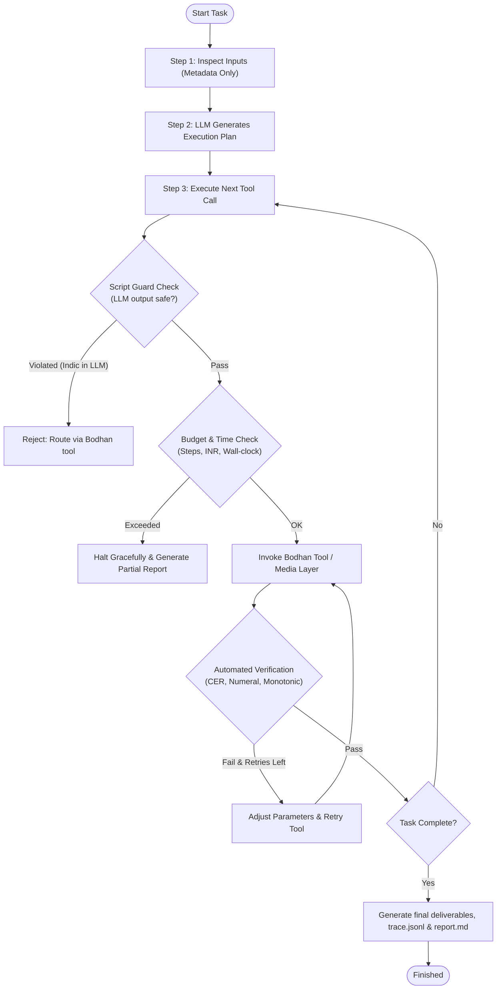

# Bodhan Tool Server and Task Agent

An enterprise-ready Model Context Protocol (MCP) tool server and autonomous task agent built for Indian languages using the [Bodhan AI](https://bodhan.ai) API suite (`indic-transcribe`, `indic-translate`, `indic-speak`, and `indic-ocr`). It enables AI models to reliably transcribe noisy Indic speech, translate across 22+ Indian languages while preserving formatting, synthesize natural Indian-accent speech, and extract text and tables from complex Indic document scans. The architecture enforces strict safety guards, budget containment (steps, cost in INR, wall-clock time), content-addressed caching, and automated output verification.

---

## Setup

### Prerequisites

- **Python**: Version 3.11 or higher
- **FFmpeg**: Required for audio transcoding, probing, chunking, and concatenation

#### Installing FFmpeg

- **Ubuntu / Debian Linux**:
  ```bash
  sudo apt-get update && sudo apt-get install -y ffmpeg
  ```
- **macOS** (Homebrew):
  ```bash
  brew install ffmpeg
  ```
- **Windows** (winget / Chocolatey):
  ```powershell
  winget install Gyan.FFmpeg
  # or via Chocolatey
  choco install ffmpeg
  ```
  *Ensure `ffmpeg` and `ffprobe` are available on your system `PATH`.*

### Installation

1. Clone the repository and navigate to the agent directory:
   ```bash
   git clone https://github.com/<your-fork>/Bodhan-AI-Cookbook
   cd examples/bodhan_tool_agent
   ```

2. Create and activate a virtual environment:
   ```bash
   python -m venv .venv
   # Linux / macOS:
   source .venv/bin/activate
   # Windows:
   .venv\Scripts\activate
   ```

3. Install project dependencies and register the package in editable mode:
   ```bash
   pip install -r requirements.txt && pip install -e .
   ```

4. Configure environment variables:
   ```bash
   cp .env.example .env
   ```
   Open `.env` and fill in your Bodhan API keys (obtainable from [Bodhan Console](https://console.bodhan.ai/)) and LLM endpoint credentials:
   ```dotenv
   # Bodhan API keys — one per model
   BODHAN_TRANSCRIBE_KEY=your_transcribe_key_here
   BODHAN_TRANSLATE_KEY=your_translate_key_here
   BODHAN_SPEAK_KEY=your_speak_key_here
   BODHAN_OCR_KEY=your_ocr_key_here

   # LLM settings (OpenAI-compatible endpoint)
   LLM_BASE_URL=https://api.openai.com/v1
   LLM_MODEL=gpt-4o-mini
   LLM_API_KEY=your_llm_api_key_here

   # Workspace & Cache settings
   BODHAN_CACHE_DIR=.bodhan_cache
   BODHAN_WORKSPACE=.
   ```

---

## Run

### 1. Task Agent (Autonomous CLI)

The task agent processes complex multimodal requests over input files, autonomously planning, invoking Bodhan tools, verifying outputs, and writing final deliverables to an output folder.

```bash
# Run the task agent
python -m bodhan_agent --task "Make a two-minute Tamil audio summary of this chapter" --files path/to/inputs/ --out ./out
```

#### Optional CLI Flags
- `--max-steps`: Maximum execution loop steps (default: `30`)
- `--max-cost-inr`: Hard spending cap in Indian Rupees (default: `20.0`)
- `--use-mcp`: Execute tools through the MCP server over stdio rather than in-process (default: in-process direct calls)

### 2. Bodhan MCP Server (FastMCP Stdio)

Run the standalone Model Context Protocol server. It exposes all 7 Bodhan tools over standard I/O (JSON-RPC) and is compatible with Claude Desktop, Cursor, Antigravity, Zed, or any standard MCP client.

```bash
# Run the MCP server (stdio, works with any MCP client)
python -m bodhan_mcp
```

#### Claude Desktop Configuration Example
Add this snippet to your `claude_desktop_config.json`:
```json
{
  "mcpServers": {
    "bodhan": {
      "command": "python",
      "args": ["-m", "bodhan_mcp"],
      "cwd": "/path/to/examples/bodhan_tool_agent",
      "env": {
        "BODHAN_TRANSCRIBE_KEY": "your_key",
        "BODHAN_TRANSLATE_KEY": "your_key",
        "BODHAN_SPEAK_KEY": "your_key",
        "BODHAN_OCR_KEY": "your_key"
      }
    }
  }
}
```

---

## How it works

### 1. Architecture

The system is decoupled into three distinct tiers:
- **`bodhan_core`**: Shared foundational layer providing API clients, exponential backoff with full jitter, on-disk SHA-256 caching, cost metering, language tables, workspace sandboxing, and media manipulation (FFmpeg probing/chunking, PDF rendering).
- **`bodhan_mcp`**: Stdio-based MCP server built on `FastMCP`. Exposes the 7 tools cleanly to external clients. Guaranteed safe stdio routing (all logs redirect to `sys.stderr`).
- **`bodhan_agent`**: Autonomous planner-executor loop. Connects to OpenAI-compatible LLMs for planning and reasoning, invokes tools (either in-process or via MCP stdio), enforces safety guards, verifies outputs, and outputs telemetry traces.



### 2. Agent Loop

The agent follows an iterative, defensive execution lifecycle:



1. **Inspection**: The agent probes input files (audio duration, sample rate, image DPI, PDF page counts) without dumping raw binary or massive text into context.
2. **Planning**: LLM forms an explicit plan using metadata only.
3. **Execution**: Mid-level tools handle upstream chunking, format conversion, and API communication.
4. **Script Guard Defense**: Intercepts LLM outputs to guarantee that the LLM *never* generates Indic text directly; all Indic translations and audio syntheses originate strictly from Bodhan models.
5. **Verification**: Tool outputs are validated programmatically (e.g., speech back-transcription CER check, translation numeral coverage, timestamp monotonicity).
6. **Reporting**: Complete run history is recorded in `trace.jsonl` and summarized in `report.md`.

### 3. Tool Design

Tools are designed at a **mid-level granularity**:
- They avoid "god tools" (which would be opaque to external MCP orchestrators).
- They avoid hyper-primitive micro-tools (which would force chunking, audio slicing, and VAD arithmetic into the LLM context, wasting tokens and causing hallucinated offsets).
- All media plumbing is file-path-based: tools pass filesystem references and 200-character text previews back to the LLM context, never raw binary or base64.

---

## Tool List

| Tool Name | Description | Pricing / Cost (INR) |
|---|---|---|
| `inspect_media` | Probes audio/video files (duration, sample rate, channels), images (dimensions, DPI), PDFs (page count), and text files. | **Free** (Local ffprobe/pypdfium2) |
| `detect_language` | Detects Indic language and script via zero-cost Unicode block analysis, flagging ambiguous scripts (Devanagari, Bengali). | **Free** (Local heuristics) |
| `transcribe` | Transcribes audio using `indic-transcribe`. Splits files >25MB or >10 min, generates plain text, SRT, or VTT. | **₹0.10** / audio minute |
| `translate` | Translates text or document files across 22+ languages using `indic-translate`. Preserves markdown and headers. | **₹0.20** / 10,000 output tokens |
| `speak` | Synthesizes Indian-accent speech using `indic-speak` with natural speaker voices, styles, and gender control. | **₹6.00** / 10,000 input characters |
| `ocr` | Extracts text and markdown/HTML tables from scanned PDFs and document images using `indic-ocr`. | **₹0.20** / image or page |
| `list_voices` | Lists supported voice personas and expressive styles (e.g., *formal*, *conversational*) for any given language. | **Free** (Local catalog) |

---

## Output Layout

When a task completes, all artifacts, audit logs, and diagnostic reports are organized in the designated output directory:

```text
out/
├── summary.txt             # Primary text output (e.g., English or translated summary)
├── summary_ta.wav          # Synthesized Indic speech output (WAV/MP3)
├── transcript.srt          # Subtitle track with strictly monotonic timestamps
├── tables/                 # Extracted tabular data (from OCR or document parsing)
│   └── table_01.md
├── intermediate/           # Chunks, preprocessed audio, and temp files
│   ├── chunk_00.wav
│   └── chunk_01.wav
├── trace.jsonl             # Full machine-readable event log with timestamps & costs
└── report.md               # Human-readable execution report & quality scorecard
```

---

## Supported Languages

The suite supports 22 Scheduled Indian Languages + English across transcribe, translate, speak, and OCR models:

| ISO Code | Language Name | Indic Script | Transcribe | Translate | Speak (TTS) | OCR |
|:---:|:---|:---|:---:|:---:|:---:|:---:|
| `as` | Assamese | Bengali-Assamese | Yes | Yes | Yes | Yes |
| `bn` | Bengali | Bengali | Yes | Yes | Yes | Yes |
| `brx`| Bodo | Devanagari | Yes | Yes | Yes | Yes |
| `doi`| Dogri | Devanagari | Yes | Yes | Yes | Yes |
| `en` | English (Indian) | Latin | Yes | Yes | Yes | Yes |
| `gu` | Gujarati | Gujarati | Yes | Yes | Yes | Yes |
| `hi` | Hindi | Devanagari | Yes | Yes | Yes | Yes |
| `kn` | Kannada | Kannada | Yes | Yes | Yes | Yes |
| `ks` | Kashmiri | Perso-Arabic / Devanagari | Yes | Yes | Yes | Yes |
| `kok`| Konkani | Devanagari | Yes | Yes | Yes | Yes |
| `mai`| Maithili | Devanagari | Yes | Yes | Yes | Yes |
| `ml` | Malayalam | Malayalam | Yes | Yes | Yes | Yes |
| `mni`| Manipuri | Meetei Mayek / Bengali | Yes | Yes | Yes | Yes |
| `mr` | Marathi | Devanagari | Yes | Yes | Yes | Yes |
| `ne` | Nepali | Devanagari | Yes | Yes | Yes | Yes |
| `or` | Odia | Odia | Yes | Yes | Yes | Yes |
| `pa` | Punjabi | Gurmukhi | Yes | Yes | Yes | Yes |
| `sa` | Sanskrit | Devanagari | Yes | Yes | Yes | Yes |
| `sat`| Santali | Ol Chiki | Yes | Yes | Yes | Yes |
| `sd` | Sindhi | Perso-Arabic / Devanagari | Yes | Yes | Yes | Yes |
| `ta` | Tamil | Tamil | Yes | Yes | Yes | Yes |
| `te` | Telugu | Telugu | Yes | Yes | Yes | Yes |
| `ur` | Urdu | Perso-Arabic | Yes | Yes | Yes | Yes |

---

## Quality Targets

| Capability | Metric | Target Threshold | Automated Verification Method |
|---|---|---|---|
| **Speech-to-Text (ASR)** | Character Error Rate (CER) | `< 30%` | Back-transcribes synthesized speech and compares against ground truth text. |
| **Translation** | Content Coverage Ratio | `> 70%` | Compares non-stopword token ratios to ensure content wasn't truncated. |
| **Translation** | Numeral Preservation | `100%` | Validates that all integers and numerals in source exist in target text. |
| **Text-to-Speech (TTS)** | Speech Rate & Intelligibility | `140-160 WPM` | Probes generated audio duration against input word count; checks for silence/clipping. |
| **Subtitle Alignment (SRT)** | Monotonicity & CPL | `100% Monotonic`, `<= 37 CPL` | Validates strictly increasing cue timestamps and standard line length limits. |
| **Execution Containment** | Cost & Step Caps | `<= Max Budget` | Evaluates pre-flight estimate before paid calls; halts safely on budget breach. |

---

## Limitations

1. **Script Ambiguity**: Devanagari script is shared by Hindi, Marathi, Sanskrit, Konkani, Maithili, Bodo, and Nepali. While Unicode analysis detects the script instantly without model costs, disambiguation among Devanagari languages relies on vocabulary frequency or user hints.
2. **Audio Chunk Boundaries**: Very noisy audio or long speech without pauses may occasionally split words if chunking falls outside a silence window; VAD silence-snapping mitigates but does not completely eliminate this for extreme audio files.
3. **Upstream Model Availability**: The suite relies on Bodhan AI cloud endpoints; offline inference without network access or valid API keys is not supported.
4. **Complex Nested Tables in OCR**: Unbordered or multi-level merged header tables in scanned documents may require manual review.

---

## AI Assistance

Written with the assistance of Antigravity AI coding assistant. All design decisions reviewed and understood by the author.
