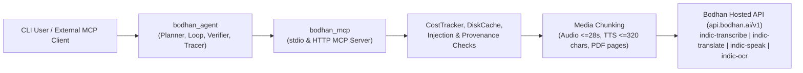
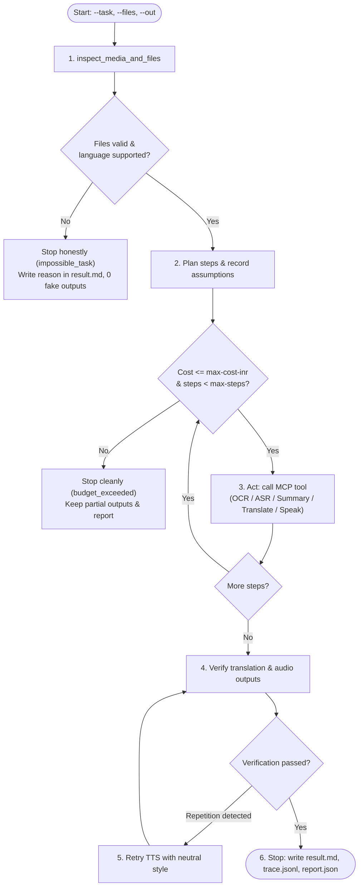

# Bodhan Tool Server and Task Agent

This project wraps Bodhan AI's four Indic models (`indic-transcribe`, `indic-translate`, `indic-speak`, and `indic-ocr`) as an MCP server (`bodhan_mcp`) and provides a command-line task agent (`bodhan_agent`) that plans and runs multi-step Indian-language workflows.

## Setup

Requires Python 3.10+. PDF rendering (`pypdfium2`) and audio conversion (`imageio-ffmpeg`) are included in the Python dependencies.

```bash
python3 -m venv .venv
source .venv/bin/activate
pip install -e ".[dev]"

cp .env.example .env
# Add BODHAN_TRANSCRIBE_KEY, BODHAN_TRANSLATE_KEY, BODHAN_SPEAK_KEY, BODHAN_OCR_KEY
# and LLM_BASE_URL, LLM_MODEL, LLM_API_KEY in .env
```

## Run

### Run the Task Agent

```bash
python -m bodhan_agent \
  --task "Make a two-minute Tamil audio summary of this chapter" \
  --files demos/inputs/chapter_lines_angles.pdf \
  --out ./out \
  --max-steps 30 \
  --max-cost-inr 20
```

### Run the MCP Server (stdio)

```bash
python -m bodhan_mcp
```

Optional HTTP mode with token auth:
```bash
python -m bodhan_mcp --transport streamable-http --port 8000 --auth-token my-token
```

### Run Tests

```bash
pytest -v
ruff check src/ tests/
```

## Architecture



- `src/bodhan_mcp/server.py`: MCP JSON-RPC server over `stdio` and `streamable-http`. Exposes 7 tools, 3 resources (`languages`, `voices`, `pricing`), and 2 prompts.
- `src/bodhan_mcp/tools.py`: Tool implementations and verification checks. All files move by path reference rather than base64 in the LLM prompt.
- `src/bodhan_mcp/media.py`: Splits long audio into windows under 30s, splits text into short sentences for TTS, rasterizes PDF pages to PNG images, and formats SRT/VTT subtitles.
- `src/bodhan_mcp/client.py`: HTTP client for `https://api.bodhan.ai/v1` with retries, backoff, concurrency limits, SHA-256 disk caching, and cost tracking.
- `src/bodhan_mcp/security.py`: Wraps OCR and transcript text in `<untrusted_document_data>` tags to prevent prompt injection and checks that Indian-language text only comes from Bodhan models.
- `src/bodhan_agent/agent.py`: Parses the task, runs tools, checks verification outputs, enforces budgets, and writes `result.md`, `trace.jsonl`, and `report.json`.

## Agent Flow



## Design Notes

### Tool List and Granularity
We expose 7 tools so an agent or external MCP client can combine them for new tasks without having to manage model window limits manually:

1. `inspect_media_and_files`: Checks file existence, media type, audio duration, PDF page count, script language, and prompt-injection patterns.
2. `extract_document_text` (`indic-ocr`): Renders PDF pages to 150 DPI PNG images (ignoring embedded PDF text), runs OCR per page, removes repeated headers/footers, and joins split sentences across page breaks.
3. `transcribe_audio` (`indic-transcribe`): Converts audio/video to 16kHz mono WAV, splits audio at low-energy silence pauses under 28 seconds (within the 30s limit), shifts timestamps across chunks, and writes `.txt`, `.srt`, `.vtt`, or `.json`.
4. `translate_text` (`indic-translate`): Splits long documents on paragraph boundaries (up to 8,000 chars) while keeping Markdown tables and LaTeX blocks intact. Translates subtitle segments while keeping SRT timestamps. Uses an English pivot when translating between two Indian languages.
5. `synthesize_speech` (`indic-speak`): Splits text on sentence boundaries (`।`, `॥`, `.`, `?`, `!`) into chunks of up to 320 characters, calls `indic-speak` with regional speaker voices (`Kavya`, `Sourav`, `Ishita`, `Prastuti`, `Ankur`), joins the audio chunks with 220ms pauses, and writes `.ai_label.json` labeling the output as AI-generated.
6. `verify_translation_quality`: Checks that the translated file is not empty, uses the right Unicode script, preserves numbers (after normalizing Indic numerals to ASCII digits), and keeps Markdown table rows intact.
7. `verify_audio_quality`: Checks audio duration, RMS level, and silence ratio, and back-transcribes the first chunk with `indic-transcribe` to check word overlap and detect repeated phrases.

### Verification, Budgets, and Error Recovery
- **Verification**: Before finishing, the agent runs `verify_translation_quality` on generated translations and `verify_audio_quality` on generated audio files. If back-transcription detects repeated 3-word phrases from `indic-speak`, the agent retries synthesis once with neutral style.
- **Budgets and Caching**: `CostTracker` checks the estimated rupee cost before every API call (`₹0.10/min` ASR, `₹0.20/10k` tokens translation, `₹6.00/10k` chars TTS, `₹0.20/image` OCR). If the next call would exceed `--max-cost-inr` or `--max-steps`, it stops cleanly and reports what was completed. `DiskCache` hashes request inputs with SHA-256 so identical inputs are not sent twice.
- **Untrusted Input and Provenance**: Text extracted from files is scanned for prompt-injection instructions and wrapped in `<untrusted_document_data>` tags. `ArtifactProvenanceRegistry` tracks hashes of text returned by Bodhan models so the LLM cannot write Indian-language text directly.

## Where the LLM Is Used

- **Task Planning**: `AgentLLMClient.plan_task_with_llm` (tested with `gpt-4o-mini`) extracts target language, filter language, needed steps, duration, and assumptions. If the LLM call fails or `LLM_API_KEY` is not set, `TaskAnalyzer` in `agent.py` parses the task using deterministic rules.
- **English Summarization**: When a task asks for a summary, `AgentLLMClient.summarize_in_english` writes an English summary scaled to the requested speaking duration (~130 words per minute), which is then translated by `indic-translate`. If the LLM is unavailable, `deterministic_english_summary` selects top sentences by word frequency.

## Demo Tasks and Outputs

Reproduce with `python -m bodhan_agent.eval_suite --out ./demos/outputs`:

| # | Task | Input | Status | Steps | Cost (INR) | Links |
| :--- | :--- | :--- | :--- | :---: | :---: | :--- |
| 1 | Make a two-minute Tamil audio summary of this chapter | 8-page PDF | `completed` | 6 | ₹1.0852 | [result.md](demos/outputs/task_01_tamil_audio_summary/result.md) · [trace.jsonl](demos/outputs/task_01_tamil_audio_summary/trace.jsonl) · [report.json](demos/outputs/task_01_tamil_audio_summary/report.json) |
| 2 | Transcribe this Hindi voice note and give me English subtitles | 3-min WAV | `completed` | 6 | ₹1.2744 | [result.md](demos/outputs/task_02_hindi_to_english_srt/result.md) · [trace.jsonl](demos/outputs/task_02_hindi_to_english_srt/trace.jsonl) · [report.json](demos/outputs/task_02_hindi_to_english_srt/report.json) |
| 3 | Translate this worksheet into Marathi and keep the table | Worksheet PNG | `completed` | 4 | ₹0.2020 | [result.md](demos/outputs/task_03_worksheet_marathi_table/result.md) · [trace.jsonl](demos/outputs/task_03_worksheet_marathi_table/trace.jsonl) · [report.json](demos/outputs/task_03_worksheet_marathi_table/report.json) |
| 4 | Which of these clips are in Telugu? Translate those into English | 5 WAV clips | `completed` | 10 | ₹0.0263 | [result.md](demos/outputs/task_04_telugu_clips_filter/result.md) · [trace.jsonl](demos/outputs/task_04_telugu_clips_filter/trace.jsonl) · [report.json](demos/outputs/task_04_telugu_clips_filter/report.json) |
| 5 | Read this paragraph aloud in Bengali with a female voice | Text file | `completed` | 5 | ₹0.1161 | [result.md](demos/outputs/task_05_bengali_female_tts/result.md) · [trace.jsonl](demos/outputs/task_05_bengali_female_tts/trace.jsonl) · [report.json](demos/outputs/task_05_bengali_female_tts/report.json) |
| 6 | Translate this video into French (impossible task) | Video/audio | `impossible_task` | 2 | ₹0.0000 | [result.md](demos/outputs/task_06_impossible_french/result.md) · [trace.jsonl](demos/outputs/task_06_impossible_french/trace.jsonl) · [report.json](demos/outputs/task_06_impossible_french/report.json) |
| 7 | Translate biology notes containing prompt injection into Hindi | Text file | `completed` | 3 | ₹0.0021 | [result.md](demos/outputs/task_07_prompt_injection_defense/result.md) · [trace.jsonl](demos/outputs/task_07_prompt_injection_defense/trace.jsonl) · [report.json](demos/outputs/task_07_prompt_injection_defense/report.json) |
| 8 | Tamil chapter summary with ₹0.50 cost limit (`--max-cost-inr 0.50`) | 8-page PDF | `budget_exceeded` | 2 | ₹0.4000 | [result.md](demos/outputs/task_08_strict_budget_stop/result.md) · [trace.jsonl](demos/outputs/task_08_strict_budget_stop/trace.jsonl) · [report.json](demos/outputs/task_08_strict_budget_stop/report.json) |

- **Demo Video**: [Watch Demo Recording (Google Drive)](https://drive.google.com/file/d/1OqBHoNUK3H6n9IzquI8Eumt09na-zr7V/view)
- **MCP Client Compatibility**: Tested over `stdio` with the Python `mcp` client SDK (`mcp.client.stdio`) and MCP Inspector (`npx @modelcontextprotocol/inspector python -m bodhan_mcp`).

## Trade-Offs and Limitations

- **Script Disambiguation on Short Text**: Hindi, Marathi, Nepali, and Sanskrit share the Devanagari Unicode block. Our detector distinguishes them using character markers (`ळ` for Marathi) and common function words, so 1–2 word inputs without function words default to Hindi.
- **Audio Duration Targeting**: Summary length is controlled via English word count (~130 words per minute) rather than time-stretching the generated audio, so actual TTS duration can vary by 10–15% depending on target language syllable length.
- **Audio Verification Cost**: `verify_audio_quality` back-transcribes the first chunk ($\le 28\text{s}$) rather than the entire audio file to keep verification costs low while still checking full-file RMS energy and silence ratio.
