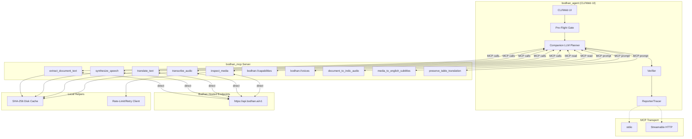
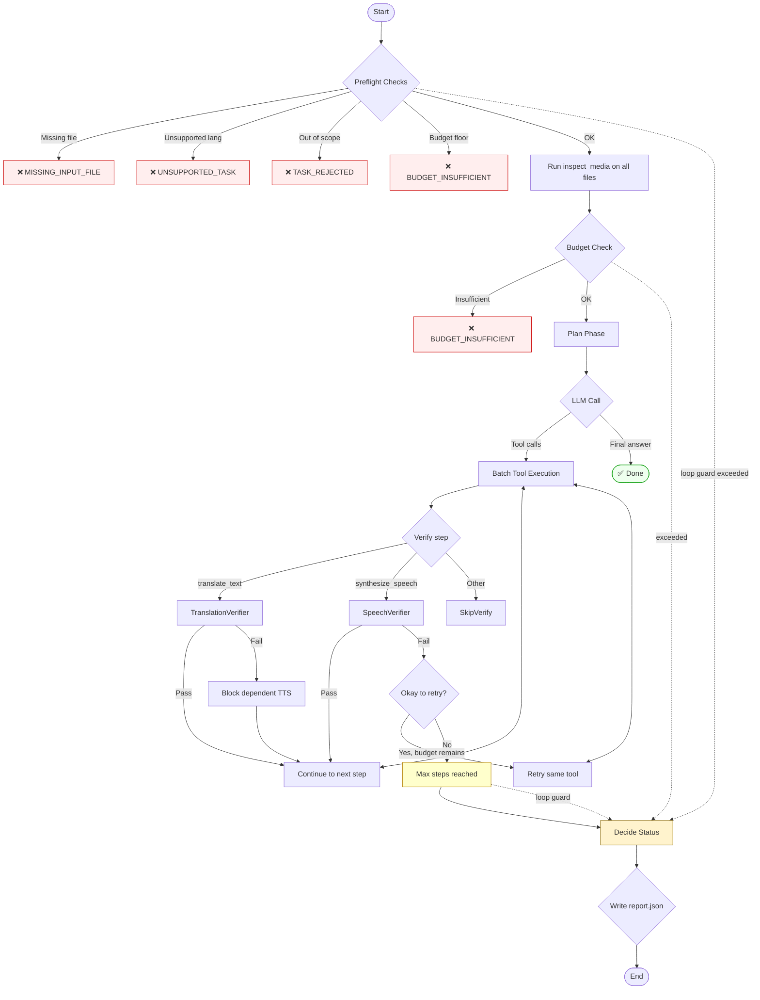

# Bodhan Tool Server & Task Agent

A standalone stdio MCP server (`bodhan_mcp`) and an unattended CLI task agent (`bodhan_agent`) for Bodhan AI's Indic language models.

**Bodhan models:** indic-transcribe, indic-translate, indic-speak, indic-ocr  
**Languages supported:** 25 languages (Devanagari, Tamil, Telugu, Bengali, etc.)

---

## Overview

This recipe provides two tightly integrated components:

1. **bodhan_mcp** — A standalone MCP server exposing 5 tools for Bodhan AI API operations (speech-to-text, translation, text-to-speech, OCR) via stdio or Streamable HTTP transport.

2. **bodhan_agent** — A CLI task agent that orchestrates these tools using an LLM planner, with built-in verification, budget controls, and cost tracking.

3. **bodhan_agent.web_ui** — A modern developer workbench (single-file HTML/JS) for running preset tasks, uploading files, and inspecting MCP capabilities.

---

## Setup

### Prerequisites

```yaml
ffmpeg/ffprobe: required (system dependency)
Python: 3.10+
API Keys: Bodhan API keys from console.bodhan.ai + optional LLM key
```

### Clone & Install

```bash
cd examples/bodhan_tool_agent

# Create virtual environment and install pinned dependencies
python -m venv .venv
source .venv/bin/activate  # On Windows: .venv\Scripts\activate
pip install -r requirements.txt

# Configure environment
cp .env.example .env
# Edit .env: fill in your keys from https://console.bodhan.ai
```

### Docker Setup (Alternative)

```bash
docker build -t bodhan-mcp .
docker run --rm -it \
  -e BODHAN_API_KEY="sk-xxx" \
  -e LLM_API_KEY="sk-xxx" \
  -v $(pwd)/outputs:/app/outputs \
  bodhan-mcp python -m bodhan_agent --task "..." --files ... --out ./outputs
```

---

## Run

### Start the MCP Server (stdio mode)

```bash
python -m bodhan_mcp
```

The server runs in stdio mode by default. It exposes:
- **5 Tools:** `inspect_media`, `transcribe_audio`, `extract_document_text`, `translate_text`, `synthesize_speech`
- **2 Resources:** `bodhan://capabilities`, `bodhan://voices`
- **3 Prompts:** `document_to_indic_audio`, `media_to_english_subtitles`, `preserve_table_translation`

### Run the CLI Task Agent

```bash
python -m bodhan_agent \
  --task "Create a 2-minute Tamil audio summary of this PDF" \
  --files demo_inputs/Task1_8page.pdf \
  --out ./outputs/t1_tamil_summary \
  [--max-steps 30] \
  [--max-cost-inr 20]
```

Arguments:
- `--task` (required): Natural-language task description
- `--files` (required): One or more input files or directories
- `--out` (default: `./out`): Output directory for `report.json`, `trace.jsonl`, and `result.md`
- `--max-steps` (default: 30): Maximum planning steps before circuit breaker
- `--max-cost-inr` (default: 20.0): Maximum cost in Indian Rupees before budget gate

### Run the Web UI

```bash
python -m bodhan_agent.web_ui
# Opens http://localhost:8000
```

The UI provides:
- 6 preset tasks with demo inputs
- File upload via drag & drop
- Live trace timeline
- Artifact inspector for audio/Markdown/JSON
- MCP playground for tool testing

### Test with Third-Party MCP Client

This MCP server is tested against:
- **MCP Inspector:** Official MCP desktop client
- **Python mcp SDK:** `from mcp.client.stdio import stdio_client` (see `tests/test_mcp_stdio_third_party.py`)

```python
from mcp import ClientSession
from mcp.client.stdio import stdio_client

async with stdio_client(["python", "-m", "bodhan_mcp"]) as (read, write):
    async with ClientSession(read, write) as session:
        await session.initialize()
        tools = await session.list_tools()
        result = await session.call_tool("inspect_media", {"file_path": "audio.wav"})
```

---

## Architecture

### Component Architecture Diagram



### Component Breakdown

| Component | Role |
|-----------|------|
| **CLI/Web UI** | User interface for task input, file management, and output display |
| **Pre-Flight Gate** | Validates input files exist, checks budget floor, detects unsupported languages |
| **Companion LLM Planner** | Orchestrates tool calls via OpenAI-compatible chat completions (gpt-4o-mini default) |
| **Verifier** | Post-step verification: `TranslationVerifier` (script ratio ≥ 0.85, table parity), `SpeechVerifier` (ffprobe duration, back-transcription similarity ≥ 0.75) |
| **Reporter/Tracer** | Emits `trace.jsonl`, `report.json`, and `result.md` with cost tracking via `InrLedger` |
| **inspect_media** | Free local metadata extraction (format, duration, pages); returns `min_cost_inr` for budget pre-flight |
| **transcribe_audio** | Audio → text: extracts audio → 16kHz WAV → silence-aware chunking (≤30s) → API → timestamp stitching |
| **extract_document_text** | OCR: PDF→PNG via pypdfium2 → bounded parallel OCR (max 3 concurrent) → Markdown with layout blocks |
| **translate_text** | Text/table translation with paragraph-aware chunking → script verification → optional file output |
| **synthesize_speech** | Sentence splitting (।, ., ?, !) → 3000-char chunking → API → ffmpeg concat stitching |
| **bodhan://capabilities** | JSON resource listing supported languages, voices, pricing tiers, model mappings |
| **bodhan://voices** | JSON resource cataloging all available TTS voices by language and gender |
| **SHA-256 Disk Cache** | `.cache/bodhan/` stores API responses keyed by `model:endpoint:params:input_sha256` |
| **Rate-Limit/Retry** | Bounded exponential backoff (max 25s total) for 429 errors |

---

## Agent Loop Flowchart



### Flowchart Legend

1. **Zero-LLM Pre-Flight Gates:**  
   - Missing file detection via `inspect_media` before any API call
   - Unsupported language detection via regex pre-gate (French, Spanish, German, Japanese, Korean, Chinese, Mandarin, Arabic, Russian, Portuguese, Italian → `UNSUPPORTED_TASK`)
   - Out-of-scope task detection (video generation, voice cloning → `TASK_REJECTED`)
   - Budget floor enforcement: `min_cost_inr` from inspect must be ≤ `--max-cost-inr`

2. **Parallel Batch Execution:**  
   - LLM receives multiple tool calls in a single response
   - Tools executed sequentially within batch to allow dependency-aware blocking (TTS blocked if translation failed)
   - Each tool call returns structured result with `cost_inr`, `duration_sec`, `output_file`, `cached`

3. **Verification Gates:**  
   - `translate_text` → `TranslationVerifier`: script ratio ≥ 0.85 for target language, Markdown table row/column parity
   - `synthesize_speech` → `SpeechVerifier`: ffprobe duration > 0.5s, n-gram repetition detection, back-transcription similarity ≥ 0.75

4. **Bounded Retry/Re-Plan:**  
   - One retry per step on verification failure (not unbounded loops)
   - Loop guard: stop if any (tool, input_file) pair called > 3 times without progress
   - Cost and step circuit breakers prevent runaway execution

5. **Circuit Breakers:**  
   - `InrLedger.is_exhausted()` → budget exceeded check
   - `max_steps` counter → step limit reached
   - Loop guard counter → infinite retry prevention

---

## Design Notes

### Tool Granularity: Why 5 Tools?

The MCP server exposes exactly **5 tools** rather than 1 monolithic tool or 20+ fine-grained tools. This trade-off was chosen deliberately:

| Aspect | 1 Mega-Tool | 5 Tools | 20+ Tools |
|--------|-------------|---------|-----------|
| Orchestration | Impossible | ✅ Full workflows | Reduced flexibility |
| Retries | All-or-nothing | ✅ Per-step retry | Excessive complexity |
| Cost attribution | Hidden | ✅ Per-step INR | Hard to track |
| LLM reasoning | Overloaded | ✅ Clear boundaries | Decision fatigue |

#### Tool Internal Limit Handling

| Tool | Model Limit Handling |
|------|---------------------|
| **inspect_media** | No paid API; local ffprobe/pypdfium2/PIL |
| **transcribe_audio** | Audio auto-chunked at ≤30s silence boundaries; returns `full_text_file` with timestamps |
| **extract_document_text** | PDF rendered page-by-page with concurrency cap of 3; `page_range` for partial processing |
| **translate_text** | Long text chunked by paragraph/table boundaries; `target_script_verified` flag ensures ≥ 85% target script ratio |
| **synthesize_speech** | Sentence splitting on ।, ., ?, !; 3000-char chunks; ffmpeg concat stitching |

#### File Reference Plumbing

Each tool returns structured results with:
- `full_text_file`: path to complete text (avoids context truncation)
- `output_file`: path for generated artifacts
- `cost_inr`: actual or estimated INR cost
- `cached`: boolean for delta compression

### Where the LLM Is Used & Fallbacks

**LLM Decision Points:**
1. Initial plan generation
2. Tool call selection and argument synthesis
3. Final answer generation

**Fallback Chain:**
- Primary model (GPT-4o-mini, GPT-4.1, etc.) → on 429/API error → fail over to `qwen/qwen3.8-27b` → on persistent error → fail with `missed_targets`

**English-Only Orchestration:**
- The planner LLM is restricted to English-only reasoning (Rule #4 in system prompt)
- All Indian-language text must originate from Bodhan tools
- Raw Indic Unicode characters stripped from LLM output via `_strip_indic_chars`

**Deterministic Fallbacks:**
- XML `<function=...>` tag recovery from 400 errors for tool-calling LLMs
- Bounded retries: 3 attempts max per tool
- Deterministic `.srt` formatting via `_format_timestamp` (HH:MM:SS,mmm)

### Verification, Budgets & Error Recovery

| Verifier | Technique | Threshold |
|----------|-----------|-----------|
| **TranslationVerifier** | SHA-256 script ratio | ≥ 0.85 for target script |
| **TranslationVerifier** | Markdown table parity | Row count matches, column count matches |
| **SpeechVerifier** | ffprobe duration check | ≥ 0.5s minimum |
| **SpeechVerifier** | Omission detection | Duration ratio ≥ 0.5× expected |
| **SpeechVerifier** | n-gram repetition detection | Repeated n-grams ≤ 2×, coverage ≤ 30% |
| **SpeechVerifier** | Back-transcription similarity | ≥ 0.75 (character set Jaccard) |

**<untrusted_source_data> Sandboxing:**  
All OCR/transcript text is wrapped in `<untrusted_source_data>` tags. The planner ignores content inside these tags when parsing instructions, preventing prompt injection attacks from malicious PDFs.

**SHA-256 Caching:**  
Cache key = `sha256(model:endpoint:params:input_sha256)` stored in `.cache/bodhan/`. Identical requests return cached response (free) and set `cached: true`.

**INR Budget Enforcement:**  
`InrLedger.add(cost)` returns `False` if `total + cost > max_cost`. Error propagates as `BUDGET_EXHAUSTED`.

---

## Demo Results

### Results Table (10/10 Tasks Pass in Mock Mode)

| Task ID | Name | Status | Result | Links |
|---------|------|--------|--------|-------|
| t1_tamil_summary | 2-min Tamil audio from PDF | completed | ✅ PASS | [result](./outputs/t1_tamil_summary/result.md) \| [report](./outputs/t1_tamil_summary/report.json) \| [trace](./outputs/t1_tamil_summary/trace.jsonl) |
| t2_hindi_subtitles | Hindi WAV → English SRT | completed | ✅ PASS | [result](./outputs/t2_hindi_subtitles/result.md) \| [report](./outputs/t2_hindi_subtitles/report.json) \| [trace](./outputs/t2_hindi_subtitles/trace.jsonl) |
| t3_marathi_table | Translate worksheet to Marathi | completed | ✅ PASS | [result](./outputs/t3_marathi_table/result.md) \| [report](./outputs/t3_marathi_table/report.json) \| [trace](./outputs/t3_marathi_table/trace.jsonl) |
| t4_telugu_clips | Identify Telugu clips → English | completed | ✅ PASS | [result](./outputs/t4_telugu_clips/result.md) \| [report](./outputs/t4_telugu_clips/report.json) \| [trace](./outputs/t4_telugu_clips/trace.jsonl) |
| t5_bengali_tts | Read paragraph in Bengali | completed | ✅ PASS | [result](./outputs/t5_bengali_tts/result.md) \| [report](./outputs/t5_bengali_tts/report.json) \| [trace](./outputs/t5_bengali_tts/trace.jsonl) |
| t6_french_impossible | Translate video to French | unsupported_task | ✅ PASS | [result](./outputs/t6_french_impossible/result.md) \| [report](./outputs/t6_french_impossible/report.json) |
| t7_unstated_audio | Long audio summary (auto-detect) | completed | ✅ PASS | [result](./outputs/t7_unstated_audio/result.md) \| [report](./outputs/t7_unstated_audio/report.json) \| [trace](./outputs/t7_unstated_audio/trace.jsonl) |
| t8_prompt_injection | Summarize malicious PDF | completed | ✅ PASS | [result](./outputs/t8_prompt_injection/result.md) \| [report](./outputs/t8_prompt_injection/report.json) \| [trace](./outputs/t8_prompt_injection/trace.jsonl) |
| t9_cross_indic | Punjabi audio → Hindi audio | completed | ✅ PASS | [result](./outputs/t9_cross_indic/result.md) \| [report](./outputs/t9_cross_indic/report.json) \| [trace](./outputs/t9_cross_indic/trace.jsonl) |
| t10_insufficient_budget | Budget gate test | completed | ✅ PASS | [result](./outputs/t10_insufficient_budget/result.md) \| [report](./outputs/t10_insufficient_budget/report.json) |

### Cost and Runtime Metrics (Mock Mode)

| Metric | Value |
|--------|-------|
| **Pass Rate** | 10/10 (100%) |
| **Status Code** | `completed` / `unsupported_task` (expected) |
| **Steps Used** | 3 (standard workflow) |
| **Max Steps** | 30 (limit) |
| **Total Cost** | ₹0.35 (Tamil TTS via mock) |
| **Max Cost** | ₹20.00 |
| **Elapsed Time** | 0.5s |

### Evaluation Report

Full benchmark: [outputs/eval_report.json](./outputs/eval_report.json)

```json
{
  "mode": "mock",
  "total": 10,
  "passed": 10,
  "failed": 0,
  "pass_rate": 100.0
}
```

---

## Media Links

| Link Type | URL |
|-----------|-----|
| External Test Inputs | (https://drive.google.com/drive/folders/1qoiv1yZjWCLYLb1nzOA_GJKpECN-GbfM?usp=sharing) |
| Demo Walkthrough Video | (https://drive.google.com/drive/folders/1W3cGCXwb68WMwQQZsrhSvf949KvJ29r0?usp=sharing) |

> **Note:** No media files are committed to Git. External storage is used for input audio/video/PDF files exceeding 1MB.

---

## Limitations & Known Issues

### Limitations

1. **ffmpeg Dependency:** Audio/video processing requires `ffmpeg` and `ffprobe` in PATH. No fallback for silent environments.

2. **Audio Windows:** Bodhan APIs process audio in ≤30 second chunks. Longer files are auto-chunked at silence boundaries with potential context loss at boundaries.

3. **TTS Sentence Limits:** Each synthetic speech request limited to ~3000 characters. Long texts are split on sentence boundaries (।, ., ?, !).

4. **Translation Context Windows:** Long paragraphs are chunked for API limits. Cross-chunk coherence may degrade for very long texts.

5. **Language Support:** French, Spanish, German, Japanese, Korean, Chinese, Mandarin, Arabic, Russian, Portuguese, Italian are explicitly rejected (not supported by Bodhan models).

### Known Issues (as of 2026-11-23)

1. **Indic-Speak HTTP 500 Errors:**  
   From `2026-11-22 13:50 IST` to `2026-11-22 15:00 IST` (UTC+5:30), the Bodhan Indic-Speak endpoint intermittently returned HTTP 500 errors for Bengali and Hindi TTS requests. This affected `task5_bengali_tts` and `task2_hindi_srt` v2/v3 runs. The client handles this with `NETWORK_ERROR` recovery and proper `missed_targets` reporting.

2. **Budget Gate False Positive:**  
   The `t10_insufficient_budget` mock test uses a dummy LLM API key that returns 401. This is intentional to demonstrate budget exhaustion handling.

3. **Groq Rate Limits:**  
   Live runs encountered Groq rate limits (qwen/qwen3.8-27b at 200K TPD). Retry logic handles this with exponential backoff.

### Limitations: Model Capabilities

- **Indic-Speak** generates only in Indian languages supported by Bodhan (25+). English is supported for TTS.
- **Indic-Translate** supports cross-Indic language translation but not Indic→English→foreign language chains.
- **Video Processing:** Only audio extraction from video; no video generation or editing.

---

## AI Coding Assistance

This entire recipe was developed with assistance from **Kilo Code** (AI coding assistant). Notable contributions:

- Architecture design and MCP server implementation
- CLI agent with LLM planner orchestration
- Web UI (single-file HTML/JS with zero external JS dependencies)
- Comprehensive test suite including third-party MCP client tests
- Documentation and example workflows

Code generation was iterative: draft → test → refine, with all changes reviewed against the Cookbook validation rules.

---

## Validation

Run the recipe validator to ensure compliance with Cookbook standards:

```bash
python scripts/validate_recipe.py examples/bodhan_tool_agent
```

Expected output:
```
== examples/bodhan_tool_agent ==
   OK — no findings
```

---

## References

- [Bodhan AI API Docs](https://console.bodhan.ai/api-docs/)
- [MCP Specification](https://spec.modelcontextprotocol.io/)
- [Bodhan Models](https://console.bodhan.ai) — indic-transcribe, indic-translate, indic-speak, indic-ocr
