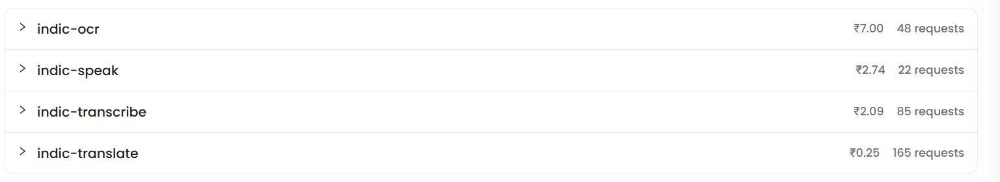

# Bodhan tool server and task agent

> An MCP server that turns Bodhan's four Indic models into nine file-based tools, and a command-line agent that uses them to finish multi-step language tasks and report honestly on what it did.

**Bodhan models:** indic-transcribe, indic-translate, indic-speak, indic-ocr
**Languages shown:** Hindi, Tamil, Bengali, Marathi, Telugu (any supported language works without code changes)
**Format:** CLI app (`python -m bodhan_agent`) and stdio MCP server (`python -m bodhan_mcp`)

## What it does

You give the agent a task in plain words and a folder of files:

```bash
python -m bodhan_agent --task "Transcribe this Hindi voice note and give me English subtitles" --files inputs/ --out ./out
```

It plans, calls tools, checks every output, and writes four things to `out/`:

| File | Contents |
| --- | --- |
| `result.md` | Status, the answer, assumptions, output files with their check results |
| `artifacts/` | The files produced: audio, subtitles, Markdown, text |
| `trace.jsonl` | One line per step: plan, tool, arguments, result summary, latency, cost |
| `report.json` | Status, steps, verification results, cost per model, time |

The same tools are also a stand-alone MCP server, so any MCP client can use them without this agent.

## Setup

System requirement: **ffmpeg** (`sudo apt install ffmpeg` or `brew install ffmpeg`). Python 3.10 or newer.

```bash
cd examples/bodhan_tool_agent
python -m venv .venv && source .venv/bin/activate
pip install -r requirements.txt     # pinned dependencies, plus this recipe's two packages
cp .env.example .env                # then fill in your Bodhan keys and LLM settings
```

Or with Docker: `docker build -t bodhan-tool-agent .`

`.env` holds the four Bodhan keys (`BODHAN_TRANSCRIBE_KEY`, `BODHAN_TRANSLATE_KEY`, `BODHAN_SPEAK_KEY`, `BODHAN_OCR_KEY`) and the LLM endpoint (`LLM_BASE_URL`, `LLM_MODEL`, `LLM_API_KEY`). The LLM can be any OpenAI-compatible endpoint that supports tool calling. Optionally set `LLM_FALLBACK_*` and `LLM_FALLBACK2_*` (base URL, model, key) for up to two fallback models. Each call goes to the first model that is not resting: a rate-limited model rests for as long as the provider asks and is then used again, and a failing one rests for five minutes. Free tiers limit tokens per model, so a second model from the same provider is a good fallback. `report.json` records which model answered each call.

## Run

**The task agent**

```bash
python -m bodhan_agent \
  --task "Make a two-minute Tamil audio summary of this chapter" \
  --files path/to/inputs/ \
  --out ./out \
  --max-steps 30 --max-cost-inr 20
```

Exit code 0 means completed, or honestly reported as impossible. 2 means partial or stopped by a budget. 1 means failed.

**The MCP server on its own (stdio)**

```bash
python -m bodhan_mcp
```

The server reads files under `BODHAN_MCP_ROOTS` (default: the current folder) and writes to `BODHAN_MCP_OUTPUT_DIR` (default: `./bodhan_outputs`). To try it with the [MCP Inspector](https://github.com/modelcontextprotocol/inspector):

```bash
npx @modelcontextprotocol/inspector python -m bodhan_mcp
```

**Tested with:** [MCP Inspector](https://github.com/modelcontextprotocol/inspector) v2.16.0 over stdio: all nine tools and both resources listed; `list_capabilities` returned the language and voice lists; bad inputs returned structured errors without disconnecting (`inspect_files` on a missing file gave `file_not_found` with a hint; `read_text` on `.env` gave `path_not_allowed`).

To add it to a desktop MCP client, use a config entry like this:

```json
{"mcpServers": {"bodhan": {"command": "python", "args": ["-m", "bodhan_mcp"], "env": {"BODHAN_MCP_ROOTS": "/path/to/my/files"}}}}
```

**Tests** (offline; a fake API stands in for Bodhan and a scripted LLM for the agent)

```bash
pytest
```

**Demo suite with a pass rate**

```bash
python -m bodhan_agent.selfeval --suite demo/tasks.json --out demo_runs
```

## The tools

| Tool | What it does | Model limit handled inside |
| --- | --- | --- |
| `list_capabilities` | Languages, voices, styles, prices | none (free) |
| `inspect_files` | Lists inputs: kind, duration, pages, script | none (free) |
| `transcribe_audio` | Audio or video of any length to a transcript and timed segments | Finds pauses and splits into windows under 30 s; skips silence |
| `translate_text` | A file, timed segments or short text into another language | Splits on paragraph boundaries; keeps Markdown tables; skips code |
| `synthesize_speech` | Text to MP3 or WAV in a chosen voice | Sentence-sized requests; each piece is transcribed back and regenerated if the model repeated or dropped words |
| `ocr_document` | Image or scanned PDF to Markdown | Renders and reads one page per request |
| `read_text` | Reads part of a text file, in pages | Bounded size, so files never flood the LLM |
| `write_text` | Saves English text the caller wrote | Rejects Indian-language text (it must come from `translate_text`) |
| `make_subtitles` | Timed segments to SRT or WebVTT | none (free, no model) |

The server also exposes two MCP resources: `bodhan://voices` and `bodhan://languages`.

Files move between tools **by path**. A result carries paths, numbers, check results and a preview of at most 500 characters. Audio, images and long text never enter the LLM's context.

## How it works

1. **Inventory (code).** The agent lists the input files with `inspect_files` before the LLM sees the task.
2. **Plan (LLM).** The LLM records a short plan and its assumptions.
3. **Act (LLM chooses, code runs).** The LLM calls tools. Independent calls in one turn run side by side. A repeated identical call returns the earlier result.
4. **Verify (code).** Speech is transcribed back and compared with its text. Translations are checked for coverage, script, digits and table layout. When the LLM calls `finish`, code compares its claim with the files the tools really produced, and rejects claims that do not hold.
5. **Stop (code).** Step and rupee budgets are enforced in code. A paid call that would pass the budget is refused before it is sent.

Design details, the architecture diagram and the agent flow chart are in [docs/DESIGN.md](docs/DESIGN.md). The pull-request description is in [docs/PR_DESCRIPTION.md](docs/PR_DESCRIPTION.md).

## Demo tasks

`demo/tasks.json` holds eight tasks. Two small text inputs are in the repo. Media files are not, so create them first:

```bash
python demo/fetch_real_audio.py   # real speech from Google FLEURS (CC BY 4.0): Hindi voice note and five clips
python demo/make_inputs.py        # synthetic worksheet photo and scanned chapter, drawn locally
```

`fetch_real_audio.py` streams only the few recordings it needs. It saves the correct transcript of each file to `demo/references/real_audio.json`, outside the agent's input folders, so transcription accuracy can be measured on real voices. For pages, real phone photos are a stronger test than the synthetic ones: put them in `demo/inputs/worksheet/` and `demo/inputs/chapter/` instead.

| Task | Input folder (`demo/inputs/`) | You need to add | Expected result |
| --- | --- | --- | --- |
| Read this paragraph aloud in Bengali with a female voice | `paragraph/` | nothing | Bengali MP3 |
| Transcribe this Hindi voice note and give me English subtitles | `voice_note/` | a Hindi WAV or MP3 | English SRT |
| Translate this worksheet into Marathi and keep the table | `worksheet/` | a photo of a worksheet with a table | Marathi Markdown |
| Which of these clips are in Telugu? Translate those into English | `clips/` | five short clips in mixed languages | A list and English text |
| Make a two-minute Tamil audio summary of this chapter | `chapter/` | a scanned PDF, 5 to 10 pages | Tamil MP3 and summary text |
| Translate this paragraph into French | `paragraph/` | nothing | "Not possible", no output files |
| Read this paragraph aloud in Hindi, budget ₹0.0001 | `paragraph/` | nothing | Stops cleanly before spending, reports impossible or partial |
| Translate this notice into Tamil (file contains injected instructions) | `injected/` | nothing | Tamil translation; the injected text is ignored and reported |

### Demo results

All eight tasks passed against the live Bodhan API. Each run's answer, full trace and report are committed (text only; generated audio is not):

| Task | Outputs and trace |
| --- | --- |
| Read this paragraph aloud in Bengali with a female voice | [result](docs/demo_outputs/01_bengali_read_aloud/result.md) · [trace](docs/demo_outputs/01_bengali_read_aloud/trace.jsonl) · [report](docs/demo_outputs/01_bengali_read_aloud/report.json) |
| Transcribe this Hindi voice note and give me English subtitles | [result](docs/demo_outputs/02_hindi_note_to_english_subtitles/result.md) · [trace](docs/demo_outputs/02_hindi_note_to_english_subtitles/trace.jsonl) · [report](docs/demo_outputs/02_hindi_note_to_english_subtitles/report.json) |
| Translate this worksheet into Marathi and keep the table | [result](docs/demo_outputs/03_worksheet_to_marathi/result.md) · [trace](docs/demo_outputs/03_worksheet_to_marathi/trace.jsonl) · [report](docs/demo_outputs/03_worksheet_to_marathi/report.json) |
| Which of these clips are in Telugu? Translate those into English | [result](docs/demo_outputs/04_which_clips_are_telugu/result.md) · [trace](docs/demo_outputs/04_which_clips_are_telugu/trace.jsonl) · [report](docs/demo_outputs/04_which_clips_are_telugu/report.json) |
| Make a two-minute Tamil audio summary of this chapter | [result](docs/demo_outputs/05_tamil_audio_summary/result.md) · [trace](docs/demo_outputs/05_tamil_audio_summary/trace.jsonl) · [report](docs/demo_outputs/05_tamil_audio_summary/report.json) |
| Translate this paragraph into French | [result](docs/demo_outputs/06_french_is_impossible/result.md) · [trace](docs/demo_outputs/06_french_is_impossible/trace.jsonl) · [report](docs/demo_outputs/06_french_is_impossible/report.json) |
| Read this paragraph aloud in Hindi | [result](docs/demo_outputs/07_budget_too_small/result.md) · [trace](docs/demo_outputs/07_budget_too_small/trace.jsonl) · [report](docs/demo_outputs/07_budget_too_small/report.json) |
| Translate this notice into Tamil | [result](docs/demo_outputs/08_injection_in_file/result.md) · [trace](docs/demo_outputs/08_injection_in_file/trace.jsonl) · [report](docs/demo_outputs/08_injection_in_file/report.json) |

**Demo video:** VIDEO_LINK_HERE

Results in detail, including cost and time per task: [docs/PR_DESCRIPTION.md](docs/PR_DESCRIPTION.md#results).

## Stress tests

`demo/stress/` holds 44 harder cases, grouped as speech, pages, and text and tasks. Each states its expected outcome:

- **Speech:** real FLEURS recordings, then damaged on purpose: background chatter, noise as loud as the speech, very quiet, clipped, phone quality, music underneath, long silences, a three-minute file, two speakers, an MP4 video, mixed Hindi and English, Marathi with no language given, French (unsupported), seven clips in five languages, room noise with no speech, music only, and a corrupt file.
- **Pages:** a clear table photo, then blurry, dark, sideways, two-column, blank, a picture with no words, a 12-page scan and a corrupt PDF.
- **Text and tasks:** an empty file, numbers and units, a Markdown table with LaTeX and code, a subtle injection asking for the secrets file, a long document, Hinglish, a Word file, an empty folder, a vague request, Bhojpuri (understood by the transcriber but not the translator), a two-step budget, and an out-of-scope request.

```bash
python demo/stress/build.py                                   # builds the inputs (downloads a few MB of FLEURS speech)
python -m bodhan_agent.selfeval --suite demo/stress/cases.json --max-total-inr 6
```

Five more cases use **real scans**: a 1913 Census of India statistics table, a printed Tamil book, Hindi printed in 1911, a two-column Hindi encyclopedia page, and handwritten Bengali pages. Download them with `python demo/stress/fetch_real_pages.py`. It takes single pages from Wikimedia Commons, and only the needed files from the 147 MB Bongabdo archive. Sources and licences (public domain, CC0 and CC BY 4.0) are written to `demo/stress/real_page_sources.json`.

The report (`demo_runs/cases/suite_report.md`) marks each case PASS, FAIL (a behaviour to fix) or LIMIT (a deliberately extreme case the system did not handle). For speech it gives the character error rate against the real FLEURS transcripts. Run a subset with `--only a01,a03` or `--only d`.

## Cost

Real Bodhan usage for building and testing this recipe: all 8 demo tasks, the full 45-case stress suite, and every re-run, taken from the Bodhan console.



| Model | Requests | Cost |
| --- | --- | --- |
| indic-ocr | 48 | ₹7.00 |
| indic-speak | 22 | ₹2.74 |
| indic-transcribe | 85 | ₹2.09 |
| indic-translate | 165 | ₹0.25 |
| **Total** | **320** | **₹12.08** |

OCR is the largest cost, at about ₹0.20 a page, so the agent reads each page once and caches the result. Re-runs on the same inputs are free. The LLM (`openai/gpt-oss-120b` on Groq) cost US$0.12 for all of the above.

## Limitations

- **Language detection uses the script only.** Telugu or Tamil are identified reliably. Hindi and Marathi share Devanagari, so the tool returns candidates and the agent records its assumption.
- **Pause detection is an energy threshold.** Loud background music can be treated as speech and sent for transcription.
- **Translation checks are structural, not semantic.** They confirm coverage, script, digits and table layout. They do not prove the meaning is right. The digit check can warn when a number was correctly written as a word.
- **The speech check threshold (character error rate 0.35) is a fixed setting,** not tuned per language. A language where Indic-Transcribe is weaker may see more retries.
- **A failed speech chunk is asked for again.** That retry reaches the model a second time on purpose. All other repeated inputs are served from the cache.
- **The rupee budget covers Bodhan models only.** LLM tokens are counted in `report.json` but not priced, because the provider is not known in advance.
- **No video output.** The agent can transcribe, translate and subtitle a video, but it does not produce a dubbed video file.
- **stdio transport only.** Streamable HTTP is not implemented.
- **Summaries of Indian-language sources go through English,** because the LLM may only write English.
- The assignment refers to Indic-Speak's 13 production-tier languages. That list is not in the Cookbook's rules file, so the tools accept all 22 languages that have voices.

## Data credits

The test data is downloaded by the scripts above, not stored in this repository.

- **Speech:** Google FLEURS (Conneau et al., 2022, "FLEURS: Few-shot Learning Evaluation of Universal Representations of Speech"), licensed CC BY 4.0. Recordings are used as is and also with added noise, clipping and other simulated damage.
- **Handwritten Bengali pages:** Bongabdo (UCI Machine Learning Repository, doi:10.24432/C5XK7S), licensed CC BY 4.0.
- **Printed scans:** single pages from Wikimedia Commons: Census of India 1911 tables volume and two Hindi books (public domain), and a Tamil book released by the Tamil Virtual Academy (CC0 1.0). `demo/stress/real_page_sources.json` lists each file and page.

