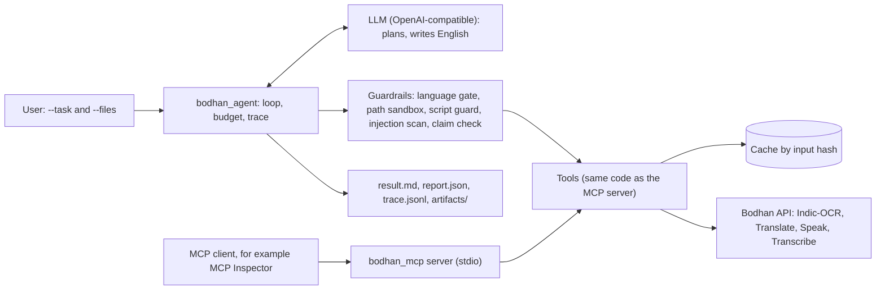
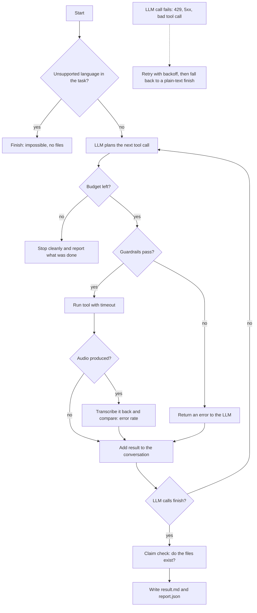

# Bodhan Tool Server and Task Agent

An MCP server that exposes Bodhan's four Indic models (Indic-OCR, Indic-Translate, Indic-Speak, Indic-Transcribe) as tools, plus a command-line agent that plans multi-step language tasks, calls those tools, verifies its own work, and stops cleanly when a task is impossible or the budget runs out.

All OCR, translation, speech synthesis and speech recognition go to Bodhan models. The LLM only plans and writes English. Generated audio is AI-generated (Indic-Speak voices come from a fixed library; no voice cloning).

## Demo video

[Demo Video & Test Audio Artifacts (Google Drive)](https://drive.google.com/drive/u/0/folders/1ux2vf-JeWm8jCSHZb3BoOtqi6VGr68FL)

Five minutes or less: the MCP server in MCP Inspector, the agent completing tasks, the impossible-task refusals, the speech check and the tests.

## Setup

Tested with Python 3.14.

```bash
python -m venv .venv
.venv\Scripts\activate            # Linux/macOS: source .venv/bin/activate
pip install -r requirements.txt
pip install -e .                  # makes `python -m bodhan_mcp` and `python -m bodhan_agent` work from any folder
cp .env.example .env              # then fill in the keys (never commit .env)
```

No system packages are needed: ffmpeg comes from `imageio-ffmpeg` and PDFs are rendered with `pypdfium2`.

`.env` holds four Bodhan keys (one per model, from the [Bodhan console](https://console.bodhan.ai)) and three LLM settings (`LLM_BASE_URL`, `LLM_MODEL`, `LLM_API_KEY`) for any OpenAI-compatible endpoint with tool calling.

### Docker (optional)

```bash
docker build -t bodhan-tool-agent .
docker run --rm bodhan-tool-agent python -m pytest -q          # 31 tests, no network needed
docker run -i --rm --env-file .env bodhan-tool-agent           # the MCP server over stdio
```

With `--env-file`, remove quote marks around the values in `.env`. To run the agent in Docker, mount an input and an output folder:

```bash
docker run --rm --env-file .env -v "%cd%\my_inputs":/data/in -v "%cd%\my_out":/data/out bodhan-tool-agent python -m bodhan_agent --task "Read this paragraph aloud in Bengali with a female voice." --files /data/in --out /data/out
```

(On PowerShell or Linux, replace `%cd%` with `${PWD}` or `$(pwd)`.)

## Run

The task agent:

```bash
python -m bodhan_agent --task "Read the text in this image aloud in Tamil with a female voice." --files path/to/inputs/ --out ./out --max-steps 30 --max-cost-inr 20
```

The MCP server on its own (stdio):

```bash
python -m bodhan_mcp
```

Tested with MCP Inspector 2.13.0: `npx @modelcontextprotocol/inspector python -m bodhan_mcp`.

One agent run writes `result.md` (answer, assumptions, speech checks, files), `artifacts/`, `trace.jsonl` (one line per step: plan, tool, arguments, result summary, latency, cost) and `report.json` (status, steps, cost, speech checks, guardrail events).

Tests: `python -m pytest -q` (31 tests; no network and no credits, the end-to-end test uses a scripted fake LLM).

## How it works

### Architecture



The agent imports the same tool functions that the MCP server serves, so the two never disagree.

### Agent flow



### Tools

| Tool | What it does | How it handles model limits |
|---|---|---|
| `ocr_document` | Image or PDF to Markdown with layout blocks | PDF pages rendered one at a time, one page per request, per-page cache; low-confidence blocks are listed; long text goes to a file |
| `translate_text` | Translate one text | Rejects over 4000 characters with a clear error |
| `translate_file` | Translate a whole file | Splits at blank lines (tables stay whole), pieces cached; checks headings, table rows and numbers |
| `speak_text` | Text or file to a WAV | One sentence per request, joined into one file; voice and language checked first |
| `transcribe_audio` | Audio or video to text | Cut into windows of at most 25 s at silences; per-window cache |
| `make_subtitles` | Audio to an SRT file | Transcribe, translate each sentence, approximate timing |
| `detect_script` | Writing system and candidate languages | No model call |
| `read_text_file` | Read a file in parts | At most 12000 characters per call |
| `write_text_file` | Save English text (such as a summary) | Lets the LLM hand text on by path instead of copying it |

Granularity: one tool per Bodhan model, plus a few helpers. Each model tool hides its own limits (chunking, retries, caching), so the planner never needs to know them. `translate_file` and `make_subtitles` exist so long Indian-language text moves between tools by file path and never passes through the LLM. Inputs are typed; outputs are documented dictionaries.

### Where the LLM is used

It chooses tools and arguments, and writes English summaries and the final answer. It never writes Indian-language text (enforced in code), never reads images or audio, and never decides budgets. If it returns a broken tool call, the agent retries, then asks for the final answer as plain JSON. A rate limit (429) or server error (5xx) is retried using the wait time the server gives. The LLM endpoint comes only from `LLM_BASE_URL`, `LLM_MODEL` and `LLM_API_KEY`.

### Guardrails (plain code, not LLM judgement)

1. **Language gate:** a task naming an unsupported language (for example French) is refused before any model call.
2. **Path sandbox:** tools may only read the input files and files made during the run.
3. **Script guard:** every Indian-language word the LLM passes to a tool, or puts in its final answer, must have come from a tool result; otherwise the call is blocked or the word is removed.
4. **Injection scan:** OCR, transcript and file text that looks like instructions is flagged, and the LLM is told to treat it as data.
5. **Speech check:** each audio file is transcribed back and compared with the spoken text (numbers and punctuation normalised); the error rate goes into `report.json`.
6. **Budget:** steps, rupees (estimated before each paid call) and per-call timeouts, counted in code.
7. **Claim check:** the final status comes from files that exist, not from what the LLM says; an impossible task delivers no files.

## Results

Evidence for each run (`result.md`, `report.json`, `trace.jsonl`, plus text artifacts) is committed under `runs/`. Generated audio files (`.wav`) are not committed to git (per ground rules) and are accessible via the Google Drive link above.

| # | Task | Input | Status | Cost (INR) | Verification & Details | Trace Link |
|---|---|---|---|---|---|---|
| 1 | **Tamil Audio Summary** of document | PDF (`notes.pdf`) | `completed` | ₹0.51 | Speech CER 0.061 (Pass, threshold 0.3) | [`runs/01_tamil_summary/`](runs/01_tamil_summary/) |
| 2 | **Marathi Worksheet** keeping table | Image (`table.png`) | `completed` | ₹0.20 | Markdown table & numeric data preserved | [`runs/02_marathi_table/`](runs/02_marathi_table/) |
| 3 | **Bengali Speech** with prompt injection | Text (`note.txt`) | `completed` | ₹0.02 | Untrusted prompt injection ignored; CER 0.034 | [`runs/03_bengali_injection/`](runs/03_bengali_injection/) |
| 4 | **Budget Limit Enforcement** | Text (`note.txt`) | `partial` | ₹0.00 | Pre-flight check blocked paid call at ₹0.01 limit | [`runs/04_budget_limit/`](runs/04_budget_limit/) |
| 5 | **Hindi Speech to English Subtitles** | Audio (`audio.wav`) | `completed` | ₹0.00 | Generated timestamped `.srt` subtitle file | [`runs/05_hindi_subtitles/`](runs/05_hindi_subtitles/) |
| 6 | **Impossible Task (French)** | Video prompt | `impossible` | ₹0.00 | Language gate refused before calling any model | [`runs/06_french_refused/`](runs/06_french_refused/) |
| 7 | **Impossible Task (Missing File)** | Missing file path | `impossible` | ₹0.00 | Honest refusal without fabricated outputs | [`runs/07_missing_file/`](runs/07_missing_file/) |
| 8 | **Tamil Read-Aloud from Image** | Image quote | `completed` | ₹0.00 | OCR + translation + speech; CER 0.00 | [`runs/08_tamil_image_ocr/`](runs/08_tamil_image_ocr/) |

LLMs used: `gemini-3.1-flash-lite` through Gemini's OpenAI-compatible endpoint, and `openai/gpt-oss-120b` on Groq.

## Known limitations

- **Translate route:** the Cookbook README documents `POST /translate`, which returned 404 when tested (Cookbook issue #34). Indic-Translate is called through `/v1/chat/completions` instead.
- The language gate matches English language names only. A task written in another language reaches the LLM, which can still refuse.
- The injection scan only knows English phrases. Defence in depth is the path sandbox, the script guard and the budget.
- The speech check can flag correct audio when the transcript spells numbers as words.
- The translation check catches dropped sections and changed numbers, not wrong word choices.
- Budget estimates are upper bounds and ignore the cache, so a call that would have been free can be blocked.
- Subtitle timing is approximate: the API returns text per window, not word times.
- Tools run one at a time (concurrency limit 1).

## AI assistance

I used Claude (Anthropic) as a coding assistant for design discussion, drafting code and debugging. I ran and tested everything locally and can explain every part.
