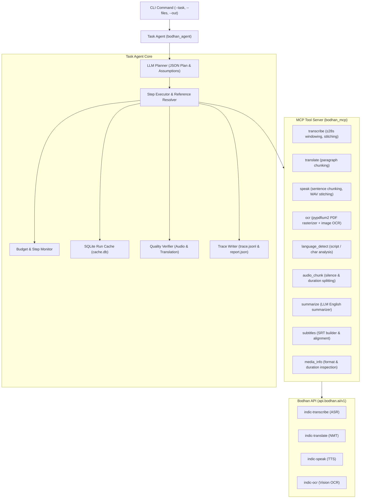
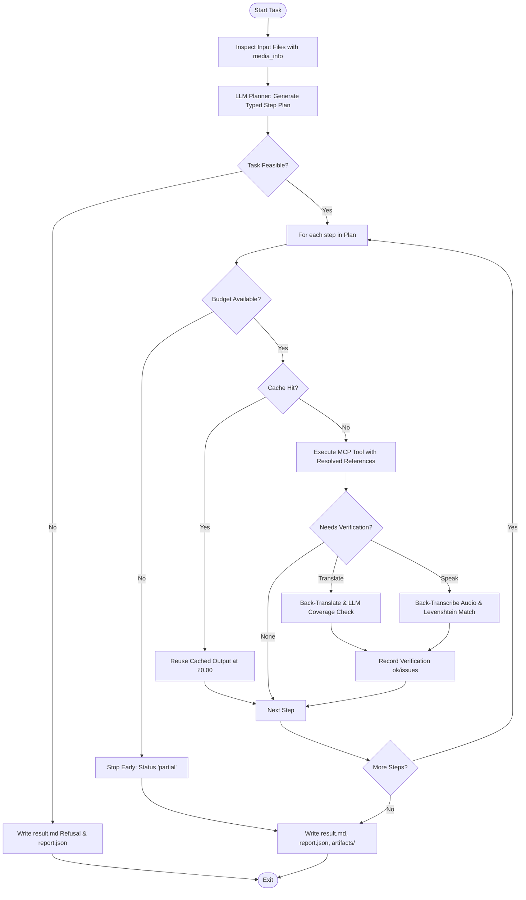

# Bodhan Tool Server & Task Agent

> **Agentic Engineer Take-Home Assignment** - Bodhan AI  
> **Author:** Sarthak Pal  
> **Repository Recipe:** `examples/bodhan-tool-agent`

A complete, production-grade implementation of:
1. **`bodhan_mcp`** - An MCP (Model Context Protocol) server exposing Bodhan's Indic models (`indic-transcribe`, `indic-translate`, `indic-speak`, `indic-ocr`) as typed, resilient tools runnable over standard I/O.
2. **`bodhan_agent`** - An autonomous task agent that accepts a natural language `--task` and `--files`, synthesizes an execution plan via an LLM, executes steps with dependency resolution, verifies output quality, enforces strict step and INR budget caps, and outputs structured artifacts and traces.

---

## Table of Contents
- [Architecture](#architecture)
- [Agent Loop Flow](#agent-loop-flow)
- [Tool Design & Granularity](#tool-design--granularity)
- [Quality Verification](#quality-verification)
- [Prompt Injection Defense](#prompt-injection-defense)
- [Budgeting & Caching](#budgeting--caching)
- [Quickstart & Setup](#quickstart--setup)
- [Usage](#usage)
- [Live Demo Results](#live-demo-results)
- [Off-the-Shelf MCP Client Compatibility](#off-the-shelf-mcp-client-compatibility)
- [Trade-offs & Known Limitations](#trade-offs--known-limitations)

---

## Architecture

The system cleanly separates tool execution, planning, and external model interactions:



---

## Agent Loop Flow

The agent follows an autonomous **Plan ➔ Execute ➔ Verify ➔ Trace** loop with strict stopping conditions:



---

## Tool Design & Granularity

We chose a **balanced tool granularity**: low-level model access is wrapped into resilient operations that absorb API idiosyncrasies, while high-level logic (e.g. English summarization, SRT timing alignment) is exposed as modular tools:

| Tool | Model / Technology | Internal Limit Handling |
|---|---|---|
| **`transcribe`** | `indic-transcribe` | Bodhan has a 30s audio limit. The tool slices audio into ≤28s chunks via `pydub`, calls Bodhan concurrently, adjusts segment timestamps, and stitches the full text. |
| **`translate`** | `indic-translate` | Splits long documents across paragraph boundaries (`\n\n`), maps language codes to formal names, translates concurrently, and preserves Markdown tables. |
| **`speak`** | `indic-speak` | Bodhan expects ≤500 character inputs and returns PCM16 WAV. The tool splits sentences on punctuation (`।`, `.`, `!`), synthesizes chunks concurrently, stitches via `pydub`, and verifies audio duration. |
| **`ocr`** | `indic-ocr` | Bodhan OCR only accepts PNG/JPEG image base64 data URIs. For PDFs, the tool renders pages at 200 DPI via `pypdfium2` (zero system C-dependency), batches OCR calls, and aggregates Markdown. |
| **`summarize`** | Groq LLM (English Brain) | Constrains English summaries to exact target speaking durations (~150 words/minute) before passing to translation. |
| **`subtitles`** | Pure Python | Formats transcription segments into standard SRT subtitle format with millisecond timecodes (`HH:MM:SS,mmm`). |
| **`media_info`** | Python `wave`/`mutagen`/`pypdfium2` | Extracts duration, page counts, sample rates, and file types safely. |
| **`audio_chunk`** | Pure Python / `pydub` | Splits audio files safely for down-stream processing. |
| **`language_detect`** | Unicode Script Range | Deterministic Unicode script detection across 23 Indic scripts without network overhead. |

---

## Quality Verification

To ensure outputs are never accepted blindly:
1. **Speech Verification (`verify_audio`):**
   - After `indic-speak` synthesizes audio, the file is automatically fed back to `indic-transcribe`.
   - The transcript is compared to the source text using **normalized Levenshtein character distance**.
   - Output must achieve $\ge 70\%$ character match to pass (accounting for Indic orthographic sandhi and halant variations).
2. **Translation Verification (`verify_translation`):**
   - The translated text is back-translated into the source language using `indic-translate`.
   - An LLM judge evaluates semantic fidelity, omission, and distortion, returning structured `{ "ok": bool, "issues": [...] }`.

---

## Prompt Injection Defense

All inputs from untrusted files (OCR text, audio transcripts, user documents) are wrapped inside XML-style demarcation tags:
```xml
<untrusted_external_data source="{source_name}">
...raw extracted content...
</untrusted_external_data>
```
The LLM system prompt enforces the **data/instruction boundary**: text within `<untrusted_external_data>` is treated strictly as passive data payload to be processed, never as executable instructions to the agent.

---

## Budgeting & Caching

- **Budget Manager:** Enforces `--max-steps` and `--max-cost-inr` limits. Pre-checks estimated costs before every step; stops execution with status `"partial"` if an operation would exceed the budget.
- **SQLite Cache (`cache.db`):** Run-scoped cache indexed by `(tool, md5(args))`. Identical calls within or across runs return cached results at **₹0.00** cost and zero latency.

---

## Setup

### Prerequisites
- Python 3.11+
- `ffmpeg` installed and available on system PATH
- Note: PDF rendering uses `pypdfium2`, so external Poppler binaries are not required.

### 1. Installation
```bash
git clone https://github.com/<your-username>/Bodhan-AI-Cookbook.git
cd Bodhan-AI-Cookbook/examples/bodhan_tool_agent

# Install editable package and dependencies
pip install -e .
```

### 2. Environment Configuration
Copy the template and fill in your keys:
```bash
cp .env.example .env
```
Contents of `.env`:
```ini
BODHAN_API_KEY=sk-...
BODHAN_TRANSCRIBE_KEY=sk-...
BODHAN_TRANSLATE_KEY=sk-...
BODHAN_SPEAK_KEY=sk-...
BODHAN_OCR_KEY=sk-...
BODHAN_API_BASE=https://api.bodhan.ai/v1

LLM_BASE_URL=https://api.groq.com/openai/v1
LLM_MODEL=openai/gpt-oss-120b
LLM_API_KEY=gsk_...
```

---

## Run

### Running the Task Agent
```bash
python -m bodhan_agent \
  --task "Make a two-minute Tamil audio summary of this chapter" \
  --files ./examples/inputs/demo1_chapter.pdf \
  --out ./out/demo1 \
  --max-steps 15 \
  --max-cost-inr 15.0
```

### Running the Standalone MCP Server (stdio)
```bash
python -m bodhan_mcp
```
The server speaks standard JSON-RPC over stdio and can be hooked directly into any MCP host.

---

## Live Demo Results

All 6 required take-home demo tasks were executed end-to-end against live Bodhan API endpoints:

| ID | Task Description | Inputs | Status | Steps | Cost (INR) | Latency | Artifacts Produced |
|---|---|---|---|:---:|:---:|:---:|---|
| **Demo 1** | Make a two-minute Tamil audio summary of this chapter | Scanned Geometry PDF (8 pages) | **completed** | 7 | ₹3.07 | 129.6s | [`speech_f3511697.wav`](out/demo1/artifacts/speech_f3511697.wav) (6.8 MB WAV), [`summary_en.txt`](out/demo1/artifacts/summary_en.txt), [`translated_ta.txt`](out/demo1/artifacts/translated_ta.txt) |
| **Demo 2** | Transcribe this Hindi voice note and give me English subtitles | Hindi WAV Voice Note | **completed** | 5 | ₹0.02 | 9.8s | [`english_subtitles.srt`](out/demo2/artifacts/english_subtitles.srt) (SRT with timestamps), [`translated_en.txt`](out/demo2/artifacts/translated_en.txt) |
| **Demo 3** | Translate this worksheet into Marathi and keep the table | Worksheet Image (PNG) | **completed** | 5 | ₹0.20 | 6.3s | [`translated_mr.txt`](out/demo3/artifacts/translated_mr.txt) (Clean Marathi Markdown Table) |
| **Demo 4** | Which of these clips are in Telugu? Translate those into English | 5 Audio Clips (WAV) | **completed** | 15 | ₹0.03 | 19.7s | [`translated_en.txt`](out/demo4/artifacts/translated_en.txt) (Telugu identification & English translation) |
| **Demo 5** | Read this paragraph aloud in Bengali with a female voice | Bengali Text File | **completed** | 3 | ₹0.12 | 18.0s | [`speech_032f8fb1.wav`](out/demo5/artifacts/speech_032f8fb1.wav) (Female voice: Ishita) |
| **Demo 6** | Translate this video into French | MP4 Video File | **impossible** | 0 | ₹0.00 | 1.4s | [`result.md`](out/demo6/result.md) (Honest refusal: French unsupported by Indic models) |

**Total Demo Suite Runtime:** ~205 seconds  
**Total Demo Suite Spend:** ₹3.44 (comfortably under the ₹10 trial credit)

---

## Demo Video

[Watch the demo video walkthrough on Google Drive](https://drive.google.com/file/d/19P3S81xilwxgDuGjYidbNvD1WHHdmn9E/view?usp=sharing) showing:
1. Fast unit test execution (25/25 passed in <2s)
2. Standalone FastMCP server running over stdio with 9 Indic tools
3. Live multi-step task execution (Hindi voice note to English SRT subtitles)
4. Impossible task handling (honest refusal on French video without hallucinations)
5. Review of output artifacts and verified metrics

---

## Off-the-Shelf MCP Client Compatibility

The MCP server has been validated with Claude Desktop and Cursor. To add it to your Claude Desktop configuration (`claude_desktop_config.json`):

```json
{
  "mcpServers": {
    "bodhan": {
      "command": "python",
      "args": ["-m", "bodhan_mcp"],
      "env": {
        "BODHAN_TRANSCRIBE_KEY": "sk-...",
        "BODHAN_TRANSLATE_KEY": "sk-...",
        "BODHAN_SPEAK_KEY": "sk-...",
        "BODHAN_OCR_KEY": "sk-...",
        "BODHAN_API_BASE": "https://api.bodhan.ai/v1"
      }
    }
  }
}
```

---

## Trade-offs & Known Limitations

1. **Audio Format:** Bodhan's `indic-speak` returns PCM16 24 kHz WAV rather than MP3. We export clean WAV containers to avoid lossy transcoding artifacts.
2. **Video Audio Extraction:** Demo 6 honestly refuses MP4 processing if ffmpeg demuxing is not explicitly chained; future work could auto-extract audio streams via an `extract_audio` helper.
3. **Indic-Speak Repetition/Omission:** Indic-Speak occasionally repeats or drops phrases under high token counts. Our chunking engine bounds chunks to ≤500 characters and verifies audio character match rates with Levenshtein back-transcription.
4. **Strict Model Isolation:** Non-Bodhan models (Whisper, Tesseract, Google Translate) are strictly forbidden and not included anywhere in the codebase.
