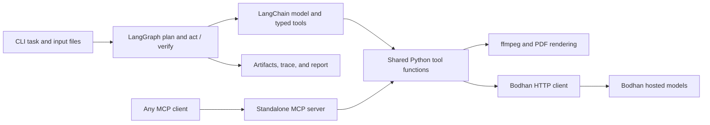

# Bodhan Tool Server and LangGraph Agent

An independently runnable MCP server for Bodhan transcription, translation, speech, and OCR, plus a non-interactive LangGraph task agent. The agent uses LangChain tools, keeps media processing in Python, enforces step and rupee limits, verifies generated artifacts, and writes a replayable run folder.

## Setup

Requires Python 3.11 or newer and ffmpeg with ffprobe on PATH.

    cd examples/bodhan_tool_agent
    python -m venv .venv
    source .venv/bin/activate
    pip install -r requirements.txt
    pip install -e .
    cp .env.example .env

Set Bodhan model keys and a planner key in `.env`. The default planner configuration uses Gemini's OpenAI-compatible endpoint; paste your Google AI Studio key into `LLM_API_KEY`. You can replace the URL and model with another tool-calling OpenAI-compatible provider:

    BODHAN_TRANSCRIBE_KEY=...
    BODHAN_TRANSLATE_KEY=...
    BODHAN_SPEAK_KEY=...
    BODHAN_OCR_KEY=...
    LLM_BASE_URL=https://generativelanguage.googleapis.com/v1beta/openai/
    LLM_MODEL=gemini-3.5-flash-lite
    LLM_API_KEY=your_gemini_api_key
    LANGSMITH_TRACING=true
    LANGSMITH_API_KEY=your_langsmith_api_key
    LANGSMITH_PROJECT=bodhan-tool-agent

The local `API/` folder is ignored by Git and excluded from the tool file browser. Copy each key into its matching variable yourself; keys never enter source, traces, prompts, or output reports.

## Run

Run the standalone MCP server over stdio:

    python -m bodhan_mcp

Run a task with the assignment's command shape (from `examples/bodhan_tool_agent`):

    python -m bodhan_agent --task "Make a two-minute Tamil audio summary of this chapter" --files path/to/inputs/ --out ./out --max-steps 30 --max-cost-inr 20

The CLI accepts multiple input paths after --files. MCP tools can inspect files under BODHAN_WORKSPACE, which defaults to the current directory.

Each run writes:

    out/
      result.md
      report.json
      trace.jsonl
      artifacts/

## Architecture

## How it works

The first model request plans in English and selects the first tool, saving a separate planning round trip. The graph loops through tools, then checks every produced artifact. A failed check gives the agent one focused repair turn. Code handles chunking, media conversion, supported-language validation, bounded API retries, duplicate-call caching, cost estimates, and output checks.

The CLI and MCP server call the same Python functions. MCP uses typed schemas generated from signatures and docstrings. The agent runs those functions through LangGraph ToolNode; there is no second implementation of API behavior. LangSmith traces LLM calls automatically and records redacted spans for standalone MCP tool calls. See [architecture](docs/architecture.md), [agent flow](docs/agent-flow.md), [design notes](docs/design-notes.md), and [authentication](docs/authentication.md).

## Tools

| Tool | What it does |
| --- | --- |
| list_files / inspect_media | Safe input inventory, media type, duration, and PDF page count |
| read_text | Bounded read of text files; content is marked as untrusted |
| transcribe_audio / translate_transcription | Bodhan speech recognition; splits audio/video into 25-second WAV windows; translation stays inside the tool layer |
| translate_text / translate_file | Bodhan Indic-Translate; splits long inputs and retries truncated chunks once; file flow supports OCR |
| synthesize_speech / translate_and_synthesize / speak_file | Bodhan Indic-Speak; translates English first when needed, joins sentence-sized audio, and marks it AI-generated |
| ocr_document | Bodhan Indic-OCR; renders PDFs page by page and preserves Markdown/table layout |
| make_subtitles | Bodhan transcription plus per-window translation into SRT |
| write_english | Writes English summaries and rejects non-Latin letters |
| list_languages_and_voices | Reads supported models, languages, and voices from the Cookbook API rules |

Media stays in files. OCR base64 encoding happens only inside the Bodhan API request, never in the planner context.

## Model use and safety

All speech recognition, Indic translation, speech synthesis, and OCR calls go to Bodhan. The planner may write English summaries and decide which tools to call. It does not create Indic-language text, transcribe audio, or directly process images. Bodhan OCR extracts text; non-English/Indic results stay inside the tools, while English text can be returned for English summaries. File contents and tool results are untrusted data; instructions inside them are ignored.

Supported languages come from scripts/bodhan_api_rules.json. The code uses Bodhan's OpenAI-compatible chat endpoint for translation because the live submissions reported that the plain /translate route returned 404. STT uses /v1/audio/transcriptions, TTS uses /v1/audio/speech, and OCR uses /v1/chat/completions.

The agent rejects unsupported target languages, missing files, empty input, invalid voices, and invalid scripts with structured errors. Indic OCR and transcript results stay in artifacts unless Bodhan translated them into English. HTTP failures include Bodhan's status and error code. Only 429 and selected 5xx responses receive bounded exponential backoff; a timeout after dispatch is not retried automatically because the call may already have been billed.

## Budgets, cache, and verification

The agent estimates Bodhan costs before each request using the assignment rates: ₹0.10 per input audio minute, ₹0.20 per 10,000 translation output tokens (estimated conservatively from input length), ₹6 per 10,000 speech input characters, and ₹0.20 per OCR page. The estimate is reserved for each retry. --max-steps and --max-cost-inr stop work cleanly.

Successful API responses are cached by model, request body, file hash, and key identity in `.bodhan-cache`. The cache is local and excluded from Git. Traces contain summarized arguments, tool names, elapsed time, error codes, artifact names, and estimated cost; text arguments are represented by length and a short hash. They omit keys and source text.

The verifier checks that artifacts exist and are non-empty, validates SRT cues and translated script, and back-transcribes generated speech with Indic-Transcribe. Subtitle timestamps are approximate 25-second windows because the API does not return word-level timing. A failed audio check is reported as partial rather than hidden. `report.json` records quality checks, Bodhan cost by model, latency, and limits that need human review. LLM provider cost is not included because the provider sets its own pricing.

## Run checks

    ruff check src tests
    pytest -q
    python ../../scripts/validate_recipe.py .

The unit tests use a fake HTTP transport and do not need API credentials. Live demo calls require the Bodhan and planner keys above.

## Limitations

- Back-transcription similarity is a coarse automatic check, not native-speaker review.
- Subtitle timing is approximate and may need alignment for professional captions.
- OCR quality depends on scan resolution and page layout; very large PDFs may exceed time or cost budgets.
- Speech format follows Bodhan's response Content-Type. ffmpeg is needed to join multi-part speech.
- Script checks detect writing systems, not semantic translation quality; romanized Indic text can look Latin and requires reviewer care.
- No web UI or Streamable HTTP authentication is included; the required standalone stdio MCP transport is supported.
