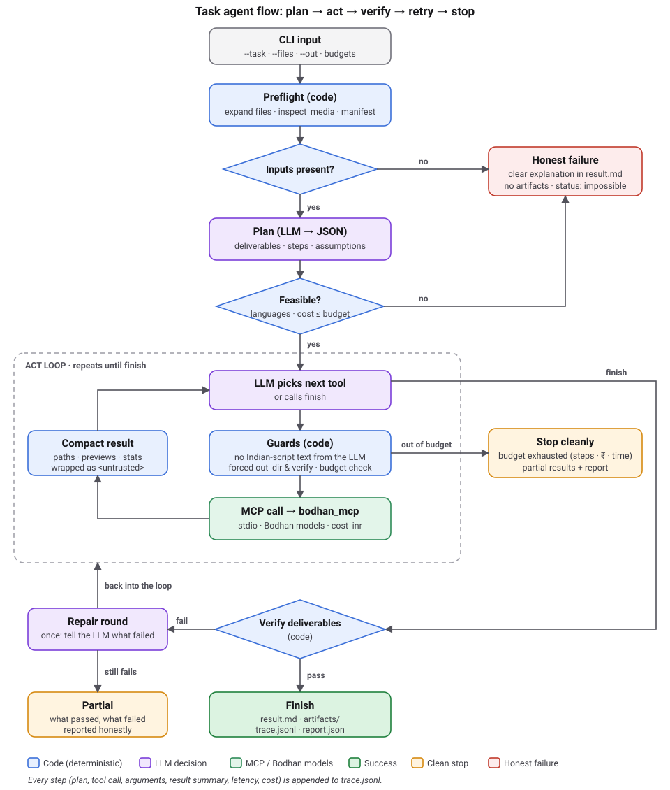

# Bodhan tool server and task agent

> An MCP server that exposes Bodhan's four Indic models as tools, and a command-line agent that uses them to complete multi-step language tasks.

**Bodhan models:** indic-transcribe, indic-translate, indic-speak, indic-ocr
**Languages shown:** Hindi, Tamil, Marathi, Telugu, Bengali (any language the models support)
**Format:** CLI agent + MCP server (stdio)

> **Status:** the MCP server, its tools and the task agent work end to end against the live Bodhan API. Demo video and self-evaluation suite are next; see [Roadmap](#roadmap).

## What it does

- `python -m bodhan_mcp` runs a standalone MCP server (stdio) with tools for speech-to-text, translation, speech synthesis and OCR. Every model limit (30-second audio windows, short TTS inputs, the translation context, multi-page PDFs) is handled inside the tools. Media moves by file path, never as inline base64.
- `python -m bodhan_agent` takes a plain-language task plus input files, plans, calls those tools, verifies its outputs, and writes `result.md`, `artifacts/`, `trace.jsonl` and `report.json`.

All speech-to-text, translation, speech synthesis and OCR go to Bodhan models. The companion LLM only plans, chooses tools, writes English and judges results. It never writes Indian-language text.

## Setup

Requires Python 3.10+ and [ffmpeg](https://ffmpeg.org/) on `PATH`.

```bash
cd examples/bodhan_tool_agent
python -m venv .venv && source .venv/bin/activate
pip install -r requirements.txt        # or: make setup (also installs dev tools)
cp .env.example .env                   # then fill in the Bodhan keys and LLM settings
```

The agent reads its LLM from `LLM_BASE_URL`, `LLM_MODEL` and `LLM_API_KEY` (any OpenAI-compatible endpoint with tool calling). Tested with:

| LLM | Where | Notes |
|---|---|---|
| `openai/gpt-oss-120b` | Groq (`https://api.groq.com/openai/v1`) | Main development model. The free tier allows 8,000 tokens per minute, so multi-step runs spend some time waiting out rate limits (logged as `llm_wait_s`). |
| `qwen2.5:7b` | Ollama on a CPU-only laptop (`http://localhost:11434/v1`, `LLM_API_KEY=ollama`) | Robustness check: same tasks, same results, but about 7× slower. Start Ollama with `OLLAMA_CONTEXT_LENGTH=16384`, because the default 4k context silently truncates the agent's prompt. |

To create the demo inputs (git-ignored): `python scripts/make_demo_inputs.py` (under ₹0.01) and `python scripts/make_full_demo_inputs.py` (about ₹0.20). The second makes an 8-page scanned Hindi chapter (original English text, translated by Indic-Translate, rendered as noisy page images with no text layer) and five unlabelled speech clips in Hindi, Telugu, Kannada, Telugu and Tamil (Indic-Translate + Indic-Speak).

Or with Docker: `docker build -t bodhan-tool-agent .`

## Run

```bash
# The task agent
python -m bodhan_agent \
  --task "Make a two-minute Tamil audio summary of this chapter" \
  --files path/to/inputs/ \
  --out ./out \
  --max-steps 30 --max-cost-inr 20

# The MCP server on its own (stdio)
python -m bodhan_mcp

# Inspect the server's tools interactively (needs Node.js)
make inspect
```

Output layout, one folder per run:

```
out/
  result.md        # what was done, the final answer, assumptions, links to artifacts
  artifacts/       # files produced: audio, subtitles, Markdown, ...
  trace.jsonl      # one line per step: plan, tool, arguments, result summary, latency, cost
  report.json      # status, steps, verification results, total cost and time
```

## How it works

See [docs/architecture.md](docs/architecture.md), [docs/agent_flow.md](docs/agent_flow.md) and [docs/design_notes.md](docs/design_notes.md).



1. **Preflight (code):** expand inputs and inspect each file for free (kind, duration, pages, script). Missing inputs end the run here, without calling the LLM.
2. **Plan (LLM, JSON):** deliverables (kind, language, target duration), steps and assumptions, validated against a schema with one repair attempt.
3. **Feasibility (code):** every output language is supported by the model that produces it, and the minimum Bodhan cost fits `--max-cost-inr`. Otherwise the run ends with a clear explanation and nothing is spent (French, for example, is refused here).
4. **Act loop (LLM + guards + MCP):** the LLM picks tools, and independent calls run in parallel. Code guards **reject any Indian-language text written by the LLM**, force `out_dir` and speech verification, and enforce step, ₹ and time budgets. The agent talks to `bodhan_mcp` over stdio, like any MCP client. Results come back compacted, with text from the input files wrapped as `<untrusted_content>`.
5. **Verify (code):** generated speech must have passed back-transcription, translations must have full coverage with tables intact, SRT files must parse, every planned deliverable must exist in the right language, and duration targets are checked. One repair round is allowed; after that the run is reported as partial, never as success.
6. **Report:** `result.md`, `artifacts/`, `report.json` and a step-by-step `trace.jsonl`.

## Tools

Every tool takes and returns **local file paths** (never base64) and returns `{"ok": true, ...}` or `{"ok": false, "error": {code, message, hint, retryable}}`. Model limits are handled inside the tools.

| Tool | Model | What it does, and how it handles the model's limits | Cost |
|---|---|---|---|
| `inspect_media` | none | Kind (audio, video, image, PDF, text), duration, pages, script; suggests the next tool and its cost | free |
| `ocr_document` | Indic-OCR | Image or PDF → Markdown. PDFs are rendered and read page by page in parallel; tables kept; per-page script; partial failures reported | ₹0.20/page |
| `transcribe_audio` | Indic-Transcribe | Any length or format, including video soundtracks. Cut at pauses into windows of 30 s or less, silence skipped, timestamps from our own cuts, language from the script. `segment_style="subtitle"` gives segments of 7 s or less | ₹0.10/min |
| `translate_text` | Indic-Translate | Text or Markdown. Long text split at sentences; **tables translated cell by cell and rebuilt**; each piece checked (non-empty, numbers kept, target script, length); free when the text is already in the target language | ≈₹0.20/10k output tokens |
| `translate_segments` | Indic-Translate | Timed segments → translated segments, timings kept | ≈₹0.20/10k tokens |
| `synthesize_speech` | Indic-Speak (+ Transcribe to verify) | Any length → one MP3 labelled AI-generated. Sentence-sized pieces in parallel; **each piece transcribed back and compared; a failing piece is re-synthesised once**; text in the wrong script is rejected | ₹6/10k chars |
| `make_srt` | none | Segments → validated SRT | free |
| `read_text` | none | Bounded reads of large outputs | free |
| `supported_languages`, `list_voices` | none | Language and voice catalogue (also exposed as resources `bodhan://languages` and `bodhan://voices`) | free |

What the live API actually returns, and why the tools are shaped this way: [docs/api_facts.md](docs/api_facts.md).

## Tests

```bash
make test        # 100+ unit and end-to-end tests; no keys, no cost
make live        # optional: one real round trip through the tools (about ₹0.05)
```

The tests never read `.env`. The end-to-end agent tests run the real CLI and the real MCP server subprocess against local fake Bodhan and LLM HTTP servers, with a scripted LLM. They cover:
- a multi-step scanned PDF → Tamil audio summary;
- French refused at ₹0;
- missing files;
- a budget too small to finish;
- the step limit;
- Indian-language text written by the LLM being blocked;
- prompt injection staying data;
- a repair round;
- a 429 that is waited out.

## Results (live Bodhan API, `openai/gpt-oss-120b` on Groq)

| Task | Input | Status | Steps | Bodhan cost | Time | Output |
|---|---|---|---|---|---|---|
| Transcribe this Hindi voice note and give me English subtitles | 6 s WAV | ✅ completed | 6 | ₹0.00 (cached) / ₹0.01 | 78 s (64 s rate-limit waits) | English SRT |
| Read this paragraph aloud in Bengali with a female voice | Bengali .txt | ✅ completed | 7 | ₹0.11 | 91 s (61 s waits) | 13 s MP3 (voice Ishita), back-transcription passed |
| Translate this worksheet into Marathi and keep the table | worksheet PNG | ✅ completed | 5 | ₹0.20 | 66 s (52 s waits) | Marathi Markdown, 3×4 table intact |
| Make a two-minute Tamil audio summary of this chapter | 8-page scanned Hindi PDF | ✅ completed | 10 | ₹2.94 | 230 s (83 s waits) | 150 s Tamil MP3 (voice Anitha); all 10 pieces passed back-transcription (min similarity 98.4%) |
| Which of these clips are in Telugu? Translate those into English | 5 unlabelled WAV clips | ✅ completed: clip2 and clip4, correct | 10 | ₹0.04 | 270 s (249 s waits) | Two English translations; Hindi, Kannada and Tamil clips correctly excluded |
| Translate this video into French | MP4 | ⛔ impossible (correct) | 0 | ₹0.00 | 5 s | Clear explanation, no artifacts |
| Same worksheet task on `qwen2.5:7b` (local Ollama, CPU) | worksheet PNG | ✅ completed | 4 | ₹0.00 (cached) | 410 s | Same Marathi Markdown |

Recovery seen in live runs:
- In the chapter run, Indic-Translate returned 429 ("Maximum rate limit reached for the model"). The agent retried, and cached pieces made the retry cheap; the client now waits out 429s for up to about 70 s.
- In the chapter and Bengali runs, the LLM tried to pass Indian-language text it had copied into `translate_text`. Both times the guard blocked it (`POLICY_VIOLATION`) and the agent switched to passing the file path. Outputs and traces stay out of git; regenerate them with the commands above.

## Roadmap

- [x] Scaffold, config, language and voice data
- [x] Bodhan HTTP client: retries, backoff, concurrency limit, cache, cost ledger
- [x] Model tools with chunking and limit handling
- [x] Agent loop: plan, act, verify, retry, budgets
- [x] All six demo tasks from the brief, run live
- [ ] Self-evaluation suite, demo video

## Limitations

- Generated audio is AI-generated from Indic-Speak's fixed voice library; voices are not cloned.
- **Language detection uses script only.** Devanagari is shared by Hindi, Marathi, Nepali and others, so the agent records an assumption when it matters. Indic-Transcribe returns no language field.
- **Timestamps** come from our own pause-aligned cuts (the API returns none), so subtitle timing is accurate to the segment, not to the word.
- **Speech verification** compares normalised text with a fuzzy-match threshold. Numbers spoken as words lower the score, so the threshold is deliberately moderate.
- **Groq free tier:** 8,000 tokens per minute makes multi-step runs slower than the brief's latency targets, mostly time spent waiting. A paid tier or another provider removes this.
- **`/translate` returns 404** for our keys, so translation uses the documented chat-completions transport (see [docs/api_facts.md](docs/api_facts.md)).

## AI assistance

TODO (author): which coding tools were used and for what. The assignment asks for this disclosure.
