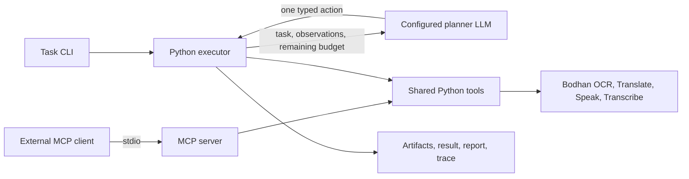
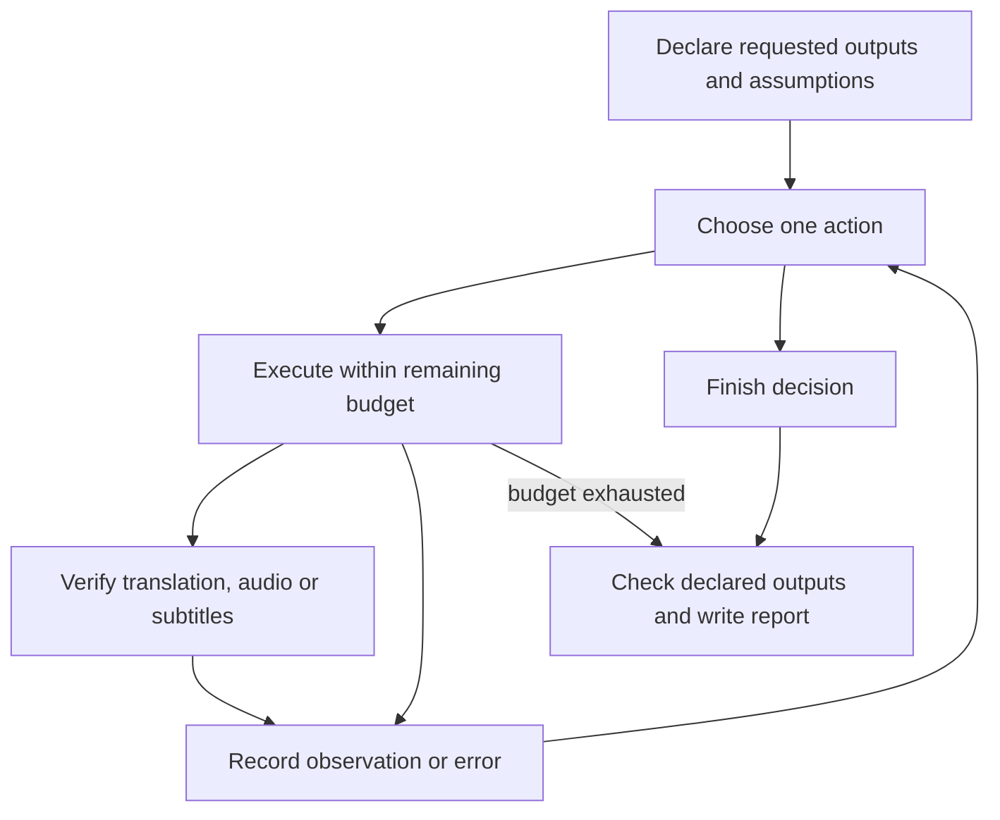

# Bodhan Tool Server and Task Agent

The standalone stdio MCP server exposes document translation, audio transcription, text-to-speech, and document OCR. The translation tool calls Indic-Translate on Bodhan's hosted `/v1/chat/completions` endpoint and returns translated text and token usage.

## Architecture



External clients discover and call the server through MCP. The agent imports
the same functions so its request budget, media paths and observations stay in one
process. The planner receives file IDs and bounded text previews. Review and
English summarization receive the passages needed for their respective checks.



## Setup

From this recipe directory, using Python 3.12:

```sh
python3 -m venv .venv
.venv/bin/python -m pip install -r requirements.txt
[ -e .env ] || cp .env.example .env
```

Add the translation key to `BODHAN_TRANSLATE_KEY` in `.env`. The server loads this file from the recipe directory. An existing environment variable takes precedence. Git ignores `.env`.

For transcription, add `BODHAN_TRANSCRIBE_KEY` to `.env` and install FFmpeg on PATH. For text-to-speech, add `BODHAN_SPEAK_KEY`. For OCR, add `BODHAN_OCR_KEY`. PDF input requires Poppler's `pdfinfo` and `pdftoppm` on PATH.

## Run

Start the server using `.venv/bin/python -m bodhan_mcp`. With Node 22.18 or later, let MCP Inspector start the process on your behalf:

```sh
npx -y @modelcontextprotocol/inspector@0.21.1 --cli .venv/bin/python -m bodhan_mcp --method tools/list
npx -y @modelcontextprotocol/inspector@0.21.1 --cli .venv/bin/python -m bodhan_mcp --method tools/call --tool-name translate_text --tool-arg 'text=The class starts at 9 tomorrow.' --tool-arg target_language=kn
```

The second command calls the hosted API. Check the Kannada output for the class, 9, and tomorrow. Use `target_language=fr` to see validation reject an unsupported language before sending a request. Inspect `isError` in the tool result.

To transcribe the Cookbook's Hindi sample with Inspector:

```sh
npx -y @modelcontextprotocol/inspector@0.21.1 --cli .venv/bin/python -m bodhan_mcp --method tools/call --tool-name transcribe_audio --tool-arg audio_path=../../sample_data/sample_hindi.wav --tool-arg language=hi
```

The server decodes the file into 16 kHz mono WAV and sends audio to Bodhan in windows of at most 30 seconds. The response includes the joined transcript and per-window text and offsets. Offsets give window boundaries rather than word timings. Exact cuts can split words, and a failed window returns an error identifying its bounds.

To generate a WAV file with Indic-Speak:

```sh
npx -y @modelcontextprotocol/inspector@0.21.1 --cli .venv/bin/python -m bodhan_mcp --method tools/call --tool-name synthesize_speech --tool-arg 'text=Class starts at nine tomorrow. Please bring your notebook.' --tool-arg language=en --tool-arg voice=Arun --tool-arg output_path=outputs/class.wav
```

The tool splits at sentence boundaries and wraps longer sentences at word boundaries. Its 200-character cap per request is a local policy based on [Bodhan's short-input guidance](https://console.bodhan.ai/api-docs/#text-to-speech-api). The response gives the file path, duration, chunk count, and an AI-generated label. Choose a new path each time.

To extract text from a scanned PDF, replace the example path with your file:

```sh
npx -y @modelcontextprotocol/inspector@0.21.1 --cli .venv/bin/python -m bodhan_mcp --method tools/call --tool-name extract_document_text --tool-arg document_path=/path/to/scan.pdf
```

The tool also accepts a PNG or JPEG as a single page. It checks the PDF page count, renders each page, and returns numbered Markdown entries in order. The MCP call takes a file path. Only the server's Bodhan HTTP request encodes the image. Bodhan receives one page per request, with a 4,096-token budget per layout block. If a page fails, the tool reports which page failed.

Run the offline checks with `.venv/bin/python -m unittest discover -s tests -v`. They use an HTTP test transport to check the request and response mapping, truncation, rate-limit behavior, the exact 30-second audio boundary, TTS chunking, and OCR page counts and ordering.

Translation accepts up to 128,000 UTF-8 bytes. It splits at lines, sentences, or
word boundaries and caps each provider input at 1,200 bytes. These are local
limits. Common Markdown headings, list markers, fenced code, and Markdown and
HTML table syntax stay local. Table cells are translated separately, so long
tables can require many requests. A repeated segment within the same call
reuses its translation. Output spans map each translated segment to its source
using Unicode code-point offsets. Translation of arbitrary Markdown syntax and
context across individually translated paragraphs remains limited.

[Translation API reference](https://console.bodhan.ai/api-docs/#translation-api)

## Run the task agent

Set `LLM_BASE_URL` (the OpenAI-compatible base, usually ending in `/v1`), `LLM_MODEL`, and `LLM_API_KEY` in the local `.env`. The Bodhan model keys remain separate.

```sh
.venv/bin/python -m bodhan_agent \
  --task "Read this scanned handout aloud in Kannada" \
  --files /path/to/scan.pdf \
  --out outputs/handout-run \
  --max-steps 12 --max-cost-inr 2
```

Choose a new or empty output directory. The agent writes `result.md`, `report.json`, `trace.jsonl` and `artifacts/`. The planner selects typed actions referencing known input and text IDs. The executor imports the same Bodhan operations exposed over stdio. It sends media directly to Bodhan and uses text previews for planning. The first planner action declares the requested deliverables. Each published
file must match its declared format and language, and speech must pass
read-back before it fulfills a deliverable. The report lists completed and
pending deliverables. Translation review checks bounded groups of aligned
source and output segments.

The cost limit covers Bodhan charges at the assignment rates. OCR and speech requests reserve cost before submission, as do each STT window and each translation request. Translation reserves for up to 2,048 output tokens and settles against usage if it is available. Uncertain charges stay reserved. Planner charges are separate. The agent checks translations for coverage through the planner and compares Bodhan's speech read-back to the source. The read-back comparison is a heuristic and can flag ASR variation as a speech mismatch.

The trace records translation review and speech read-back as verification events linked to the planner step that triggered them. Each event has its own latency and Bodhan request costs. Tool events exclude verification latency and costs, so those amounts are counted once. The step count reflects planner decisions and includes the finish decision.

For an audio summary, the agent writes and reviews an English narration from
up to 48 KB of English source text. Indic-Translate handles any language
conversion. The matched summary text and audio use the same narration.
The agent supports WAV and MP3. For a timed request, ffmpeg can adjust playback
tempo by up to 15%. The agent uses the final audio's decoded duration and
reports a miss outside 15% of the requested duration, with a one-second
minimum tolerance. It can revise the narration before exporting the text.

For SRT, the agent uses audio windows of at most eight seconds and prefers nearby pauses, translates each nonblank cue
with Bodhan when needed, reviews the translation, and validates cue order and coverage.
Offsets are window boundaries. A window can split a word or include silence.

Four simultaneous Bodhan HTTP requests are allowed per process. Short rate limits
and pre-send connection failures get bounded backoff. Numeric provider cooldowns of up to 60 seconds are supported. Identical requests reuse
successful responses within an agent run. Ambiguously billed attempts keep
their reservation. Starting another run creates a fresh cache. If OCR
stops after completing some pages, those pages are saved as a partial Markdown
artifact. Completed translation text is kept as an unverified artifact if
its coverage review is unavailable or fails. A partial file cannot fulfill
a requested deliverable. The trace
records reserved costs even when a tool aborts mid-call.
