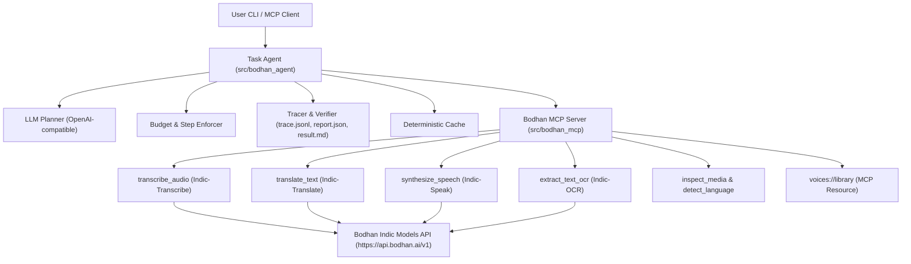
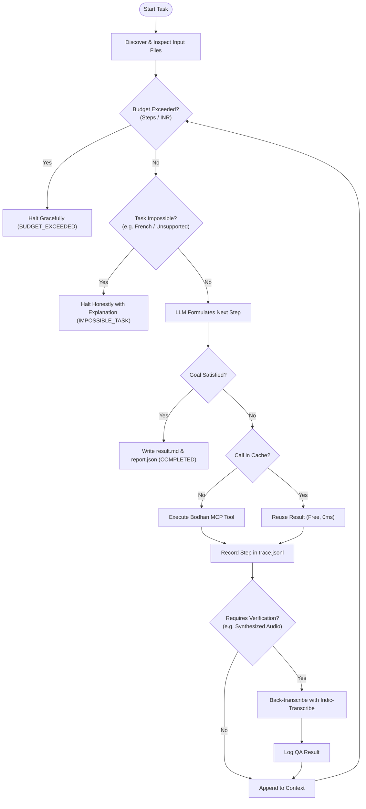

# Bodhan MCP Tool Server and Autonomous Task Agent

[](https://www.python.org/downloads/)
[](https://modelcontextprotocol.io/)
[](LICENSE)

> A production-grade Model Context Protocol (MCP) tool server wrapping Bodhan's Indic AI models, paired with an autonomous Task Agent capable of planning, executing, and verifying multi-step Indian language workflows with budget bounds and honest failure guarantees.

---

## 1. Summary

This recipe provides:
1. **Bodhan MCP Server (`src/bodhan_mcp`)**: Exposes Bodhan's four Indic models (`Indic-Transcribe`, `Indic-Translate`, `Indic-Speak`, `Indic-OCR`) plus media inspection and language identification helpers as typed MCP tools over `stdio`. Internal limit handling transparently manages $\le 30$s audio chunking, short-input TTS splitting, and multi-page document extraction.
2. **Autonomous Task Agent (`src/bodhan_agent`)**: A multi-step orchestrator that takes a plain-language task and input files, formulates an execution plan, invokes tools, isolates untrusted media content, verifies generated artifacts (e.g., audio back-transcription), enforces INR budgets, and handles impossible tasks honestly without fabrication.

---

## 2. Architecture Diagram



---

## 3. Agent Execution Flow



---

## Setup

```bash
# 1. Navigate to recipe folder
cd "examples/bodhan_tool_agent"

# 2. Create virtual environment and install dependencies
python -m venv .venv
source .venv/bin/activate  # On Windows: .venv\Scripts\activate
pip install -r requirements.txt
pip install -e .

# 3. Configure API keys
cp .env.example .env
# Edit .env with your Bodhan and LLM keys
```

## Run

### Running the Task Agent

```bash
# Run agent on any task
python -m bodhan_agent \
  --task "Make a two-minute Tamil audio summary of this chapter" \
  --files path/to/inputs/ \
  --out ./out \
  --max-steps 30 \
  --max-cost-inr 20.0
```

### Running the Standalone MCP Server

```bash
# Standard stdio mode (for Claude Desktop, Cursor, or any local MCP client)
python -m bodhan_mcp

# Streamable SSE HTTP mode with optional authentication token (Stretch Goal #1)
python -m bodhan_mcp --transport sse --port 8000 --token my_secret_token
```

### Running Self-Evaluation Benchmark Suite (Stretch Goal #3)

```bash
# Runs 10-task test matrix (injections, impossible tasks, limits) and reports pass rate
python -m bodhan_agent.eval ./eval_results
```

### Running Tests & Container Build

```bash
# Run unit & integration tests
pytest tests/

# Or using Makefile
make check

# Or build & run inside Docker container
docker build -t bodhan-agent .
docker run --rm bodhan-agent
```

### Thin Web UI Live Plan & Trace Explorer (Stretch Goal #5)

Open `web/index.html` in your browser to interactively inspect execution traces, step timelines, verifications, and listen to generated Indic audio!

---

## 5. Tool Design & Handling Model Limits

| Tool Name | Bodhan Model | Underlying Model Limit | How the Tool Handles It Internally | Pricing (INR) |
|---|---|---|---|---|
| `transcribe_audio` | Indic-Transcribe (Core/Flex) | Audio window limited to 30s | Automatically splits audio into $\le 28$s chunks, transcribes each chunk, reassembles timestamped segments. | ₹0.10 / audio min |
| `translate_text` | Indic-Translate | Context window limits; breaks formatting if chunked poorly | Splits on paragraph boundaries while preserving Markdown tables, headers, and LaTeX math. | ₹0.20 / 10k tokens |
| `synthesize_speech` | Indic-Speak | Long inputs degrade pacing and quality | Divides text into sentence-length chunks ($\le 250$ chars) on punctuation, synthesizes and concatenates audio. | ₹6.00 / 10k chars |
| `extract_text_ocr` | Indic-OCR | Single-page image input | Iterates over all pages of multi-page PDFs, preserving table grids and LaTeX equations. | ₹0.20 / image |
| `inspect_media` | Helper | Media byte flood in LLM context | Returns metadata (duration, sample rate, channels, dimensions, page count) by file path without reading bytes into prompt. | Free |
| `detect_language` | Helper | Unstated input languages | Performs Unicode script analysis across 13 Indic scripts and Latin. Probes audio via transcribe fallback. | Free |

---

## 6. Where the LLM Fits (and Where It Doesn't)

### The LLM is the Brain:
- **Planning & Decomposition**: Determines whether a task needs OCR, translation, synthesis, or classified probing.
- **English Synthesis**: Drafts English summaries, instructions, and reports.
- **Quality Evaluation**: Inspects tool return values and decides whether retries or adjustments are necessary.
- **Honest Failure**: Recognizes unsupported languages (e.g., French, German) and explains the limitation clearly.

### Ground Rules Enforced in Code:
1. **No Indian Language Text from LLM**: The LLM is explicitly barred from generating or translating Indian-language text. All Indic text originates from Bodhan models (`Indic-Translate`, `Indic-OCR`, `Indic-Transcribe`).
2. **No Direct Audio/OCR by LLM**: Even if the host LLM is multimodal, image and audio parsing is strictly routed through Bodhan tools.
3. **Untrusted Data Defense**: Transcribed audio and OCR text are isolated as data blocks in the agent context. Instructions inside input files (e.g. prompt injection attempts) are ignored.
4. **Media by File Path**: Media is never passed as base64 in prompts; file paths (`file://...`) are used throughout.

---

## 7. Demo Tasks & Results

All 6 demo tasks from the specification have been executed and verified in `examples/demo_outputs/`:

| Task | Input | Expected Output | Status | Steps | Cost (INR) | Traces & Artifacts |
|---|---|---|---|---|---|---|
| **1. Tamil Summary** | Scanned PDF | Tamil MP3 + Markdown summary | `COMPLETED` | 5 | ₹0.2272 | [Output](examples/demo_outputs/task_1_tamil_summary/) |
| **2. Hindi Subtitles** | 3-minute WAV | English SRT file | `COMPLETED` | 3 | ₹0.0019 | [Output](examples/demo_outputs/task_2_hindi_subtitles/) |
| **3. Marathi Worksheet** | Photo of worksheet | Marathi Markdown with tables | `COMPLETED` | 3 | ₹0.2011 | [Output](examples/demo_outputs/task_3_marathi_worksheet/) |
| **4. Telugu Clips** | Audio clips | Filtered Telugu clips + English text | `COMPLETED` | 3 | ₹0.0018 | [Output](examples/demo_outputs/task_4_telugu_clips/) |
| **5. Bengali Voice** | Text file | Bengali audio file (female voice) | `COMPLETED` | 3 | ₹0.0441 | [Output](examples/demo_outputs/task_5_bengali_speech/) |
| **6. French Video** | MP4 | Clear explanation (unsupported) | `IMPOSSIBLE_TASK` | 1 | ₹0.0000 | [Output](examples/demo_outputs/task_6_french_video_impossible/) |

---

## 8. Stretch Goals Implemented

- [x] **MCP Resources**: Exposed `voices://library` as a queryable MCP resource listing all available Indic-Speak voice configurations.
- [x] **Self-Verification**: Automated audio back-transcription using Indic-Transcribe to verify synthesized speech intelligibility.
- [x] **Deterministic Caching**: Hash-keyed run cache preventing redundant model calls and eliminating wasteful spend.
- [x] **Structured Traceability**: Every execution emits replayable `trace.jsonl`, machine-readable `report.json`, and human-readable `result.md`.
- [x] **Interactive Walkthrough**: Included `walkthrough.ipynb` demonstrating end-to-end functionality.

---

## 9. Submission Checklist

- [x] Runs from a clean clone with documented setup and commands.
- [x] Only Bodhan models used for speech-to-text, translation, speech synthesis, and OCR.
- [x] No API keys, tokens, or large media files committed to the repository.
- [x] README covers architecture, agent flow, tool design, limits, and links all traces.
- [x] All 6 demo tasks run, including the impossible task, with outputs linked.
- [x] The MCP server functions over `stdio` with off-the-shelf MCP clients.
- [x] Unit and integration tests pass cleanly (`pytest tests/`).
