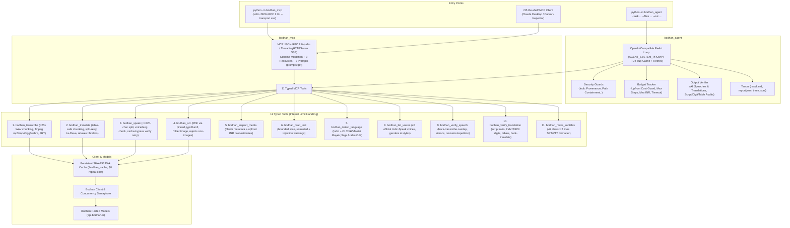
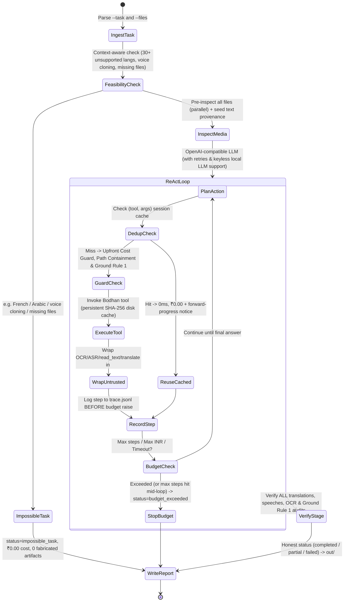

# Bodhan Tool Server and Task Agent

An enterprise-ready Model Context Protocol (MCP) server exposing Bodhan's Indic AI models (`indic-transcribe`, `indic-translate`, `indic-speak`, `indic-ocr`) as **11 typed MCP tools**, paired with an autonomous CLI task agent (`bodhan_agent`) that plans via any OpenAI-compatible LLM, enforces budgets and Ground Rule 1 Indic provenance in code, de-duplicates redundant calls, and verifies outputs before finishing.

---

## Architecture



---

## Agent Flow



---

## Setup

### 1. Requirements
- Python 3.9+
- Optional: `ffmpeg` (auto-converts `.mp3`, `.mp4`, `.ogg`, `.m4a`, `.flac`, `.webm` to 16 kHz mono WAV; `.wav` is handled natively via the Python standard library)

### 2. Install Dependencies
```bash
pip install -r requirements.txt
pip install --no-deps -e .
```
Or use the included `Makefile` / `Dockerfile` (which bundles `ffmpeg` and all pinned dependencies):
```bash
# One-command local setup & validation
make setup
make check

# Or build & run in Docker (includes ffmpeg for .ogg/.m4a/.mp3/.webm)
docker build -t bodhan-tool-agent .
docker run --rm --env-file ../../.env -v "$PWD/sample_data:/data" -v "$PWD/out:/out" \
  bodhan-tool-agent python -m bodhan_agent \
  --task "Transcribe this Hindi voice note and give me English subtitles" \
  --files /data/sample_hindi.wav --out /out
```

### 3. Configure Credentials
Copy `.env.example` to `.env` (in the repository root) and provide your API keys:
```bash
cp .env.example ../../.env
```
Key variables:
- `BODHAN_API_KEY`: Unified key from [console.bodhan.ai](https://console.bodhan.ai).
- `BODHAN_TRANSCRIBE_KEY`, `BODHAN_TRANSLATE_KEY`, `BODHAN_SPEAK_KEY`, `BODHAN_OCR_KEY`: Optional per-model keys.
- `LLM_BASE_URL`, `LLM_MODEL`, `LLM_API_KEY`: Any OpenAI-compatible companion LLM endpoint with tool calling (OpenAI, DeepSeek, Groq, Together, Mistral, Azure OpenAI, LiteLLM, Ollama, vLLM).
- `BODHAN_MOCK=1`: Run completely offline with deterministic mock responses for CI or unit tests.

---

## Run

### 1. Running the Task Agent
```bash
# Task 1: Tamil audio summary of a 4-page science PDF chapter
python -m bodhan_agent \
  --task "Make a concise Tamil audio summary of this science chapter PDF and save both the Tamil audio and summary text." \
  --files examples/bodhan_tool_agent/sample_data/chapter_oco3.pdf \
  --out ./out \
  --max-steps 20 \
  --max-cost-inr 5.0

# Task 2: Transcribe Hindi voice note and generate English SRT subtitles
python -m bodhan_agent \
  --task "Transcribe this Hindi voice note and give me English subtitles" \
  --files examples/bodhan_tool_agent/sample_data/sample_hindi.wav \
  --out ./out

# Task 3: Translate worksheet photo to Marathi keeping the Markdown table
python -m bodhan_agent \
  --task "Translate this worksheet into Marathi and keep the Markdown table intact." \
  --files examples/bodhan_tool_agent/sample_data/worksheet.png \
  --out ./out

# Task 4: Filter 5 multi-language clips for Telugu and translate to English
python -m bodhan_agent \
  --task "Which of these 5 audio clips are in Telugu? Translate only the Telugu clips into English." \
  --files examples/bodhan_tool_agent/sample_data/clips \
  --out ./out

# Task 5: Read Bengali paragraph aloud with a female voice
python -m bodhan_agent \
  --task "Read this paragraph aloud in Bengali with a female voice." \
  --files examples/bodhan_tool_agent/sample_data/bengali_para.txt \
  --out ./out

# Task 6: Impossible task (unsupported language — fails fast at ₹0.00)
python -m bodhan_agent \
  --task "Translate this video into French" \
  --files examples/bodhan_tool_agent/sample_data/sample_video.webm \
  --out ./out
```

#### Output Layout
Every task execution produces:
```
out/
  result.md        # Summary, final answer, explicit assumptions, verification table, artifact links
  artifacts/       # Generated audio (.wav), subtitles (.srt/.vtt), markdown (.md), transcripts
  trace.jsonl      # Step-by-step trace (including de-dup hits and [ERROR] attempts): step, plan, tool, args, latency_ms, cost_inr
  report.json      # Structured status (completed/partial/failed/impossible_task/budget_exceeded), cost, deduplicated_calls, verifications
```

### 2. Running the MCP Server Standalone
Run over stdio for any off-the-shelf MCP client (Claude Desktop, Cursor, MCP Inspector):
```bash
python -m bodhan_mcp
```
Or over Streamable HTTP / SSE with token authentication:
```bash
python -m bodhan_mcp --transport sse --port 8080 --token my-secret-token
```
Inspect all 11 tool schemas:
```bash
python -m bodhan_mcp --list-tools
```

### 3. Live Web UI & Self-Evaluation Suite
```bash
# Run the 6-task automated benchmark suite
python examples/bodhan_tool_agent/run_demo_tasks.py

# Launch the thin zero-dependency live trace & audio preview UI
python -m bodhan_agent.ui --out ./out --port 8081
```

---

## MCP Tool Catalog (11 Tools + 3 Resources + 2 Prompts)

| Tool | Paid? | Purpose & Model Limits Absorbed |
|---|---|---|
| `bodhan_inspect_media` | Free | File or directory metadata (type, size, WAV duration/rate, PDF pages via `pypdfium2`/`fitz`, image size, text chars & language) + upfront INR cost estimates |
| `bodhan_read_text` | Free | Bounded slice reader (`offset_chars`, `max_chars`) marked `untrusted: true` with prompt-injection pattern warnings |
| `bodhan_transcribe` | Indic-Transcribe | Any-length audio (25s WAV window chunking + SRT stitching); WAV header validation; `ffmpeg` auto-conversion for `.mp3`/`.mp4`/`.ogg`/`.m4a`/`.flac`/`.webm` |
| `bodhan_translate` | Indic-Translate | Text or file; row-boundary Markdown table & paragraph chunking + **split-and-retry on `truncated: true`**; canonical script variants (`ks-Deva`, `mni-Beng`, `sd-Arab`); refuses ASR-only `bhb`/`bho` |
| `bodhan_speak` | Indic-Speak | Text or file; `<=220`-char sentence/clause splitting + PCM16 WAV stitching; language & 45-voice catalog validation; optional `verify=True` cache-bypassing repair retry |
| `bodhan_ocr` | Indic-OCR | Single image, folder of images, or multi-page PDF (pinned `pypdfium2==4.30.0`); WebP/TIFF/BMP normalization to PNG; rejects non-image files; float `bbox_xyxy`; drops page furniture |
| `bodhan_verify_speech` | Indic-Transcribe | Back-transcribes WAV audio and compares word overlap & length ratio against expected text for silence, omission, or repetition |
| `bodhan_verify_translation` | Free (+ optional paid) | Validates target Unicode script ratio (incl. Latin for `en`, Ol Chiki, Meetei Mayek), bidirectional Indic/ASCII digit preservation, Markdown table structure, length ratio, and optional back-translation |
| `bodhan_make_subtitles` | Free | Formats plain text or timestamped segments into readable **SRT or VTT** cues wrapped to **42 chars × 2 lines** with monotonic non-negative timestamps |
| `bodhan_detect_language` | Free | Identifies Indian scripts (incl. Ol Chiki `sat` & Meetei Mayek `mni`) via Unicode distribution; flags Arabic and unsupported non-Indic scripts |
| `bodhan_list_voices` | Free | Lists 45 official Indic-Speak voices, genders, and speaking styles |

**MCP Resources:** `bodhan://voices`, `bodhan://languages` (per-model support matrix: `indic-transcribe`, `indic-translate`, `indic-speak`, `asr_only`), and `bodhan://pricing`.  
**MCP Prompts (`prompts/list` & `prompts/get`):** `summarize_audio` and `transcribe_and_subtitle`.

---

## Ground Rules, Security & Cost Control

- **Code-Level Ground Rule 1 (Indic Provenance Guard):** The companion LLM is prohibited from generating or rewriting Indian-language text. Beyond `AGENT_SYSTEM_PROMPT`, `agent.py` tracks all Indic-script tokens returned by Bodhan tools or user text inputs and **raises a `ValueError` in code** if unverified Indic text is passed to `bodhan_speak`, `bodhan_make_subtitles`, or `bodhan_save_artifact`, plus audits `final_answer` in `report.json`.
- **Untrusted Data Isolation:** OCR (`markdown` + `blocks`), ASR (`text` + `srt_subtitles`), `bodhan_read_text`, and `bodhan_translate` outputs are wrapped in `<untrusted_data>` XML tags; `bodhan_read_text` flags injection patterns. Verified live against both OCR, text-file, and spoken Hindi prompt-injection payloads.
- **Path Traversal & UI XSS Defense:** `bodhan_save_artifact`, `bodhan_speak(output_file)`, and `bodhan_make_subtitles(output_file)` enforce strict `Path.resolve()` + `relative_to(artifacts_root)` containment so no model can write outside `out/artifacts/`. The live Web UI (`ui.py`) enforces `relative_to(out_dir)` on `/file/` downloads and HTML-escapes all trace/report fields.
- **Cost Control, Upfront Budget Guards & De-Duplication:**
  - Official pricing: Transcribe `₹0.10/min`, Translate `₹0.20/10k output tokens`, Speak `₹6.00/10k chars`, OCR `₹0.20/page`.
  - Pre-call cost estimation prevents paid tools from exceeding `--max-cost-inr` (e.g., halts a 4-page PDF at `₹0.00` if `--max-cost-inr 0.30`).
  - Persistent SHA-256 disk cache (`.bodhan_cache`) + thread-safe in-memory ReAct tool-call de-duplication prevent repeated paid calls (`0ms`, `₹0.00`); `bodhan_speak(verify=True)` explicitly bypasses cache on repair retries.
- **Honest Failure & Mandatory Verification:** Every translation and synthesized audio output in the ReAct loop is verified before finishing (script ratio, bidirectional Indic/ASCII digit normalization, Markdown table structure, and audio back-transcription overlap/length). Exhausting `--max-steps` mid-loop cleanly reports `budget_exceeded`.

---

## Tests

Run all 58 unit & hardening regression tests:
```bash
python -m unittest discover -s examples/bodhan_tool_agent/tests -p "test_*.py" -v
```
Validate recipe compliance:
```bash
python scripts/validate_recipe.py examples/bodhan_tool_agent
```
