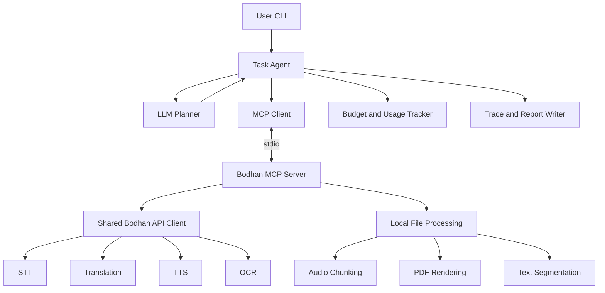
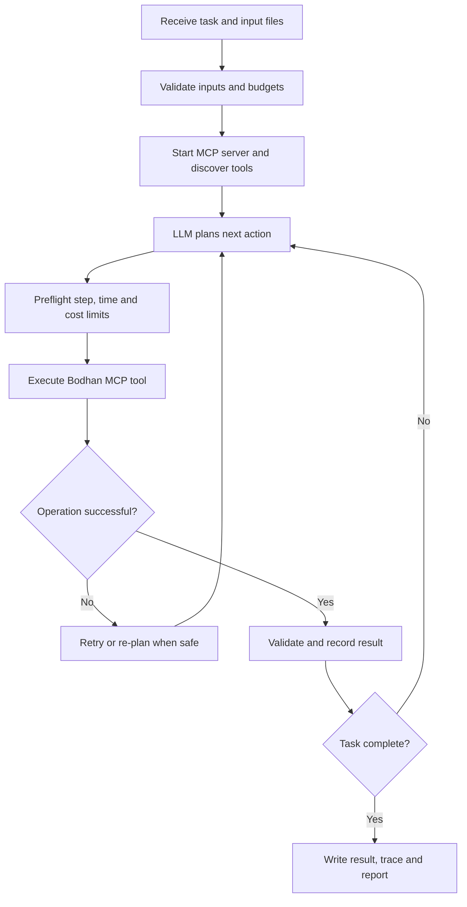

# Bodhan Tool Server and Task Agent

A standalone MCP tool server and LLM-powered task agent for Bodhan's Indic AI capabilities: speech transcription, translation, speech synthesis, and OCR.

## Features

- **Bodhan API client:** Typed requests, response validation, bounded retries, and actionable errors.
- **MCP server:** Exposes four typed tools over stdio using the Model Context Protocol.
- **Task agent:** Uses an LLM for planning and reasoning while executing media operations exclusively through Bodhan MCP tools.
- **Audio processing:** Splits longer audio into sequential 25-second chunks and combines transcription results in chronological order.
- **Long-text translation:** Splits text at grapheme boundaries, preserves whitespace, and handles incomplete or truncated translations explicitly.
- **PDF OCR:** Renders PDF pages locally and sends each page to Bodhan OCR, preserving page order and partial results.
- **Cost budgets:** Estimates and reserves service costs before paid calls, reconciles usage when available, and reports unknown costs honestly.
- **Execution limits:** Supports tool-step, cost, and wall-clock time limits.
- **Retry and replanning:** Handles recoverable failures with bounded retries and replanning while avoiding blind retries of uncertain paid requests.
- **Tracing and reports:** Produces a JSONL execution trace and a structured JSON report without logging source media or sensitive text.

## Architecture



The LLM plans tasks and interprets tool results. It does not transcribe audio, perform OCR, generate Indic-language translations, or synthesize speech. Those operations are delegated to Bodhan models.

Media is processed through local file references and is not passed to the LLM as inline base64 or raw media content.

## Execution flow



## Requirements

- Python 3.10 or later
- Bodhan API credentials for the capabilities being used
- An OpenAI-compatible LLM endpoint for task planning

## Setup

From the repository root:

```bash
python -m venv examples/bodhan_tool_agent/.venv
```

Activate the environment and install dependencies.

**Windows PowerShell:**

```powershell
.\examples\bodhan_tool_agent\.venv\Scripts\Activate.ps1
pip install -r examples/bodhan_tool_agent/requirements.txt
```

**Linux/macOS:**

```bash
source examples/bodhan_tool_agent/.venv/bin/activate
pip install -r examples/bodhan_tool_agent/requirements.txt
```

Copy `.env.example` to `.env` inside `examples/bodhan_tool_agent` and configure the required credentials.

### Environment variables

Bodhan credentials:

- `BODHAN_API_KEY` — optional shared fallback key.
- `BODHAN_TRANSCRIBE_KEY`
- `BODHAN_TRANSLATE_KEY`
- `BODHAN_SPEAK_KEY`
- `BODHAN_OCR_KEY`

Model-specific keys take precedence over the shared fallback.

LLM configuration:

- `LLM_BASE_URL`
- `LLM_MODEL`
- `LLM_API_KEY`

Optional PDF configuration:

- `BODHAN_MAX_PDF_PAGES` — maximum PDF pages accepted per document; defaults to 50.

Do not commit `.env` or API credentials.

## Running the MCP server

From `examples/bodhan_tool_agent`:

```bash
python -m bodhan_mcp
```

The server uses stdio transport and exposes:

| Tool | Purpose |
|---|---|
| `indic_transcribe` | Transcribe an audio file using Bodhan STT |
| `indic_translate` | Translate text using Bodhan translation |
| `indic_speak` | Generate speech using Bodhan TTS |
| `indic_ocr` | Extract text from an image or PDF using Bodhan OCR |

TTS output files are written under the configured outputs directory. Tool responses return file references and metadata rather than media bytes.
TTS accepts a maximum of 2,000 input characters per request. Longer text is rejected before calling the Bodhan API; automatic TTS chunking is not supported.

Speech output is restricted to WAV (`.wav`) files. Generated audio is validated as mono, 16-bit PCM at 24 kHz before it is saved.

## Running the task agent

From `examples/bodhan_tool_agent`:

```bash
python -m bodhan_agent --task "Transcribe the audio and translate it into Hindi" --files sample_data/input.wav --out outputs/run
```

The CLI supports:

| Argument | Description | Default |
|---|---|---|
| `--task` | Task description | Required |
| `--files` | Input file paths | Optional |
| `--out` | Output directory | Required |
| `--max-steps` | Maximum tool calls | 30 |
| `--max-cost-inr` | Maximum estimated cost in INR | 20.0 |
| `--max-time-seconds` | Overall wall-clock execution limit | 300 seconds |

Example with explicit limits:

```bash
python -m bodhan_agent --task "Transcribe this recording and summarize the transcript" --files recording.wav --out outputs/run --max-steps 15 --max-cost-inr 2.0 --max-time-seconds 300
```

The time limit covers planning and MCP operations. A timeout or incomplete operation cannot be reported as successful.

## Processing and safety behavior

### Audio transcription

- Audio is divided into sequential 25-second chunks to stay below the approximate 30-second request limit.
- Chunk transcripts are combined in chronological order.
- Failed chunks produce an incomplete operation rather than a misleading complete transcript.
- Temporary chunk files are cleaned up.

### Translation

- Long text is segmented at Unicode grapheme boundaries.
- Whitespace and source ordering are preserved.
- A 4,000-character internal chunk boundary is used as an implementation safety limit, not an official Bodhan API context limit.
- Translation requests use a default maximum output allowance of 1,024 tokens unless configured otherwise.
- Truncated or incomplete translations are not treated as successful complete translations.

### OCR and PDF

- PNG and JPEG images are sent to Bodhan OCR.
- PDFs are rendered locally using PyMuPDF and processed one page at a time through the same Bodhan OCR capability.
- PDF page order is preserved.
- The default maximum is 50 pages per PDF and can be changed using `BODHAN_MAX_PDF_PAGES`.
- Encrypted, password-protected, empty, and corrupt PDFs are rejected.
- Partial page results and failed-page information are preserved.

### Cost and execution budgets

The implementation uses the following Bodhan pricing assumptions for estimates:

| Capability | Estimated cost |
|---|---:|
| Transcription | ₹0.10 per audio minute |
| Translation | ₹0.20 per 10,000 output tokens |
| Speech synthesis | ₹6 per 10,000 input characters |
| OCR | ₹0.20 per image/page |

Estimates and usage-derived costs are distinguished in the execution report. Missing or malformed usage information is treated as unknown, not silently counted as zero. Paid operations are preflighted against available budgets before execution.

Retries are bounded. Requests with uncertain paid outcomes are not blindly repeated.

## Output files

A typical task run produces:

```text
outputs/
└── run/
    ├── result.md
    ├── report.json
    ├── trace.jsonl
    └── artifacts/
```

- `result.md` — final task result.
- `report.json` — task status, budget information, usage, and failure details.
- `trace.jsonl` — structured execution events, tool calls, retries, and timing.
- `artifacts/` — generated output files such as speech audio.

Trace data avoids recording source media, base64 payloads, or full source and translated text.

## Tests and linting

From the repository root:

```bash
python -m pytest tests/test_bodhan_tool_agent_stage1.py tests/test_bodhan_mcp_stage2.py tests/test_bodhan_agent_stage3.py tests/test_bodhan_budget_stage3.py -q
```

Run Ruff against the implementation:

```bash
ruff check examples/bodhan_tool_agent/bodhan_tool_agent examples/bodhan_tool_agent/bodhan_mcp examples/bodhan_tool_agent/bodhan_agent
```

## Limitations

- Bodhan API credentials and a configured LLM endpoint are required for live execution.
- Provider-side limits, network availability, and account credits can affect execution.
- Cost estimates depend on the documented pricing assumptions; actual usage is reconciled when the provider supplies valid usage metadata.
- An uncertain paid request outcome is reported rather than blindly retried.
- The agent uses bounded planning, retries, tool-call limits, and a wall-clock deadline; it cannot guarantee completion of every arbitrary task.
