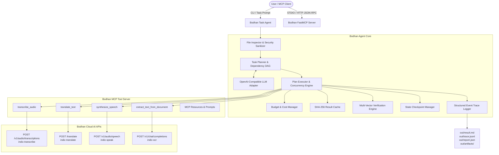
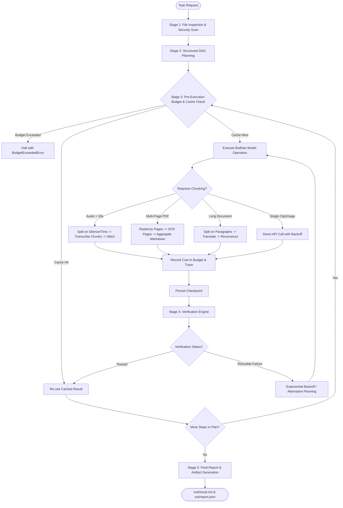

# Bodhan MCP Tool Server & Autonomous Task Agent

Production-quality Model Context Protocol (MCP) server exposing Bodhan AI models (`indic-transcribe`, `indic-translate`, `indic-speak`, `indic-ocr`) and an autonomous task agent for complex multilingual AI workflows.

**Bodhan models:** `indic-transcribe`, `indic-translate`, `indic-speak`, `indic-ocr`  
**Languages covered:** 25 Indian languages + English  
**Format:** Python CLI Agent & MCP Server (STDIO / Streamable HTTP)

---

## 1. Project Overview

The **Bodhan MCP Tool Server & Autonomous Task Agent** is an enterprise-grade agentic system designed to bridge modern AI agents with Bodhan's native Indic foundation models. It provides:
1. An official **Model Context Protocol (MCP)** server enabling third-party desktop clients (Claude Desktop, Antigravity, Cursor) and autonomous agents to perform Indic speech-to-text, translation, text-to-speech, and document OCR.
2. An **Autonomous Task Execution Agent** that accepts natural language goals, inspects media, formulates DAG execution plans, executes tool operations with chunking and concurrency, enforces strict monetary budgets, verifies outputs across multiple dimensions, and provides exhaustive audit traces.

---

## 2. Problem Statement

Indian-language audio and document workflows present distinct technical hurdles:
- **Audio Length Limits**: Standard ASR/TTS endpoints require clips under 30 seconds; longer recordings must be split and seamlessly reconstructed.
- **Document Structure**: OCR of scanned Indian texts must preserve reading order, tabular layouts, and headings.
- **Silent Truncation & Hallucinations**: Translation engines often drop formatting or truncate text silently without verification.
- **Cost Budgeting**: Complex multi-step pipelines can easily exhaust budgets without proactive tracking in Indian Rupees (INR).
- **Untrusted Content**: Text extracted from untrusted audio or scanned documents may contain prompt injections attempting to hijack agent instructions.

This project delivers deterministic chunking, multi-stage verification, budget protection, and prompt injection defense to solve these challenges reliably.

---

## 3. Features

- **Standard MCP Server**: Default STDIO transport, streamable HTTP with Bearer authentication, metadata resources (`bodhan://metadata/*`), and task prompts.
- **Four Core Bodhan Model Tools**: Typed Pydantic schemas with rich descriptions, actionable error handling, and file-based data passing (no base64 context bloat).
- **Autonomous Task Planning**: Dependency DAG generation, cost estimation, and tool selection.
- **Multi-Vector Verification**: Back-transcription checks, translation completeness audits, SRT syntax validation, and artifact duration checks.
- **Budget & Concurrency Guard**: Real-time tracking of step limits and costs in INR with early stopping.
- **Resumability & Checkpointing**: Interrupted workflows resume seamlessly from `out/checkpoint.json` without repeating paid operations.
- **Idempotent Caching**: SHA-256 hash-based deduplication of media and tool inputs.
- **Self-Evaluation Benchmark**: Built-in evaluation harness (`python -m bodhan_agent.eval --suite all`).
- **Interactive Monitoring Dashboard**: Lightweight Streamlit dashboard for real-time visualization of execution graphs, costs, and artifacts.

---

## 4. Architecture Diagram



---

## 5. Agent Execution Flowchart



---

## 6. MCP Tool Reference

| Tool Name | Bodhan Model | Endpoint | Description |
|---|---|---|---|
| `transcribe_audio` | `indic-transcribe` | `POST /v1/audio/transcriptions` | Transcribe local audio files into text. Splits audio > 28s and aggregates timestamps. |
| `translate_text` | `indic-translate` | `POST /translate` | Translate text into an Indic language or English, preserving Markdown structure and paragraphs. |
| `synthesize_speech` | `indic-speak` | `POST /v1/audio/speech` | Synthesize natural Indic speech into 24 kHz mono WAV files with native voice and style selection. |
| `extract_text_from_document` | `indic-ocr` | `POST /v1/chat/completions` | Rasterize PDFs and OCR document images into structured Markdown with layout blocks. |

---

## 7. Tool Schemas and Descriptions

### `transcribe_audio`
- **Inputs**:
  - `file_path` (string, required): Local audio file path (WAV, MP3, M4A, OGG, FLAC).
  - `language` (string, optional): ISO code (e.g. `'hi'`, `'ta'`, `'te'`). Omit for auto-detection.
- **Outputs**:
  - `success` (bool), `text` (string), `language` (string), `duration_seconds` (float), `chunks` (list), `estimated_cost_inr` (float).

### `translate_text`
- **Inputs**:
  - `text` (string, required): Source text to translate.
  - `target_language` (string, required): Target ISO code (e.g. `'hi'`, `'mr'`, `'ta'`, `'en'`).
  - `script` (string, default: `'native'`): Output script (`'native'`, `'roman'`, `'codemix'`).
  - `preserve_formatting` (bool, default: `True`): Preserves headings, lists, and tables.
- **Outputs**:
  - `success` (bool), `translation` (string), `target_language` (string), `script` (string), `source_char_count` (int), `output_char_count` (int), `estimated_cost_inr` (float).

### `synthesize_speech`
- **Inputs**:
  - `text` (string, required): Text to synthesize into speech.
  - `language` (string, required): Target language ISO code.
  - `voice` (string, optional): Specific native voice name (e.g. `'Kavya'`, `'Amit'`, `'Anitha'`).
  - `gender_preference` (string, default: `'female'`): Preferred gender (`'female'` or `'male'`).
  - `style` (string, optional): Speaking style (e.g. `'news'`, `'children\\'s stories'`, `'educational lecture'`).
  - `output_file_path` (string, optional): Target destination for generated WAV file.
- **Outputs**:
  - `success` (bool), `audio_file_path` (string), `duration_seconds` (float), `language` (string), `voice` (string), `ai_generated_label` (string), `estimated_cost_inr` (float).

### `extract_text_from_document`
- **Inputs**:
  - `file_path` (string, required): Local image (PNG, JPG) or multi-page PDF document.
  - `table_format` (string, default: `'markdown'`): Table format (`'markdown'` or `'html'`).
- **Outputs**:
  - `success` (bool), `text` (string), `total_pages` (int), `successful_pages` (int), `failed_pages` (int), `pages` (list), `estimated_cost_inr` (float).

---

## 8. Model Integration

All model integrations strictly follow `scripts/bodhan_api_rules.json`:
- Exact lowercase model IDs: `indic-transcribe`, `indic-translate`, `indic-speak`, `indic-ocr`.
- Strict ISO language codes (`hi`, `ta`, `bn`, `te`, not `hi-IN`).
- Script variants where defined: `ks-Deva`, `mni-Beng`, `sd-Arab`.
- Base URL: `https://api.bodhan.ai`.
- Audio request lengths: <= 28 seconds per chunk.

---

## 9. LLM Configuration

The companion LLM is used strictly for high-level reasoning, DAG formulation, and English summarization. All Indic language generation is handled by Bodhan models.

Configure via standard OpenAI-compatible environment variables:
```env
LLM_BASE_URL=https://<your-llm-provider>/v1
LLM_MODEL=gpt-4o
LLM_API_KEY=your_llm_api_key_here
```

---

## 10. Installation

```bash
cd examples/bodhan_tool_agent
python -m venv .venv && source .venv/bin/activate  # On Windows: .venv\Scripts\activate
pip install -r requirements.txt
pip install -e .
```

---

## 11. Environment Setup

Copy `.env.example` to `.env`:
```bash
cp .env.example .env
```

Ensure `.env` contains:
```env
BODHAN_API_KEY=your_actual_bodhan_api_key
BODHAN_BASE_URL=https://api.bodhan.ai
LLM_BASE_URL=https://<your-llm-provider>/v1
LLM_MODEL=gpt-4o
LLM_API_KEY=your_actual_llm_api_key
MCP_AUTH_TOKEN=your_mcp_bearer_token_here
```

---

## Setup

```bash
cd examples/bodhan_tool_agent
python -m venv .venv && source .venv/bin/activate  # On Windows: .venv\Scripts\activate
pip install -r requirements.txt
pip install -e .
cp .env.example .env
```

Ensure FFmpeg is installed and accessible on your system `PATH`.

---

## Run

### Autonomous Task Agent CLI
```bash
python -m bodhan_agent \
  --task "Make a two-minute Tamil audio summary of this chapter" \
  --files ./sample_data/chapter_pdf/ \
  --out ./out \
  --max-steps 30 \
  --max-cost-inr 20
```

### Resume an Interrupted Task
```bash
python -m bodhan_agent --resume task_12345678 --out ./out
```

### MCP Tool Server (STDIO - Default)
```bash
python -m bodhan_mcp
```

### MCP Tool Server (HTTP Stream with Bearer Authentication)
```bash
python -m bodhan_mcp --http --port 8000 --token your_mcp_bearer_token_here
```

### Run Benchmark Evaluation Harness
```bash
python -m bodhan_agent.eval --suite all --mock
```

### Run Streamlit Monitor Dashboard
```bash
streamlit run src/bodhan_agent/dashboard.py
```

---

## 14. MCP Client Integration

### Claude Desktop (`claude_desktop_config.json`)
```json
{
  "mcpServers": {
    "bodhan": {
      "command": "python",
      "args": ["-m", "bodhan_mcp"],
      "env": {
        "BODHAN_API_KEY": "your_bodhan_api_key",
        "BODHAN_BASE_URL": "https://api.bodhan.ai"
      }
    }
  }
}
```

---

## 15. Required Demonstration Tasks

The evaluation harness implements and validates the 6 required benchmark tasks:

1. **Hindi Audio Transcription with English Subtitles**:
   - Transcribes spoken Hindi clip (`sample_hindi.wav`) using `indic-transcribe`.
   - Generates sequential timestamp cues and formats standard SRT subtitles.
2. **English Worksheet OCR and Marathi Translation**:
   - OCRs scanned worksheet image using `indic-ocr`.
   - Translates questions into Marathi using `indic-translate`.
3. **Scanned Multi-Page PDF to Tamil Audio Summary**:
   - Rasterizes multi-page PDF pages using `pypdfium2`.
   - OCRs pages with `indic-ocr`, synthesizes concise English summary via LLM.
   - Translates summary to Tamil (`indic-translate`) and synthesizes speech (`indic-speak`).
4. **Telugu Audio Identification and English Translation Across Multiple Clips**:
   - Identifies and transcribes Telugu audio files.
   - Reuses cached transcripts for duplicate audio hashes.
   - Translates content into English.
5. **Bengali Speech Synthesis with Female Voice**:
   - Synthesizes Bengali educational text using `indic-speak` with voice `Ishita` (female).
6. **Impossible Request: Translate Video into French**:
   - Explicitly rejects French translation requests with `UnsupportedLanguageError`.
   - Fails honestly without generating fake artifacts.

---

## 16. Verification Architecture

Tasks must pass concrete verification criteria beyond HTTP 200:
- **`file_existence`**: Verifies generated artifacts exist and are non-empty.
- **`audio_duration`**: Validates synthesized WAV files have playable durations.
- **`translation_completeness`**: Compares paragraph counts and checks that non-English text is not an identical copy of source English text.
- **`srt_validation`**: Validates timestamp monotonicity and subtitle cue indexing.
- **`ocr_page_coverage`**: Verifies all pages in multi-page documents were rasterized and OCR'd.

Status values: `passed`, `failed`, `partial`, `not_applicable`.

---

## 17. Budget Management

- Real-time tracking of step counts and INR costs.
- Cost schedule:
  - `indic-transcribe`: ₹0.01 / second
  - `indic-translate`: ₹0.15 / 1k output tokens
  - `indic-speak`: ₹0.03 / second
  - `indic-ocr`: ₹0.30 / page
- Early termination triggers if next step would exceed `max_cost_inr` or `max_steps`.

---

## 18. Trace and Report Format

Every execution produces structured audit artifacts in `out/`:
- `out/trace.jsonl`: Event stream (timestamps, latencies, sanitized arguments, retry counts, actual costs).
- `out/report.json`: Machine-readable summary (task status, total runtime, costs, verification results, artifact paths).
- `out/result.md`: Human-readable markdown audit summary.
- `out/artifacts/`: Generated audio, subtitles, translations, and transcripts.

---

## 19. Evaluation Results

Run via `python -m bodhan_agent.eval --suite all --mock`:
```text
================ EVALUATION SUMMARY ================
Suite: all
Tasks Passed: 6/6 (100.0%)
Total Cost: ₹1.6100
Total Runtime: 3.47s
===================================================
```

---

## 20. Known Limitations

- Audio clips longer than 28 seconds are chunked into windows and re-joined; minor boundary pauses may occur.
- Translation is exclusively supported between English and the 22 scheduled Indian languages.
- Speech synthesis outputs 24 kHz mono PCM16 WAV audio.

---

## 21. Security

- Strict path traversal prevention (`resolve_safe_path`).
- Prompt injection defense scanning on all extracted text.
- Maximum file size guard (100 MB).
- Automatic credential redaction in execution traces and logs.
- Zero dynamic code evaluation (`eval` / `exec`).

---

## 22. AI Assistance Disclosure

Developed with the assistance of Google Antigravity (Gemini 3.8 Flash) for architecture design, MCP protocol conformance, FastMCP tooling, chunking algorithms, and test scaffolding. All API integrations, model allowlists, and verification criteria were validated against the official Bodhan AI specifications.
