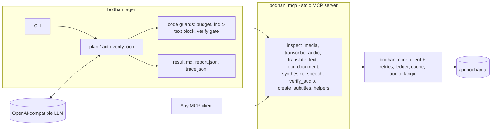
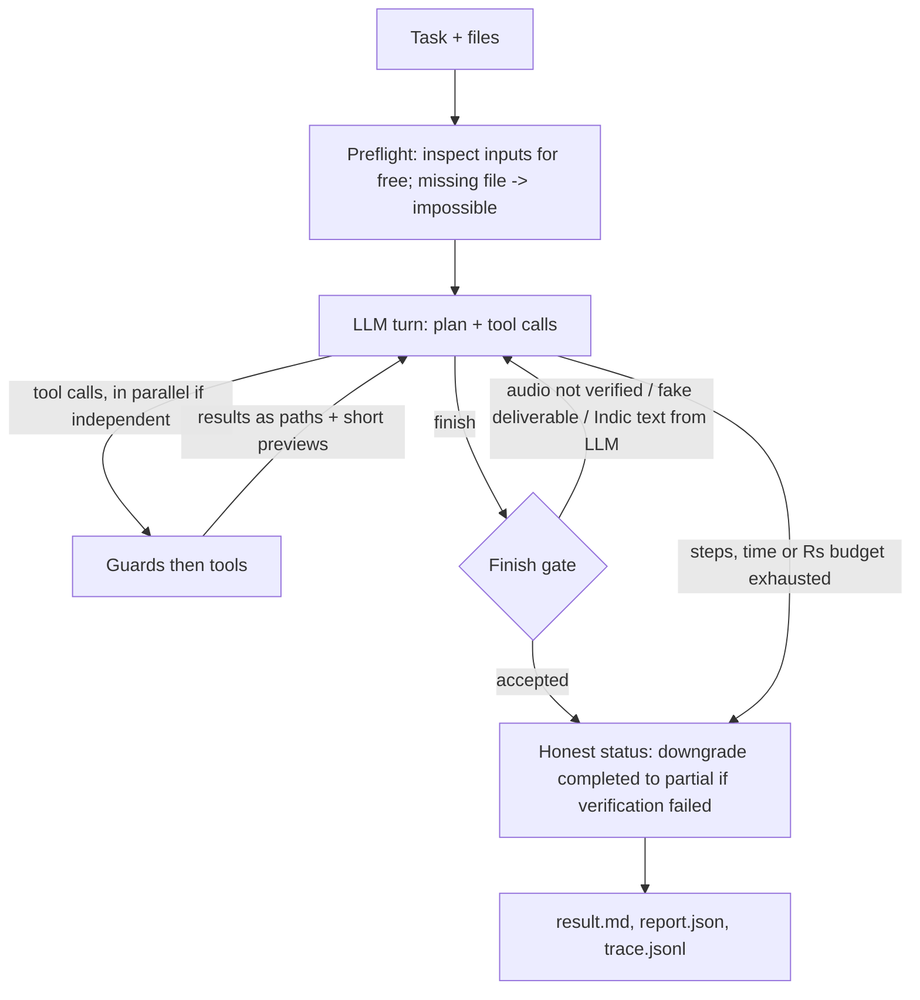

# Bodhan tool agent

> An MCP server that exposes Bodhan's four Indic models as typed tools, plus a budget-aware CLI agent that plans, calls them, verifies its work and leaves a replayable trace.

**Bodhan models:** indic-transcribe, indic-translate, indic-speak, indic-ocr
**Format:** Python package (`bodhan_mcp` server + `bodhan_agent` CLI)
**Status:** first working scaffold. See [Known limitations](#known-limitations-and-next-steps).

## What it does

- `python -m bodhan_mcp` runs a stdio MCP server any MCP client can use on its own.
- `python -m bodhan_agent --task "..." --files inputs/ --out ./out` takes a plain-language task and input files, runs a plan / act / verify loop with an OpenAI-compatible LLM, and writes `result.md`, `artifacts/`, `trace.jsonl` and `report.json`.

## Setup

Needs Python 3.10+ and (recommended) [ffmpeg](https://ffmpeg.org/) on `PATH` for mp3 output, video input and non-WAV audio. Without ffmpeg, 16-bit PCM WAV input and WAV output still work.

```bash
cd examples/bodhan_tool_agent
python -m venv .venv && source .venv/bin/activate     # Windows: .venv\Scripts\activate
pip install -r requirements.txt && pip install -e . --no-deps
cp .env.example .env     # Bodhan keys from https://console.bodhan.ai + any OpenAI-compatible LLM
```

## Run

```bash
# The task agent
python -m bodhan_agent \
  --task "Transcribe this Hindi voice note and give me English subtitles" \
  --files path/to/inputs/ --out ./out [--max-steps 30] [--max-cost-inr 20] [--max-seconds 600]

# The MCP server on its own (stdio). Example client config (Claude Desktop / any MCP client):
#   {"mcpServers": {"bodhan": {"command": "python", "args": ["-m", "bodhan_mcp"], "env": {"BODHAN_API_KEY": "..."}}}}
python -m bodhan_mcp

# Tests (offline: fake Bodhan API + scripted LLM)
pip install pytest==9.2.0 && pytest
```

Output per run: `out/result.md` (what was done, answer, assumptions, artifact links), `out/artifacts/`, `out/trace.jsonl`, `out/report.json` (status, steps, verification, cost, time, missed targets).

## How it works



The agent imports the same server object the stdio server uses, so tool schemas and behaviour are identical for both (the assignment FAQ allows this; the server also runs standalone).



### Tools (medium granularity)

| Tool | Model | What it hides from the planner |
|---|---|---|
| `inspect_media` | none (free) | file type, duration, pages, audio track, script-based language guess |
| `transcribe_audio` | indic-transcribe | any audio/video; decode, split into <=25 s windows cut at quiet points, stitch, timestamps; language detection from script |
| `translate_text` | indic-translate | paragraph/sentence chunking under the model window, Markdown tables / headings / lists preserved, de-duplication, coverage check |
| `ocr_document` | indic-ocr | images and multi-page PDFs rendered page by page (<=40), Markdown with tables |
| `synthesize_speech` | indic-speak | sentence-group chunking (<=220 chars), fixed voice library, joins audio, wav/mp3, AI-generated label |
| `verify_audio` | indic-transcribe | back-transcribes and flags omitted or repeated content |
| `create_subtitles` | indic-translate | transcript segments to a (translated) `.srt` |
| `read_text_file`, `write_artifact`, `list_voices`, `check_language_support` | none | text plumbing, voice library, "is this language supported?" |

Why not one tool per model only, or one mega-tool: per-model tools alone push chunking and plumbing onto the LLM; a "do the task" tool would hide control. Each tool here absorbs one model's limits and returns a typed `{ok, error, cost_inr, warnings, ...}`. Media and long text move **by file path**; tools return short previews, never base64 or full documents.

### Where code decides and where the LLM decides

| Code (deterministic) | LLM |
|---|---|
| budgets (steps, seconds, Rs cap enforced *before* every paid call), caching, retries, concurrency | understand the task, plan, pick tools |
| blocks Indian-script text authored by the LLM in tool args or the final summary | write English; decide assumptions |
| refuses `finish` for non-existent deliverables; asks for `verify_audio` first | decide retries and when to give up |
| downgrades `completed` to `partial` if verification failed | explain impossible tasks in English |

Ground rules are structural: only `bodhan_core/client.py` calls the network, and only Bodhan endpoints. No other ASR/MT/TTS/OCR library is a dependency. OCR text, transcripts and file previews are labelled untrusted and are never placed in the agent's task prompt.

## Configuration

Env vars only (see `.env.example`): `BODHAN_TRANSCRIBE_KEY`, `BODHAN_TRANSLATE_KEY`, `BODHAN_SPEAK_KEY`, `BODHAN_OCR_KEY` (or one shared `BODHAN_API_KEY`), `LLM_BASE_URL`, `LLM_MODEL`, `LLM_API_KEY`. The LLM client uses plain chat-completions with tool calling only.

Prices used for the ledger: transcribe Rs 0.10/audio min, translate Rs 0.20/10k output tokens (estimated from characters when the API reports no usage; the estimate is deliberately pessimistic), speak Rs 6/10k chars, OCR Rs 0.20/image. Identical requests are served from `out/.cache` at no cost.

## Known limitations and next steps

This is a first scaffold, tested offline against a fake API; **it has not yet been run against the live Bodhan API or a real LLM.** Do that first.

- Translate request-size, TTS and STT window limits are conservative guesses from the docs (25 s audio, 220 chars speech, 1200 chars translation); tune after live runs.
- Impossible tasks rely on the LLM calling `check_language_support`; a deterministic backstop for unsupported languages named in the task is a planned addition.
- Indic-Speak repeat/omit handling detects (via `verify_audio`) but does not yet re-synthesize the offending sentence automatically.
- Subtitle cues follow transcription windows (<=25 s), so cues are long; sentence-level timing is not implemented.
- Audio language detection transcribes the first window without a hint, then reuses the detected language; Devanagari-script languages (hi/mr/ne/...) are reported as ambiguous.
- Table preservation covers Markdown tables; HTML tables from OCR are translated as plain text.
- Not done: Dockerfile, streamable-HTTP transport, resumable runs, web UI, demo video, demo-task results table.
