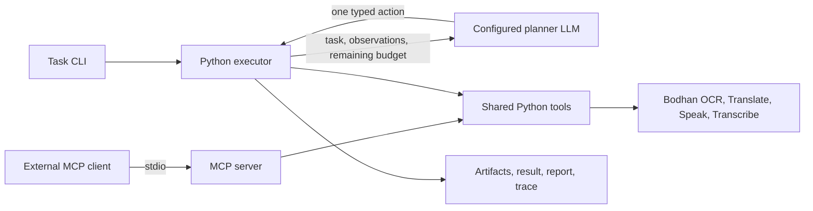
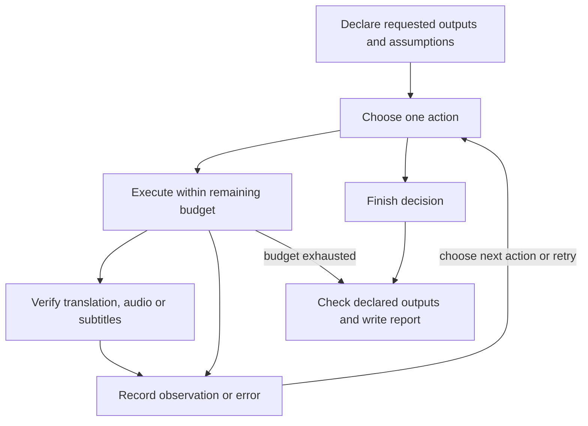

# Bodhan Tool Server and Task Agent

Give the task agent a plain-language request and one or more files. It plans across Bodhan’s OCR, translation, transcription, and speech tools, checks the outputs, and saves its artifacts and a trace. The same tools are available individually to any stdio MCP client.

**[Download the captioned demo (MP4, 3:54)](https://github.com/Druvith/Bodhan-AI-Cookbook/releases/download/classroom-demos-2026-11-22/classroom-demo.mp4)** · [Browse the six demos and frozen replay](https://github.com/Druvith/Bodhan-AI-Cookbook/releases/tag/classroom-demos-2026-11-22)


[Run the recipe](#quickstart) · [Architecture](#architecture) · [Agent flow](#agent-flow) · [Tool design](#tool-design) · [Verification and recovery](#verification-and-recovery)

## Demo tasks

These are the outputs shown in the film. Each trace records the planner’s decisions and the executor’s observations. For the Tamil case, follow `text-3` into the MP3 and saved script.

| Demo task | Outcome | Output and execution record |
| --- | --- | --- |
| Tamil recap | 40.004 s. The MP3 and script share the verified narration. | [MP3](https://github.com/Druvith/Bodhan-AI-Cookbook/releases/download/classroom-demos-2026-11-22/recorded-tamil-deliverable-1.mp3) · [Script](https://github.com/Druvith/Bodhan-AI-Cookbook/releases/download/classroom-demos-2026-11-22/recorded-tamil-deliverable-2.md) · [Report](https://github.com/Druvith/Bodhan-AI-Cookbook/releases/download/classroom-demos-2026-11-22/recorded-tamil-report.json) · [Trace](https://github.com/Druvith/Bodhan-AI-Cookbook/releases/download/classroom-demos-2026-11-22/recorded-tamil-trace.jsonl) |
| Marathi worksheet | The Markdown table preserves the counts and days. | [Worksheet](https://github.com/Druvith/Bodhan-AI-Cookbook/releases/download/classroom-demos-2026-11-22/recorded-marathi-deliverable-1.md) · [Report](https://github.com/Druvith/Bodhan-AI-Cookbook/releases/download/classroom-demos-2026-11-22/recorded-marathi-report.json) · [Trace](https://github.com/Druvith/Bodhan-AI-Cookbook/releases/download/classroom-demos-2026-11-22/recorded-marathi-trace.jsonl) |
| English subtitles | The agent exported timed English cues. | [SRT](https://github.com/Druvith/Bodhan-AI-Cookbook/releases/download/classroom-demos-2026-11-22/recorded-hindi-deliverable-1.srt) · [Report](https://github.com/Druvith/Bodhan-AI-Cookbook/releases/download/classroom-demos-2026-11-22/recorded-hindi-report.json) · [Trace](https://github.com/Druvith/Bodhan-AI-Cookbook/releases/download/classroom-demos-2026-11-22/recorded-hindi-trace.jsonl) |
| Telugu clip selection | The report names two clips and gives both translations. | [Selections](https://github.com/Druvith/Bodhan-AI-Cookbook/releases/download/classroom-demos-2026-11-22/recorded-telugu-deliverable-1.md) · [Report](https://github.com/Druvith/Bodhan-AI-Cookbook/releases/download/classroom-demos-2026-11-22/recorded-telugu-report.json) · [Trace](https://github.com/Druvith/Bodhan-AI-Cookbook/releases/download/classroom-demos-2026-11-22/recorded-telugu-trace.jsonl) |
| Bengali read-aloud | Ishita reads the passage. The WAV passed read-back. | [WAV](https://github.com/Druvith/Bodhan-AI-Cookbook/releases/download/classroom-demos-2026-11-22/recorded-bengali-deliverable-1.wav) · [Report](https://github.com/Druvith/Bodhan-AI-Cookbook/releases/download/classroom-demos-2026-11-22/recorded-bengali-report.json) · [Trace](https://github.com/Druvith/Bodhan-AI-Cookbook/releases/download/classroom-demos-2026-11-22/recorded-bengali-trace.jsonl) |
| Unsupported French | Expected refusal. The report explains the unsupported target. | [Refusal](https://github.com/Druvith/Bodhan-AI-Cookbook/releases/download/classroom-demos-2026-11-22/recorded-french-refusal.md) · [Report](https://github.com/Druvith/Bodhan-AI-Cookbook/releases/download/classroom-demos-2026-11-22/recorded-french-report.json) · [Trace](https://github.com/Druvith/Bodhan-AI-Cookbook/releases/download/classroom-demos-2026-11-22/recorded-french-trace.jsonl) |

## Replay results

On 22 November, a frozen snapshot using Groq `openai/gpt-oss-120b` passed **4/6 demo tasks** and **8/10 local stress cases**. [Download the stress scorecard and run evidence (ZIP)](https://github.com/Druvith/Bodhan-AI-Cookbook/releases/download/classroom-demos-2026-11-22/stress-evidence.zip). The expected French refusal counts as a pass. The film uses earlier runs with multiple planners.

The Tamil MP3 passed read-back but ran **56.768 seconds** against a 34–46 second window. The matching script stayed pending. In the short Hindi lesson, review caught “Indo-European” becoming “European.” The run returned a transcript and exhausted its evaluator planner-attempt allowance before it could deliver an SRT. [Tamil replay trace](https://github.com/Druvith/Bodhan-AI-Cookbook/releases/download/classroom-demos-2026-11-22/replay-tamil-trace.jsonl) · [Hindi replay trace](https://github.com/Druvith/Bodhan-AI-Cookbook/releases/download/classroom-demos-2026-11-22/replay-hindi-trace.jsonl)

The two local stress failures were a longer Hindi subtitle task that exhausted its Bodhan budget after cue review and a Bengali table narration whose currency wording failed translation review. [All six demo replay outcomes, costs and timings](https://github.com/Druvith/Bodhan-AI-Cookbook/releases/tag/classroom-demos-2026-11-22)

## Quickstart

From the root of a clean Cookbook checkout, install the pinned Python dependencies. Use Python 3.12, FFmpeg and Poppler (`pdfinfo` and `pdftoppm` on your PATH).

```sh
cd examples/bodhan_tool_agent
python3.12 -m venv .venv
.venv/bin/python -m pip install -r requirements.txt
[ -e .env ] || cp .env.example .env
```

Fill in the four Bodhan keys in `.env`: `BODHAN_TRANSCRIBE_KEY`, `BODHAN_TRANSLATE_KEY`, `BODHAN_SPEAK_KEY` and `BODHAN_OCR_KEY`. For the agent, also set `LLM_BASE_URL`, `LLM_MODEL` and `LLM_API_KEY`. The frozen replay used `https://api.groq.com/openai/v1` and `openai/gpt-oss-120b`. Reviewers can supply their own OpenAI-compatible planner. Existing environment variables take precedence.

Try the agent with the Hindi audio included in the Cookbook. Choose a new or empty output directory.

```sh
.venv/bin/python -m bodhan_agent \
  --task "Transcribe this voice note in Hindi and save the transcript as text." \
  --files ../../sample_data/sample_hindi.wav --out outputs/hindi-note \
  --max-steps 12 --max-cost-inr 1
```

Open `outputs/hindi-note/result.md` for the answer, `artifacts/` for the files, `report.json` for status, cost and checks, and `trace.jsonl` for the steps. To start the independent stdio server for an MCP client, run this command from the same recipe directory.

```sh
.venv/bin/python -m bodhan_mcp
```

## Architecture



External clients discover and call the server through MCP. The agent imports
the same functions so its request budget, media paths and observations stay in one
process. The planner receives file IDs and bounded text previews. Review and
English summarization receive the passages needed for their respective checks.

## Agent flow



## Tool design

One tool per Bodhan model lets an external client compose the operations. Each tool owns preprocessing and model limits. The agent owns decisions that depend on the task, including which files to produce and how to verify them.

| MCP tool | Bodhan model | What the caller gets |
| --- | --- | --- |
| `extract_document_text` | Indic-OCR | Numbered Markdown pages from an image or scanned PDF. The tool renders and sends one page at a time. |
| `translate_text` | Indic-Translate | Translated text with source spans. The tool bounds UTF-8 segments and preserves common Markdown structure and table cells. |
| `transcribe_audio` | Indic-Transcribe | A transcript with timed windows. FFmpeg normalizes the audio and each request contains at most 30 seconds. |
| `synthesize_speech` | Indic-Speak | A labeled, AI-generated WAV. The tool splits long passages, validates the returned audio and joins the chunks. |

## Use MCP Inspector

The standalone MCP server runs tool calls on up to four worker threads so it
can handle protocol messages while a tool waits on Bodhan or prepares media.
The task agent calls the same tool functions directly.

Start the server using `.venv/bin/python -m bodhan_mcp`. With Node 22.18 or later, let MCP Inspector start the process on your behalf:

```sh
npx -y @modelcontextprotocol/inspector@0.21.1 --cli .venv/bin/python -m bodhan_mcp --method tools/list
npx -y @modelcontextprotocol/inspector@0.21.1 --cli .venv/bin/python -m bodhan_mcp --method tools/call --tool-name translate_text --tool-arg 'text=The class starts at 9 tomorrow.' --tool-arg target_language=kn
```

The second command calls the hosted API. Check the Kannada output for the class, 9, and tomorrow. Use `target_language=fr` to see validation reject an unsupported language before sending a request. Inspect `isError` in the tool result.

To transcribe the Cookbook's Hindi sample with Inspector:

```sh
npx -y @modelcontextprotocol/inspector@0.21.1 --cli .venv/bin/python -m bodhan_mcp --method tools/call --tool-name transcribe_audio --tool-arg audio_path=../../sample_data/sample_hindi.wav --tool-arg language=hi
```

The server decodes the file into 16 kHz mono WAV and sends audio to Bodhan in windows of at most 30 seconds. The response includes the joined transcript and per-window text and offsets. Offsets identify window boundaries. A cut can split a word. If a later window fails, the agent can preserve the completed windows as a partial transcript.

To generate a WAV file with Indic-Speak:

```sh
npx -y @modelcontextprotocol/inspector@0.21.1 --cli .venv/bin/python -m bodhan_mcp --method tools/call --tool-name synthesize_speech --tool-arg 'text=Class starts at nine tomorrow. Please bring your notebook.' --tool-arg language=en --tool-arg voice=Arun --tool-arg output_path=outputs/class.wav
```

The tool splits at sentence boundaries and wraps longer sentences at word boundaries. Its 200-character cap per request is a local policy based on [Bodhan's short-input guidance](https://console.bodhan.ai/api-docs/#text-to-speech-api). The response gives the file path, duration, chunk count, and an AI-generated label. Choose a new path each time.

To extract text from a scanned PDF, replace the example path with your file:

```sh
npx -y @modelcontextprotocol/inspector@0.21.1 --cli .venv/bin/python -m bodhan_mcp --method tools/call --tool-name extract_document_text --tool-arg document_path=/path/to/scan.pdf
```

The tool also accepts a PNG or JPEG as a single page. It checks the PDF page count, renders each page, and returns numbered Markdown entries in order. The MCP call takes a file path. Only the server's Bodhan HTTP request encodes the image. Bodhan receives one page per request, with a 4,096-token budget per layout block. If a page fails, the tool reports which page failed.

Run the offline checks with `.venv/bin/python -m unittest discover -s tests -v`. They use an HTTP test transport to check the request and response mapping, truncation, rate-limit behavior, the exact 30-second audio boundary, TTS chunking, and OCR page counts and ordering.

Translation accepts up to 128,000 UTF-8 bytes. It splits at lines, sentences, or
word boundaries and caps each provider input at 1,200 bytes. These are local
limits. Common Markdown headings, list markers, fenced code, and Markdown and
HTML table syntax stay local. Table cells are translated separately, so long
tables can require many requests. A repeated segment within the same call
reuses its translation. Standalone identifiers such as `AB123` are carried
through literally. Output spans map each translated segment to its source
using Unicode code-point offsets. Translation of arbitrary Markdown syntax and
context across individually translated paragraphs remains limited.

[Translation API reference](https://console.bodhan.ai/api-docs/#translation-api)

## Verification and recovery

The planner selects typed actions referencing known input and text IDs. The executor imports the same Bodhan operations exposed over stdio. It sends media directly to Bodhan and uses text previews for planning. The first planner action declares the requested deliverables. Each published
file must match its declared format and language, and speech must pass
read-back before it fulfills a deliverable. The report lists completed and
pending deliverables. Translation review checks bounded groups of aligned
source and output segments, including whether deadlines and eligibility rules
include their cutoffs.

When a translation or English summary is itself a requested text artifact, a
planner action can name its deliverable directly. The executor publishes it
after verification passes. Text deliverables can declare the kind of content
they require, so raw OCR cannot fulfill a declared summary. When all declared
outputs are typed text and ready, the executor records completion without a
separate planner turn. A language-identification artifact records an inference
from a Bodhan transcript and can flag uncertainty.

The cost limit covers Bodhan charges at the assignment rates. OCR and speech requests reserve cost before submission, as do each STT window and each translation request. Translation reserves for up to 2,048 output tokens and settles against usage if it is available. Uncertain charges stay reserved. Planner charges are separate. The agent checks translations for coverage through the planner and compares Bodhan's speech read-back to the source. The read-back comparison is a heuristic and can flag ASR variation as a speech mismatch.

For original-language Markdown or text exports, a raw OCR result or automatic
transcript may lack a language label. If the deliverable names a language, the
agent checks the source text using script evidence and, for ambiguous scripts,
planner inference. A mismatch or inconclusive check leaves the deliverable
pending. The check appears as `raw_text_language` in the trace.

The trace records translation review and speech read-back as verification events linked to the planner step that triggered them. Each event has its own latency and Bodhan request costs. Tool events exclude verification latency and costs, so those amounts are counted once. The step count reflects planner decisions, including a finish decision when one is used. If the last allowed step fulfills every declared deliverable, the executor logs a `completion_check` and reports `completed` without another planner call. If any deliverable is still pending, the run reports `step_limit`.

For an audio summary, the agent writes and reviews an English narration from
up to 48 KB of English source text. For OCR sources, both the summarizer and
reviewer receive numbered pages, including after translation to English.
Indic-Translate handles any language
conversion. The matched summary text and audio use the same narration.
The planner links a requested matching script to its audio deliverable with
`narration_for`. A single script and audio output with the same declared language
are linked by default. The planner sets `narration_for: "independent"` for
unrelated text. The executor saves the linked script from the text used by
the audio that passed verification and logs a `narration_pair` check.
MCP tool discovery lists voice profiles by recording language and gender.
The speech tool reads HTML and Markdown table cells in row order, including
merged HTML cells. It rejects truncated provider WAV chunks before publishing audio.
The agent supports WAV and MP3. A timed request bounds the English word budget
based on the requested seconds. FFmpeg can adjust playback
tempo by up to 15%. The agent uses the final audio's decoded duration and
reports a miss outside 15% of the requested duration, with a one-second
minimum tolerance. It can revise the narration before exporting the text.

For SRT, the agent defaults to audio windows of at most eight seconds and can
select a different bound between six and twelve seconds. It prefers nearby pauses, translates each nonblank cue
with Bodhan when needed, reviews up to four aligned translations per check, and validates cue order and coverage.
Offsets are window boundaries. A window can split a word or include silence.

Four simultaneous Bodhan HTTP requests are allowed per process. Short rate limits
and pre-send connection failures get bounded backoff. Numeric provider cooldowns of up to 60 seconds are supported.
If a Bodhan rate limit persists or the provider asks for a longer wait,
the agent stops with `rate_limited` and preserves any completed or partial artifacts.
Start a new run after the cooldown. Identical requests reuse
successful responses within an agent run. Ambiguously billed attempts keep
their reservation. Starting another run creates a fresh cache. If OCR
stops after completing some pages, those pages are saved as a partial Markdown
artifact. If transcription stops after completing some windows, the agent saves
a partial Markdown transcript with the original text, timing and stop reason.
Any requested subtitles stay pending. If translation coverage review is
unavailable or fails, the agent keeps the translation as an unverified
artifact. A partial file cannot fulfill a requested deliverable. The trace
records reserved costs even when a tool aborts mid-call.

To find clips with Telugu speech and translate only the matches into English:

```sh
.venv/bin/python -m bodhan_agent \
  --task "Which of these clips are in Telugu? Translate those into English." \
  --files /path/to/clips \
  --out outputs/telugu-clips \
  --max-steps 8 --max-cost-inr 2
```

The agent sends audio to Indic-Transcribe without a language hint. Clip
selection accepts any of the 25 transcription language codes. Only six languages can have a confirmed match based on script alone. The
current mapping singles out Malayalam, Meitei, Punjabi, Santali, Tamil, and
Telugu.
Shared scripts (such as Devanagari for Hindi and Marathi), mixed scripts,
and short or romanized transcripts can leave a clip inconclusive. The agent
records inconclusive clips in the report and translates confirmed matches.
A completed report can contain zero translations if every clip was skipped.
If the budget runs out, a partial artifact preserves any verified translations
and identifies unfinished clips.

## Demo credits

Bodhan Indic-Speak generated the Tamil and Bengali task audio. The film’s English voiceover uses the ElevenLabs Raju voice. The Hindi recording is by Magicalsaumy. The excerpt was trimmed and converted, and the agent generated English subtitles. The adapted excerpt, subtitles and their presentation are shared under [CC BY-SA 3.0](https://creativecommons.org/licenses/by-sa/3.0/). [Original recording](https://commons.wikimedia.org/wiki/File:Hi-Hind-Europiya_bhaashaa_parivaar_part1.ogg)
