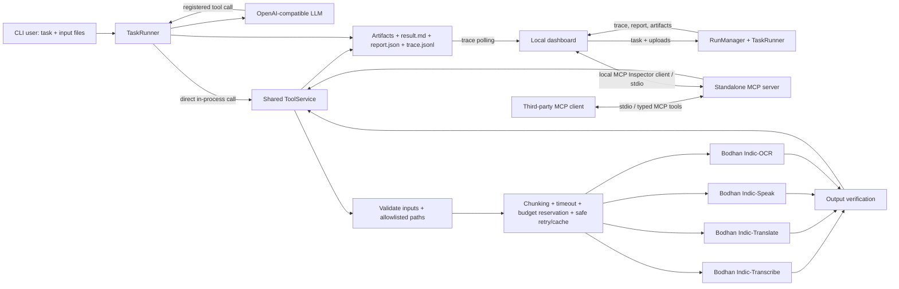
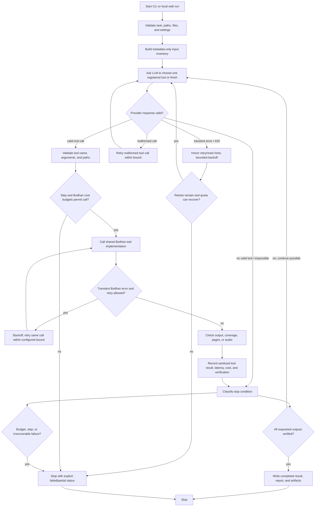

# Bodhan Tool Server and Task Agent

A Python MCP server exposing Bodhan Indic-Transcribe, Indic-Translate, Indic-Speak, and Indic-OCR, plus a CLI agent that plans tool calls with an OpenAI-compatible LLM. Bodhan performs every ASR, translation, TTS, and OCR operation; the LLM only plans, selects tools, and may write English summaries.

## Setup

Requires Python 3.11–3.13. Compressed audio splitting uses the bundled FFmpeg from `imageio-ffmpeg`; WebP OCR conversion and MP3 speech export are handled locally by the installed dependencies.

```powershell
python -m venv .venv
.\.venv\Scripts\Activate.ps1
python -m pip install -r requirements.txt -e .
Copy-Item .env.example .env
```

Set the four Bodhan model keys and the LLM settings in `.env`. The default LLM configuration uses Groq's OpenAI-compatible API (`https://api.groq.com/openai/v1`) with `openai/gpt-oss-20b`; set either `LLM_API_KEY` or `GROQ_API_KEY` to a valid Groq key. Never commit or distribute `.env` or `keys.txt`; both are ignored locally. Configure `LLM_BASE_URL`, `LLM_MODEL`, and `LLM_API_KEY` to use another OpenAI-compatible provider. Credentials are read from environment variables, not from `keys.txt`. The `BODHAN_API_KEY` mention in `.env.example` exists only for the Cookbook validator; this app does not read that shared key and requires the four model-specific Bodhan keys. For Groq, optional `GROQ_RPM_LIMIT` and `GROQ_TPM_LIMIT` overrides can be set to your account's current limits; the default `openai/gpt-oss-20b` values are the documented 30 RPM / 8,000 TPM base limits, not a guarantee of your organization's actual quota. Set `GROQ_ITPM_LIMIT` and `GROQ_OTPM_LIMIT` only if your account's Limits page shows separate input/output limits.

The Bodhan contract was checked against the [official API reference](https://console.bodhan.ai/api-docs/). The implementation uses Bodhan's chat-completions translation transport because `/translate` returned HTTP 404 in the live test environment. It uses the documented model/message/target-language fields and omits generic generation settings, which Bodhan rejects.

## Run

```powershell
python -m bodhan_agent `
  --task "Transcribe this Hindi audio and translate it into English" `
  --files .\inputs `
  --out .\out `
  --max-steps 30 `
  --max-cost-inr 20
```

The run directory contains `result.md`, `artifacts/`, `trace.jsonl`, and `report.json`. The CLI accepts a single input file or a directory (including nested files). It uses at most 30 tool calls and ₹20 by default. Exit codes: `0` complete, `1` failed, `2` invalid arguments/configuration, `3` partial, `4` impossible/needs input.

The JSON report follows [schemas/report.schema.json](./schemas/report.schema.json) (schema version 1.1). `api_call_count` is the total of Bodhan provider submissions and LLM request attempts; `provider_submission_count` is Bodhan-only, and `llm_request_count` is reported separately. In schema 1.0, `provider_submission_count` included both Bodhan and LLM requests; schema 1.1 corrects that definition and retains the combined total in `api_call_count`. Existing schema 1.0 reports are not rewritten, so their recorded values remain unchanged. `tool_invocation_count`, `cache_hit_count`, and `total_retry_count` have separate, consistent values in the report and final trace event. A cache-hit invocation is counted as a tool invocation but has zero Bodhan submissions and zero incremental estimated charge. `estimated_cost_inr` and `estimated_charges_inr` are Bodhan estimates, never actual billing; `actual_cost_inr` and `llm_cost_inr` are null when provider billing data is unavailable. Artifact paths in the dashboard API are normalized for display, while report and trace files remain the run's source records. `result.md` repeats the original task and final status, then lists artifacts, warnings, failures, assumptions, and verification.

## Optional local live-trace web UI

Start the dashboard independently:

```powershell
python -m bodhan_agent dashboard --port 8765
```

Open `http://127.0.0.1:8765`, enter the task and budgets, and select one or more files. The dashboard shows the current plan, sanitized tool trace, call latency and estimated cost, verification (separate from tool execution success), retries and recovery, assumptions, input inventory, remaining budgets, final status, and downloadable/previewable reports and artifacts. It also lists saved CLI and web runs, and retains input snapshots so historical inputs can be inspected after the original files move. Trace updates are polled every 700 ms. It displays tool decisions, not hidden model reasoning; provider billing and LLM charges are not available in the cost estimate.

Use the `run` subcommand for a CLI task while retaining the same required flags:

```powershell
python -m bodhan_agent run `
  --task "Transcribe this Hindi audio and translate it into English" `
  --files .\inputs `
  --out .\out `
  --max-steps 30 `
  --max-cost-inr 20
```

The original no-subcommand form remains supported. Add `--dashboard` to either CLI form to open the dashboard for that run; the terminal remains attached until the dashboard is closed. Closing the dashboard server does not cancel the task. Use its explicit **Stop run** action or Ctrl+C in the task's CLI to request a cooperative stop; an in-flight model/tool operation may finish before the agent stops. To inspect runs in another terminal or after the CLI exits, start `python -m bodhan_agent dashboard` separately.

The dashboard binds only to localhost, checks browser request origins, accepts at most 20 files and 100 MiB per web-uploaded run, and allows one active task run at a time. By default, the run catalog is `out/.bodhan-dashboard`; set `--runs-dir` on both the CLI and dashboard commands to share a different catalog. Web-uploaded inputs and outputs, and archived CLI input snapshots, are kept under that catalog by run ID. The **Clear completed history** dashboard button removes completed run records and archived dashboard input copies but preserves task output folders; active runs remain visible. The CLI writes to the requested `--out` directory; if it already contains a `report.json` or `trace.jsonl`, the next run is placed in a new child directory so the prior run is not overwritten. Files are not automatically deleted otherwise. The same local credentials and task-run cost/step limits apply as in the CLI. The independent MCP Inspector discovers schemas from and invokes the real `python -m bodhan_mcp` stdio server; it allows at most ₹20 estimated Bodhan cost per dashboard session, passed to the server as `BODHAN_COST_BUDGET_INR`. Inspector files are written under `out/mcp-inspector/artifacts/`. Do not upload secrets or files you are not authorized to process. The browser never receives provider credentials or environment variables.

Run the independently usable stdio server from a directory containing permitted inputs:

```powershell
python -m bodhan_mcp
```

The server writes protocol messages to stdout and logs to stderr. Configure an MCP client with the command `python -m bodhan_mcp` and the desired working directory. It exposes four model tools plus the `translate_subtitles` helper. An optional positive `BODHAN_COST_BUDGET_INR` environment variable enforces a finite INR ceiling for standalone MCP calls; it is unset by default.

The stdio server was manually tested with the off-the-shelf MCP Inspector
1.0.6 (Node.js 22.7.5 or newer). From this recipe directory, launch:

```powershell
npx --yes @modelcontextprotocol/inspector@1.0.6 python -m bodhan_mcp
```

In Inspector, connect and select **Tools → List Tools**. A no-cost negative
check is to call `transcribe_audio` with `outputs/does-not-exist.wav`; the
server returns structured `missing_input` content without a provider call.

## Architecture



The CLI agent and independent stdio MCP server use the same `ToolService`, so validation, model-specific request handling, caching, and errors stay consistent. The agent calls the service in-process; an external client calls the separate MCP server. The LLM only plans, selects tools, and writes English summaries or explanations. Media files are read locally and passed to Bodhan tools by file reference where applicable; image bytes are sent to Bodhan's OCR endpoint, never embedded in the LLM prompt. Before planning, deterministic local inspection reports media format, audio duration/sample rate/channels, image dimensions, PDF page count, and unsupported or corrupt inputs.

## Agent flow



The loop does not treat an HTTP success alone as task success: it checks tool outputs and mandatory verification before accepting a completed final status. When a provider error cannot be recovered within the retry policy, the run stops honestly and preserves any artifacts already produced.

## Simulated hidden-task evaluation

Run the configurable suite of 11 deterministic scenarios with:

```powershell
python -m bodhan_agent.evaluation
python -m bodhan_agent.evaluation --output .\evaluation\self-evaluation-results.json --overwrite
```

The suite covers multiple files and formats, ambiguous language, multi-step OCR/translation, TTS verification, prompt injection, unsupported requirements, missing inputs, budget exhaustion, and partial provider failures. It makes no Bodhan or planner-provider calls; its machine-readable pass rate is orchestration simulation evidence only, not a live model-quality result. Scenarios are defined in [evaluation/scenarios.json](./evaluation/scenarios.json).

## Design notes

### Tool set and granularity

The four model tools are intentionally model-aligned rather than task-specific. The subtitle helper preserves media timing while delegating every caption translation to Indic-Translate. This keeps the tools reusable for unseen combinations of files and languages, while leaving sequencing and task interpretation to the agent.

| Tool | Responsibility and design choice |
|---|---|
| `transcribe_audio` | Uses Bodhan Indic-Transcribe for all speech-to-text. Accepts a local audio file reference and optional Bodhan language code; splits longer audio into configurable windows of at most 30 seconds and joins transcripts in order. Bodhan returns no timestamps; the compatibility `include_segments` option never fabricates an SRT. |
| `translate_text` | Uses Bodhan Indic-Translate for all translation. Accepts inline short text or a local text-file reference, target language, and script. Long input is split into bounded chunks; results are assembled in order and each chunk must return non-empty text. |
| `translate_subtitles` | Translates each caption in a user-provided, already-timed SRT through Indic-Translate and preserves its cue order and timestamps. It does not create timestamps from a plain transcript. |
| `generate_speech` | Uses Bodhan Indic-Speak to generate AI WAV output from text or a local text-file reference. Long text is split into conservative short chunks and joined. The output is back-transcribed with Bodhan Indic-Transcribe; callers may request a locally encoded MP3. The report records duration and token coverage. |
| `ocr_document` | Uses Bodhan Indic-OCR for PDF, PNG, JPEG, and WebP inputs. PDFs are rendered and processed page by page; WebP images are converted to PNG locally. Table output can be requested as HTML or Markdown. Image data is sent to Bodhan by the tool implementation and never placed in the LLM context. |

These are supported by local validation, media inspection/chunking, path restrictions, cost accounting, bounded retries, same-run request caching, and structured errors. The MCP server exposes typed arguments and structured outputs; the agent uses the same service implementation directly rather than running a second orchestration path.

### Orchestration and verification

- The LLM receives the task, a metadata-only inventory, tool schemas, and bounded tool results. It decides which registered tool to invoke next; it may write English summaries/explanations but must not perform OCR, transcription, translation, or speech synthesis.
- Follow-up tools may consume either an original input or the exact `artifact_path` returned by a successful earlier tool. The agent prompt tells the planner to preserve that path and use `text_file_path` for Indic transcript/OCR text; path validation still confines access to permitted input and run-output roots.
- If a translation or speech text-file path is missing or cannot be resolved, the agent may recover only to a unique matching input filename, the sole valid text input, or (for translation) the sole successful OCR artifact or sole successful transcript whose probable script is explicitly named in the task / (for speech) the sole successful translation artifact in the requested language; it does not guess when multiple files could match.
- For long OCR/transcription sources, a title-length summary is rejected before translation and the planner is prompted to produce a substantive summary; repeated short summaries stop without being translated.
- Tool calls are allowlisted and schema-validated. Paths are confined to permitted input and output roots. Document text and transcripts are treated as untrusted data, not instructions.
- The agent checks OCR page count/order/duplicates/empty pages, translation chunk coverage/order/non-empty output, and speech decoding/duration plus Bodhan back-transcription. Speech checks use multiset token coverage, sequence similarity, and length ratio to flag omission/reordering/repetition; these metrics are not a human quality rating.
- A verified OCR-only request for one input file finalizes directly from the saved OCR artifact; multi-step requests continue through the planner.
- Language identification is deliberately conservative: a unique Indic script is reported as probable, while shared scripts such as Devanagari or Arabic are unknown without model-provided language metadata. Latin-only output is unknown.
- A completed status is downgraded if mandatory checks fail. Partial outputs are retained and reported when a later step fails.
- Translation validation establishes that output was returned for all chunks; it cannot prove semantic fidelity. No native-speaker review is claimed unless separately performed.

### Budgets, retries, and recovery

- `--max-steps` bounds agent tool calls. `--max-cost-inr` bounds estimated Bodhan spend; a thread-safe ledger reserves an estimate before sending, then settles or cancels it. Bodhan does not provide billing data, so `actual_cost_inr` is null and no estimate is described as actual cost. LLM charges are provider-dependent and outside this Bodhan budget.
- Per-call timeouts and bounded retries apply to connection failures known to occur before send and HTTP 429s. Read/write timeouts, post-send transport failures, and server errors have an uncertain outcome: the request is not retried, its reserved estimate is charged to the run estimate, and the error explains that a duplicate call could incur another charge.
- Successful same-input model calls and chunks are cached within a run; cache hits report zero incremental cost. Repeated identical non-retryable agent tool failures stop the run, preserving already-produced artifacts.
- A `ToolService` instance currently serializes model operations (effective concurrency one). This is conservative for cost and cache safety, but the limit is not configurable and parallel execution remains a gap against the assignment's concurrency requirement.
- For Groq `openai/gpt-oss-20b`, proactive pacing uses the documented baseline limits and actual usage/rate-limit response headers when present. Input-token estimates are calibrated from successful provider usage; rejected 4xx requests remain in the request-rate window but are removed from local token estimates. Groq documents `x-ratelimit-remaining-requests` and `x-ratelimit-reset-requests` as RPD; the agent treats a zero remaining value as daily exhaustion. Short-window 429s use `Retry-After`, provider reset text, or bounded backoff. Pacing is best-effort because Groq limits are organization-wide and may be consumed by other processes.
- If retries, the step budget, or the cost budget are exhausted, the agent stops, writes the status and reason, and keeps artifacts from completed steps. A planner failure after completed Bodhan operations is reported as partial, not failed-with-no-output.
- Each output directory is single-run: an existing trace/report/result or non-empty artifacts directory causes an actionable error rather than overwriting prior work.
- The JSONL trace records event time, run/event/step IDs, planner tool selections, tool name, sanitized arguments, input fingerprints, result summaries, latency, estimated cost, retries, verification, and LLM rate-limit diagnostics. Prompt text, media contents, credentials, and raw generated arguments are not written to the trace.

## Tools and verified API contracts

| Tool | Bodhan endpoint | Behavior |
|---|---|---|
| `transcribe_audio` | `POST /v1/audio/transcriptions`, multipart | WAV/FLAC/OGG/MP3; splits audio into configurable windows no longer than 30 seconds; language optional. Bodhan returns text but no timestamps; this tool does not produce timed subtitles. |
| `translate_text` | `POST /v1/chat/completions`, JSON | Sends one user message with `model: indic-translate`, plus `target_language_code` and `target_script`. Splits input into bounded chunks and checks each returned message and finish reason before saving the result. |
| `translate_subtitles` | Uses `translate_text` per SRT caption | Accepts a user-provided SRT, validates syntax, and preserves cue order/timestamps; returns an SRT artifact and explicit coverage. |
| `generate_speech` | `POST /v1/audio/speech`, JSON | Uses documented voice library and language instructions; joins WAV chunks and back-transcribes the result with Indic-Transcribe. Optional MP3 encoding is local. |
| `ocr_document` | `POST /v1/chat/completions`, JSON | PDF pages are rendered locally; one PNG/JPEG page is sent per request. WebP is converted to PNG. OCR response and page order are saved. |

OCR sends image bytes to Bodhan as a data URI because that is the official API contract. Media is never sent to the LLM. Large text can be passed between model tools by local file reference rather than copied into an LLM prompt. Unsupported files/languages, missing keys, provider errors, and budget exhaustion produce structured errors.

## Recorded demo runs

The six runs below are retained as public text evidence: task results,
reports, traces, and text artifacts. Input media and generated audio are
intentionally excluded. A `completed` status records the agent's terminal
status, not human-verified semantic quality.

| Task | Status | Bodhan estimate | Runtime | Recorded outcome and evidence |
|---|---:|---:|---:|---|
| 1 | `completed` | ₹0.404 | 198.935 s | English summary is truncated. [Result](./demo-results/task-01/result.md) · [report](./demo-results/task-01/report.json) · [trace](./demo-results/task-01/trace.jsonl) · [text artifacts](./demo-results/task-01/artifacts/) |
| 2 | `completed` | ₹0.033 | 50.106 s | Available input was MP3 rather than the requested WAV. [Result](./demo-results/task-02/result.md) · [report](./demo-results/task-02/report.json) · [trace](./demo-results/task-02/trace.jsonl) · [text artifacts](./demo-results/task-02/artifacts/) |
| 3 | `completed` | ₹0.214 | 52.190 s | OCR and translation coverage checks passed; semantic accuracy was not independently reviewed. [Result](./demo-results/task-03/result.md) · [report](./demo-results/task-03/report.json) · [trace](./demo-results/task-03/trace.jsonl) · [text artifacts](./demo-results/task-03/artifacts/) |
| 4 | `completed` | ₹0.178 | 276.554 s | Five clips were transcribed and one probable Telugu transcript was translated; language identification is tentative and the generated summary is truncated. [Result](./demo-results/task-04/result.md) · [report](./demo-results/task-04/report.json) · [trace](./demo-results/task-04/trace.jsonl) · [text artifacts](./demo-results/task-04/artifacts/) |
| 5 | `completed` | ₹0.626 | 95.816 s | Bengali speech back-transcription check passed. [Result](./demo-results/task-05/result.md) · [report](./demo-results/task-05/report.json) · [trace](./demo-results/task-05/trace.jsonl) · [text artifacts](./demo-results/task-05/artifacts/) |
| 6 | `impossible` | ₹0.000 | 41.481 s | No Bodhan tool calls or audio artifact were produced. [Result](./demo-results/task-06/result.md) · [report](./demo-results/task-06/report.json) · [trace](./demo-results/task-06/trace.jsonl) |

Local absolute paths in result/report summaries are redacted; recorded
statuses, costs, traces, and text artifacts otherwise remain as captured.
Audio artifacts are referenced in some reports but omitted from Git, as required
by the no-media submission rule. Costs are Bodhan estimates only and exclude
LLM charges. Do not claim all six tasks passed.

The [demo video guide](./DEMO_VIDEO_GUIDE.md) contains the architecture,
recovery/error details, and recording checklist; the
[4:44 video script](./DEMO_VIDEO_SCRIPT_4M44.md) covers three tasks and MCP.
## Demo video

A public recording of five minutes or less is required before submission.
The [demo video](https://drive.google.com/file/d/1ZyBMrgxfROON7VtOpBXK6x4hlY5utdWQ/view?usp=sharing)
is publicly available on Google Drive.

Prices use the assignment's estimates: transcription ₹0.10/audio-minute, translation ₹0.20/10,000 output tokens, speech ₹6/10,000 input characters, OCR ₹0.20/page. These are estimates, not a billing guarantee. Translation uses the documented usage when supplied; other tools conservatively estimate from input size/duration. `--max-cost-inr` bounds Bodhan model charges using those published estimates; LLM charges are not included because evaluator LLM pricing is provider-specific and not supplied. Every paid request reserves an estimated amount before execution, and the same successful model/input/options request is cached within a run.

The official reference describes TTS requests as a sentence or two, about 30 seconds, without a numeric character ceiling. This implementation uses a conservative 280-character chunk target; it is an implementation heuristic, not a claimed provider limit. Translation's 2,500-character chunks are likewise an internal context safeguard, not a published model maximum. Bodhan's published 30-second ASR limit is enforced.

## Safety, verification, and limitations

- OCR text, transcripts, filenames, and all document contents are untrusted data; they cannot change tool policy.
- Tool calls are allowlisted and schema-validated. Paths are resolved and restricted to the input directory and run output directory.
- Translation must return a non-empty result for every input chunk; an API `truncated: true` response is not accepted as complete.
- Generated audio is decoded, checked for positive duration, and back-transcribed by Bodhan. The coverage threshold is recorded in the report.
- The verified transcription API has no timestamps, so accurate SRT subtitles cannot be produced from audio alone. The agent must not invent them; translation of a user-provided, accurately timed SRT remains supported.
- `.env` is ignored by the recipe and Cookbook `.gitignore` files. Only `.env.example` contains placeholders.
- Bodhan rate-limit retries are bounded and use `Retry-After` when supplied. Requests with uncertain post-send outcomes are never retried automatically. For Groq `openai/gpt-oss-20b`, the agent conservatively paces requests against the documented 30 RPM / 8,000 TPM base limits, using estimated request size, successful-response usage, and live rate-limit headers. If configured, separate ITPM/OTPM limits are paced as well. It lowers the completion cap to 256 tokens and uses low reasoning effort for this Groq model. On 429 it honors `retry-after`, relevant reset headers, or provider wait text; daily request exhaustion is not retried as a short-window limit. Trace events record estimates, provider usage when returned, remaining quota headers, wait durations and inferred limit dimension, never prompts or API keys. These safeguards cannot guarantee avoidance of 429s because limits are organization-wide, account-specific, and may be consumed by other processes. Malformed tool-call JSON is retried at most twice. Successful same-request results are cached, and failed calls are not repeated unchanged.
- The agent cannot guarantee semantic translation quality, source language detection in every case, or perfect TTS pronunciation.
- Six live demo runs have recorded terminal statuses as listed above; their reports, traces, and text outputs are currently local-only and have not been approved for publication. Native-speaker quality review, the public demo video, and a public Cookbook PR remain outstanding. Automated MCP integration is tested with the Python MCP SDK, and MCP Inspector 1.0.6 was manually used to connect over stdio, discover all five tools, and confirm a structured `missing_input` response.

## Testing and verification

Run local mocked tests first; these do not use API keys or Bodhan credits:

```powershell
.\.venv\Scripts\Activate.ps1
python -m pytest -q
ruff check src tests scripts
python -m compileall -q src tests scripts
python -m pip check
python -m bodhan_agent --help
python -m bodhan_agent run --help
python -m bodhan_agent dashboard --help
python -m bodhan_agent.evaluation --output .\evaluation\self-evaluation-results.json --overwrite
```

The tests cover audio chunk limits and inspection, translation chunking and API request shape, translation truncation/coverage, PDF page-by-page OCR and empty-page failure, WAV TTS with ordered back-transcription metrics, ambiguous language detection, uncertain paid-request outcomes, cache/budget accounting, path restrictions, sensitive-file rejection, run-report schemas, multi-step agent and artifact handoff, MCP stdio discovery/error handling and real Inspector calls, cooperative stopping, CLI compatibility and repeated-run preservation, persistent dashboard history, input archival/preview/download safety, and local web upload/live-trace security. A separate deterministic 11-scenario evaluation harness is run with `python -m bodhan_agent.evaluation`.

Recipe validation in this workspace: **100 tests passed** with five third-party SWIG deprecation warnings; Ruff, compileall, and `pip check` passed. MCP Inspector 1.0.6 connected to the stdio server, listed all five tools, and received the structured `missing_input` error for a nonexistent file; no paid provider call was made. The machine-readable simulation report at [evaluation/self-evaluation-results.json](./evaluation/self-evaluation-results.json) records **11/11 scenarios passed** and `external_api_calls: 0`; this does not establish live Bodhan or planner quality.

### Live provider smoke tests

Set fresh credentials locally in `.env`; do not paste them into chat or commit them:

```dotenv
BODHAN_TRANSCRIBE_KEY=...
BODHAN_TRANSLATE_KEY=...
BODHAN_SPEAK_KEY=...
BODHAN_OCR_KEY=...
LLM_BASE_URL=https://api.groq.com/openai/v1
LLM_MODEL=openai/gpt-oss-20b
LLM_API_KEY=...
```

Use the standard CLI command from the `Run` section with a small, authorized input and a low `--max-cost-inr` value. Live calls may incur charges. If a request fails, retain the HTTP status and provider message but never include the key. A 401/403 requires checking the key and model access; 404 suggests the route or model identifier does not match the current API; 429 indicates rate/quota limits; 5xx or timeout may be transient. Do not retry repeatedly against a failing paid endpoint.

### CLI demo run matrix

Prepare authorized input files in `.\demo-inputs\` and run each task into its own output directory. Prompts are in [examples/tasks.md](./examples/tasks.md); adapt paths and source languages to your actual inputs. A task passes only when `result.md`, `report.json`, `trace.jsonl`, and expected artifacts exist and have been manually reviewed:

| Case | Example workflow | Check |
|---|---|---|
| 1 | Scanned multi-page PDF → English summary → Tamil translation → Tamil speech | OCR page order, summary, full translation, playable WAV and back-transcription verification |
| 2 | Hindi WAV transcription | Transcript exists; do not claim timestamped SRT support |
| 3 | Worksheet photo → Marathi while preserving detected table structure | OCR artifact and translation artifact are present and readable |
| 4 | Several short clips → identify Telugu → translate matching transcripts to English | Each clip is represented and only matching clips are translated |
| 5 | English text → Bengali translation and speech | Translation is non-empty and speech artifact passes back-transcription check |
| 6 | MP4 dubbing into French (unsupported) | Honest impossible/unsupported explanation; no fabricated audio |

Example command (repeat with distinct task text, input paths, and `--out`):

```powershell
python -m bodhan_agent `
  --task "Transcribe this Hindi voice note" `
  --files .\demo-inputs\hindi.wav `
  --out .\out\case-02 `
  --max-steps 30 `
  --max-cost-inr 20
```

For each run, inspect `report.json` for status, steps, cost, duration and verification; inspect every line of `trace.jsonl` for plan/tool/result events; compare output artifacts with the source. Save actual status and cost—do not label a prompt as a completed demo before running it. Check the CLI exit code: `0` completed, `1` failed, `2` bad arguments/configuration, `3` partial, `4` impossible/needs input.

### Negative and edge-case checks

- Missing input path: run with a nonexistent `--files` path and verify a clear error and no claimed output.
- Unsupported media: pass a `.txt` file to `transcribe_audio` or unsupported media to the relevant MCP tool; expect a structured error, not a server crash.
- Long audio/document/text: test audio longer than 30 seconds, a multi-page scanned PDF, and text over 2,500 characters; verify internal chunk/page handling and complete ordering.
- Insufficient budget/steps: run a paid workflow with `--max-cost-inr 0.001` and a multi-step task with `--max-steps 1`; verify a clean partial/stop status, artifacts for completed work, and no budget overrun.
- Bad paths and credentials: call MCP tools with a nonexistent path, a path outside the configured working directory, a `keys.txt` path, and missing API keys; expect structured, actionable errors and no secret disclosure.
- Untrusted content: include prompt-injection text in an OCR image/transcript and verify it is treated only as document text, not as instructions.
- Unsupported requirement: request accurate SRT timestamps or French Indic-Speak; verify an honest limitation and no invented output.
- Retry/cache: use the mocked tests to check transient retry behavior and same-input caching; do not generate repeated live calls just to test retries.

Run the MCP server independently with `python -m bodhan_mcp`; automated `test_mcp_stdio.py` coverage uses the MCP Python SDK `ClientSession`. MCP Inspector 1.0.6 was also manually verified as an off-the-shelf stdio client, as described above.

The six prompts in [examples/tasks.md](./examples/tasks.md) have recorded local runs. Input media and generated audio are not committed. The result/report/trace links required by the assignment must be added after the evidence is reviewed and cleared for publication. Before opening the public Cookbook PR, add the verified video link and prepare the final commit SHA. These submission steps are not completed by the local test suite.

## AI assistance

Implemented with an AI coding assistant in VS Code. The API contract was checked against Bodhan's official documentation; this README distinguishes verified API limits from local conservative heuristics.
