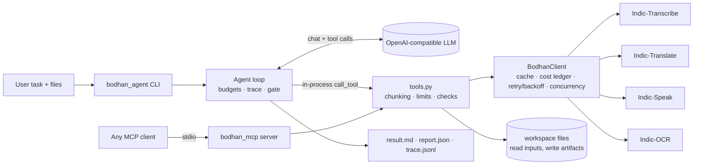
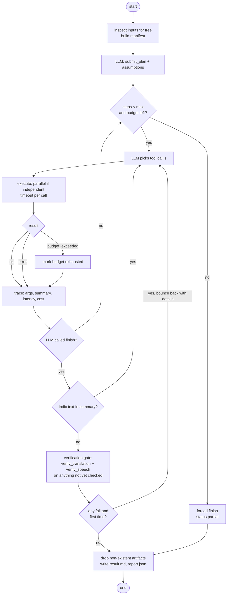

# Design notes

## Architecture

The server and the agent share one implementation (`bodhan_mcp.tools`). The agent imports it directly instead of going
through stdio (allowed by the brief), so there is one code path to test, and the server remains usable on its own. The
server registers exactly the same functions, so the schema a third-party agent sees is the docstring and type hints that
sit next to the code.

| Part | Responsibility |
|---|---|
| `bodhan_mcp/client.py` | The only place that talks to Bodhan. Disk cache by exact input, a cost ledger checked *before* each call, a concurrency semaphore (4), retries with exponential backoff and jitter on 429/5xx/network errors, not on 4xx |
| `bodhan_mcp/tools.py` | Tool bodies: model limits, chunking, verification, sandboxed paths, structured errors |
| `bodhan_mcp/audio.py`, `textutil.py` | Silence-aware windowing, joining, sentence/paragraph chunking, normalisation, CER, script ID |
| `bodhan_mcp/server.py` | MCP stdio server; each call runs in a worker thread so a slow model call doesn't block the others |
| `bodhan_agent/agent.py` | Plan → act → verify → finish loop, step/cost/time budgets, trace, verification gate, output writers |

## Agent flow

Where the LLM decides: the plan, which tool next, whether a language is ambiguous (and what to assume), how to fix a
failed check (smaller pieces, another voice), the English text of a summary, and the final wording. Where it doesn't:
chunking, retries, caching, budgets, path access, whether a finished run may call itself "completed".

### Tool granularity

One tool per model is simple but pushes every limit onto the planner (it would have to cut audio at 28 s, pack
sentences under 280 characters, rasterise PDFs, page through results). Very high-level tools ("summarise this PDF
as audio") hide the decisions the task is about and can't be reused for the tasks I haven't thought of. So the middle:

- **Four model tools** that each absorb their model's limits and keep full control of the interesting parameters (language,
  voice, style, page range, table format).
- **Two composites** (`make_subtitles`, `detect_language`) where the same three or four calls are always chained and
  the plan gains nothing from seeing the intermediate steps.
- **Two verifiers** that cost little or nothing. They are separate tools, not hidden in the model tools, because the agent
  must be able to re-run one after a fix, and an external MCP client can use them alone.
- Everything returns paths and ≤600-character previews. Documents flow between tools as files, never as context.

## Verification

| Output | Check | Cost |
|---|---|---|
| Translation | Output script matches target language; length ratio (0.35–3.5×) catches truncation/loops; every source number appears (digits normalised across scripts); heading/table/list/LaTeX counts equal; sentence coverage. Truncation is also caught at the source, since the API reports `truncated` | free |
| Speech | Per request: duration vs text length (catches omission and looping before joining). Whole file: back-transcribed with Indic-Transcribe in ≤28 s windows; CER vs the text that should have been spoken; heard/expected length ratio flags repetition (>1.4) and omission (<0.65) | ~Rs 0.10/min |
| OCR | Low-confidence blocks (<0.5) are listed, never silently passed on; per-page failures are reported without losing other pages | free |
| Whole run | The gate runs any verification the LLM skipped before a run may end `completed`. One bounce-back to fix; after that failures are reported as warnings and the status becomes `completed_with_warnings` | – |

The gate means the quality target "every generated audio file and translation is checked before the task ends" holds
even when the model forgets.

## Failure and recovery

| Failure | Handling |
|---|---|
| 429 / 5xx / network | Backoff with jitter, up to 4 retries; non-retryable 4xx fail immediately with a hint |
| Translation `truncated` | Chunk halved at a boundary and retried (depth ≤3), else `translation_truncated` |
| TTS too short/long for its text | Redone as two smaller requests (different input, so not a duplicate bill); flagged in the result |
| OCR 502 (block exceeded `max_tokens`) | `max_tokens` doubled up to 8192, then retried |
| One OCR page fails | Page listed in `pages_failed`, rest of the document continues |
| Tool crashes / bad arguments / unknown tool | Structured error to the LLM; the loop and the MCP server continue |
| LLM endpoint down | Run stops cleanly as `failed`, report and partial artifacts still written |
| Budget or steps exhausted | One last forced `finish` (only that tool offered); if that call fails too, a summary is built from the trace |
| Unsupported / impossible | `check_language_support` then `finish(impossible)`; artifacts are cleared so nothing fake ships |

## Budgets

`--max-steps` counts LLM turns that use tools (a forced finish after the limit is one extra call).
`--max-cost-inr` is enforced in `CostLedger.check` *before* a request is sent using an estimate, so a single large
TTS call can't blow past the cap; billed amounts use the API's own usage numbers where available (translation tokens),
otherwise the documented unit prices. `--call-timeout` bounds each tool call.

## Trade-offs

- **Direct import instead of MCP between agent and server.** One code path, faster tests; the cost is that the agent doesn't
  exercise the stdio transport. `tests/test_server_stdio.py` covers the transport with the official client.
- **Heuristic prompt-injection flag.** The regex only raises a warning; the defence that matters is structural: tools can't
  leave the workspace, can't be given LLM-typed Indic text, and the summary is screened.
- **Cache keyed by exact input.** Great for cost and determinism; it means a deliberate "try again for a different take"
  needs a different input (different voice or style).
