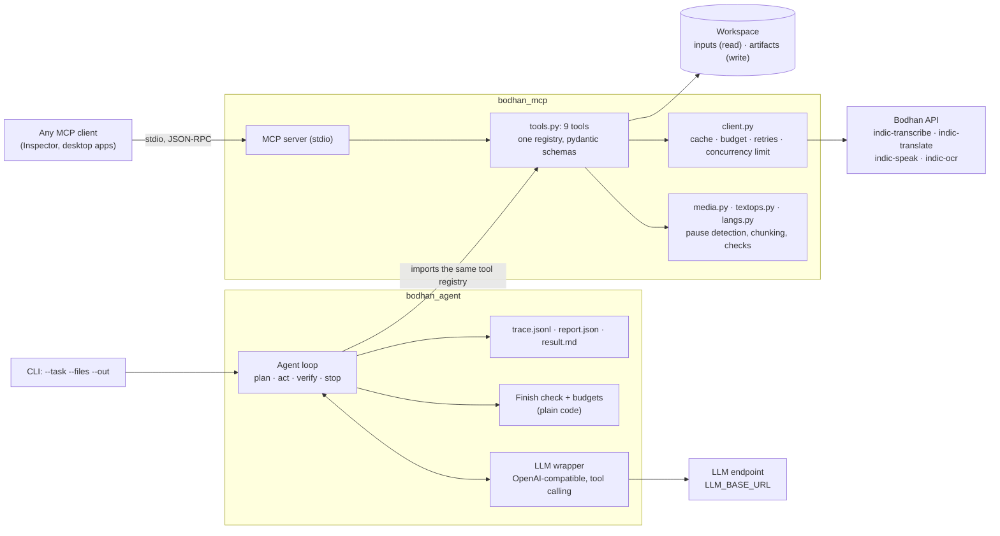
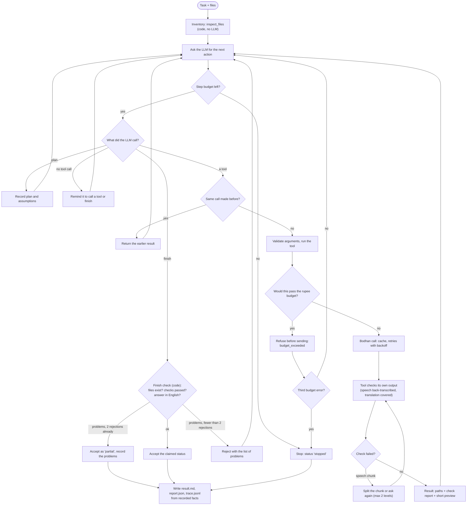

# Design notes

## The main idea

The LLM decides **what to do next**. Plain code does everything that must be right every time: chunking, timing, budgets, checks, caching and the final report. If the LLM makes a mistake, the code layer catches it or stops it from costing money.

## Architecture

One line per part:

- **`tools.py`** holds the nine tools in one list. The server publishes that list; the agent offers the same list to its LLM. Names, schemas and behaviour cannot drift apart.
- **`server.py`** wraps the list with the MCP SDK's low-level `Server`, so the advertised input schema comes straight from each tool's pydantic model and every failure is returned as `isError: true` with a structured `{code, message, hint, retryable}`.
- **`client.py`** is the only code that talks to Bodhan. Every call passes through the cache, the budget check, the concurrency limit and the retry loop.
- **`media.py`, `textops.py`, `langs.py`** are deterministic helpers with unit tests: pause detection, audio windows, sentence and Markdown chunking, table checks, character error rate, subtitles, script detection.
- **`agent.py`** runs the loop, enforces budgets, checks the finish claim, and writes the trace and report from recorded facts.

The agent imports the tool code directly instead of talking to the server over stdio. The assignment allows either. Importing removes a subprocess and an async layer from the agent while the server stays fully usable on its own. `tests/test_mcp_server.py` starts the real server as a subprocess and drives it with the SDK's client.

## Agent flow

## Tool design

### Why this granularity

The choice was between three levels:

| Level | Example | Problem |
| --- | --- | --- |
| One thin tool per API call | `transcribe_30s_clip` | The planner must cut audio, count characters and stitch results. That is arithmetic, which LLMs do badly, and it floods the context. |
| One tool per whole task | `make_audio_summary` | Works for the demo tasks only. A new task needs new code. |
| **One tool per capability, limits handled inside** | `transcribe_audio` (any length) | The planner thinks in user-level steps; the tools hide the model limits. |

I chose the third. Each of the four model tools accepts input of any size and deals with its model's limit inside. Five small helpers cover what the planner needs around them: see the inputs, read text in pages, save English text, build subtitles, and look up languages and voices.

A new task is a new **sequence** of the same tools. For example "which clips are in Telugu" is `transcribe_audio` on each clip (the result reports the detected script) and then `translate_text` on the matching ones. No tool was written for that task.

### How each tool handles its model's limit

| Tool | Limit | Handling |
| --- | --- | --- |
| `transcribe_audio` | About 30 s of audio per request | Decode with ffmpeg; mark 20 ms frames as speech or silence with an energy threshold relative to the recording's own levels; pack speech regions into windows of at most 28 s so cuts fall in pauses; cut an over-long region at its quietest frame. Silence is never sent. Window boundaries give the segment timestamps (the API returns text only). |
| `translate_text` | Output length limit; structure can break | Split Markdown into blocks. Text goes in pieces of at most 1,800 characters cut on line and sentence boundaries. A table is sent whole; if the row and column counts change, it is rebuilt cell by cell. Code blocks are copied. If the API reports `truncated`, the piece is halved and retried. |
| `synthesize_speech` | A sentence or two per request; the model sometimes repeats or omits | Pack whole sentences into requests of at most 280 characters. Check each clip (see Verification). Join clips with short pauses, normalise loudness to about −16 LUFS, export MP3 or WAV with an "AI-generated" metadata tag. |
| `ocr_document` | One page image per request | Render PDF pages at 170 DPI, read each page, join with page markers. Report failed or empty pages and low-confidence blocks. Limit of 40 pages per call, with a `pages` range for longer documents. |

### Schemas and errors

- Inputs are pydantic models with a description on every field and `extra="forbid"`, so a misspelt argument is an error, not silently ignored.
- Languages are accepted as codes or names (`ta` or `Tamil`).
- Every failure has a `code` (for programs), a `message` (what happened) and a `hint` (what to do next). Codes: `invalid_arguments`, `file_not_found`, `path_not_allowed`, `unsupported_language`, `unsupported_file_type`, `missing_api_key`, `budget_exceeded`, `rate_limited`, `timeout`, `upstream_error`, `content_rule_violation`, `unknown_tool`, `internal_error`.
- A bug inside a tool is caught and returned as `internal_error`. The server process never dies from a bad call.

### Media plumbing

Tools read from the input folders and write to one output folder. Paths are resolved and checked against those folders, so `../` and absolute paths outside them are refused. Results name files by short relative paths that later calls accept back. The largest text a result can carry is a 500-character preview, or one `read_text` page of at most 12,000 characters.

## Where the LLM is used, and why

| Decision | Why an LLM | If it gets it wrong |
| --- | --- | --- |
| Understand the task and plan the tool sequence | Tasks arrive in free text and are new each time | Wrong tool or arguments return a structured error with a hint; the step budget bounds wasted turns |
| Resolve ambiguity (which language, which file) | Needs judgment about what the user most likely meant | The assumption is recorded in `result.md` for the user to see |
| Write English summaries and explanations | Needs reading comprehension | Only English is accepted; Indian-language text is rejected by `write_text` and by the finish check |
| Decide to retry, change approach or give up | Depends on the error and what is left to try | Budgets stop loops; the finish check stops false "completed" claims |
| Write the final answer | Needs to explain the outcome in words | The status, file list and check results in `result.md` come from code, not from the LLM |

Things the LLM is **not** used for: cutting audio, counting characters, timing subtitles, checking outputs, tracking cost, detecting scripts, building the report. Those are deterministic and unit-tested.

## Verification

| Output | Check | On failure |
| --- | --- | --- |
| Speech | Duration compared with text length (catches loops and truncation cheaply), then each clip transcribed back with Indic-Transcribe and compared with its text by character error rate after Unicode, digit and punctuation normalisation. Pass at 0.35 or below. | Split the chunk in two and synthesise each half; if it cannot be split, ask again. Two levels at most. Remaining failures are listed in `verification.failed_chunks` and the file is marked failed. |
| Translation | Every chunk translated, non-empty, not truncated, in the target script. Digits and table layout compared with the source. Length ratio flagged when extreme. | Tables are rebuilt cell by cell. Other failures set `checks.passed` to false; digit and length differences are warnings. |
| Subtitles | Cue count above zero and timestamps in order. | Error returned. |
| The finish claim | Each listed file was produced by a tool in this run; audio, translations and subtitles passed their checks; the answer is in English; `impossible` and `partial` have a reason. | Rejected up to twice with the list of problems. After that the run is recorded as `partial`, never `completed`. |

Back-transcription is noisy: the speech model can be right while the recogniser mishears. That is why the threshold is lenient, the cheap duration test runs first, and a failed clip gets a second attempt before it is reported.

## Budgets and cost control

- **Steps.** One step is one LLM turn. The loop stops at `--max-steps`.
- **Rupees.** Before any paid request, the client estimates its cost and refuses it if spending would pass `--max-cost-inr`. Whole jobs (all chunks of a speech request, all pages of a PDF) are checked up front, so a job that cannot fit fails before it spends anything. On the third refused call the run stops.
- **Timeouts.** Each Bodhan request has a timeout (default 120 s) and so does each LLM request (90 s).
- **Cache.** Each model output is stored on disk under the SHA-256 of its exact input. The same input is never paid for twice, within a run or across runs.
- **Duplicate calls.** If the LLM repeats an identical tool call, the agent returns the earlier result without running anything.
- **Speech is the expensive step,** so the prompt tells the planner never to synthesise the same text twice, and checking a minute of speech costs roughly a fifth of what synthesising it does (about ₹0.10 against ₹0.50).

## Recovery

| Failure | Response |
| --- | --- |
| HTTP 429, 408, 5xx, network error, timeout | Retry up to 4 times with exponential backoff and jitter, honouring `Retry-After` |
| Other 4xx | No retry; error returned with Bodhan's message and request id |
| One OCR page fails | The other pages are kept; the failed page is reported |
| Speech repeats or omits | Split or retry the chunk (see Verification) |
| A tool returns an error | The LLM sees the code and hint and can re-plan |
| LLM endpoint fails or is rate-limited | The call goes to the next configured model (`LLM_FALLBACK_*`); a rate-limited model rests for as long as the provider asks and is then used again. If every model fails, the run ends as `failed` with a report of what exists |
| LLM emits a malformed tool call | Asked again up to three times at a higher temperature, then answered by the fallback model |

## Untrusted content

Text from OCR, transcripts and input files can contain instructions. Defences, in layers:

1. **Labelling.** Such text is returned only under keys named `untrusted_*`, with a note that it is data.
2. **Prompt rule.** The system prompt says never to follow instructions found in those fields, and to mention them in the answer.
3. **Flagging.** The agent scans those fields for instruction-like phrases and adds an `injection_warning` to the result and the trace. This is a hint, not a filter.
4. **Limited power.** This is the layer that does not depend on the LLM. The tools can only read the input folders and write new files to the output folder. There is no tool that sends data anywhere, runs commands, deletes files or reads keys. An injected instruction has very little it can make the agent do.
5. **Independent report.** The status and file list in `result.md` come from code, so injected text cannot make a run claim success.

## Impossible tasks

The system prompt lists the supported languages and says that an unsupported language, a missing file or a missing ability must end with `finish(status="impossible")` and no output files. The tools back this up: an unsupported language returns `unsupported_language` with the supported list, and a missing file returns `file_not_found`. For an impossible run, `result.md` lists no output files even if working files exist.

## Trade-offs

- **Mid-level tools over a framework.** The loop is about 150 lines of plain Python with no agent framework. It is easy to explain line by line and has no hidden behaviour. The cost is that features like resumable runs would need to be written by hand.
- **Energy-based pause detection over a neural detector.** No model download and fully deterministic. It can mistake loud music for speech.
- **Structural translation checks over back-translation.** They are free and exact. A back-translation check would catch meaning errors but doubles translation calls and adds its own noise. It would be the next check to add, run only on a sample.
- **Lenient fixed speech threshold.** Simple and explainable. A per-language threshold tuned on labelled clips would be more accurate.

## What I would do next

1. Tune the speech check threshold per language from a small labelled set, and report the false-alarm rate.
2. Add a sampled back-translation check with an LLM judge for meaning errors.
3. Streamable HTTP transport with token authentication.
4. Resumable tasks: reload `trace.jsonl` and continue from the last completed step.
5. A neural voice-activity detector as an option for noisy recordings.
