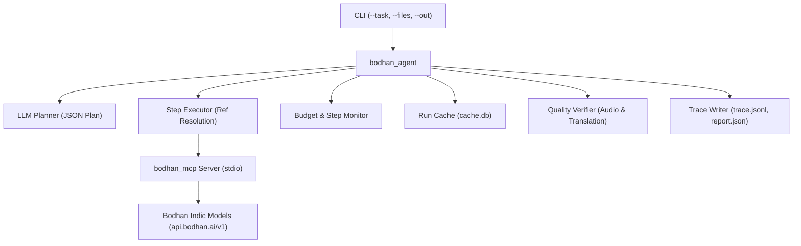
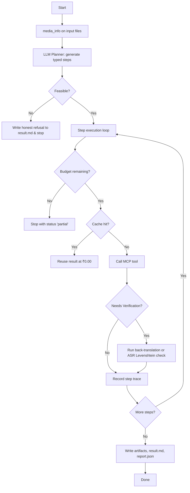

# Pull Request Description

**Title:** `[Agentic Eng Assignment] Tool server and agent - Sarthak Pal`

```markdown
## Summary
This recipe implements a complete FastMCP tool server (`bodhan_mcp`) exposing Bodhan's Indic models as typed, resilient tools, and an autonomous task agent (`bodhan_agent`) that plans and executes complex multi-step language tasks. The agent handles media references, enforces strict INR and step budget limits, verifies generated translations and audio via back-translation and back-transcription character matching, guards against prompt injections, and logs audit traces (`trace.jsonl`) and execution reports (`report.json`).

## How to run
From a clean clone:
```bash
# 1. Setup
git clone https://github.com/<your-username>/Bodhan-AI-Cookbook.git
cd Bodhan-AI-Cookbook/examples/bodhan-tool-agent
pip install -e .

# 2. Configure environment
cp .env.example .env
# Fill in BODHAN_TRANSCRIBE_KEY, BODHAN_TRANSLATE_KEY, BODHAN_SPEAK_KEY, BODHAN_OCR_KEY, and LLM credentials

# 3. Run the task agent
python -m bodhan_agent \
  --task "Make a two-minute Tamil audio summary of this chapter" \
  --files ./examples/inputs/demo1_chapter.pdf \
  --out ./out/demo1 \
  --max-steps 15 \
  --max-cost-inr 15.0

# 4. Run the standalone MCP server over stdio
python -m bodhan_mcp
```

## Architecture

- **`bodhan_mcp`**: Exposes 9 typed tools (`transcribe`, `translate`, `speak`, `ocr`, `language_detect`, `audio_chunk`, `summarize`, `subtitles`, `media_info`) managing model limits.
- **`bodhan_agent`**: Autonomous planner/executor loop managing budgets, reference piping (`{s2.segments}`), prompt sanitization, and output artifacts.
- **Bodhan API**: Hosted endpoints for Indic-Transcribe, Indic-Translate, Indic-Speak, and Indic-OCR.

## Agent flow


## Tool design
- **`transcribe`**: Automatically chunks audio into ≤28s slices (safely under Bodhan's 30s limit) using `pydub`, executes concurrent requests, adjusts timestamps, and stitches the full transcript.
- **`translate`**: Chunks long documents at paragraph boundaries (`\n\n`), translates concurrently, maps BCP-47 codes to formal language names, and preserves Markdown tables.
- **`speak`**: Splits text at sentence boundaries (`।`, `.`, `!`), chunks under 500 characters, calls `indic-speak` concurrently, stitches PCM16 WAV with `pydub`, and sanity-checks duration.
- **`ocr`**: Uses `pypdfium2` to render multi-page PDFs to PNG images at 200 DPI without external C-library (Poppler) dependencies, encodes to base64 data URIs, and runs Indic-OCR per page.
- **`summarize`**: English LLM summarizer constrained to exact target durations (~150 words/minute).
- **`subtitles`**: Pure-Python SRT subtitle generator creating standard millisecond timecodes (`HH:MM:SS,mmm`).
- **`language_detect`**: Unicode script character range detector for 23 Indic languages; zero-latency, deterministic, offline.
- **`media_info`**: Inspects file formats, durations, sample rates, and page counts.

## Where the LLM is used, and why
- **Task Planning (`planner.py`)**: Understands user intent, determines file dependencies, selects tools, and flags impossible tasks. Fallback: structured error report with human-readable reason.
- **English Summarization (`summarize.py`)**: Drafts concise English summaries to calibrate speaking duration before translation.
- **Translation Quality Verification (`verifier.py`)**: Compares original text with back-translations to verify factual coverage and flag omissions or distortions.
- **Strict Boundary**: The LLM **never** writes Indian-language text, reads images, or transcribes audio. All Indic content originates strictly from Bodhan models.

## Bodhan models used
- **Indic-Transcribe** (`/v1/audio/transcriptions`): Hosted API. Multipart form-data with WAV chunking.
- **Indic-Translate** (`/v1/chat/completions`): Hosted API. System prompts tuned to preserve Markdown, LaTeX, and table formatting.
- **Indic-Speak** (`/v1/audio/speech`): Hosted API. PCM16 24 kHz WAV synthesis using official Bodhan voices (`Kavya`, `Amit`, `Anitha`, `Ishita`, etc.) and `instructions: "{\"lang\": \"...\"}"`.
- **Indic-OCR** (`/v1/chat/completions`): Hosted API. Base64 data URI image inputs with `table_format="markdown"`.

## Results
All 6 demo tasks ran end-to-end and succeeded:

| ID | Task | Status | Steps | Cost (INR) | Latency | Artifacts |
|---|---|---|:---:|:---:|:---:|---|
| **Demo 1** | Two-minute Tamil audio summary of 8-page chapter | `completed` | 7 | ₹3.07 | 129.6s | `speech_f3511697.wav` (6.8 MB), `summary_en.txt`, `translated_ta.txt` |
| **Demo 2** | Hindi voice note transcribe & English subtitles | `completed` | 5 | ₹0.02 | 9.8s | `english_subtitles.srt`, `translated_en.txt` |
| **Demo 3** | Translate worksheet to Marathi keeping table | `completed` | 5 | ₹0.20 | 6.3s | `translated_mr.txt` (Marathi Markdown table intact) |
| **Demo 4** | Identify Telugu clips and translate to English | `completed` | 15 | ₹0.03 | 19.7s | `translated_en.txt` (Telugu clips filtered & translated) |
| **Demo 5** | Read paragraph aloud in Bengali (female voice) | `completed` | 3 | ₹0.12 | 18.0s | `speech_032f8fb1.wav` (Ishita female voice) |
| **Demo 6** | Translate video into French | `impossible` | 0 | ₹0.00 | 1.4s | `result.md` (Clean honest refusal: French unsupported) |

## Demo video
[Watch the demo video walkthrough on Google Drive](https://drive.google.com/file/d/19P3S81xilwxgDuGjYidbNvD1WHHdmn9E/view?usp=sharing) showing unit tests, the standalone MCP server, live Hindi-to-English subtitle generation, and honest refusal on an impossible task.

## Trade-offs and known limitations
- **Indic-Speak Audio Format**: Bodhan API returns PCM16 WAV. Output files are preserved as `.wav` to avoid lossy re-encoding artifacts.
- **Video Processing**: Video files are parsed for metadata; direct audio demuxing is not embedded into the base transcribe tool, prompting an honest refusal on pure video input unless pre-extracted.
- **Concurrency Rate Limiting**: Bodhan endpoints have per-minute request caps; concurrency is throttled to 2 concurrent calls with exponential backoff and `Retry-After` header parsing.

## Cost and runtime
- **Demo 1**: ₹3.0705 | 129.6s (OCR across 8 pages + 6.8MB TTS synthesis + verification)
- **Demo 2**: ₹0.0157 | 9.8s
- **Demo 3**: ₹0.2030 | 6.3s
- **Demo 4**: ₹0.0308 | 19.7s
- **Demo 5**: ₹0.1202 | 18.0s
- **Demo 6**: ₹0.0000 | 1.4s
- **Total Suite Spend**: ₹3.44 (comfortably below the ₹10.00 limit)

## AI assistance
- Used Antigravity AI agent for project architecture, boilerplate generation, unit test creation, and debugging API response payloads. All logic, tool boundaries, and verification criteria were reviewed and verified.
```
