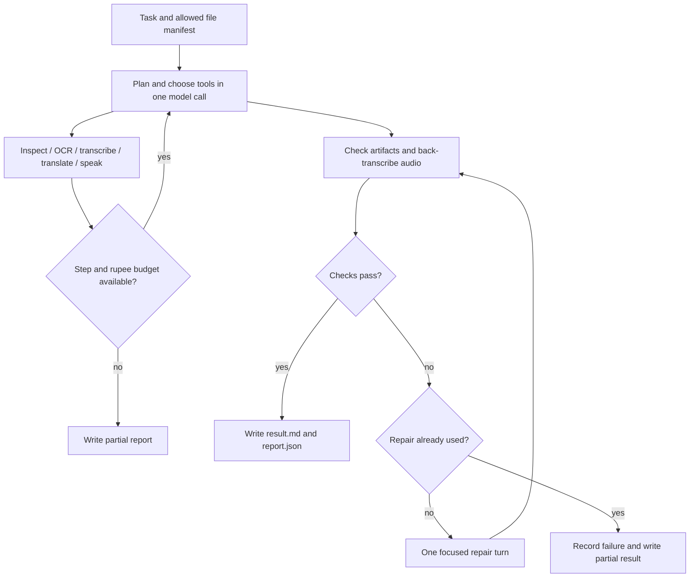

# Agent flow

The first model response plans and chooses the first tool call, avoiding a separate planning request. Later turns receive bounded tool outputs. Exact repeated tool calls return their prior result instead of creating artifacts or repeating a paid request. A persistent rate limit, network failure, timeout, or exhausted budget stops additional work and is reported in the partial result. Recoverable tool errors stay visible in the report but do not turn a later successful run into a failure.

English OCR artifacts can be read in bounded sections by artifact ID. Indic OCR, transcript, and translation artifacts remain inside the Bodhan tool boundary.

The MCP server is available independently over stdio. The agent uses the shared Python tool implementations in-process, which keeps the local CLI simple and lets external MCP clients use the same tool behavior.
