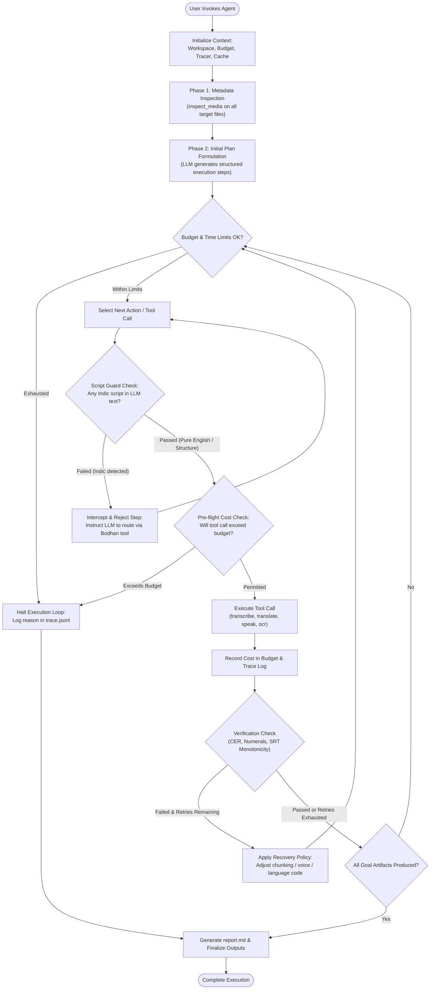

# Agent Loop & Execution Flow

## 1. Overview & Flowchart

The **Bodhan Task Agent** operates as an autonomous, goal-directed loop. Rather than executing an unchecked chain of tool invocations, the agent enforces structured planning, guardrail checks, deterministic verification, and automated recovery at every step.



---

## 2. Division of Responsibility: LLM vs. Deterministic Code

To ensure reliability, deterministic business logic and arithmetic are handled in code, while semantic planning and parameter reasoning are delegated to the LLM:

| Decision Point | Entity in Charge | What It Decides | Fallback / Safety Constraint |
|---|:---:|---|---|
| **Goal Decomposition & Planning** | **LLM** | Determines the sequence of tool calls needed to achieve the user's objective (e.g. OCR PDF → Summarize English → Translate Tamil → Synthesize Audio). | Fixed default pipeline if LLM output fails schema validation. |
| **Media Chunking & Splitting** | **Deterministic Code** | Computes audio split points on silence windows; splits text into token windows. | LLM is never allowed to specify raw audio byte offsets or millisecond split slices. |
| **Language Selection** | **Hybrid (Code + LLM)** | Code performs zero-cost Unicode block analysis. LLM disambiguates ambiguous scripts (e.g., Devanagari between `hi` and `mr`). | Code defaults to most spoken language for that script (e.g. `hi` for Devanagari) if LLM fails to disambiguate. |
| **Speaker Voice Selection** | **LLM** | Selects gender and voice persona from `list_voices` based on user style prompt. | Code defaults to verified fallback voice for target language (e.g., `Kavitha` for Tamil female). |
| **Budget Enforcement** | **Deterministic Code** | Tracks cumulative steps, INR spend, and wall-clock milliseconds; halts execution when limits are hit. | Non-overridable by the LLM. |
| **Translation & Text Generation** | **Bodhan Models** | Performs all Indian-language generation. | LLM is strictly prohibited from emitting Indian text directly. |
| **Output Verification** | **Deterministic Code** | Computes CER on back-transcriptions, checks numeral preservation, validates monotonic SRT timestamps. | If score fails threshold, automatic retry is triggered or output is flagged in `report.md`. |

---

## 3. The Script Guard (Enforcing Zero Indic Text in LLM)

### Why It Exists
General-purpose LLMs frequently produce transliterated, grammatically warped, or hallucinated Indian-language text when asked to write directly in Indic scripts. The Bodhan architecture mandates a core invariant:

> **Core Rule**: *All Indian-language text and speech must originate exclusively from Bodhan AI models (`indic-translate`, `indic-speak`, `indic-ocr`). The LLM acts purely as an English-language planner, orchestrator, and summarizer.*

### Implementation Mechanism (`bodhan_agent.guard`)
Before any string output from the LLM is written to disk or sent to a tool:
1. The `ScriptGuard` scans the character sequence against Unicode ranges for Indian scripts:
   - Devanagari (`\u0900-\u097F`)
   - Bengali / Assamese (`\u0980-\u09FF`)
   - Gurmukhi (`\u0A00-\u0A7F`)
   - Gujarati (`\u0A80-\u0AFF`)
   - Odia (`\u0B00-\u0B7F`)
   - Tamil (`\u0B80-\u0BFF`)
   - Telugu (`\u0C00-\u0C7F`)
   - Kannada (`\u0C80-\u0CFF`)
   - Malayalam (`\u0D00-\u0D7F`)
   - Ol Chiki (`\u1C50-\u1C7F`)
   - Meetei Mayek (`\uABC0-\uABFF`)
   - Tirhuta (`\u11480-\u114DF`)
2. **Threshold**: Allows a strict tolerance (maximum 10 characters) strictly to accommodate proper nouns or filenames passed in context.
3. **Action on Violation**: Raises a `ValueError`. The agent intercepts the error, adds an explicit correction into the prompt history (*"Script guard violation: You generated Indian text directly. Summarize in English first, then invoke the `translate` tool to produce the target language."*), and requests a new plan.

---

## 4. Three-Layer Budget Enforcement

Every execution run is bounded by three simultaneous, non-negotiable safety limits:

```text
┌────────────────────────────────────────────────────────┐
│               THREE-LAYER BUDGET CONTROLLER            │
├────────────────────────────────────────────────────────┤
│  Layer 1: Max Steps (Default: 30 steps)                │
│  Layer 2: Max Cost (Default: ₹20.00 INR)               │
│  Layer 3: Max Wall-Clock Time (Default: 300 seconds)  │
└────────────────────────────────────────────────────────┘
```

### Pre-Flight Spending Guard
Before dispatching any billable upstream request, the agent computes the estimated cost:
$$\text{Estimated Call Cost} = \text{cost\_meter.estimate}(\text{tool\_name}, \text{payload\_size})$$
$$\text{Projected Total} = \text{cost\_used} + \text{Estimated Call Cost}$$

If $\text{Projected Total} > \text{max\_cost\_inr}$:
- The call is immediately aborted.
- `ErrorCode.BUDGET_EXCEEDED` is raised.
- The agent halts the loop and transitions to generating a partial completion report.

### Partial Result Graceful Halt
When any budget constraint (steps, cost, or time) is triggered:
- Completed intermediate artifacts (transcripts, OCR tables, translations) are preserved in `out/`.
- `trace.jsonl` logs the exact terminal event: `BUDGET_EXHAUSTED` with snapshot metrics.
- `report.md` is generated with a prominent warning detailing what finished, what was skipped, and the spend at termination.

---

## 5. Recovery & Retry Policy

When tool execution fails or verification thresholds are not met, the agent applies deterministic recovery policies:

| Failure Mode | Root Cause | Automated Recovery Policy |
|---|---|---|
| **`OUTPUT_FAILED_VERIFICATION` (ASR / CER > 30%)** | Synthesized speech was poorly aligned or audio back-transcription diverged from source. | 1. Re-synthesize audio with a different speaker voice or reduced speed style (`formal`).<br/>2. If second attempt fails, record warning in `report.md` and keep best candidate. |
| **`OUTPUT_FAILED_VERIFICATION` (Translation Numerals Missing)** | Model omitted figures, monetary amounts, or dates during translation. | 1. Re-run translation with `preserve_markdown=True` and explicit numeral preservation prompt.<br/>2. If discrepancy persists, append numeral appendix to translated text. |
| **`UPSTREAM_RATE_LIMIT` (HTTP 429)** | Upstream Bodhan API concurrency or token limits reached. | 1. Exponential backoff with full jitter.<br/>2. Honor `Retry-After` header if present (up to 30s max). |
| **`INPUT_TOO_LARGE` (>25MB audio or >10k tokens)** | File exceeds single-request gateway payload limit. | 1. Code automatically triggers silence-aware audio chunker (`chunk_audio`) or text windowing.<br/>2. Merges processed outputs into single output artifact. |
| **`UNSUPPORTED_LANGUAGE`** | User specified an unsupported language dialect or invalid code. | 1. Fall back to `detect_language` script heuristics.<br/>2. Report candidate language family to LLM to request user clarification. |
| **`PATH_OUTSIDE_WORKSPACE`** | Malicious or erroneous path traversing outside workspace. | 1. Tool rejects call immediately with `PATH_OUTSIDE_WORKSPACE`.<br/>2. LLM re-routes path to resolve within `./out` or `./tmp`. |
