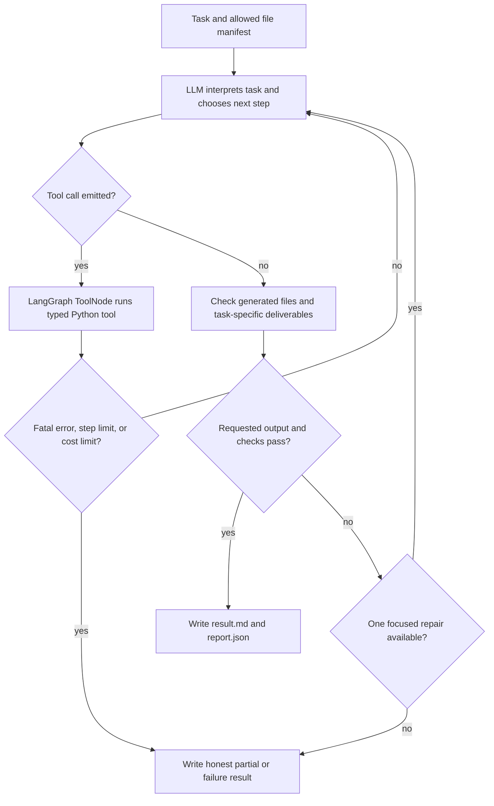

# Agent flow

The first LLM response can include a tool call, combining planning with the first action. Each tool result is summarized before the next agent turn. The verification step checks files and output types requested by the task; a missing requested artifact cannot be reported as success. One repair turn is allowed for recoverable errors or failed checks.

Persistent upstream errors, unsupported languages, missing files, exhausted budgets, and exhausted repair attempts stop cleanly with the work completed so far. A recoverable validation error can be marked recovered if a later successful call completes the same tool operation. The report retains the original error for auditability.

English OCR artifacts can be read in bounded sections by artifact ID. Indic OCR, transcript, and translation text stays inside the Bodhan tool boundary.

The stdio MCP server is available independently from the agent. It imports the same Python operations, so an external client gets the same input validation and media handling without starting LangGraph.
