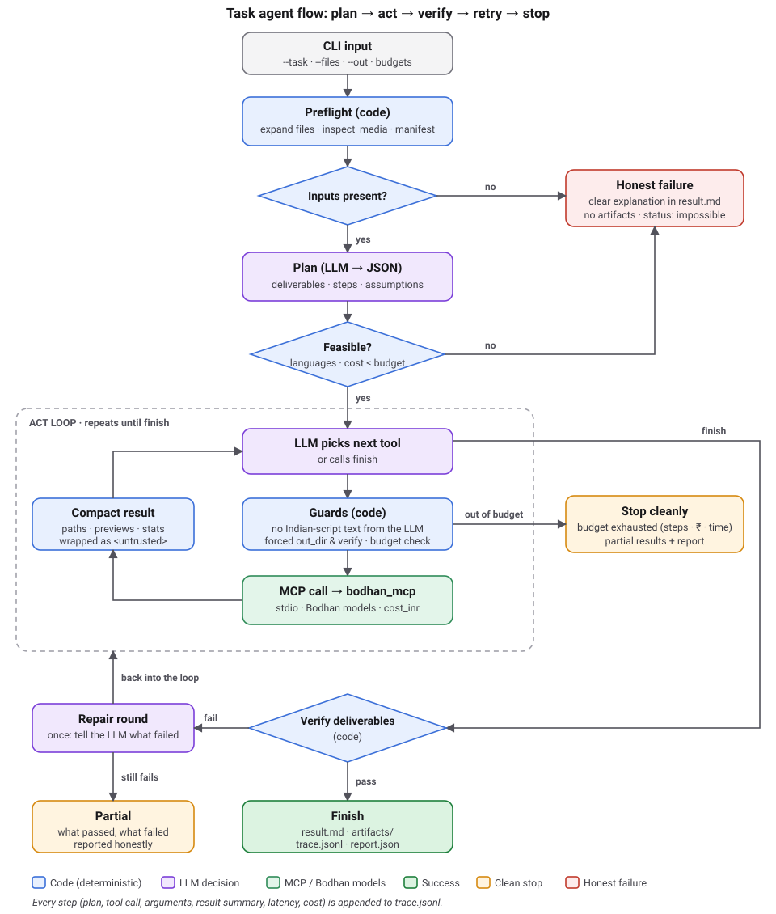
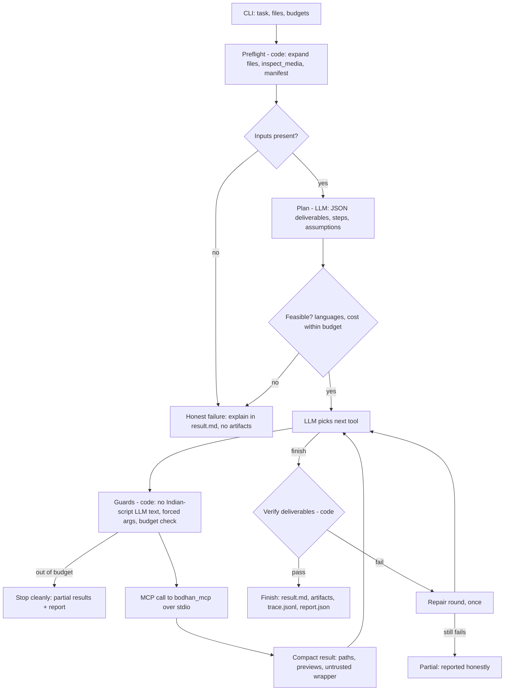

# Agent flow



([PNG version](images/agent_flow.png))

```
preflight (code) → plan (LLM, JSON) → feasibility check (code)
  → act loop: LLM picks a tool → guards (code) → MCP call → compact result
  → verify every deliverable (code) → one repair round if needed → finish
```

| Step | Who | What happens | Ends early when |
|---|---|---|---|
| Preflight | code | Expand `--files`, run `inspect_media` on each file (free), build a short manifest | Inputs are missing → honest failure |
| Plan | LLM | JSON plan: deliverables (kind, language, format, target duration), steps, assumptions | |
| Feasibility | code | Every deliverable language is supported by the model that produces it; cost estimate ≤ `--max-cost-inr` | Unsupported language or budget too small → honest failure |
| Act loop | LLM + code + MCP | The LLM picks a tool. Guards reject Indian-language text written by the LLM, force `out_dir` and `verify`, and check budgets. The call goes to `bodhan_mcp` over stdio, and the result comes back compacted, with untrusted text wrapped | Steps, ₹ or time run out → clean stop with partial results |
| Verify | code | Audio verified by back-transcription and duration; translation coverage and tables; valid SRT; every planned deliverable exists | |
| Repair | LLM | One round: the LLM is told exactly what failed | Still failing → partial, reported honestly |
| Finish | code | Writes `result.md`, `artifacts/`, `trace.jsonl`, `report.json` | |


