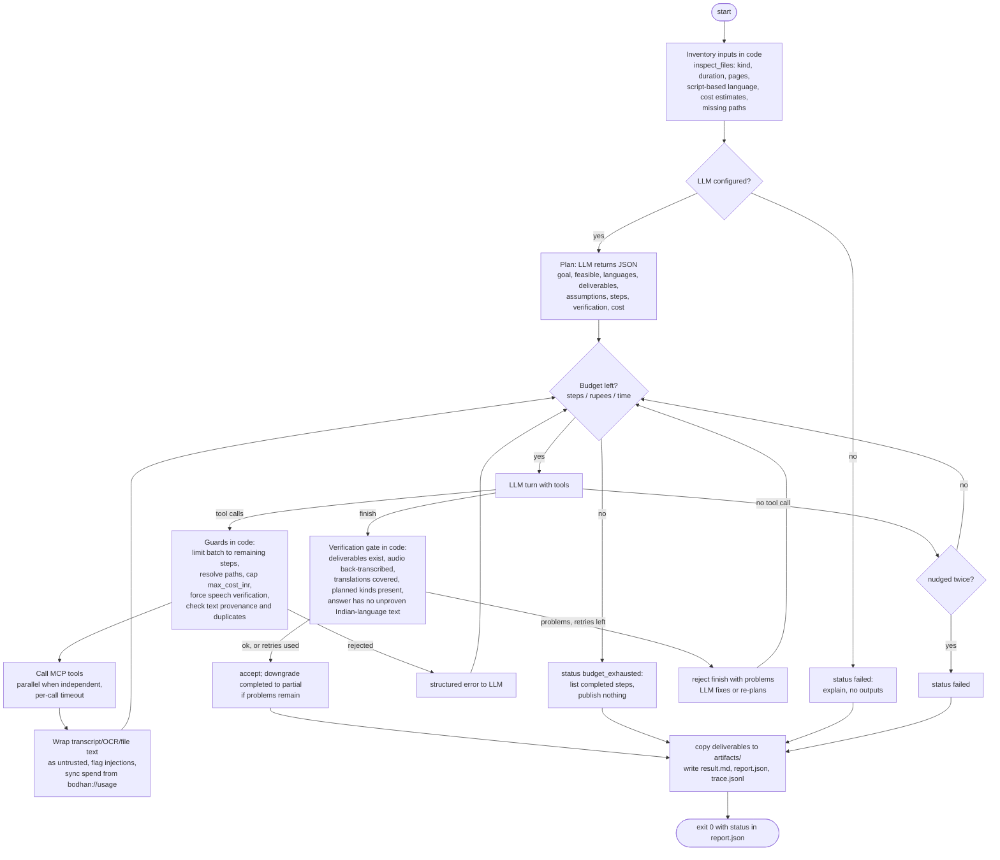

# Agent flow: plan, act, verify, retry, stop

## Retry layers

| Layer | What is retried | How |
|---|---|---|
| HTTP client | timeouts, connection errors, 429 (rate limit), 5xx | exponential backoff with jitter, honours `Retry-After`, up to `BODHAN_MAX_RETRIES` (3). 429 caused by exhausted credit is not retried. A 401 is retried once if that key already worked in this process (as the API docs advise). |
| OCR tool | 502 (a block exceeded `max_tokens`) | resend with `max_tokens` 4096, then 8192 (a different request, not a duplicate) |
| Translate tool | `truncated: true` | split the unit in half at sentence boundaries and translate the halves |
| Speech tool | a chunk whose back-transcription shows repetition, omission or low similarity | regenerate that chunk as smaller pieces (different inputs), keep the better version |
| Agent | tool errors, rejected finish | the LLM sees the structured error (`code`, `hint`) and decides: fix the call, re-plan, or finish honestly |
| LLM client | timeouts, 429, 5xx; unsupported `temperature`; no native tool calling | backoff; drop `temperature`; switch to a JSON-in-text tool protocol |

## Stop conditions

* `finish` accepted by the gate: status `completed`, `partial`, `impossible` or `failed`
* steps, rupees or wall-clock exhausted: `budget_exhausted` (checked before every LLM turn; paid tools also refuse before spending if their estimate exceeds the remaining rupees)
* LLM unavailable after retries, or it stops calling tools: `failed`
* any internal exception: `failed`, and the report is still written
