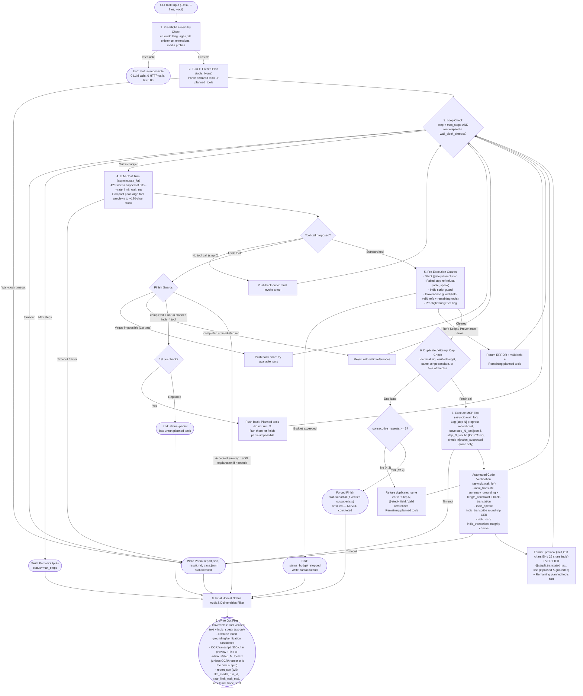

# Agent Execution Flow: Detailed Lifecycle & Guard Rails

## 1. Execution Flow Diagram

---

## 2. Step-by-Step Lifecycle & Guard Details

### 2.1 Pre-Flight Feasibility Check
Runs before starting the MCP server or calling the LLM:
- **48 World Languages Catalog**: Detects unsupported target or audio languages (`detect_requested_unsupported_language`) while allowing topic mentions (e.g. "French Revolution in Tamil").
- **File & Media Validation**: Checks file existence in `--files`, supported extensions, non-zero byte size, audio duration via `ffprobe`, and PDF page count via `PyMuPDF`. Infeasible tasks end immediately with `status: "impossible"` at `Rs 0.0000`.

### 2.2 Plan Turn & Planned-Tools Hints
- Turn 1 runs with `tools=None` to produce a 3-to-6 line English plan logged as `"type": "plan"` in `trace.jsonl`.
- `parse_planned_tools` extracts declared tool names in order of first appearance. After each tool result, duplicate refusal, or provenance rejection, the agent appends `Remaining planned tools: ...` so the LLM progresses instead of looping.

### 2.3 Reference Passing, Provenance, and Passive Data Defense
- Tool outputs are stored under `@stepN.<field>` handles and returned inside `<tool_data>...</tool_data>`.
- English primary text fields are shown up to 1,200 chars on the next turn (850 head + 350 tail for multi-page documents) and then compacted to a ~180-char `@stepN` stub on subsequent turns to keep prompt tokens within Groq's 8,000 TPM limit. Indic-script outputs are always capped at 25 chars + `@stepN` handle.
- Prompt-injection patterns (`check_for_injection_signature`) are logged as `injection_suspected: true` in `trace.jsonl` without hiding the passive `<tool_data>` content.
- **Indic Script Guard** rejects raw Indian-language characters authored directly by the LLM; **Provenance Guard** restricts non-English `indic_speak` inputs to `@stepN` references or files in `--files`, listing valid references and earlier completed steps on rejection.

### 2.4 Duplicate Suppression, Attempt Caps, and Forced Finish
- Any call with an identical signature (`call_sig`) or an already-verified `(tool_name, target_key)` is refused before dispatch, returning the earlier step number, primary reference (`@stepN.text`, `@stepN.translated_text`, etc.), all valid references, and `Remaining planned tools: ...`.
- Re-translating text already in the target Indic script (`script_ratio >= 0.50`) is refused, and `indic_translate` is capped at 2 attempts per source text group / target language.
- **Forced Finish after 3 Consecutive Repeats**: Sets `status` to `"partial"` only if verified output or an artifact exists, otherwise `"failed"` — **never `"completed"`** — and records which planned tools did not run.

### 2.5 Unrun Planned Bodhan Tool Pushback & Finish Unwrapping
- If the LLM calls `finish(status="completed")` while any planned `indic_*` tool never ran successfully, the loop pushes back once (`"Planned tools did not run: X. Run them, or call finish with status partial or impossible and explain."`). Repeating `finish(status="completed")` downgrades the run to `"partial"` listing the unrun tools.
- If a `finish` explanation is a JSON object containing `"explanation"` and `"status"` keys, only the explanation string is displayed in the console and `result.md`, preserving the status from the real `finish` argument.

### 2.6 Code-Driven Verification
- **Summary Grounding (`summary_grounding`)**: For any LLM-authored text passed to `indic_translate` when source text exists from `indic_ocr`, `indic_transcribe`, or `read_text_file`, computes content-word overlap against the source (`>= 0.50` pass, `0.30–0.50` warn, `< 0.30` fail). Failed-grounding steps are excluded from `produced_refs`, `provenance_registry`, `VERIFIED` hints, and `Deliverables`, and refused if referenced by `indic_speak` or `finish`.
- **Length Constraint (`length_constraint`)**: If the task asks for "about N characters" or "N words", reports `pass` within `+-30%` and `warn` otherwise (report-only).
- **Back-Translation & Coverage (`indic_translate_back_translation`)**: Translates output back to the source language, checks similarity (`>= 0.35` pass, `>= 0.20` warn, `< 0.20` fail), target script presence, Unicode digit preservation, and segment ratio. Passing grounded translations append `VERIFIED. Use @stepN.translated_text (language <iso>) as the text for the next tool.`.
- **Speech Round-Trip CER (`indic_speak_audio_cer`)**: Transcribes generated WAV via `indic_transcribe` and checks NFC normalized CER (`<= 0.20` pass, `<= 0.40` warn, else fail).
- A failed candidate is superseded if a later grounded candidate in the same category passes; a run fails verification only if an unresolved failure remains.

### 2.7 Rate-Limit Waits, Wall-Clock Timeout, Partial Outputs, and Deliverables Filtering
- HTTP 429 waits in `OpenAILLMClient` are capped at 30 s per retry, printed live to console, and tracked separately in `rate_limit_wait_ms` (never folded into `llm_ms` or `overhead_ms`).
- Real elapsed wall-clock time (including rate-limit waits) is enforced via `asyncio.wait_for` on every LLM turn, MCP tool call, and verification call (default 300 s). Timeouts and errors still write partial `report.json`, `result.md`, and `trace.jsonl`.
- Full `indic_ocr` and `indic_transcribe` text is written to `artifacts/step_N_<tool>.txt`. `result.md` Deliverables list only (a) final verified text outputs not consumed by a later successful step and (b) text passed to `indic_speak`, excluding failed grounding/verification candidates and showing a 300-char preview plus relative file link for non-final OCR/transcript steps.
