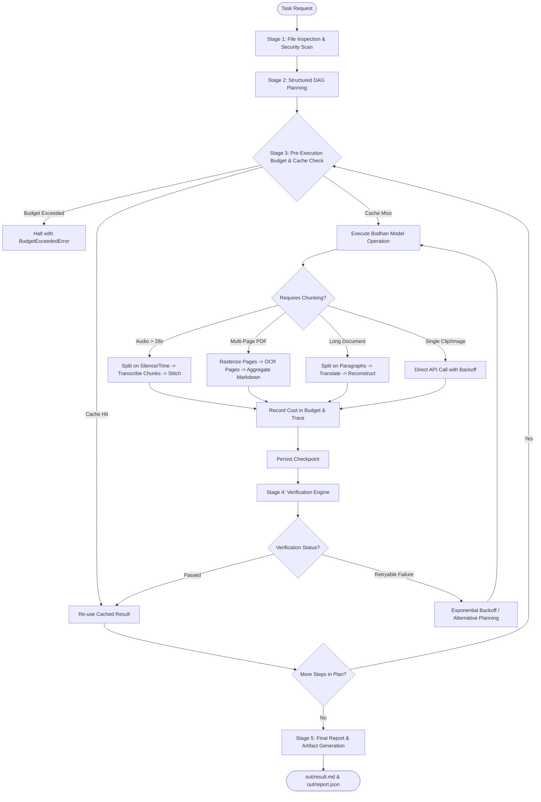

# Agent Execution Flow

The Bodhan Autonomous Task Agent follows a resilient 6-stage lifecycle:

## Stage Descriptions

1. **Task Understanding**: Inspects input files, resolves durations and page counts, detects requested source/target languages, and neutralizes injection vectors.
2. **DAG Formulation**: Generates ordered steps with explicit inputs, outputs, and dependencies.
3. **Execution & Budget Guard**: Validates that remaining step count and INR balance permit the operation before calling the Bodhan API.
4. **Resilient Chunking**:
   - Audio files longer than 28 seconds are chunked into windows and rejoined sequentially.
   - Multi-page PDFs are rasterized to PNG images at 150 DPI and OCR'd page-by-page.
   - Text documents are chunked along paragraph boundaries to maintain Markdown structure.
5. **Multi-Vector Verification**: Evaluates artifact existence, non-emptiness, audio frame duration, translation paragraph counts, and SRT subtitle formatting.
6. **Reporting**: Emits machine-readable event streams (`trace.jsonl`), audit data (`report.json`), and readable summaries (`result.md`).
