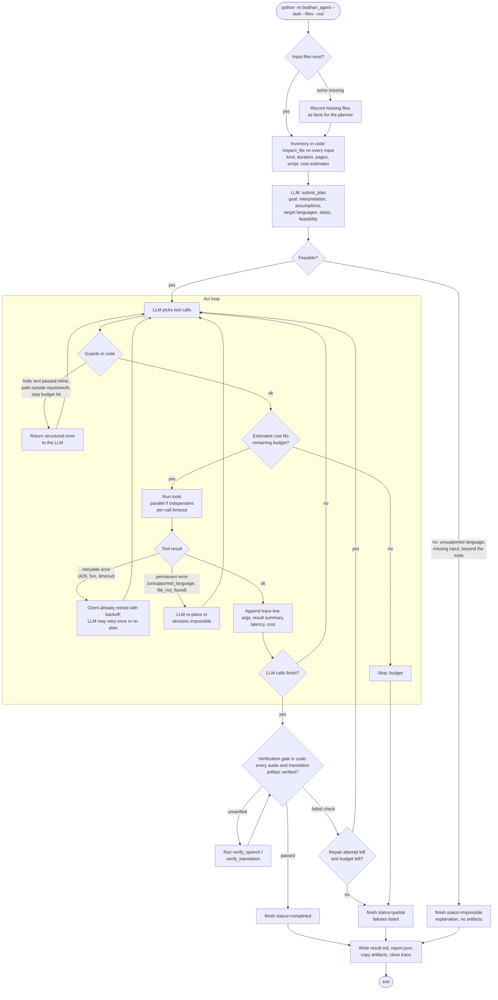

# Agent flow

## Stop conditions

| Condition | Where it is enforced | Outcome |
| --- | --- | --- |
| LLM calls `finish` and the verification gate passes | agent, in code | `completed` |
| Task cannot be done: unsupported language (for example French), missing input, a capability the tools do not have | LLM judgement, backed by tool errors such as `unsupported_language` and `file_not_found` | `impossible`, with an explanation and no artifacts |
| `--max-steps` reached | agent, in code | `partial` (or `failed` if nothing was produced), with what was done so far |
| Next paid call would exceed `--max-cost-inr` | Bodhan client pre-check (`budget_exceeded`) and agent pre-check | `partial`, spend never exceeds the cap |
| Verification still fails after one repair | verification gate | `partial`, failed chunks and issues listed in `report.json` |
| LLM endpoint unreachable or returns garbage repeatedly | agent | `failed`, with the error, and any finished artifacts kept |

## What the trace records

One JSON line per step in `out/trace.jsonl`:

`{step, ts, type: plan|llm|tool|verify|finish|error, tool, arguments, result_summary, latency_s, cost_inr, cumulative_cost_inr, cache_hits}`

Arguments are summarised (long strings truncated, paths kept), so the trace shows why each step was taken without copying whole documents into it.
