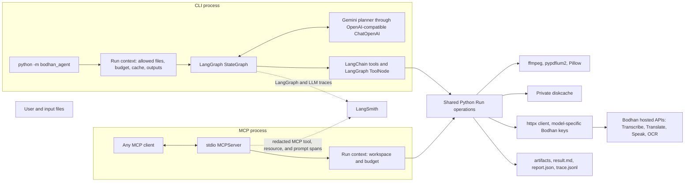

# Architecture design

The recipe has two entry points: a command-line agent for multi-step tasks and a standalone stdio MCP server for external clients. Both entry points create a per-run context and use the same Python tool implementations, so API validation, budgets, caching, media handling, and output rules stay consistent.

## System architecture

## Components

- **CLI entry point** parses the required `--task`, `--files`, and `--out` arguments, then creates a bounded run context.
- **LangGraph agent** asks the configured LLM to interpret the task and choose tools. Its ToolNode executes typed LangChain tools and returns bounded, sanitized results to the next agent turn.
- **Shared Python core (`Run`)** owns file access, tool implementations, Bodhan requests, retry policy, cost accounting, caching, artifact verification, and local reports. The CLI and MCP server import the same functions but have separate per-process run contexts.
- **MCP server** exposes the shared operations over stdio, plus the `bodhan://languages` resource and `task_agent` prompt. It does not require the LangGraph agent to be running.
- **Media adapters** use ffmpeg for audio/video conversion and chunking, pypdfium2 to render PDF pages, and Pillow for image handling and OCR recovery.
- **Bodhan client** sends model-specific requests to the hosted API using the corresponding environment key. No alternate provider performs OCR, Indic speech recognition, translation, or speech synthesis.
- **Observability** writes a redacted, replay-oriented `trace.jsonl` and a cost/status `report.json` for every run. LangSmith captures LangGraph/LLM activity and explicit redacted spans for standalone MCP calls.

## Data and trust boundaries

1. The CLI grants access only to the explicit files or directory supplied by the user. The MCP server uses `BODHAN_WORKSPACE` (current directory by default).
2. File references, media metadata, and bounded English text may reach the planner. Audio bytes, image bytes, and Indic OCR/transcript/translation text remain inside the shared tool layer and output artifacts.
3. The planner writes English summaries and selects tools. Bodhan models produce all Indic text and speech, and perform OCR and transcription.
4. API credentials are read from environment variables. Local traces summarize text arguments with length and a digest; they do not record credentials or raw media.
5. Successful Bodhan responses are cached locally by model, request body, file hash, and key identity. Cache files and generated media stay out of Git.

## Execution and failure controls

- The first LLM response can select the first tool, avoiding a separate planning request.
- Step and INR limits are checked before Bodhan requests. API requests have bounded timeouts and one retry for selected rate-limit and server errors; a dispatched timeout is not repeated automatically.
- Audio/video is converted to mono 16 kHz WAV and sent in 25-second windows, below Bodhan Transcribe's 30-second request limit.
- Translation is split into 4,000-character chunks and a truncated chunk can be split once more.
- Speech is sent in chunks of at most 350 characters and joined with ffmpeg when needed.
- PDFs are rendered and OCRed one page at a time. When Bodhan reports block truncation, the tool raises the token allowance and recursively splits only the affected image region; successful page and region responses are cached.
- Verification checks artifact presence, subtitle structure, translation script, and generated speech by back-transcribing it. A failed repair or missing requested artifact is reported as incomplete rather than represented as success.

The agent's plan/act/verify/retry/stop diagram is in [agent-flow.md](agent-flow.md). Tool boundaries and trade-offs are in [design-notes.md](design-notes.md).
