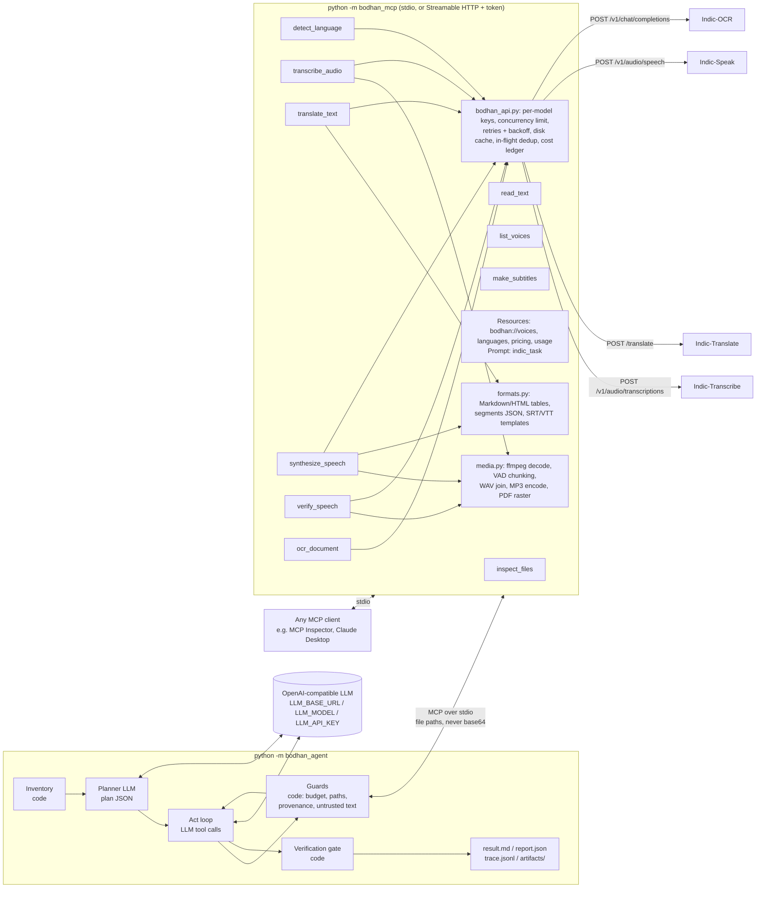
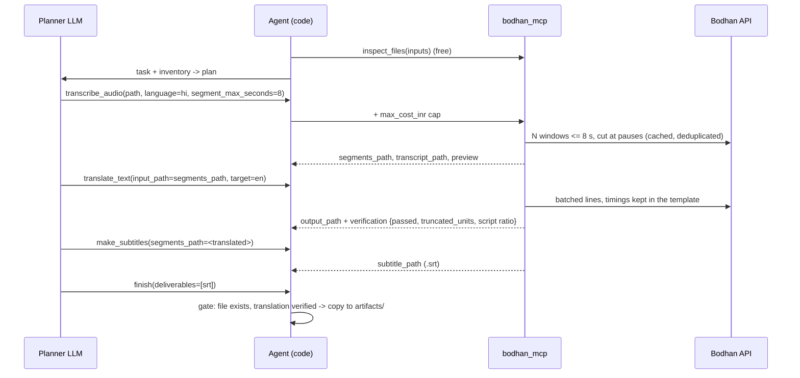

# Architecture

| Part | One line |
|---|---|
| `bodhan_agent` CLI | Takes `--task`, `--files`, `--out`; owns budgets, trace, guards and reporting. |
| Planner LLM | Reads the task and inventory, writes a JSON plan, picks tool calls, writes English text, judges results. |
| Guards (code) | Per-call cost caps, step/time limits, timeouts, path resolution, duplicate-call suppression, Indian-language provenance check, untrusted-text wrapping. |
| Verification gate (code) | At `finish`, checks every deliverable exists and passed its check (back-transcription, translation coverage); rejects or downgrades otherwise. |
| `bodhan_mcp` server | Ten tools, four resources and one prompt over stdio (or HTTP with a bearer token). Runs alone for any MCP client. |
| `bodhan_api.py` | The only code that talks to Bodhan. Keys, retries, cache, concurrency, exact cost. |
| `media.py` / `formats.py` | Plain-code media and document plumbing; no model calls. |

## How data moves

Media and long text never enter the LLM context. Every tool writes its result to a file and returns
the path plus a short preview; the next tool takes that path (`input_path`, `segments_path`,
`audio_path`). Images go to Indic-OCR as base64 only inside `bodhan_api.py`, which is the API's
required format; no tool accepts or returns base64.

Example: *Hindi voice note to English subtitles*

