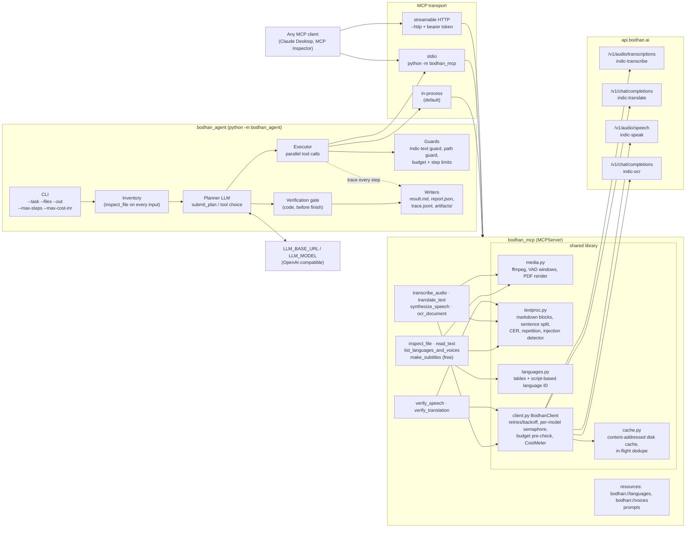

# Architecture

Two packages. `bodhan_mcp` is a standalone MCP server that wraps the four Bodhan models as ten tools. `bodhan_agent` is a command-line task agent that drives those tools with a planner LLM. The agent talks to the server through an MCP client, either in-process (default, no subprocess) or over stdio, so it only ever sees what a third-party MCP client sees.

## One line per part

**Server (`src/bodhan_mcp/`)**

| Part | Role |
| --- | --- |
| `server.py` | Builds the `MCPServer`, registers the ten tools, two resources and the prompts. |
| `__main__.py` | `python -m bodhan_mcp` runs stdio; `--http --port 8765` runs streamable HTTP behind a bearer token from `BODHAN_MCP_TOKEN`. |
| `tools.py` | Tool implementations. Each tool absorbs one model's limits (windows, chunks, pages) and returns a typed result with `cost_inr`, `calls`, `cache_hits`, `warnings`. |
| `client.py` | The only code that talks to Bodhan. Async httpx, retries with backoff on 429/5xx/timeouts (honours `Retry-After`), a semaphore per model, a cost estimate checked against the budget before every paid call, and a `CostMeter` that records every call. |
| `cache.py` | Disk cache keyed by sha256 of endpoint + parameters + input bytes. Identical concurrent requests share one in-flight call. Cache hits cost nothing. |
| `media.py` | ffmpeg/ffprobe wrappers (system ffmpeg, else the binary bundled with `imageio-ffmpeg`), decode to 16 kHz mono, energy-based VAD that cuts audio into windows of at most 28 s at pauses and drops silence, WAV concat, MP3 export with an "AI-generated" tag, PDF to PNG via pypdfium2. |
| `textproc.py` | Markdown block parser (heading, list, table, code, math, paragraph), sentence splitting for Latin and Indic punctuation, TTS chunking, normalisation, character error rate, repetition detection, prompt-injection phrase detector. |
| `languages.py` | Language and voice tables from the API docs, plus language identification by Unicode script and marker words. |
| `errors.py` | `ToolFailure(code, message, hint, retryable)`, serialised as a JSON `ToolError` so clients get a stable `code` to branch on. |
| `runtime.py` | Holds the settings and client for the process; tests and the agent inject their own (for example a fake HTTP transport). |

**Agent (`src/bodhan_agent/`)**

| Part | Role |
| --- | --- |
| CLI | Parses `--task`, `--files`, `--out` and budgets; loads `.env`; sets `BODHAN_WORKDIR` to `out/work/`. |
| Inventory | Calls `inspect_file` on every input before the LLM sees anything, so the plan starts from facts (kind, duration, pages, detected script, cost estimates). |
| Planner LLM | Any OpenAI-compatible model with tool calling. Writes a plan through `submit_plan`, chooses tools, writes English text, judges results. |
| Executor | Runs the tool calls the LLM asked for, in parallel when several arrive in one turn, with per-call timeouts. |
| Guards | Code-level rules: no inline Indic `text` from the LLM into translate/speak tools, English-only `write_text_artifact`, step and cost budgets. |
| Verification gate | Before `finish` is accepted, code checks that every generated audio file and translation has a passing verification result, or that the failure is reported. |
| Trace / report writers | `trace.jsonl` (one line per step), `report.json` (status, verification, cost, time), `result.md` (answer, assumptions, artifact links). |

**Transports**

- In-process: `mcp.Client(build_server())`. Same protocol and schemas as stdio, without a subprocess. Default for the agent.
- stdio: `python -m bodhan_mcp`. What Claude Desktop, MCP Inspector and our own `--transport stdio` use.
- Streamable HTTP: `python -m bodhan_mcp --http --port 8765`, requests must carry `Authorization: Bearer $BODHAN_MCP_TOKEN`.

See [agent_flow.md](agent_flow.md) for the loop and [design_notes.md](design_notes.md) for the reasoning behind these choices.
