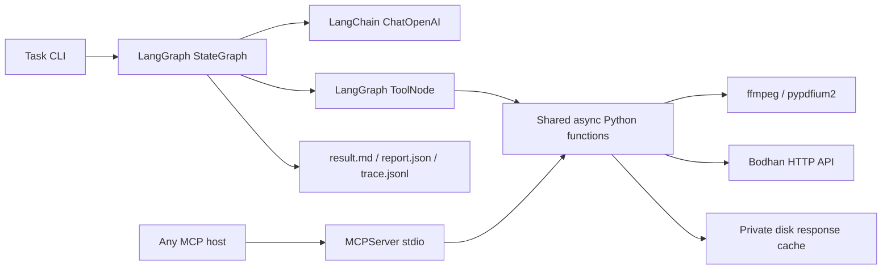

# Architecture

## Boundaries

- The agent and standalone MCP server use the same typed operations.
- The planner sees file references and bounded English text snippets; images, audio bytes, and Indic OCR/transcript/translation text stay in the tool layer.
- Bodhan credentials are read from environment variables and never included in model messages or trace records.
- Deterministic code owns file scope, media conversion, API limits, supported language validation, budgets, retries, and verification.
- The planner interprets the task, selects tools, chooses reasonable assumptions, and writes English summaries. Its first tool choice shares the planning request to reduce latency and model cost.
- Direct file inputs grant access only to those files. Directory inputs grant access to eligible files below that directory.
- Identical tool calls in one run are memoized, and API retries are bounded to one attempt after the initial request.
- Tool outputs keep Indic OCR, transcript, and translation content in artifacts; the agent receives English text or metadata.
